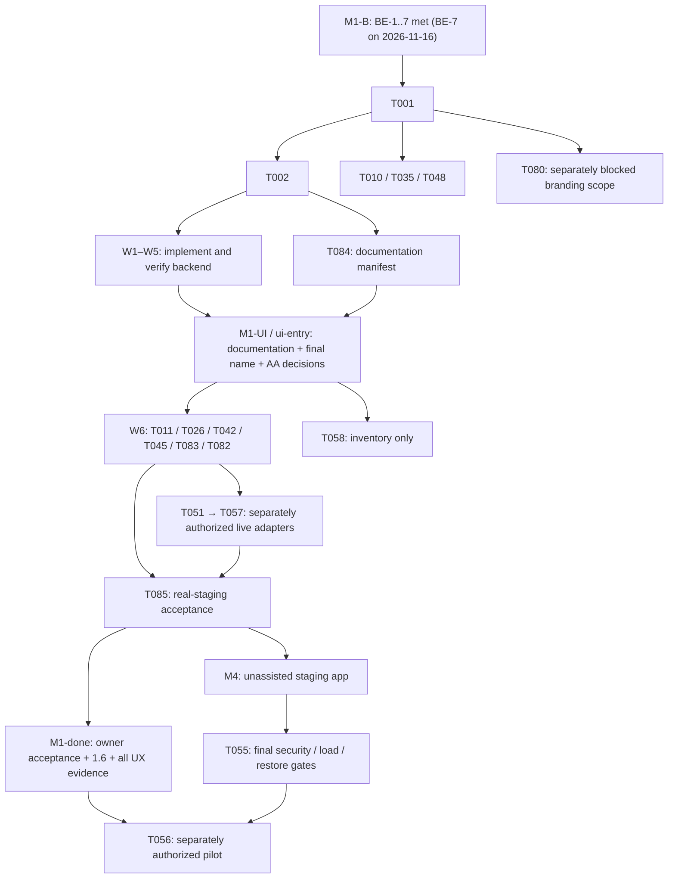

# Backend-first, UI-last amendment: proposal (revision 3)

**Status:** Revision 3 and the revised Gate 2 content/structure package were approved by the owner on 2026-11-15; the synchronized §9 adoption edits have now been applied. U-b is the selected route. G01's five-file comparison passed. Its independent review gate closed 2026-11-16 (PD-048 item 6): the 2026-11-15 15:47Z G01 PASS plus the 2026-11-16 post-adoption delta PASS. BE-7 is met. BE-5 checklist-run/owner-disposition requirement was separately satisfied on 2026-11-15 (checklists/entry-gate-assessment.md §G), preserving every item status and gate. Named T001 authorization remains outstanding. No implementation, staging, commit, push or deployment is authorized. Sections 10 and 12 retain their dated, pre-adoption validation snapshots as historical evidence.

**Adoption record (2026-11-15):** The owner approved PD-047 Revision 3, including U-b and the scoped amendments described here, and separately approved the revised Gate 2 package exactly within §§2-4 of `gate2-approval-package.md`; its §5 exclusions remain binding. The §9 synchronized adoption edits were applied only after that Gate 2 approval. This records approval state and does not close BE-5 (CHK001-CHK082 disposition), BE-7 (G01 independent review), or grant named implementation authorization.

**Separate BE-5 disposition (2026-11-15):** The owner explicitly approved the CHK001–CHK082 disposition as presented in the Wanees decision package dated 2026-11-15; see [assessment §G](checklists/entry-gate-assessment.md#g-be-5-owner-disposition--approved-2026-11-15). This later approval satisfies BE-5 only. The adoption record above retains the scope of the earlier approval; original evidence, classifications, open items and all 82 unchecked markers are preserved. No underlying open product decision is resolved, no gate is waived and no implementation or operational action is authorized. Separate named T001 authorization remains open; BE-8 is not produced. (BE-7, open at this record, closed 2026-11-16 (PD-048 item 6); see the BE-7 closure record in §12.)

**Risk and review:**
- Risk: **HIGH**, because the proposal changes the entry gate for every implementation card.
- Sol round 1 ran read-only on 2026-11-14 through the plan-review lane: **PASS WITH REQUIRED CHANGES**, 8 required changes. The record is `specs/002-p0-prd/evidence/backend-first-20261114/sol-review-run2.md`. An earlier attempt could not read files and does not count as a review.
- Revision 2 proposed responses to all 8 required changes (§11); those responses were not independently accepted. Revision 3 corrects the gate-inclusive cycles and records U-b. The independent `plan-review` (Sol High) completed **PASS — REVIEW ONLY** on the corrected snapshot `f49cefe4a9167f8033c9b472871320a9b0dc3b61888dba649dc53c82bfd078d8`; all three findings closed with evidence. The report in §12 records the exact reviewed snapshot and the subsequent review-status-only metadata reconciliation. The G01 independent review is separately open (closed 2026-11-16, PD-048 item 6; see the §12 BE-7 closure record). Historical Fable evidence is preserved; Fable has no prospective role under G01.

**Owner direction (2026-11-14):**
- Implement and verify backend, database, authentication, domain logic, APIs and integrations first.
- Build the final UI/UX in one later, coordinated phase.
- Discard none of the UX research, decisions, journeys, D1–D4 or acceptance criteria.

**Owner selection and scope (2026-11-15):** U-b is selected; U-a is historical and is not an outstanding option. A pre-implementation Figma prototype is not the selected route. Selecting the route and authorizing Revision 3 drafting does not approve PD-047, amend PD-039/PD-044/PD-045, accept a UX artifact, approve revised cards, or authorize implementation. The proposal below describes the amendments still requiring approval.

## 0. The problem, with evidence

- **Every card but one waits on M1.** T001 is a transitive prerequisite of every implementation card except T080, which has no task prerequisite and is blocked only by `branding-contracts`. T001's only gates are `G-IMPLEMENT`, `M1` and `feature-checklist` (`tasks.md` T001).
- **What M1 requires.** M1 = "PRD v1.0 + clickable Arabic prototype approved" (`06-roadmap.md` Milestones), meaning Phase 1 DoD rows 1.2–1.6. Those include 1.3 (b) and 1.4 (b), which are measured on the prototype, and 1.5, the accepted prototype and final name.
- **PD-039 forbids an early start.** PD-039 item 4 (Approved) says: "There is no early-implementation exception." Its gates are roadmap 1.2–1.6, the final name, the checklist run and T001 evidence.
- **PD-045 already names this as an open question.** Open M-01 says: "Holding 1.3 and 1.4 open until real-app verification would block implementation indefinitely."
- **A Figma prototype cannot be built.** The connected Figma account is on Starter with a View seat (handoff §N). The owner has ruled out a paid upgrade.
- **A second blocker sits inside `tasks.md`.** Five backend cards wait on UI cards or on UI gates:
  - T027 (via T011, and via the `prototype` and `accessibility` register rows);
  - T040 (via T026);
  - T043 (via T042);
  - T046 and T047 (via T045).
- **No constitution amendment is needed.** The constitution, `AGENTS.md` and `.agents/rules/` do not mention M1, the prototype or a phase gate, apart from AGENTS §4 "do not work on tasks whose phase gate is closed". That rule still applies once the roadmap gate is amended. Sol round 1 agreed that an owner-approved decision-log amendment is the right vehicle, as long as the Tier 3 approvals, Article XI and separate implementation authorization stay intact.

## 1. Current versus proposed phase structure

**Current:** M1 (all of Phase 1, including the prototype) → T001 → foundation → identity → counter loop → integrity → surfaces → readiness. UI cards are interleaved, and five backend cards depend on them.

**Proposed:** two entry milestones and seven workstreams.
- Existing IDs, acceptance criteria and per-card gates are kept.
- Three new cards are proposed. Their IDs are provisional and are assigned at the Gate 2 revision.
- Workstreams are labels only; prerequisites still set the order.
- Cross-workstream task edges run forward, W1 → … → W7; within-workstream prerequisites still apply. T084 is W6 documentation preparation **before** UI entry, not UI implementation. The full model also checks gates and milestone evidence, not only task edges.

| Workstream | Cards | Exit evidence (executable, per phase) |
| --- | --- | --- |
| W1 Infrastructure, database, multi-tenancy, pure seams | T001–T009, T012–T014; pure seams T010, T079, T035, T048, T080 | quickstart §2 spikes (S-1/S-2/S-4); `tenant-isolation-live`, storage tenant isolation and `postgres-lease-conformance` on Linux + PG17 with zero mandatory skips; pure-seam vectors |
| W2 Authentication, identity, authorization | T015–T025, T040 | E2 at API level; E19; session, CSRF and fake-OTP suites; T040 device and phone-change tests; cross-tenant and cross-branch negatives |
| W3 Loyalty domain and transactions | T027 (backend), T028–T034, T036–T039, T041, T043 (backend), T050 | E3–E9, E11, E15, E18 at API level; concurrency and idempotency proofs; FR-069 harness (T039) |
| W4 APIs and integrations | T044, T046, T047, T081 | E10, E12, E13, E17; contract tests for every changed or added API (rule 01 §5) |
| W5 Backend security, reliability, verification | T052, T053, T054 | E16; two-instance and lease proofs; redaction and readiness; backend security regression suites |
| W6 Final UI/UX and API integration | T084 (pre-entry documentation manifest, new), then T011, T026, T042, T045, T082, T083 (owner onboarding UI, new) | Local/disposable-compose browser and AA evidence for implemented screens; AR RTL and EN LTR, 360 and 320 px, 200 % text. Real-staging acceptance is separately owned by T085; local/fake-service evidence cannot close it. |
| W7 End-to-end acceptance and release | T049, T051, T055, T056, T057, T058, T085 (real-app verification, new) | Full browser E2E; security review (5.1) and load test (5.2) after M4; restore drill; real-device, camera and live-service evidence (T085); pilot gates |
| Gate register (unscheduled) | T059–T078 | Unchanged; FP-003 stays not authorized (T078) |

**Why T049, T051 and T057 sit in W7:** each still has a real UI or live-channel dependency, so this proposal does not move them into a backend phase.
- T049 probes "public Cloudflare/web/BFF/LIP" and keeps T042.
- T051 presents the support contact and keeps T045.
- T057 depends on T051 and on company registration.

## 2. Exact amendments (proposed old → new)

**A. New decision PD-047 (Proposed).** Record it in `01-decisions.md` only after separate owner approval. Proposed decision text:
> **PD-047 — Backend-first, UI-last sequencing; U-b (Proposed, revision 3, 2026-11-15).**
> 1. **M1-B / backend-entry** (§5) precedes T001. T001 produces the dated entry record; it does not require its own output. Every subsequent implementation card requires that record, including T080 (§2 H). Per-card Gate 2 content approval, field 13 and named implementation authorization remain mandatory.
> 2. Supersede PD-039 item 4 **only for sequencing**: backend cards may start after M1-B and T001 without waiting for roadmap 1.3 (b), 1.4 (b), accepted 1.5, or the final name. Explicit task-level gates remain: for example `plans-values` still blocks T046, and branding-dependent deployment/sender work still needs the final name. No pure-helper exception bypasses M1-B.
> 3. **U-b is the owner's selected route.** Prepare T084's UI manifest before `ui-entry`; implement the final UI after the backend exit and documentation entry conditions (§6); then measure and accept UX on the real staging app through T085. Roadmap 1.3 (b), 1.4 (b) and final 1.5 acceptance are completion conditions, never prerequisites of T084 or UI implementation.
> 4. Replace the circular use of M1 with **M1-UI** (entry) and **M1-done** (completion). The historical M1/Phase 1 record is not marked complete. Its replacement completion record requires all carried acceptance evidence, including 1.6 and owner acceptance of the staging UI. Rebrand inventory T058 uses M1-UI plus its existing final-name gate; shipped rebrand edits still need their separate reviewed scope and authorization.
> 5. Amend only the measurement-artifact/sequence clauses of PD-044 and PD-045: implemented real staging UI replaces the pre-implementation Figma measurement prototype. Preserve WCAG 2.2 AA, all locales and responsive criteria, OTP paste/autofill, the unresolved A11Y-01 decision, journeys, D1–D4 and all thresholds. U-b settles the route part of M-01; the remaining protocol and M5 onboarding-evidence decisions in §10 stay open.
> 6. Preserve OD-01–OD-18, F-01–F-12 and JG limitations, FP-003 non-authorization, the historical owner approvals and separate legal, cost, messaging, pilot and deployment gates. G01 changes prospective review routing only; its independent review remains open.

**B. `06-roadmap.md` (adoption proposal only)**
- Replace the single M1 entry/completion use with these explicitly separate rows:
  - **M1-B:** backend-entry BE-1–BE-7; enables T001, then backend work within separately approved cards.
  - **M1-UI:** verified W1–W5 backend exit, approved final name and implementation brief derived from D1–D4, T084 complete, and the entry decisions/AA criteria in §6; enables final UI implementation and T058 inventory.
  - **M1-done:** roadmap 1.2 and journey (a) records retained; 1.3 (b) and 1.4 (b) real-staging evidence through T085; owner acceptance of 1.5 implemented staging UI; 1.6 plan values approved; final name approved. Record completion only when evidence exists.
- Preserve the old M1 and Phase 1 DoD as dated history; add the proposed replacement and cross-reference it. No old approval or NOT RUN record is rewritten as a pass.
- **Rows 1.3/1.4:** keep the journey acceptance and all thresholds. Part (b) depends on implemented UI, real staging services and T085, with the F-02/F-11/A11Y-01 protocol decisions; it no longer precedes implementation.
- **Row 1.5:** final Arabic RTL/English LTR UI implementation and owner UX acceptance on the real staging app; replaces the pre-implementation Figma requirement only after ratification. D1–D4 remain source requirements; no replacement prototype tool is required.
- **Row 1.6:** retain its independent approval and verified-rate evidence; it still blocks T046 and M1-done. It is not silently removed from the Phase 1 goals.
- **Rows 3.3, 3.7, 4.3, 4.7 and 5.5:** keep every acceptance criterion. Backend implementation and API tests may finish before the screens, but the roadmap rows and M2/M3/M4 are not reported complete until their original staging/UI evidence exists. No whole roadmap milestone is added as a hidden backend implementation prerequisite.
- Final name remains required before UI implementation, T058, and any deployment/sender work that embeds it. Working-name permission for historical prototype work is not expanded.

**C. `plan.md` Entry gates, item 4.**
- Replace the blanket Phase 1/M1 implementation prerequisite with backend-entry (§5), T001's record for subsequent implementation cards, and each card's existing gates.
- Final UI implementation uses M1-UI/`ui-entry` (§6); UI acceptance uses T085 and M1-done. T084's documentation preparation requires T002, its approved card and named authorization; it does **not** require `ui-entry`, a prototype or staging measurements.
- **Split every mixed plan milestone into implementation entry and full completion.** Backend portions execute after M1-B/T001 using named task prerequisites and card gates; no whole PM milestone, UI work or real-service outcome is an implicit backend entry prerequisite. Current plan “Depends on”/exit-evidence columns retain their full-completion meaning and must be explicitly split on adoption.

| Plan milestone | Backend implementation / verification entry | UI or full-completion portion |
| --- | --- | --- |
| PM-S | Named spike and staging/cost prerequisites, backend-entry/T001 | S-3 keeps explicit staging permissions; no UI gate |
| PM-1 | Foundation, persistence/RLS and framework tasks use named backend prerequisites | T058 rebrand inventory and T011 UI i18n use M1-UI; PM-2 backend does not wait for these late portions |
| PM-2 | Directory, fake-OTP, sessions, staff and devices use backend prerequisites | Live delivery stays T057; PM-3 backend does not wait for full live/UI completion |
| PM-3–PM-5 | Counter/void/points APIs and backend tests use named task dependencies | Original staging/UI/timed outcomes remain completion evidence, not backend entry blockers |
| PM-6 | T040 self-service, T041 deletion and T043 migration use backend prerequisites and PM-6-backend-entry | Only UI cards use PM-6-UI-entry (= ui-entry); full PM-6 completion retains original surfaces and T085 evidence |
| PM-7 | T028/T046 backend keeps plans-values and accounting/security gates | T045 plan-panel display completes the original billing row; it does not gate backend T046 |
| PM-8 | T044/T047 backend projections/alerts use named prerequisites | T045 display and W7 prober T049 stay late; original 4.5/roadmap 2.7 completion and separate authorization remain, without scheduling that track |
| PM-9 | T054 two-instance/lease backend proof runs before UI entry under PM-9-backend-entry; W5 tests are not postponed | **T055 final security/load stays after M4**, PM-6/PM-7/PM-8 full completion, UI and T057; restore/legal permissions remain |

- T085 precedes M4 acceptance; it never requires M4, PM-9-final-entry, T055 or pilot authorization. Full PM completion cannot substitute for missing roadmap evidence.

**D. `tasks.md` gate register**
- Replace `M1 → T001` with `backend-entry → T001`; BE-1–BE-7 only.
- Add `ui-entry` to T011, T026, T042, T045, T082, T083 and T058. **Exclude T084.**
- Rename the prospective `prototype` row to `ux-brief`: owner-approved implementation brief mapping the preserved D1–D4 states/flows to T084's files and tests, final name, locales and acceptance criteria. This is documentation readiness, not final 1.5 acceptance or a new Figma deliverable.
- Transfer T027's `prototype` (renamed `ux-brief`) and `accessibility` assignments to T083. Keep all other assignments, inherited blockers and closed-row history.
- Add these proposed gate rows; no source decision is resolved by adding a row:

| Gate row | Source/evidence | Direct scope |
| --- | --- | --- |
| F-12 | JG-12 / CHK015 | T027, T050, T083 |
| F-10 | JG-10 | T024, T025, T040, T041, T043 |
| JG-08-refusal | JG-08 / CHK012 | T024 |
| A11Y-01 | PD-044 / open-decisions-M01-A11Y01.md | T021; also an M1-UI entry condition |
| F-11 | JG-11 device/tap protocol | T085 |
| M-01-staging | ratified staging protocol/assignment; no invented scoring defaults | T085 |
| M-01-M5 | owner decision on use/re-measurement of onboarding evidence at the M5 pilot gate | T056 |
| M1-done | all completion evidence in §6 | T056 |
| M4 | original unassisted-app acceptance, evidenced through T085 | T055 |
| PM-6-backend-entry / PM-9-backend-entry | backend-entry and T001; named prerequisites remain | T040/T041/T043 and T054 respectively |
| PM-6-UI-entry | ui-entry for actual UI implementation only | T026/T042/T045/T082/T083 |
| PM-9-final-entry | M4 plus original PM-6/PM-7/PM-8 full completion | T055 only |
| F-02 / data-use-authorization | exact timing decision / explicit permission for staging fixtures, test identities and data used | T085; also expanded within M-01-staging |

The `backend-ready`, M1-UI and M1-done definitions are in §6 and modelled in §4. G01-review and amendment-review are separate evidence requirements of backend-entry. Current PD-047 review evidence is recorded in §12; Earlier state (2026-11-15): "G01-review remains open, so BE-7 is not satisfied." G01-review closed 2026-11-16, so BE-7 is met (§12 BE-7 closure record).

**E. T001** (the self-dependency is removed; Sol round 1, change 1)
- Readiness and Prerequisites: "G-IMPLEMENT ; M1, feature-checklist" → "G-IMPLEMENT ; backend-entry, feature-checklist". `backend-entry` is BE-1 to BE-7 only. T001's own record (BE-8) is its output, not its entry condition.
- Step 1:
  - Old: "Attach dated completion evidence for roadmap 1.2–1.6, approved prototype and final name".
  - New: "Attach dated evidence for BE-1 to BE-7, including the owner's checklist disposition. Record 1.3 (b), 1.4 (b) and 1.5 acceptance as open and carried to T085/M1-done; 1.6 to plans-values/M1-done; final name to M1-UI and every explicit naming-dependent gate."
- Edge cases and Tests:
  - Old: "missing journey, prototype, plan numbers … leaves entry blocked".
  - New: "a missing BE-1 to BE-7 element leaves entry blocked; each unfinished UX/plan/name element is recorded at its specific entry or completion gate, never as done."
- Field 13 is unchanged (documentation only).

**F. T010, T035, T048.** "Follow plan Entry gates/M1" → "Follow plan Entry gates (backend entry, PD-047)". They are already implementation-authorized (2026-11-14); this edit removes only the M1 wording.

**G. T002 narrowed, and the UI manifest split into a new card** (Sol round 1, change 2)
- T002 keeps its ID and one completion state, and becomes the backend manifest.
  - Step 1, old: "Record audited exact Next.js, i18n, QR and Playwright versions and the module-internal file/test manifest before delegating new module code."
  - Step 1, new: "Record the audited backend dependency and module-internal file/test manifest, keeping the Hono pins. Record Next.js, i18n, QR and Playwright as `unresolved — T084`."
  - Its acceptance already allows unresolved choices ("unresolved choices are marked unresolved, never defaults").
  - FR-130 coverage moves to T084. SC-015 stays.
- **New card T084 (proposed): "Pin UI dependency versions and the component/state/file manifest", in `specs/002-p0-prd/plan.md`.**
  - Prerequisites: **T002 only** as a task dependency; G-IMPLEMENT, Gate 2 content approval of this new card and named authorization still apply. No `ui-entry`, `ux-brief`, accessibility completion, accepted 1.5 or staging-result prerequisite.
  - Objective: FR-130, SC-015 for the UI modules.
  - It carries the full rule 05 card, modelled on T002's, including field 13.
  - Every UI card gains T084 as a task prerequisite. This replaces the revision-1 `ui-manifest` gate and the two-pass model.

**H. Other text and the T080 exception**
- Replace blanket "M1 gates implementation" wording in the tasks Status, Phase 1 note, dependency section and diagram with the specific backend-entry / M1-UI / M1-done rules.
- **T080 gains T001 as an entry-evidence prerequisite only.** It is the sole existing implementation card without T001 ancestry. This aligns the common entry rule; it does not approve its branding scope, algorithm, tests or Gate 2 content/structure. The separate branding package must carry this entry-only correction when adopted. First-batch work does not depend on T080 or branding-contracts.
- T058 step 1 changes "M1 approval" to "M1-UI approval and final-name evidence"; only its read-only inventory is covered, never shipped rebrand edits.
- Prospective readiness remains **0 ready / 85 blocked / 0 draft** after adding T083–T085. Planned routing: 7 mechanical, 58 reasoning, 20 gate-only records; currently assignable: 0. New cards remain blocked and need full rule-05 cards, including field 13, and separate approval.
- §4.1 is the exact proposed edge/gate manifest. If prose and manifest disagree, stop for correction; neither silently overrides approved source documents.

## 3. Card changes

**3.1 Prerequisite edits on backend cards.** Each UI prerequisite is replaced by that UI card's own backend prerequisites, so the backend ancestry is kept exactly. Sol verified this independently.

| Card | Removed | Added | Moved out (receiving card) |
| --- | --- | --- | --- |
| T027 | T011; `prototype` and `accessibility` (card line and register rows) | T003, T010; gate `F-12` | Wizard screens, browser scope `apps/web/src/app/(owner)/`, Tests "E1/E1b stamp walkthrough under 15min/3min" → **T083** |
| T040 | T026 | T003, T010, T025; gate `F-10` | Step 1 "Mirror these states in approved customer screens" and the browser scope → **T026** |
| T043 | T042 | T030, T032, T033, T036; gate `F-10` | Customer accept/decline screens → **T026**. Owner attestation screens on the staff device → **T042**. The actor permissions stay separate. |
| T046 | T045 | T027, T030, T032, T033, T034, T036, T044 | Overview/Settings plan panel → **T045**. Roadmap 5.5 is done only after 4.4. |
| T047 | T045 | T027, T030, T032, T033, T034, T036 | Owner alert review page → **T045** |

**3.2 Decision gates added to backend cards** (Sol round 1, change 4). These cards are blocked until the owner decides. No implementer may choose the policy.

| Gate | Source | Cards | Scope blocked |
| --- | --- | --- | --- |
| `F-12` | JG-12; CHK015 | T027, T050, T083 | The wizard's missing threshold, rate and cost bounds and the expiring-reward indicator window. PD-020/PD-024 values that are already fixed are not reopened. |
| `F-10` | JG-10 | T024, T025, T040, T041, T043 | The per-stage allow/refuse cell for each listed customer operation: sign-in; card and history; member and reward code display; name, language and consent edits; device enrollment and revocation; sign-out-all; phone change; erasure; migration accept/decline. |
| `JG-08-refusal` | JG-08 (Approved, contract open); CHK012 | T024 | The customer-facing refusal before a café's first publication. No new API error code may be invented. |
| `A11Y-01` | `open-decisions-M01-A11Y01.md` | T021 | The staff-PIN input form (SC 3.3.8). PIN length stays under OD-01. |

**Consequence, stated plainly:**
- The counter loop runs through T024 and T025, so it now waits on F-10 and JG-08 as well as the ODs it already needed.
- The owner can decide these early. They are documentation decisions and need no prototype.

**3.3 New cards** (proposed, blocked; full 13-field cards are drafted only in the later, separately authorized Gate 2 package)

| Card | Workstream | Prerequisites | Gates | Scope and acceptance owned |
| --- | --- | --- | --- | --- |
| T083 Owner onboarding and program-wizard UI | W6 | T017, T020, T023, T027, T011, T084 | G-IMPLEMENT, ui-entry, ux-brief, accessibility, OD-01, OD-02, F-12 | OWN-01/02 invite and OTP sign-in; OWN-03–OWN-07 branch, wizard, publish, print-ready QR; E1/E1b browser scenarios with disposable/fake-service evidence labelled accordingly. OWN-08 remains T082. Implements the SC-001/SC-002 path; final real-staging measurement is T085. |
| T084 UI dependency and component/state/file manifest | W6 preparation, before entry | T002 | G-IMPLEMENT; new-card content approval and named authorization | FR-130 and SC-015 UI pins, screen/state/file/test and D1–D4 mapping. Documentation only: no UI implementation, invented product policy, accepted prototype or completed staging evidence required. |
| T085 Real-staging UX, accessibility, device, camera and live-service acceptance | W7 | T026, T042, T045, T082, T083, T057, T053 | G-IMPLEMENT, F-02, F-11, data-use-authorization, M-01-staging, live-messaging-authorization, deployment-authorization; inherited gates | Roadmap 1.3 (b), 1.4 (b), final 1.5 acceptance evidence, E1/E1b, SC-001/SC-002, SC-004, SC-009, FR-134/SC-018 and D3 §9 real-app items. Receives complete owner flow including OWN-08. Links the unchanged SC-003 real-pilot measure to T056; it does not claim pilot results. |

**3.4 Edges and completion rules**
- T011, T026, T042, T045, T082 and T083 gain `ui-entry` and T084. T084 is upstream of that gate, never a consumer.
- T026 gains T040/T043; T042 gains T043; T045 gains T046/T047; T082 gains T083.
- **T083 and T042 completion** requires implemented path, contract integration, local browser/AA tests and reviewed evidence. Their local completion does not close the real-staging acceptance or M1-done. T083 does not depend on T082, T057 or T085; T082 depends on T083, and T057 depends on T051/T045. Requiring those downstream results to finish T083 would recreate a cycle.
- **T085** receives all final screens (including T082), live OTP adapters and the deployed staging configuration. No fake-OTP or local-compose run counts as final staging timing, delivery or device evidence.
- **T055** gains T011, T026, T042, T045, T082, T083 and T057, and retains its after-M4 security/load condition. M4 accepts the unchanged unassisted-app criterion through T085. T085 has no T055/M4/pilot prerequisite.
- **T056** gains T085, M1-done and the unresolved M-01-M5 evidence decision. Existing legal, company, restore, security, FP-003/points-pilot and explicit pilot-authorization conditions remain.
- T080's T001 prerequisite is the entry-only exception correction in §2 H; it is not branding approval.

**3.5 Tests, traceability and coverage**
- T027 retains all API tests, validation, stale-draft, immutability and stage refusals; browser E1/E1b move to T083 (implementation checks) and T085 (official real-staging measurements). Nothing is dropped.
- T026 receives T040 device/phone/name/language screens and T043 customer accept/decline E11 browser states. T042 receives owner attestation E11 states. Actor permissions remain distinct.
- T045 receives T046's E17 plan panel and T047's E12 alert review.
- US4 → T018, T020, T027, T081, T082, T083, T085; US9 → T028, T046, T045; US11 → T043, T026, T042; US12 → T047, T045.
- SC-001/SC-002 → T027 (API), T083 (UI path), T082 (OWN-08 for SC-001), T085 (real-staging timed acceptance), T056 (pilot gate/protocol). SC-009 and FR-134/SC-018 gain T085 as final acceptance owner, without removing local UI checks.
- FR-130 UI manifest → T084 instead of T002, retaining T011/T026/T040/T058; FR-131 gains T083; FR-122 gains T026; FR-110 gains T045; FR-094 already lists T045.
- Preserve all other FR/SC mappings and thresholds. In particular, FR-017, FR-018, FR-019, FR-022, FR-040–FR-049 and FR-070–FR-074 retain their backend card; each transferred UI half has its receiving card above. D3 §6 A1–A10, §8's seven raw timing markers and §9 carry-forward requirements remain acceptance inputs, translated to implemented-app evidence instead of Figma frames.

## 4. Updated dependency graph

**Reproducible model:** `specs/002-p0-prd/evidence/backend-first-20261115-revision3/graph_v3.py` parses current task prerequisites **and** gate-register assignments, then applies the single proposed manifest in §4.1. It checks task edges and expanded gate/milestone evidence dependencies. The report in §12 contains the actual counts and results; no task-only result is presented as gate-graph proof.

This supersedes the verification claim of Revision 2 for the current proposal. The original `graph_v2.py`, `graph_v2-output.txt`, Sol findings and exact pre-edit Revision 2 snapshot are retained as historical evidence. Revision 2's 85-card/185-task-edge result did not model the T084/ui-entry and implemented-UI completion cycles.



The diagram is a summary; §4.1 records the proposed edges. It authorizes no execution.

### 4.1 Proposed dependency manifest

```json
{
  "schema": "pd047-revision3.graph.v1",
  "remove_prerequisites": {
    "T027": [
      "T011"
    ],
    "T040": [
      "T026"
    ],
    "T043": [
      "T042"
    ],
    "T046": [
      "T045"
    ],
    "T047": [
      "T045"
    ]
  },
  "add_prerequisites": {
    "T027": [
      "T003",
      "T010"
    ],
    "T040": [
      "T003",
      "T010",
      "T025"
    ],
    "T043": [
      "T030",
      "T032",
      "T033",
      "T036"
    ],
    "T046": [
      "T027",
      "T030",
      "T032",
      "T033",
      "T034",
      "T036",
      "T044"
    ],
    "T047": [
      "T027",
      "T030",
      "T032",
      "T033",
      "T034",
      "T036"
    ],
    "T080": [
      "T001"
    ],
    "T011": [
      "T084"
    ],
    "T026": [
      "T084",
      "T040",
      "T043"
    ],
    "T042": [
      "T084",
      "T043"
    ],
    "T045": [
      "T084",
      "T046",
      "T047"
    ],
    "T082": [
      "T084",
      "T083"
    ],
    "T055": [
      "T011",
      "T026",
      "T042",
      "T045",
      "T082",
      "T083",
      "T057"
    ],
    "T056": [
      "T085"
    ]
  },
  "remove_gates": {
    "T001": [
      "M1"
    ],
    "T010": [
      "M1"
    ],
    "T035": [
      "M1"
    ],
    "T048": [
      "M1"
    ],
    "T027": [
      "prototype",
      "accessibility"
    ]
  },
  "rename_gates": {
    "prototype": "ux-brief"
  },
  "add_gates": {
    "T001": [
      "backend-entry"
    ],
    "T021": [
      "A11Y-01"
    ],
    "T024": [
      "F-10",
      "JG-08-refusal"
    ],
    "T025": [
      "F-10"
    ],
    "T027": [
      "F-12"
    ],
    "T040": [
      "F-10",
      "PM-6-backend-entry"
    ],
    "T041": [
      "F-10",
      "PM-6-backend-entry"
    ],
    "T043": [
      "F-10",
      "PM-6-backend-entry"
    ],
    "T050": [
      "F-12"
    ],
    "T011": [
      "ui-entry"
    ],
    "T026": [
      "ui-entry",
      "PM-6-UI-entry"
    ],
    "T042": [
      "ui-entry",
      "PM-6-UI-entry"
    ],
    "T045": [
      "ui-entry",
      "PM-6-UI-entry"
    ],
    "T082": [
      "ui-entry",
      "PM-6-UI-entry"
    ],
    "T055": [
      "M4",
      "PM-9-final-entry"
    ],
    "T056": [
      "M1-done",
      "M-01-M5"
    ],
    "T058": [
      "ui-entry"
    ],
    "T054": [
      "PM-9-backend-entry"
    ]
  },
  "new_cards": {
    "T083": {
      "prerequisites": [
        "T017",
        "T020",
        "T023",
        "T027",
        "T011",
        "T084"
      ],
      "gates": [
        "G-IMPLEMENT",
        "ui-entry",
        "ux-brief",
        "accessibility",
        "OD-01",
        "OD-02",
        "F-12",
        "PM-6-UI-entry"
      ]
    },
    "T084": {
      "prerequisites": [
        "T002"
      ],
      "gates": [
        "G-IMPLEMENT"
      ]
    },
    "T085": {
      "prerequisites": [
        "T026",
        "T042",
        "T045",
        "T082",
        "T083",
        "T057",
        "T053"
      ],
      "gates": [
        "G-IMPLEMENT",
        "F-11",
        "M-01-staging",
        "live-messaging-authorization",
        "deployment-authorization",
        "F-02",
        "data-use-authorization"
      ]
    }
  },
  "gate_dependencies": {
    "backend-entry": [
      "e:BE-1",
      "e:BE-2",
      "e:BE-3",
      "e:BE-4",
      "e:BE-5",
      "e:BE-6",
      "g:G01-review",
      "g:amendment-review"
    ],
    "backend-ready": [
      "workstream:W1",
      "workstream:W2",
      "workstream:W3",
      "workstream:W4",
      "workstream:W5"
    ],
    "M1-UI": [
      "g:backend-ready",
      "T084",
      "g:ux-brief",
      "g:final-name",
      "g:A11Y-01",
      "e:UI-card-content-and-AA-criteria-approved"
    ],
    "ui-entry": [
      "g:M1-UI"
    ],
    "M1-done": [
      "T085",
      "g:plans-values",
      "g:final-name",
      "e:journeys-conditionally-accepted",
      "e:owner-accepts-roadmap-1.5-staging-UI"
    ],
    "M4": [
      "T026",
      "T042",
      "T045",
      "T082",
      "T083",
      "T085",
      "e:SC-009-unassisted-staging-results"
    ],
    "PM-6-backend-entry": [
      "g:backend-entry",
      "T001"
    ],
    "PM-6-UI-entry": [
      "g:ui-entry"
    ],
    "PM-6-complete": [
      "T026",
      "T040",
      "T041",
      "T042",
      "T043",
      "T045",
      "T082",
      "T083",
      "T085",
      "e:original-PM-6-roadmap-exit-evidence"
    ],
    "PM-7-complete": [
      "T046",
      "T045",
      "g:plans-values",
      "e:original-PM-7-roadmap-exit-evidence"
    ],
    "PM-8-complete": [
      "T044",
      "T047",
      "T049",
      "T045",
      "e:roadmap-2.7-separately-authorized-completion",
      "e:original-PM-8-roadmap-exit-evidence"
    ],
    "PM-9-backend-entry": [
      "g:backend-entry",
      "T001"
    ],
    "PM-9-final-entry": [
      "g:M4",
      "g:PM-6-complete",
      "g:PM-7-complete",
      "g:PM-8-complete"
    ],
    "M-01-staging": [
      "g:F-02",
      "g:F-11",
      "g:A11Y-01",
      "g:data-use-authorization",
      "e:owner-staging-protocol-and-placement-approval"
    ]
  },
  "workstreams": {
    "W1": [
      "T001",
      "T002",
      "T003",
      "T004",
      "T005",
      "T006",
      "T007",
      "T008",
      "T009",
      "T012",
      "T013",
      "T014",
      "T010",
      "T079",
      "T035",
      "T048",
      "T080"
    ],
    "W2": [
      "T015",
      "T016",
      "T017",
      "T018",
      "T019",
      "T020",
      "T021",
      "T022",
      "T023",
      "T024",
      "T025",
      "T040"
    ],
    "W3": [
      "T027",
      "T028",
      "T029",
      "T030",
      "T031",
      "T032",
      "T033",
      "T034",
      "T036",
      "T037",
      "T038",
      "T039",
      "T041",
      "T043",
      "T050"
    ],
    "W4": [
      "T044",
      "T046",
      "T047",
      "T081"
    ],
    "W5": [
      "T052",
      "T053",
      "T054"
    ],
    "W6": [
      "T084",
      "T011",
      "T026",
      "T042",
      "T045",
      "T082",
      "T083"
    ],
    "W7": [
      "T049",
      "T051",
      "T055",
      "T056",
      "T057",
      "T058",
      "T085"
    ],
    "G": [
      "T059",
      "T060",
      "T061",
      "T062",
      "T063",
      "T064",
      "T065",
      "T066",
      "T067",
      "T068",
      "T069",
      "T070",
      "T071",
      "T072",
      "T073",
      "T074",
      "T075",
      "T076",
      "T077",
      "T078"
    ]
  },
  "historical_content_approved": [
    "T001",
    "T002",
    "T010",
    "T035",
    "T048",
    "T058"
  ],
  "historical_implementation_authorized": [
    "T010",
    "T035",
    "T048"
  ],
  "proposed_first_batch": [
    [
      "T001"
    ],
    [
      "T002",
      "T010",
      "T035",
      "T048"
    ]
  ]
}
```

## 5. Backend entry (M1-B)

**5.1 Entry conditions: the `backend-entry` gate that T001 needs** (Sol round 1, changes 1 and 8)

| # | Condition | Evidence | State |
| --- | --- | --- | --- |
| BE-1 | PRD v1.0 Gate 1 approved | roadmap 1.1; commit 3016954 | met |
| BE-2 | Phase 2 gate: 0.7 and 0.8 passed (PD-002) | roadmap M0 | met |
| BE-3 | Journeys 1.2, 1.3 (a) and 1.4 (a) accepted as conditional drafts | PD-045 item 2 | met |
| BE-4 | Gate 2 (scoped) approved | `tasks.md` Status | met |
| BE-5 | `feature-checklist`: run recorded, **and** the owner records an explicit disposition of the unchecked items CHK001–CHK082. Running the command alone does not close the gate (`entry-gate-assessment.md`: "What this does not do"). | `checklists/entry-gate.md`; assessment §§E–G (original §F findings preserved); explicit owner disposition 2026-11-15 | **met for run/disposition only (2026-11-15)**; item statuses, evidence and named gates preserved |
| BE-6 | PD-047 approved and recorded; the Gate 2 revision (§2–§3) approved | `01-decisions.md` PD-047 approval record; `tasks.md` Status; separate owner approvals 2026-11-15 | met by the prior separate approvals; not granted by BE-5 disposition |
| BE-7 | Independent plan-review of the current amendment completed, with findings resolved with evidence; the separate G01 independent review gate also satisfied | separate dated review records under AGENTS §5 G01 | historical findings preserved; current PD-047 review PASS for review only (see §12); G01 independent review: 2026-11-15 15:47Z PASS plus the 2026-11-16 post-adoption delta PASS (Sonnet 5.5 XHigh `plan-review` under G02); **BE-7 met 2026-11-16** (PD-048 item 6) |

**5.2 Produced by T001, not required by it.**
- **BE-8:** T001's dated entry-evidence record in `quickstart.md`. Every subsequent implementation card inherits T001; T080 gains the missing entry-only edge (§2 H). Gate-only decision records T059–T078 are not implementation cards. T001 never requires its own output.

**5.3 Per-card conditions**

BE-9 is corrected (Sol round 1, change 7):
- **Content-approved with field 13:** T001, T002, T010, T035 and T048, plus T058, which stays behind `final-name`.
- **Implementation-authorized:** T010, T035 and T048 only.
- **T059–T078** retain separate historical approval **as gate records**; this grants no implementation authority.
- **Remaining implementation cards T003–T057 and T079, excluding the content-approved cards listed above,** are approved as blocked structure only and lack field 13. They are not conflated with the gate records.
- **T080–T082** have **no Gate 2 approval of any kind**, neither content nor structure. The Gate 2 revision for this amendment explicitly **excludes** the branding package (`gate2-branding-revision.md`, D-1 to D-7).
- Neither `branding-contracts` nor the T028 72 → 75-cell revision is a first-batch prerequisite. The T028 revision is required only before T081.
- Per-card gates stay in force: OD-xx, F-01, F-10, F-12, JG-08, A11Y-01, `schema-brief`, `benchmark-profile`, `journal-execution-brief`, `deployment-cost` and the rest.

## 6. U-b: separate preparation, UI entry and staging completion

**Selection is recorded; adoption is pending.** U-b is no longer an owner-choice question. Until PD-047 and the synchronized adoption package are approved and applied, PD-039/PD-044/PD-045 and the current roadmap gates remain binding.

| Stage | Required evidence / permission | Explicitly not a prerequisite of this stage |
| --- | --- | --- |
| T084 documentation preparation | T002 complete; T084's full card/content approval, field 13, review and named authorization | ui-entry, accepted prototype, implemented UI or completed staging measurements |
| backend-ready | W1–W5 backend task exits and their executed tests pass; all applicable card decisions/authorizations satisfied | UI-card completion, accepted roadmap 1.5, 1.3 (b) or 1.4 (b) |
| M1-UI / ui-entry | backend-ready; T084 complete and reviewed; final Arabic/Latin name approved; owner-approved implementation brief mapping existing D1–D4 to files/tests; A11Y-01 decided; each UI card's Gate 2 content/field 13 and AA acceptance criteria reviewed; separate named implementation authorization | M1-done, final 1.5 acceptance, finished T083/T042, T085 or measured UX results |
| W6 card completion | implemented scope, contract integration and local browser/AA checks evidenced; every card-specific prerequisite satisfied | downstream T085 measurement; no local/fake-service result substitutes for final staging evidence |
| T085 / staging acceptance | all final UI and T082/OWN-08 integrated; T057 real OTP adapters; T053 staging configuration; F-02/F-11 and applicable A11Y/measurement decisions resolved; explicit deployment/live-message/data-use permissions | M1-done, M4, T055 or pilot acceptance |
| M1-done (replacement full M1 completion record) | T085 evidence for 1.3 (b)/1.4 (b), owner acceptance of final 1.5 staging UI, retained journey (a) acceptance, approved 1.6 plan values and final name | This milestone does not gate the work needed to produce its own evidence |
| M4 and final release gates | unchanged unassisted owner onboarding and customer join → earn → redeem results through T085; then T055 after M4 and T056 after all pilot gates | No automatic staging deployment, production operation or pilot authorization |

**Documentation brief, not a pre-implementation prototype:** M1-UI uses the preserved research, approved journey principles, D1 screen states, D2 tokens, D3 criteria/flows and D4 annotations plus T084's exact component/state/file/test mapping. It needs owner acceptance as an implementation direction; it does not require a runnable, Figma or substitute prototype, finished screens or measured outcomes. Open product policy stays visibly DD/GATED and blocks its affected card.

**Card-specific conditions remain:** legal-fields for T045 with real data; 1.6 plans-values for T046 and the plan panel; F-12 for T027/T083; branding-contracts and separate branding Gate 2 for T080–T082; all OD and inherited gates. Final name (PD-029 A1; the PD-043 working name is not final approval) still gates T058 and any hostname/sender/template work that embeds the name.

**Composite measurement gate:** M-01-staging explicitly requires F-02, F-11, A11Y-01, data-use-authorization and the owner's recorded staging-protocol/placement approval. Data-use-authorization identifies permitted fixtures/test identities, real numbers and any real-data scope; it never waives tagged legal/privacy requirements. All components are expanded in §4.1 and checked for absence as well as cycles.

**Measurement rules:** T085 measures roadmap 1.3 (b) and 1.4 (b) on a versioned real staging build, preserving all seven D3 §8 events, raw wall-clock time including OTP waits/errors/assistance, invite-acceptance start (exact event F-02), separately timed <3-minute stamp wizard, and OWN-08's time in SC-001 but outside SC-002. Cashier steps remain ≤2 taps on the owner-approved cheap-Android reference device and convention (F-11/JG-11). No result is scored while its protocol decision is open, and no measurement is claimed before execution. Staging measurements do not prove SC-003's real-pilot median ≤10 s.

**M-01 residual:** the U-b route is selected. Ratifying T085's placement/protocol and deciding whether the M5 onboarding gate reuses the staging evidence or also requires a pilot re-measure remain owner decisions (§10). No answer is inferred. Historical prototype evidence stays labelled provisional; existing NOT RUN/NOT SCORED records stay unchanged until actual evidence is added.

## 7. Deferred UX evidence and acceptance (preserved and assigned)

| Evidence | Owning card | Completion blocker |
| --- | --- | --- |
| 1.3 (b), each cashier step ≤2 taps on a cheap Android phone | T042 implements; T085 measures on real staging | F-11/JG-11, OD-01, A11Y-01; NOT SCORED while protocol open |
| 1.4 (b), owner onboarding <15 min from invite acceptance | T083 implements, T082 includes OWN-08; T085 measures real staging with T057 | F-02, F-12, M-01-staging; all seven raw timing markers and OTP waits retained |
| E1/E1b; SC-001/SC-002 (<15 min / <3 min) | T083 local browser checks; T085 official real-staging results | no fake-service substitution; separate timers and invite-acceptance start retained |
| D1's 58 screen-state rows; D4 DD/GATED annotations | T011/T026/T042/T045/T082/T083 for their scope; T085 final acceptance | 360 and 320 px, AR RTL and EN LTR, 200 % text; every state mapped, no deletion |
| WCAG 2.2 AA; FR-134/SC-018; D3 §6 A1–A10 | every UI card locally; T085 final implemented-screen audit | re-reviewed AA criteria before readiness; A11Y-01 unresolved means no PIN-step AA claim; OTP paste/autofill retained |
| Merchant theming; SC-019 / US1.8 / US4.9 / US4.10 | T082; T085 integration acceptance | branding-contracts, separate branding Gate 2 and accessibility; no cross-tenant leakage |
| Camera scan speed/reliability, rendering, real OTP delivery | T085; delivery adapter verification T057 | F-11 reference phone, approved protocol, live messaging, deployment/data-use permissions |
| SC-004 customer balance visible within 2 s; SC-009 unaided flows | T026/T042/T083 implement; T085 real-staging evidence | original criteria unchanged; M4 not complete without evidence |
| SC-003 real-pilot median award flow ≤10 s; M5 onboarding gate | T056 with link from T085 | actual pilot evidence, separate pilot authorization; M-01-M5 onboarding basis still open |
| Security (5.1), load (5.2), restore and legal readiness | T055 after M4, UI and T057 | security-review including blocked Hydrogen isolation requirements; no substituted Sol sign-off |

**Early checks that cannot safely be deferred.** These are documentation checks during the backend phases; no UI or prototype is built.
1. **Screen-to-contract coverage.**
   - Before an API card is marked done, every D1 screen state that calls it must map to an endpoint and error code in its contract. Examples: CUS-01 `410`/`403 stage_forbidden`; OWN-17 `401`/`429`.
   - The map is drawn screen by screen against D1 and the D4 register. FR IDs do not work for this, because the contracts are organised by endpoint and do not cite FRs consistently.
   - This is an acceptance addition to the affected API cards. Unresolved policy is not settled by this check: it is blocked by the §3.2 gates **before** dispatch.
2. **Cashier tap budget against `staff-api.md`.** Review the scan → preview → confirm call shape against the D1 cashier flows before T029 and T030, because changing it later is an API break (rule 01 §5).
3. **Final name before T053 and T057**, if hostnames, the sender name or WhatsApp template names embed it. Check this when those cards are revised. Persisted BFF IDs are brand-neutral: `crv_` appears only in upstream `apps/cloud` customer code.
4. **Server-side localization.** Error codes are locale-neutral and digit normalization is server-side (T079).

**Scope note for the owner.** "Platform administration UI" is outside P0: `spec.md` lists "Super Admin console UI | P1 (6.7); operator tools only in P0" (PD-011). W6 covers the customer, cashier and owner surfaces only, unless the owner changes PD-011.

## 8. Security and governance impact

- **Backend testing stays per phase.** Every W1–W5 card keeps its unit, integration, PG17, isolation, auth, concurrency, idempotency and contract tests (rule 03; rule 05 field 8). Only browser E2E, human usability and real-device checks move later, to named cards (§7).
- **Security review stays after the UI.** T055 covers the browser controls and the live OTP adapters (T057) and keeps its M4 condition. Backend security regression suites run in W5. CSRF and session work stays in T017.
- **Unresolved policy is gated, not deferred.** F-10, F-12, JG-08, A11Y-01 and OD-01 to OD-18 block their cards before dispatch. Deferred UX findings never authorize a contract break (rule 01 §5).
- **Unchanged governance:** FP-003 (T078); the deployment, legal, company, pilot, restore and live-messaging gates; the no-Stripe rule.
- **Branding is excluded.** The Gate 2 revision for this amendment is bounded to §2–§3 and does not approve T080–T082, `branding-contracts` or D-1 to D-7.
- **Reviews:**
  - The configured `plan-review` lane (Sol High) is mandatory for HIGH/CRITICAL work and this amendment, in a separate session with enforced read-only permissions. Historical round 1 ran and reported required changes. The corrected Revision 3 snapshot received PASS — REVIEW ONLY; the separate G01 review remains open. Failed connectivity, isolation or relay completion does not provide sign-off. At most two evidence-based follow-up rounds apply to a substantive disagreement; failed launches are not completed review rounds.
  - The independent final-verdict (Sol High) is required only for a material technical disagreement unresolved after those rounds, and before any push (AGENTS §5 G01).
  - No author self-review substitutes for either.
  - **G02 supersession (owner-authorized 2026-11-16, PD-048).** The three bullets above are the G01 record and are preserved as written. Prospectively:
    - the independent review is the `plan-review` lane on Claude Sonnet 5.5 XHigh for Opus-authored work, or the cross-model Opus `migration-review` lane for Sonnet-authored work, in a separate session with enforced read-only permissions;
    - the final-verdict gate is retired, and a material disagreement unresolved after two follow-up rounds stays blocked for the owner;
    - Codex Sol is not invoked;
    - no self-review, even across sessions.
- **Delegate lanes**: use the approved fleet in `.delegate/config.json` (read only). Under G02 (PD-048) it has 20 active lanes: `plan-review` is Claude Sonnet 5.5 XHigh, `final-verdict` is retired, and no active lane routes to Codex. AGENTS §5 G02 governs orchestration and reviews. Superseded G01 text, quoted verbatim: "**Delegate lanes are unchanged**: use the approved 21-lane fleet in `.delegate/config.json` (read only); AGENTS §5 G01 governs orchestration and reviews." The Hydrogen XHigh `security-review` and `critical-architecture-hydrogen` lanes remain blocked until their isolation requirements are satisfied with recorded enforcement evidence. Argon requires explicit owner approval.
  - **Historical authorization scope:** the owner's Codex authorization of 2026-11-14 covered only this read-only review; the tests and complex-fix lanes were unavailable under that authorization. G01 grants no implementation authorization and closes no task or review gate. The tests and complex-fix lanes remain unavailable for implementation without separate owner authorization.

## 9. Synchronized adoption record

**Applied 2026-11-15 after the owner's separate revised Gate 2 approval.** The following authorized adoption edits were applied. The historical artifacts listed below retain their prior evidence and approval records; dated notes identify the prospective U-b route.

| File | Later synchronized adoption change, only within explicit owner approval |
| --- | --- |
| docs/context/01-decisions.md | Approved PD-047 recorded; dated partial supersession of PD-039 item 4; precise measurement-format/sequence amendments to PD-044 and PD-045; historical approvals and unresolved M-01 scope retained. |
| docs/context/06-roadmap.md | M1-B, M1-UI, M1-done; rows 1.3–1.6 and milestone completion distinctions in §2 B; original acceptance criteria preserved. |
| specs/002-p0-prd/plan.md | Entry rules, T002/T084 manifests, explicit PM-S/PM-1–PM-9 implementation-entry versus full-completion split; historical approvals and separate authority retained. |
| specs/002-p0-prd/tasks.md | Scoped Status update; §2–§3 card/gate/coverage edits; blocked T083–T085 cards with field 13; exact dependency manifest; no automatic readiness or implementation authorization. |
| specs/002-p0-prd/spec.md | Dependencies passage ties implementation to M1-B/M1-UI and T085; no FR/SC change. |
| journeys/README.md and journey measurement records; prototype/1.5-prototype-brief.md, 1.5-entry-amendment-impact.md, D3-figma-requirements.md and open-decisions-M01-A11Y01.md | Dated adoption/cross-reference notes identify the selected staging route and evidence owners; original prototype brief, research, observations, NOT RUN records and historical approvals preserved. D1/D2/D4 criteria remain source inputs. |
| .scratch/entry-1.5-apply-20261113/handoff.md | Approved outcome appended; historical handoff preserved. |

Not amended by PD-047: constitution, AGENTS.md/rules, API contracts, data model, approved branding design or fleet configuration. G01 is already applied; do not reapply it. Any later UI finding requiring an API/schema/approved-policy change returns through its own approval and compatibility process.

## 10. Earliest executable batch after approval

**Executable once BE-1 to BE-7 close:**
1. **T001** (LOW, documentation), which needs a named implementation authorization.
2. **T002** (HIGH, backend manifest), which needs a named authorization, and **T010, T035 and T048**, which are already authorized.
   - Sol round 1 verified that T010, T035 and T048 have field 13 and are pure seams. They need no branding approval, prototype or UI-framework choice.

The batch stops there. These are the only cards that are content-approved and have field 13.

**Reachable next in the graph, but not executable yet:** T003 and T079, then T004, then T005 and T008, then T039. Each needs:
- Gate 2 content approval;
- rule 05 field 13 (the 2026-11-13 transition rule);
- T002's file pins;
- a named authorization.

**Further stops, in graph order:**
- T006 and T012 (`schema-brief`);
- T009 (`benchmark-profile`);
- T013 (`journal-execution-brief`);
- T015 (OD-08);
- T016 (OD-05, F-01);
- T018 (OD-06, `deployment-cost`);
- T020–T022 (OD-01; T021 also A11Y-01);
- T024–T025 (F-10, JG-08).

The counter loop then also needs OD-02, OD-09, OD-10, OD-12 to OD-17, F-12, `benchmark-pass`, `reservation-ttl` and `stamp-characterization`.

**Exact remaining owner decisions and approvals (not granted by this draft):**

| Item | Current state / required scope | When it blocks |
| --- | --- | --- |
| U-b route | **Selected by owner 2026-11-15. No repeat choice requested.** | Recorded direction only; does not approve the amendment |
| Independent G01 review | **Closed 2026-11-16**: 15:47Z G01 PASS plus the post-adoption delta PASS (PD-048 item 6). Independent review is evidence, not owner approval. (Earlier state: open, despite the applied five-file comparison PASS.) | BE-7; no self-verdict or repeat fleet test |
| Independent current PD-047 review | **Completed for review only**, configured plan-review with enforced read-only; three findings closed on the reviewed hash in §12 | Review evidence only; G01 review and all owner adoption approvals remain outstanding (as of 2026-11-15; PD-047 adoption approved 2026-11-15; G01 review closed 2026-11-16, PD-048 item 6) |
| PD-047 approval | Owner must ratify Revision 3's sequencing, M1 split, exact partial amendments to PD-039/PD-044/PD-045 and synchronized adoption scope (§9) | BE-6; no implementation before it |
| Revised plan/tasks content | Separate bounded Gate 2 revision of §2–§3, full T083–T085 cards/test seams/field 13 and T002/T058 changes; does not approve T080–T082 branding scope or D-1–D-7 | BE-6 and per-card execution; this turn does not draft/approve that full package |
| Checklist disposition | Explicit owner disposition of CHK001–CHK082, preserving unresolved blockers | BE-5 |
| First-batch authorization | Named authorization for T001 and revised T002; existing T010/T035/T048 authorization remains scoped and blocked until prerequisites close | First batch only |
| UI implementation direction and permissions | Final Arabic/Latin name plus required checks; owner-approved D1–D4/T084 implementation brief; per-card content/AA review; separately named UI implementation authorization | M1-UI and W6 |
| A11Y-01 | Staff PIN SC 3.3.8 mechanism/alternative and shared-device accountability; no inferred answer | T021 and UI entry |
| F-02 | Exact invite-acceptance timing event / endpoint and first-stamp interpretation within unchanged JG-02/SC-001 thresholds | T085 owner measurement |
| F-11 / JG-11 | Reference cheap Android, tap convention and device/camera performance protocol | T085 cashier/device measurement |
| F-12 | Wizard threshold/rate/reward-cost bounds and seven-day indicator semantics, preserving already approved PD-020/PD-024 values | T027/T050/T083; not merely deferred UX |
| M-01-staging | Ratify the T085 acceptance placement/protocol and the proposed M1 completion mapping; U-b route itself is settled | T085 and M1-done |
| M-01-M5 | Whether M5 onboarding uses T085's staging record or also requires pilot re-measurement; neither option is assumed | T056/M5; SC-003 still requires real pilot transactions |
| 1.6 plans-values | Owner approves plan limits/prices; verified Meta rate evidence is not plan approval | T046, plan panel, M1-done |
| Backend decisions and execution briefs | F-10 stage cells, JG-08-refusal, F-01 transport/failure accounting; OD-01–OD-18 only at their existing scopes; schema-brief, benchmark-profile, journal-execution-brief and other card gates | Before the affected card, not after implementation |
| Branding and operational gates | Separate branding Gate 2 / branding-contracts D-1–D-7; legal/company/provider/cost/deployment/live-message/restore/pilot gates and FP-003 verification plus separate authorization remain | Their tagged cards; none is first-batch approval by implication |

Independent review verdicts never provide any owner approval in this table. No commit, push or deployment is requested. Under G02 (PD-048) the separate final-verdict publication review is retired: a push needs the owner's explicit authorization, and every HIGH/CRITICAL change in it must carry a passing independent review. A material disagreement unresolved after two follow-up rounds stays blocked for the owner. Superseded G01 text, quoted verbatim: "No commit, push or deployment is requested; the independent final-verdict publication review is therefore not currently triggered. It is otherwise required only for a material disagreement unresolved after two follow-up rounds, per G01."

## 11. Response to Sol round 1 (2026-11-14)

| Sol required change | Where answered |
| --- | --- |
| 1. Remove the T001/M1-B self-dependency | §2 E; §5.1/§5.2: BE-8 is T001's output, not its entry condition |
| 2. Independently trackable T002 completion | §2 G: T002 is narrowed to the backend; new card T084 holds the UI manifest; no two-pass state |
| 3. Reconcile the gate register; transfer T027's accessibility gate; model the manifest | §2 D; §3.1; `graph_v2.py` merges the register (no lost assignment; no backend card inherits a UI gate) |
| 4. Backend blockers for F-12, F-10/JG-08 and A11Y-01 | §3.2 (scoped gates on T021, T024, T025, T027, T040, T041, T043, T050) |
| 5. Receiving UI cards; tests, traceability and coverage | §3.3 T083 (OWN-01 to OWN-07, E1/E1b, SC-001/002); §3.5 |
| 6. Named homes for deferred device, camera, live-timing and integration security | §3.3 T085; §3.4 T055 ← T057; §7 table; T055 keeps M4 |
| 7. Correct BE-9; bound Gate 2; keep the branding exclusions | §5.3; §8 |
| 8. Explicit checklist disposition | §5.1 BE-5 |

Historical note: Revision 2 attempted to answer Sol's U-b risk note in §6, but its T084/ui-entry and completion dependencies were incomplete. Revision 3's §4–§7 and gate-inclusive validator supersede that proposed answer; the original Sol findings and Revision 2 artifacts remain unchanged.

## 12. Revision 3 scope, compatibility and verification record

- **Impact:** this proposal and related evidence only. Future authorized adoption affects the files listed in §9. No API, schema, migration, persisted data, runtime implementation, fleet routing or security settings change in this draft.
- **Compatibility:** current approved requirements and contracts remain binding. UX checks keep the same thresholds and scope; only the proposed sequence, artifact and evidence ownership change. Any later contract break needs separate approval and migration/consumer regression evidence (rule 01 §5).
- **Operations/performance:** no runtime performance effect. Deferring real UX evidence can reveal backend changes late; screen-to-contract and tap-budget checks in §7 remain early acceptance work. Staging, live OTP and pilot actions remain separately authorized.
- **Failure/rollback:** if review or consistency fails, keep the draft Proposed and all affected gates blocked. Restore from the exact Revision 2 snapshot if the owner requests; no runtime/data rollback exists because none was changed.
- **Evidence:** [consolidated validation/review report](evidence/backend-first-20261115-revision3/validation.md); [gate-inclusive validator](evidence/backend-first-20261115-revision3/graph_v3.py); [preserved Revision 2 baseline](evidence/backend-first-20261115-revision3/revision2-baseline.md); [independent-review brief](evidence/backend-first-20261115-revision3/review-brief.md).
- The validation report records executed graph/document checks and the review preflight separately. Author checks are not an independent review or product acceptance. Full application tests and real-staging measurements are not claimed.

**Review-status reconciliation (2026-11-15):** The independent PASS covers the exact corrected content snapshot `f49cefe4a9167f8033c9b472871320a9b0dc3b61888dba649dc53c82bfd078d8`, preserved with the external review artifacts. Subsequent edits only reconcile the review-status sentences, the diagram's open-review label and this provenance note; proposed decision text, acceptance criteria, owner-approval boundaries and the §4.1 graph manifest are unchanged. G01's separate review remains open. The validation report records the final working-file hash.

**BE-7 closure record (2026-11-16):** BE-7 is met. This is recorded under the owner's 2026-11-16 direction in PD-048 item 6, archived verbatim at `docs/context/evidence/G02-20261116/owner-authorization-verbatim.txt`.

Evidence:
- **PD-047 amendment review:** the PASS recorded above (§12).
- **G01 independent review, pre-adoption:** the PASS of 2026-11-15 15:47Z, at `docs/context/evidence/G01-independent-review-result/final.txt`.
- **G01 independent review, post-adoption delta:** the independent `plan-review` of 2026-11-16, run on Claude Sonnet 5.5 XHigh in a separate read-only session with `readOnlyViolation: false`. It covered G01-19/23/24, the T083–T085 prerequisite wording and the PD-047/BE-5 post-adoption documentation, on the frozen pre-G02 snapshot. It returned PASS with 8 LOW findings and no HIGH or MEDIUM. Record: `docs/context/evidence/G02-20261116/review-BE7-delta/final.txt`.
- **G02 governance:** it passed its own independent review in follow-up round 2, at `docs/context/evidence/G02-20261116/review-G02-followup2/final.txt`.

The delta review's LOW findings are recorded as open follow-ups. None of them blocks BE-7. This record addresses F7, the missing citation of the G01 PASS. The others are:
- F1: G01-23 clause on amendment line 3.
- F2: three sentences dropped from the T083–T085 cards.
- F3: T083–T085 have no Readiness line.
- F4: T083 does not name `PM-6-UI-entry`.
- F5: stale "adoption pending" text at §1 and around line 724.
- F6: the wording of "feature-checklist" in the Readiness lines.
- F8: the retired `prototype` gate wording in six Readiness lines.

None of them authorizes anything. F5, F6 and F8 understate approval. F1 is a dropped "does not approve PD-047" clause, whose meaning the review found preserved elsewhere.

BE-7 closure does not authorize T001 or any implementation, staging, commit, push or deployment. T001 still needs its separate named owner authorization (G-IMPLEMENT). BE-8 remains T001's unproduced output.
