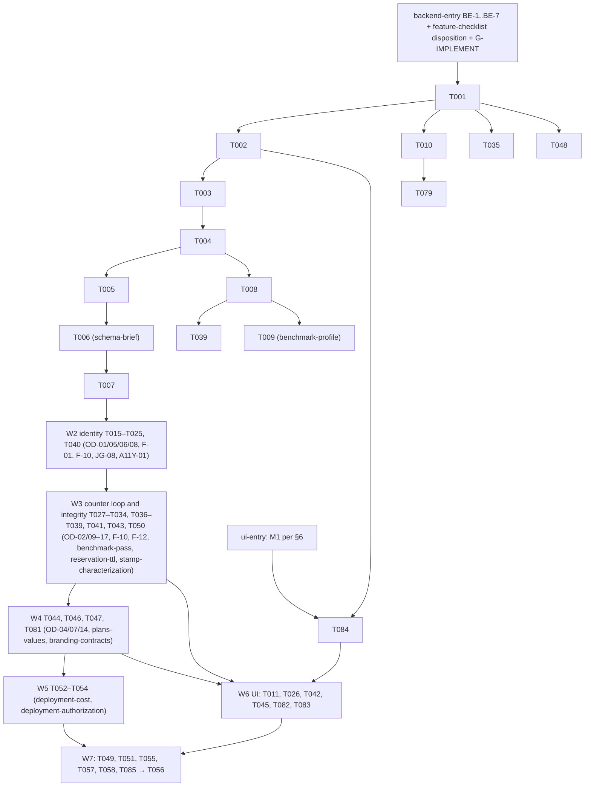

# Backend-first, UI-last amendment: proposal (revision 2)

**Status:** PROPOSED. Revision 2 was written 2026-11-14 after Sol round 1. **The backend-first proposal is not applied.** G01 updates governance references only; it does not approve or authorize PD-047 or any sequencing, decision, roadmap, plan or task change proposed here. M1 is not closed, no gate is opened and no implementation is authorized.

**Risk and review:**
- Risk: **HIGH**, because the proposal changes the entry gate for every implementation card.
- Sol round 1 ran read-only on 2026-11-14 through the plan-review lane: **PASS WITH REQUIRED CHANGES**, 8 required changes. The record is `.scratch/backend-first-20261114/sol-review-run2.md`. An earlier attempt could not read files and does not count as a review.
- Revision 2 answers all 8 changes (§11). Sol round 2 is pending. Fable has not been consulted.

**Owner direction (2026-11-14):**
- Implement and verify backend, database, authentication, domain logic, APIs and integrations first.
- Build the final UI/UX in one later, coordinated phase.
- Discard none of the UX research, decisions, journeys, D1–D4 or acceptance criteria.

## 0. The problem, with evidence

- **Every card but one waits on M1.** T001 is a transitive prerequisite of every implementation card except T080, which has no task prerequisite and is blocked only by `branding-contracts`. T001's only gates are `G-IMPLEMENT`, `M1` and `feature-checklist` (`tasks.md` T001).
- **What M1 requires.** M1 = "PRD v1.0 + clickable Arabic prototype approved" (`06-roadmap.md` Milestones), meaning Phase 1 DoD rows 1.2–1.6. Those include 1.3 (b) and 1.4 (b), which are measured on the prototype, and 1.5, the accepted prototype and final name.
- **PD-039 forbids an early start.** PD-039 item 4 (Approved) says: "There is no early-implementation exception." Its gates are roadmap 1.2–1.6, the final name, the checklist run and T001 evidence.
- **PD-045 already names this as an open question.** Open M-01 says: "Holding 1.3 and 1.4 open until real-app verification would block implementation indefinitely."
- **A Figma prototype cannot be built.** The connected Figma account is on Starter with a View seat (handoff §N). The owner has ruled out a paid upgrade.
- **A second blocker sits inside `tasks.md`.** Five backend cards wait on UI cards or on UI gates:
  - T027 (via T011, and via the `prototype` and `accessibility` register rows);
  - T040 (via T026);
  - T043 (via T042);
  - T046 and T047 (via T045).
- **No constitution amendment is needed.** The constitution, `AGENTS.md` and `.agents/rules/` do not mention M1, the prototype or a phase gate, apart from AGENTS §4 "do not work on tasks whose phase gate is closed". That rule still applies once the roadmap gate is amended. Sol round 1 agreed that an owner-approved decision-log amendment is the right vehicle, as long as the Tier 3 approvals, Article XI and separate implementation authorization stay intact.

## 1. Current versus proposed phase structure

**Current:** M1 (all of Phase 1, including the prototype) → T001 → foundation → identity → counter loop → integrity → surfaces → readiness. UI cards are interleaved, and five backend cards depend on them.

**Proposed:** two entry milestones and seven workstreams.
- Existing IDs, acceptance criteria and per-card gates are kept.
- Three new cards are proposed. Their IDs are provisional and are assigned at the Gate 2 revision.
- Workstreams are labels only; prerequisites still set the order.
- In the computed workstream graph, every edge runs from a lower workstream to a higher one, W1 → … → W7.

| Workstream | Cards | Exit evidence (executable, per phase) |
| --- | --- | --- |
| W1 Infrastructure, database, multi-tenancy, pure seams | T001–T009, T012–T014; pure seams T010, T079, T035, T048, T080 | quickstart §2 spikes (S-1/S-2/S-4); `tenant-isolation-live`, storage tenant isolation and `postgres-lease-conformance` on Linux + PG17 with zero mandatory skips; pure-seam vectors |
| W2 Authentication, identity, authorization | T015–T025, T040 | E2 at API level; E19; session, CSRF and fake-OTP suites; T040 device and phone-change tests; cross-tenant and cross-branch negatives |
| W3 Loyalty domain and transactions | T027 (backend), T028–T034, T036–T039, T041, T043 (backend), T050 | E3–E9, E11, E15, E18 at API level; concurrency and idempotency proofs; FR-069 harness (T039) |
| W4 APIs and integrations | T044, T046, T047, T081 | E10, E12, E13, E17; contract tests for every changed or added API (rule 01 §5) |
| W5 Backend security, reliability, verification | T052, T053, T054 | E16; two-instance and lease proofs; redaction and readiness; backend security regression suites |
| W6 Final UI/UX and API integration | T084 (UI manifest, new), T011, T026, T042, T045, T082, T083 (owner onboarding UI, new) | Playwright on disposable compose, AR RTL and EN LTR, at 360 and 320 px with 200 % text; WCAG 2.2 AA (PD-044); E1/E1b (T083) |
| W7 End-to-end acceptance and release | T049, T051, T055, T056, T057, T058, T085 (real-app verification, new) | Full browser E2E; security review (5.1) and load test (5.2) after M4; restore drill; real-device, camera and live-service evidence (T085); pilot gates |
| Gate register (unscheduled) | T059–T078 | Unchanged; FP-003 stays not authorized (T078) |

**Why T049, T051 and T057 sit in W7:** each still has a real UI or live-channel dependency, so this proposal does not move them into a backend phase.
- T049 probes "public Cloudflare/web/BFF/LIP" and keeps T042.
- T051 presents the support contact and keeps T045.
- T057 depends on T051 and on company registration.

## 2. Exact amendments (proposed old → new)

**A. New decision PD-047 (Proposed).** It is recorded in `01-decisions.md` only after owner approval. Text:
> **PD-047 — Backend-first, UI-last sequencing (Proposed 2026-11-14).**
> 1. A new roadmap milestone **M1-B, "Backend entry"**, gates backend implementation. Its conditions are listed in `backend-first-amendment.md` §5. M1 keeps its definition and gates UI implementation (W6), the rebrand (roadmap 2.1, T058) and, through the cards that already name them, every UI gate.
> 2. This supersedes PD-039 item 4 **in part**. Roadmap 1.3 (b), 1.4 (b), 1.5, 1.6 and the final name no longer precede backend cards. They still precede the UI cards, the rebrand and every gate that already names them (`plans-values` → T046, `final-name` → T058, `prototype`/`accessibility` → UI cards). The following still precede every card:
>    - the `/speckit-checklist` run, with the owner's explicit disposition of its items;
>    - T001's entry-evidence record;
>    - separate implementation authorization.
>
>    The pure helpers get no exception beyond M1-B.
> 3. **Answers part of PD-045 M-01.** Real-app verification (camera, device performance, OTP delivery, service timing) is assigned to a named card (T085) in W7. Still open for the owner: whether 1.3 (b) and 1.4 (b) are measured on a prototype artifact or on the implemented UI (§6, variants U-a and U-b).
> 4. Thresholds, journeys, D1–D4, FR/SC acceptance criteria, OD-01–OD-18, F-01–F-12, JG items and FP-003 are unchanged. Unresolved decisions that backend cards would otherwise have to settle become explicit card gates (§3).

**B. `06-roadmap.md`**
- **Milestones table.** Add this row:

  `| M1-B | Backend entry: PRD v1.0, conditional journey acceptance (1.2, 1.3 (a), 1.4 (a)), Phase 2 gate (0.7/0.8), Gate 2 revision, feature checklist with owner disposition (PD-047) | Backend phases 2–3 and backend parts of 4–5 |`

  Keep the M1 row and append "; gates UI implementation (PD-047)".
- **Phase 1 DoD.** Keep it, and add: "M1-B (PD-047) lets backend work start before this DoD; UI rows (2.1, 2.8 UI parts, 4.1, 4.2, 4.4, 4.6, the 4.7 and 4.8 screens) wait for M1."
- **Rows 3.3, 3.7, 4.3, 4.7 and 5.5** keep their acceptance criteria. Their backends (T030, T027, T041, T043, T046) may run ahead, but each row is *done* only when its UI-timed or display part completes in W6. This applies plan.md's existing rule that "early scaffolding of a later task is allowed but is not completion".
- **Conditional, only if the owner picks variant U-b in §6.** Roadmap 1.5's "Figma" wording and PD-044's prototype clause need a matching amendment, because the measurement artifact would no longer be a Figma prototype.

**C. `plan.md` Entry gates, item 4.**
- Old: "Phase 1 DoD: tasks 1.2–1.6 … are not done yet", with the final-name bullet as a gate for all implementation.
- New, for backend cards: M1-B (PD-047).
- New, for UI cards and the rebrand: M1 and the final name.
- The PM-1 to PM-5 milestones and the backend parts of PM-7 and PM-8 start at M1-B.
- PM-6 and the UI parts of PM-7 and PM-8 start at M1.

**D. `tasks.md` gate register**
- Replace the `M1 → T001` row with `backend-entry` → T001. Its evidence is §5 entry conditions BE-1 to BE-7.
- Add a `ui-entry` row covering T011, T026, T042, T045, T082, T083 and T084, with the evidence in §6.
- Add these decision rows. Each is Proposed until the owner decides it.

  | Gate row | Source | Cards it blocks |
  | --- | --- | --- |
  | `F-12` | JG-12 | T027, T050, T083 |
  | `F-10` | JG-10 | T024, T025, T040, T041, T043 |
  | `JG-08-refusal` | CHK012 | T024 |
  | `A11Y-01` | `open-decisions-M01-A11Y01.md` | T021 |
  | `F-11` and `M-01` | journeys, PD-045 | T085 |

- In the `prototype` and `accessibility` rows, replace T027 with T083. In the `prototype` row, "T002 component/state/file mapping" becomes "T084 manifest".
- M1 remains as the definition behind `ui-entry`.

**E. T001** (the self-dependency is removed; Sol round 1, change 1)
- Readiness and Prerequisites: "G-IMPLEMENT ; M1, feature-checklist" → "G-IMPLEMENT ; backend-entry, feature-checklist". `backend-entry` is BE-1 to BE-7 only. T001's own record (BE-8) is its output, not its entry condition.
- Step 1:
  - Old: "Attach dated completion evidence for roadmap 1.2–1.6, approved prototype and final name".
  - New: "Attach dated evidence for BE-1 to BE-7, including the owner's checklist disposition. Record 1.3 (b), 1.4 (b), 1.5, 1.6 and the final name as open and carried to `ui-entry`."
- Edge cases and Tests:
  - Old: "missing journey, prototype, plan numbers … leaves entry blocked".
  - New: "a missing BE-1 to BE-7 element leaves entry blocked; an open M1 element is recorded as carried forward, never as done."
- Field 13 is unchanged (documentation only).

**F. T010, T035, T048.** "Follow plan Entry gates/M1" → "Follow plan Entry gates (backend entry, PD-047)". They are already implementation-authorized (2026-11-14); this edit removes only the M1 wording.

**G. T002 narrowed, and the UI manifest split into a new card** (Sol round 1, change 2)
- T002 keeps its ID and one completion state, and becomes the backend manifest.
  - Step 1, old: "Record audited exact Next.js, i18n, QR and Playwright versions and the module-internal file/test manifest before delegating new module code."
  - Step 1, new: "Record the audited backend dependency and module-internal file/test manifest, keeping the Hono pins. Record Next.js, i18n, QR and Playwright as `unresolved — T084`."
  - Its acceptance already allows unresolved choices ("unresolved choices are marked unresolved, never defaults").
  - FR-130 coverage moves to T084. SC-015 stays.
- **New card T084 (proposed): "Pin UI dependency versions and the component/state/file manifest", in `specs/002-p0-prd/plan.md`.**
  - Prerequisites: T002, `ui-entry`.
  - Objective: FR-130, SC-015 for the UI modules.
  - It carries the full rule 05 card, modelled on T002's, including field 13.
  - Every UI card gains T084 as a task prerequisite. This replaces the revision-1 `ui-manifest` gate and the two-pass model.

**H. Other text**
- `tasks.md` line 90: "M1 remains open" → "M1-B gates this phase; M1 stays open for W6".
- Line 1532: "/M1/" → "/backend-entry/".
- Mermaid: `Entry[Gate 2 + implementation + M1]` → `Entry[Gate 2 + implementation + M1-B]`, plus a `UIEntry[M1]` node feeding the UI cards.
- T058 step 1: "M1 approval" is unchanged, because the rebrand stays behind M1 and the final name.
- Readiness summary: 82 blocked → 85 blocked (T083, T084 and T085 added as blocked). Planned routing: T083 is reasoning, T084 reasoning, T085 reasoning.

## 3. Card changes

**3.1 Prerequisite edits on backend cards.** Each UI prerequisite is replaced by that UI card's own backend prerequisites, so the backend ancestry is kept exactly. Sol verified this independently.

| Card | Removed | Added | Moved out (receiving card) |
| --- | --- | --- | --- |
| T027 | T011; `prototype` and `accessibility` (card line and register rows) | T003, T010; gate `F-12` | Wizard screens, browser scope `apps/web/src/app/(owner)/`, Tests "E1/E1b stamp walkthrough under 15min/3min" → **T083** |
| T040 | T026 | T003, T010, T025; gate `F-10` | Step 1 "Mirror these states in approved customer screens" and the browser scope → **T026** |
| T043 | T042 | T030, T032, T033, T036; gate `F-10` | Customer accept/decline screens → **T026**. Owner attestation screens on the staff device → **T042**. The actor permissions stay separate. |
| T046 | T045 | T027, T030, T032, T033, T034, T036, T044 | Overview/Settings plan panel → **T045**. Roadmap 5.5 is done only after 4.4. |
| T047 | T045 | T027, T030, T032, T033, T034, T036 | Owner alert review page → **T045** |

**3.2 Decision gates added to backend cards** (Sol round 1, change 4). These cards are blocked until the owner decides. No implementer may choose the policy.

| Gate | Source | Cards | Scope blocked |
| --- | --- | --- | --- |
| `F-12` | JG-12; CHK015 | T027, T050, T083 | The wizard's missing threshold, rate and cost bounds and the expiring-reward indicator window. PD-020/PD-024 values that are already fixed are not reopened. |
| `F-10` | JG-10 | T024, T025, T040, T041, T043 | The per-stage allow/refuse cell for each listed customer operation: sign-in; card and history; member and reward code display; name, language and consent edits; device enrollment and revocation; sign-out-all; phone change; erasure; migration accept/decline. |
| `JG-08-refusal` | JG-08 (Approved, contract open); CHK012 | T024 | The customer-facing refusal before a café's first publication. No new API error code may be invented. |
| `A11Y-01` | `open-decisions-M01-A11Y01.md` | T021 | The staff-PIN input form (SC 3.3.8). PIN length stays under OD-01. |

**Consequence, stated plainly:**
- The counter loop runs through T024 and T025, so it now waits on F-10 and JG-08 as well as the ODs it already needed.
- The owner can decide these early. They are documentation decisions and need no prototype.

**3.3 New cards** (Sol round 1, changes 2, 5 and 6). Each must carry the full 13-field card before Gate 2 approval.

| Card (proposed) | Workstream | Prerequisites | Gates | Scope and acceptance owned |
| --- | --- | --- | --- | --- |
| T083 Owner onboarding and program-wizard UI | W6 | T017, T020, T023, T027, T011, T084 | G-IMPLEMENT, `ui-entry`, `prototype`, `accessibility`, OD-01, OD-02, `F-12` | OWN-01 (invite), OWN-02 (OTP sign-in), OWN-03–OWN-07 (branch, wizard, publish, print-ready QR). The OWN-08 colour step stays in T082. Owns E1, E1b, SC-001, SC-002 and, under variant U-b, roadmap 1.4 (b). |
| T084 UI dependency and component/state/file manifest | W6 | T002 | G-IMPLEMENT, `ui-entry` | FR-130 and SC-015 for the UI modules; T002's former UI pins |
| T085 Real-app device, camera and live-service verification | W7 | T026, T042, T083, T057, T053 | G-IMPLEMENT, `F-11`, `M-01`, `live-messaging-authorization`, `deployment-authorization` | Every D3 §9 carry-forward item: camera scan speed and reliability, and device rendering performance, on the F-11 reference phone; OTP delivery time (roadmap 2.4); onboarding time with live OTP and services (per M-01); a recorded pointer to SC-003 on pilot transactions (T056). PD-045 item 3. Under variant U-b it also owns roadmap 1.3 (b). |

**3.4 Edges added to UI and release cards**
- **UI cards gain `ui-entry` and T084:** T011, T026, T042, T045, T082 and T083.
- **UI cards wait for the backends whose screens they absorb:**
  - T026 gains T040 and T043;
  - T042 gains T043;
  - T045 gains T046 and T047;
  - T082 gains T083.
- **T055** gains T011, T026, T042, T045, T082, T083 and **T057**, so the security review covers the browser controls and the live OTP adapters (Sol round 1, change 6). T055's own after-M4 condition (5.1 and 5.2 depend on M4) stays authoritative. T057's live delivery stays separately gated.
- **T056** (pilot) gains T085.

**3.5 Test ownership, traceability and coverage edits** (Sol round 1, change 5)
- **T027 Tests:** remove "E1/E1b stamp walkthrough under 15min/3min". T027 keeps every API-level test (stale draft, validation, immutability, read-only and suspended refusal).
- **T083 Tests:** E1 and E1b as timed browser walkthroughs; Playwright AR/EN; AA checks.
- **T026 Tests** gain:
  - T040's screen states: device list and revoke, phone change, name and language;
  - T043's customer accept and decline: the E11 browser variant.
- **T042 Tests** gain the owner attestation (E11 browser variant).
- **T045 Tests** gain the plan panel (E17 display) and alert review (E12 display).
- **User-story traceability:**
  - US4 → T018, T020, T027, T081, T082, **T083**;
  - US9 → T028, T046, **T045**;
  - US11 → T043, **T026, T042**;
  - US12 → T047, **T045**.
- **Requirement coverage index:**
  - SC-001 and SC-002 → **T027 (API), T083 (timed)**, T056;
  - FR-130 → T002 is replaced by **T084**, alongside T011, T026, T040 and T058;
  - FR-131 → add **T083**;
  - FR-122 → add **T026**;
  - FR-094 already lists T045;
  - FR-110 → add **T045**.
- Every other row is unchanged. FR-017, FR-018, FR-019, FR-022, FR-040–FR-049 and FR-070–FR-074 keep their backend card, and the UI half is listed where it is added above.

## 4. Updated dependency graph

**How it was computed.** The script `.scratch/backend-first-20261114/graph_v2.py` builds the graph from the `tasks.md` Prerequisites lines **merged with the gate register's direct-card column**, then applies every edit in §2–§3. Its output is in `graph_v2-output.txt`. Results:
- 85 cards and 185 task edges; acyclic;
- every prerequisite resolves to a card;
- every card has a workstream, and no workstream edge runs backward;
- no backend card (W1–W5) reaches a UI card;
- no backend card inherits `prototype`, `accessibility`, `final-name` or `ui-entry`;
- no gate-register assignment is lost, apart from the intended T027 → T083 move.

This corrects revision 1. Its script read only the Prerequisites lines and therefore missed T027 in the `accessibility` register row (Sol round 1, finding 3).

**The diagram below is a summary.** The card prerequisites are authoritative.

## 5. Backend entry (M1-B)

**5.1 Entry conditions: the `backend-entry` gate that T001 needs** (Sol round 1, changes 1 and 8)

| # | Condition | Evidence | State |
| --- | --- | --- | --- |
| BE-1 | PRD v1.0 Gate 1 approved | roadmap 1.1; commit 3016954 | met |
| BE-2 | Phase 2 gate: 0.7 and 0.8 passed (PD-002) | roadmap M0 | met |
| BE-3 | Journeys 1.2, 1.3 (a) and 1.4 (a) accepted as conditional drafts | PD-045 item 2 | met |
| BE-4 | Gate 2 (scoped) approved | `tasks.md` Status | met |
| BE-5 | `feature-checklist`: run recorded, **and** the owner records an explicit disposition of the unchecked items CHK001–CHK082. Running the command alone does not close the gate (`entry-gate-assessment.md`: "What this does not do"). | `checklists/entry-gate.md`; assessment §F (0 CRITICAL, 0 HIGH, 4 MEDIUM) | run done; **disposition pending** |
| BE-6 | PD-047 approved and recorded; the Gate 2 revision (§2–§3) approved | `01-decisions.md`; `tasks.md` Status | pending |
| BE-7 | Sol review of this amendment completed, with findings resolved with evidence | review record | round 1 done; round 2 pending |

**5.2 Produced by T001, not required by it.**
- **BE-8:** T001's dated entry-evidence record in `quickstart.md`. Every later card inherits T001 as a task prerequisite, so it needs no separate gate.

**5.3 Per-card conditions**

BE-9 is corrected (Sol round 1, change 7):
- **Content-approved with field 13:** T001, T002, T010, T035 and T048, plus T058, which stays behind `final-name`.
- **Implementation-authorized:** T010, T035 and T048 only.
- **Every other card from T003 to T079** is approved as blocked structure only and lacks field 13.
- **T080–T082** have **no Gate 2 approval of any kind**, neither content nor structure. The Gate 2 revision for this amendment explicitly **excludes** the branding package (`gate2-branding-revision.md`, D-1 to D-7).
- Neither `branding-contracts` nor the T028 72 → 75-cell revision is a first-batch prerequisite. The T028 revision is required only before T081.
- Per-card gates stay in force: OD-xx, F-01, F-10, F-12, JG-08, A11Y-01, `schema-brief`, `benchmark-profile`, `journal-execution-brief`, `deployment-cost` and the rest.

## 6. Entry to final UI implementation (`ui-entry` = M1)

**Conditions for each UI card:**
1. **Backend prerequisites done.** The card's backend prerequisites are done and their API contract tests pass. For example, T042 needs T030, T032, T033, T036 and T043.
2. **Final name approved** (PD-029 A1, Arabic and Latin).
3. **A UX artifact approved under roadmap 1.5.** Its form is the owner's choice. A paid Figma upgrade is ruled out, and the agent does not choose.
4. **Accessibility (PD-044).** A11Y-01 decided, with AA criteria re-reviewed in each UI card.
5. **Branding.** `branding-contracts` approved, for T082.
6. **Card-specific gates:**
   - `legal-fields` for T045 with real data;
   - 1.6 plan values for the plan panel;
   - F-12 for T083.
7. **T084 done.**

**Where 1.3 (b) and 1.4 (b) are measured: owner decision M-01.** Sol round 1 noted that M1 cannot both require these measurements before UI work and measure them on the implemented UI.

| | U-a: measure on a prototype artifact | U-b: measure on the implemented UI (staging) |
| --- | --- | --- |
| 1.3 (b) and 1.4 (b) | Part of `ui-entry`, as now | **Completion** gates instead: 1.4 (b) on T083, 1.3 (b) on T042 and T085. Not entry gates. |
| M1 | Unchanged: the prototype is approved, then UI work starts | Split into M1-UI ("UX artifact approved + final name", entry) and M1-done ("1.3 (b) and 1.4 (b) recorded", completion) |
| Extra amendments | None | Roadmap 1.5 "Figma" wording, the PD-044 prototype clause, and PD-045 item 1 ("measurement on a versioned, testable 1.5 measurement prototype") |
| Requires | A prototype tool or artifact without a paid Figma seat | Scoring still needs F-02, F-11, F-12 and M-01, before T083 and T042 can be *done* |

## 7. Deferred UX evidence and acceptance (preserved and assigned)

| Evidence | Owning card | Completion blocker |
| --- | --- | --- |
| 1.3 (b) cashier taps (≤ 2 per step, cheap Android) | U-a: `ui-entry` artifact; U-b: T042 + T085 | NOT SCORED until F-11, JG-11, OD-01 and A11Y-01 are decided |
| 1.4 (b) owner onboarding (< 15 min, 7 timing markers, D3 §8) | U-a: `ui-entry` artifact; U-b: T083 | NOT SCORED until F-02 is decided |
| E1 / E1b (SC-001, SC-002) | T083 | T083 acceptance |
| D1 screen states (58 rows) and the D4 DD/GATED register | T026, T042, T045, T082, T083 (each for its own screens) | UI card acceptance: 360 and 320 px, AR RTL and EN LTR, 200 % text |
| WCAG 2.2 AA (FR-134, SC-018) | Every UI card (`accessibility` gate) | UI card acceptance |
| Merchant theming (SC-019, US1.8, US4.9, US4.10) | T082 | `branding-contracts`, `accessibility` |
| Camera, device performance, OTP delivery, live onboarding timing (PD-045 item 3; D3 §9) | **T085** | F-11, M-01, live messaging, deployment |
| Final integration security (5.1) and load (5.2) | T055 (after M4, now including the UI cards and T057) | `security-review` |

**Early checks that cannot safely be deferred.** These are documentation checks during the backend phases; no UI or prototype is built.
1. **Screen-to-contract coverage.**
   - Before an API card is marked done, every D1 screen state that calls it must map to an endpoint and error code in its contract. Examples: CUS-01 `410`/`403 stage_forbidden`; OWN-17 `401`/`429`.
   - The map is drawn screen by screen against D1 and the D4 register. FR IDs do not work for this, because the contracts are organised by endpoint and do not cite FRs consistently.
   - This is an acceptance addition to the affected API cards. Unresolved policy is not settled by this check: it is blocked by the §3.2 gates **before** dispatch.
2. **Cashier tap budget against `staff-api.md`.** Review the scan → preview → confirm call shape against the D1 cashier flows before T029 and T030, because changing it later is an API break (rule 01 §5).
3. **Final name before T053 and T057**, if hostnames, the sender name or WhatsApp template names embed it. Check this when those cards are revised. Persisted BFF IDs are brand-neutral: `crv_` appears only in upstream `apps/cloud` customer code.
4. **Server-side localization.** Error codes are locale-neutral and digit normalization is server-side (T079).

**Scope note for the owner.** "Platform administration UI" is outside P0: `spec.md` lists "Super Admin console UI | P1 (6.7); operator tools only in P0" (PD-011). W6 covers the customer, cashier and owner surfaces only, unless the owner changes PD-011.

## 8. Security and governance impact

- **Backend testing stays per phase.** Every W1–W5 card keeps its unit, integration, PG17, isolation, auth, concurrency, idempotency and contract tests (rule 03; rule 05 field 8). Only browser E2E, human usability and real-device checks move later, to named cards (§7).
- **Security review stays after the UI.** T055 covers the browser controls and the live OTP adapters (T057) and keeps its M4 condition. Backend security regression suites run in W5. CSRF and session work stays in T017.
- **Unresolved policy is gated, not deferred.** F-10, F-12, JG-08, A11Y-01 and OD-01 to OD-18 block their cards before dispatch. Deferred UX findings never authorize a contract break (rule 01 §5).
- **Unchanged governance:** FP-003 (T078); the deployment, legal, company, pilot, restore and live-messaging gates; the no-Stripe rule.
- **Branding is excluded.** The Gate 2 revision for this amendment is bounded to §2–§3 and does not approve T080–T082, `branding-contracts` or D-1 to D-7.
- **Reviews:**
  - Sol High is mandatory for every HIGH card and for this amendment, in a separate session with enforced read-only permissions. Round 1 is done and round 2 is pending; at most two follow-up rounds are allowed.
  - The independent final-verdict (Sol High) is required only for a material technical disagreement unresolved after those rounds, and before any push (AGENTS §5 G01).
  - No author self-review substitutes for either.
- **Delegate lanes are unchanged**: use the approved 21-lane fleet in `.delegate/config.json` (read only); AGENTS §5 G01 governs orchestration and reviews. The Hydrogen XHigh `security-review` and `critical-architecture-hydrogen` lanes remain blocked until their isolation requirements are satisfied with recorded enforcement evidence. Argon requires explicit owner approval.
  - **Historical authorization scope:** the owner's Codex authorization of 2026-11-14 covered only this read-only review; the tests and complex-fix lanes were unavailable under that authorization. G01 grants no implementation authorization and closes no task or review gate. The tests and complex-fix lanes remain unavailable for implementation without separate owner authorization.

## 9. Files requiring revision (on approval only)

| File | Change |
| --- | --- |
| `docs/context/01-decisions.md` | Add PD-047. Mark PD-039 item 4 "superseded in part by PD-047". Note under PD-045 that M-01 is partly answered. Under U-b only, also amend PD-044 and PD-045 item 1 (§6). |
| `docs/context/06-roadmap.md` | Add the M1-B row; amend the M1 row; add the Phase 1 DoD note (§2 B). Under U-b only, also change the 1.5 wording. |
| `specs/002-p0-prd/plan.md` | Entry gates item 4; Milestones note (§2 C) |
| `specs/002-p0-prd/tasks.md` | Status line and readiness counts; gate register (`backend-entry`, `ui-entry`, decision rows, T027 → T083 in `prototype`/`accessibility`); line 90; T001; T002; T010, T035 and T048 wording; T027, T040, T043, T046 and T047 (prerequisites, gates, scope, tests); UI cards (T011, T026, T042, T045, T082: prerequisites and tests); T055 and T056 prerequisites; new cards T083, T084 and T085 (blocked, full rule 05 cards); dependency section, line 1532 and the mermaid diagram; user-story traceability; requirement coverage index (§3.5) |
| `.scratch/entry-1.5-apply-20261113/handoff.md` | Record the outcome |

**Not revised:** the constitution, `AGENTS.md`, `.agents/rules/`, `spec.md`, the contracts, `data-model.md`, the journeys, D1–D4, the branding package and the Delegate configuration.

## 10. Earliest executable batch after approval

**Executable once BE-1 to BE-7 close:**
1. **T001** (LOW, documentation), which needs a named implementation authorization.
2. **T002** (HIGH, backend manifest), which needs a named authorization, and **T010, T035 and T048**, which are already authorized.
   - Sol round 1 verified that T010, T035 and T048 have field 13 and are pure seams. They need no branding approval, prototype or UI-framework choice.

The batch stops there. These are the only cards that are content-approved and have field 13.

**Reachable next in the graph, but not executable yet:** T003 and T079, then T004, then T005 and T008, then T039. Each needs:
- Gate 2 content approval;
- rule 05 field 13 (the 2026-11-13 transition rule);
- T002's file pins;
- a named authorization.

**Further stops, in graph order:**
- T006 and T012 (`schema-brief`);
- T009 (`benchmark-profile`);
- T013 (`journal-execution-brief`);
- T015 (OD-08);
- T016 (OD-05, F-01);
- T018 (OD-06, `deployment-cost`);
- T020–T022 (OD-01; T021 also A11Y-01);
- T024–T025 (F-10, JG-08).

The counter loop then also needs OD-02, OD-09, OD-10, OD-12 to OD-17, F-12, `benchmark-pass`, `reservation-ttl` and `stamp-characterization`.

**Owner approvals required:**
1. Sol round 2 on revision 2. This is covered by the owner's 2026-11-14 read-only authorization.
2. Approve PD-047, which supersedes PD-039 item 4 in part.
3. Approve the Gate 2 revision bounded to §2–§3: card edits, the three new blocked cards, and the gate rows. Branding is excluded.
4. Record an explicit disposition of checklist items CHK001–CHK082 (BE-5).
5. Give named implementation authorization for T001 and T002.
6. Before the UI phase:
   - choose U-a or U-b and the UX artifact;
   - decide the final name, A11Y-01, F-02, F-11, F-12 and M-01.
7. Early in the backend phase, to keep the counter loop moving: F-10, the JG-08 refusal contract, A11Y-01 and the OD items.

## 11. Response to Sol round 1 (2026-11-14)

| Sol required change | Where answered |
| --- | --- |
| 1. Remove the T001/M1-B self-dependency | §2 E; §5.1/§5.2: BE-8 is T001's output, not its entry condition |
| 2. Independently trackable T002 completion | §2 G: T002 is narrowed to the backend; new card T084 holds the UI manifest; no two-pass state |
| 3. Reconcile the gate register; transfer T027's accessibility gate; model the manifest | §2 D; §3.1; `graph_v2.py` merges the register (no lost assignment; no backend card inherits a UI gate) |
| 4. Backend blockers for F-12, F-10/JG-08 and A11Y-01 | §3.2 (scoped gates on T021, T024, T025, T027, T040, T041, T043, T050) |
| 5. Receiving UI cards; tests, traceability and coverage | §3.3 T083 (OWN-01 to OWN-07, E1/E1b, SC-001/002); §3.5 |
| 6. Named homes for deferred device, camera, live-timing and integration security | §3.3 T085; §3.4 T055 ← T057; §7 table; T055 keeps M4 |
| 7. Correct BE-9; bound Gate 2; keep the branding exclusions | §5.3; §8 |
| 8. Explicit checklist disposition | §5.1 BE-5 |

Sol's risk note on U-b, where M1 cannot both gate and measure, is answered in §6.
