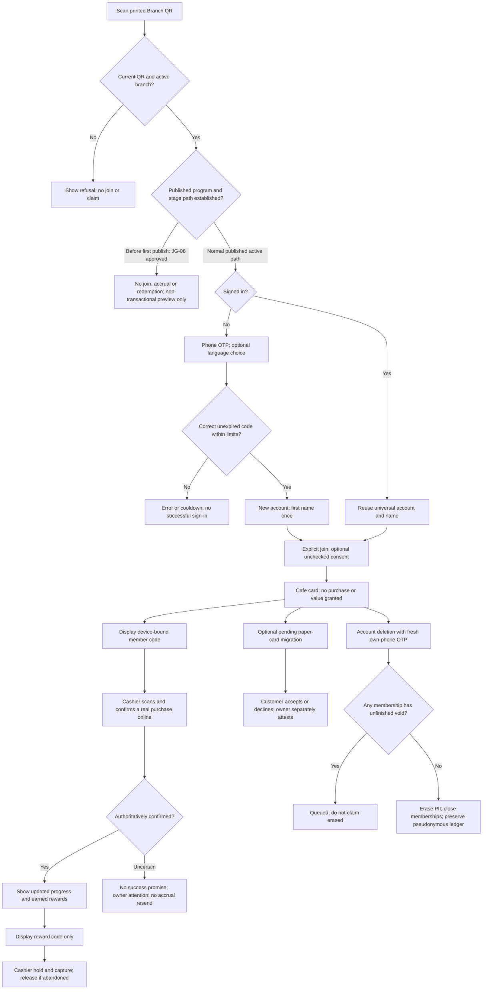

# Roadmap 1.2 — Customer journey

**Status**: Draft documentation completed for review, 2026-11-13; **accepted by the owner 2026-11-13 as a conditional draft (PD-045)**. No prototype, user test, live delivery or implementation is claimed. [README.md](README.md) keeps the original JG-01–JG-12 questions. The owner's JG decisions of 2026-11-13 are recorded in PD-041: JG-05/08/09 approved; JG-01/02/03/06/07/10/12 approved as principles, with mechanisms blocked; JG-04 and JG-11 unresolved. The JG decisions do not approve roadmap 1.2; the conditional acceptance is PD-045 and leaves every open decision open. OD-01–OD-18 remain unresolved; FP-003 remains unauthorized.

**Sources**: [PRD](../spec.md), US1/US3/US6/US10/US11 and FR-001–FR-032, FR-050–FR-056, FR-070–FR-074, FR-120–FR-133; [customer contract](../contracts/customer-api.md); [decisions](../../../docs/context/01-decisions.md), PD-001/003/004/007/016/020/021/022/023/031/039 and PD-005 A2–A4. Approved decisions and normative protocol outrank these journeys.

## Owner JG decisions (PD-041, 2026-11-13) and remaining conditions

The [consolidation assessment](jg-consolidation-review.md) records each JG's approved policy and the mechanism still blocked. OD-01–OD-18 remain unresolved and FP-003 unauthorized.

**JG-03/04/05 recovery:**
- **JG-03, approved principle:** support-assisted recovery after permanent number loss is offered only through a separately approved verification mechanism. Possession of a new number alone never transfers or exposes historical value. The mechanism (F-03) is blocked, so no support rebinding can run and none is promised.
- **JG-04, unresolved:** PD-004's accepted MVP reused-number risk stands until a separately approved security design exists. The OTP-only baseline must not be described as protecting a previous holder.
- **JG-05, approved (PD-040 C1):** no automatic duplicate merge or value transfer; suspected duplicates are flagged for support review only. Ordinary authorized ledger operations and privacy erasure continue. Triage tooling waits for F-05.

**JG-08/09 value gates (approved, PD-040 C3/C4):**
- Before the café's first publication there is no active-program join, real accrual or redemption, and any preview is clearly non-transactional.
- While the café is suspended, customers cannot create new pending claims. Permitted voids, corrections, redemptions and A3 recovery stay available.
- JG-09 is recorded as PD-005 A4. While suspended, claim creation is refused with the existing stage error `403 stage_forbidden` (`details.stage`), and no existing claim is cancelled. The JG-08 customer-facing refusal contract is not yet specified, and this journey chooses no error code for it.

**JG-10 stage principle (approved; cells blocked):**
- A customer's read-only access to their own account and cards, their privacy rights and secure recovery are universal-account rights, not café billing entitlements. They continue across stages.
- Value-changing café actions keep their own stage guards.
- F-10 must still map each customer operation to a stage cell before it is wired: sign-in, code display, name/language/consent edits, customer devices, phone change, deletion, migration response. No cell is inferred.
- A migration response is not value posting; posting keeps its stage checks. Erasure still waits for unfinished voids.

## Scope, actor and entry conditions

The customer holds one universal phone-verified account and an independent, non-transferable card for each café. The normal path below assumes a valid QR for an active branch with a published program, an active café subscription and a working network. Arabic RTL is the initial UI regardless of phone language; English is selectable and remembered. P0 collects only the verified Egyptian phone and first name. Name constraints not fixed by PD-023 remain OD-08; no new name rule is introduced.

The café/branch is resolved by the server from the QR and authenticated context. The customer never supplies an authoritative tenant id, types a bill amount, awards value, reserves a reward or captures redemption. Merchant credentials remain server-side. OTP messages are the only P0 messages; no reward/expiry reminder is promised. Expiry moments displayed on cards come from LIP and use Africa/Cairo date and time, Western digits and main-language content fallback.

## Flow diagram

This diagram shows the normal published/active path. Other-stage customer self-service follows the approved **JG-10** principle, but each operation's cell waits for F-10; none is inferred. The suspended new-join denial is already fixed by A2. Permanent number loss, recycled numbers and duplicates use the separate [recovery draft](1.2-recovery-procedures.md).

## Ordered journey and expected outcomes

| Step | Customer action | Expected system outcome / permission | Failure or recovery |
| --- | --- | --- | --- |
| C1 | Scan the one printed Branch QR | Resolve café and branch, including language-correct names; joining and claiming remain separate explicit actions (FR-031) | Rotated QR: `410 qr_rotated`; inactive branch refused; no membership/claim created. A pre-publish scan follows approved JG-08 (PD-040 C3): no join, accrual or redemption; the refusal contract is not yet specified |
| C2 | Choose language and enter mobile | Accept valid Egyptian mobile prefixes 10/11/12/15 after digit normalization; server bot/OTP checks; no email/birthday/last name collection | Invalid mobile rejected before send. Wrong-number entry is corrected before requesting a new code; never display or select another account by name |
| C3 | Request and enter OTP | Correct-purpose code authenticates; new session, protected cookie/CSRF. Approved code lifetime 5 minutes, resend cooldown 60 seconds, max 5 wrong attempts; phone send limits are 5 in any rolling 60 minutes across WhatsApp, SMS and all purposes (PD-042) and 10/day | `422 otp_invalid`/`otp_expired`/`otp_attempts_exceeded`; `429 rate_limited`; `503 otp_paused`. Show only the authorized retry/cooldown behavior; JG-01's transport and failure accounting (F-01) and the OD-05 extra limits remain open |
| C4 | Give first name if needed | Save once on universal account. Existing account joining café B does not re-enter it | No name from another phone is accepted as proof of ownership; OD-08 governs any additional technical name bound |
| C5 | Explicitly join café and choose consent | One card for this café; acquisition branch recorded. Consent optional and unchecked by default, with purpose/version/source/time. Declining still joins. No purchase or stamp/points granted | Suspended new join: `403 stage_forbidden`; cross-café data hidden. Same-account repeat join cannot create another café card. Capacity-limit excess alone never rejects join (FR-095) |
| C6 | Open card and show member code | Device-bound, single-use, café-bound code, validity at most 60 seconds; at most 3 active customer devices | Fourth active device refused (`409 device_limit`); revoke an existing one through approved self-service when that stage path is decided. Expired/replayed/revoked code is not a fallback static barcode |
| C7 | Buy at counter; let cashier scan and type amount | Staff previews using LIP and confirms. Customer sees authoritatively confirmed progress within the SC-004 target of 2 seconds; no target success is claimed from this draft | No network: no award or offline queue. Uncertain outcome is not success; same submission returns state and never resends accrual. Fresh-capture/owner handling remains OD-10/OD-15/OD-17; see cashier journey |
| C8 | Open a reward and show its code | Customer only displays; cashier holds then captures. Earlier issued reward/open hold keeps its terms; customer cannot consume it directly | Insufficient balance, used reward or concurrent losing attempt refuses; a hold without capture follows the 120-second rule, with exact boundary OD-16 unresolved. An uncertain capture is not handed over as confirmed |
| C9 | If scan fallback needed, explicitly create branch claim | Pending only, one open claim per customer/branch, 15-minute lifetime; cashier types code and amount at that branch | Three wrong attempts cancel the claim, but attribution/code format remains OD-12. Rotation keeps already-valid claims; branch deactivation cancels them. JG-09 approved (PD-040 C4; recorded as PD-005 A4): creation is refused while suspended with `403 stage_forbidden`; existing claims are not cancelled by this rule |
| C10 | Review paper-card migration and accept or decline | See café, stamps and expiry; acceptance alone never posts value. Owner must independently attest collection/VOID. Posting rechecks all guards | Decline/expiry cannot post; pending life 15 minutes, first 60 days, stamps only, one successful migration/member/program and final balance ≤ threshold−1. The customer-stage cell for accept/decline waits for F-10 (JG-10); owner posting obeys A2 |
| C11 | Manage own account/devices | Own cards/history with branches; name/language choice once; revoke device, sign out everywhere, or signed-in phone change with OTP to the new phone | Successful phone change revokes every old session/device secret; bad/expired code changes nothing. Customer self-service stage cells wait for F-10 under the approved JG-10 principle. No cross-café transfer, export or support bypass is created |
| C12 | Request deletion and enter fresh OTP to own phone | Queue while any membership has an unfinished void; once safe, close all memberships and scrub PII while preserving pseudonymous ledger | Incorrect/missing code deletes nothing. Queued is not completed. Pending migration is cancelled on account deletion before posting (PRD assumptions). An erased membership cannot admit a new operation (`410 member_erased`) |

## Permission and subscription-stage boundary

| Operation | Active | Grace / read-only | Suspended | Source / unresolved branch |
| --- | --- | --- | --- | --- |
| New café join | Allowed with ordinary checks | Allowed | Denied | PD-005 A2; plan capacity is not enforced |
| Staff confirms purchase or claim | Allowed with ordinary checks | Allowed | Denied | PD-005 A2; customer does not perform it |
| Staff redeems existing reward | Allowed with ordinary checks | Allowed | Allowed on already-authorized access | A2/A3; a new staff device cannot be registered while suspended |
| Owner posts paper migration | Allowed with all migration guards | Grace allowed; read-only denied | Denied | PD-021/022, A2; customer's accept/decline cell waits for F-10 (JG-10) |
| Customer sign-in, card/code display, devices, name/language/consent, phone change, sign-out, deletion, migration response | Normal account permissions; no inferred café restriction | JG-10 principle approved; cell per F-10 | JG-10 principle approved; cell per F-10 | Read-only access, privacy rights and secure recovery continue across stages (PD-041); each operation's cell still needs F-10 before wiring |
| Customer creates pending claim | Explicit normal branch-claim path | Normal claim path | Denied (PD-005 A4) | Confirmation is already denied when suspended (A2); creation denial recorded as PD-005 A4 (JG-09); `403 stage_forbidden` |

Every “allowed” cell still requires valid credentials, scope, active branch/device as applicable, idempotency and accounting guards. A denial in an approved PD-005 A2–A4 cell is `403 stage_forbidden`; this includes the JG-09 suspended-claim cell (PD-005 A4), while the JG-08 refusal contract is not yet specified (PD-041) and this code does not imply it; unknown policy is a documentation decision gate, not a new implemented error code.

## Failure/recovery checkpoints and acceptance evidence

- Lost phone but still controls the number: ordinary own-number OTP sign-in; independently verify safe device revocation, with the JG-10 cells still open (F-10). Permanent number loss (JG-03: principle approved, mechanism F-03 blocked), reuse (JG-04: unresolved) and duplicates (JG-05: approved, no merge or transfer) have no executable support transfer or rebinding.
- Card expiry is shown at its authoritative Cairo moment. Points warning configuration is approved; JG-12 (PD-041) approves in principle an in-app indicator for issued rewards expiring within 7 days. P0 outbound messages remain OTP-only (PD-016/FR-140); no reminder is sent. The indicator's window semantics (F-12) remain open, and points warning_days:[30] and reward expiry are unchanged.
- A wrong bill is the cashier/owner's authorized full-void/re-capture flow, never customer-edited spend. Once the customer has left, no P0 amount-correction shortcut or linked `service_recovery` substitution exists (PD-030).
- **FP-003:** a points void currently refuses `409 points_void_unavailable`; no reversal code, computed candidate amount or enabled point-void promise appears here. V1–V7 and SC-017/owner authorization still gate points pilots.
- Future review evidence: trace C1–C12 to US1/US3/US6/US10/US11; walk through same phone/two cafés, wrong code, expired/replayed QR, no-consent join, suspended join, uncertain accrual, migration accept/decline and queued deletion. Record prototype version, observed result and failure recovery. All results are **NOT RUN**; neither roadmap 1.2 nor SC-009 is approved by writing this draft.
