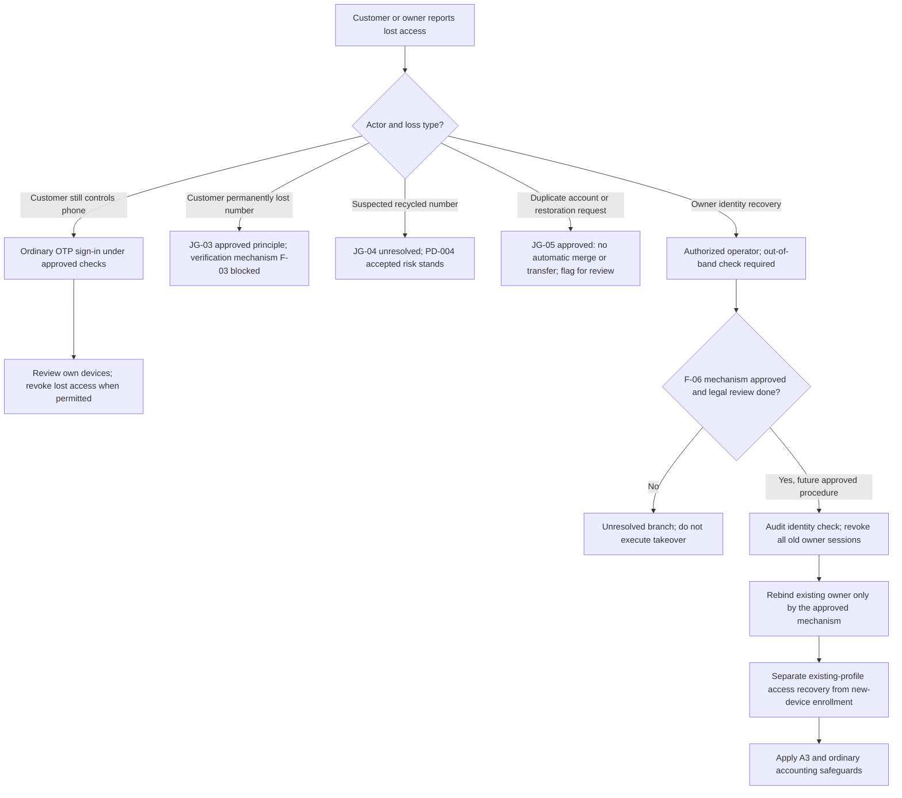

# Roadmap 1.2 — Customer and owner recovery procedures

**Status**: Draft, decision-dependent; **accepted 2026-11-13 as a conditional draft only (PD-045)**. Its blocked mechanisms (F-03, F-04, F-06, JG-04) stay blocked. This is a recovery design for owner review, not an executable support runbook. The owner's JG decisions are recorded in PD-041 (2026-11-13); the consolidation assessment shows which policies are approved and which mechanisms stay blocked, OD-01–OD-18 remain open, and FP-003 is unauthorized. No test, legal clearance or recovery execution is claimed.

**Authority**: [PRD](../spec.md), US10/US14, FR-007–FR-019, FR-028, FR-063–FR-069, FR-141/142/152; [decisions](../../../docs/context/01-decisions.md), PD-001/004/010/011/013/014/019, PD-005 A2–A4; [customer contract](../contracts/customer-api.md); [operator contract](../contracts/operator-api.md). Task 0.10 legal review includes identity checks/support provider data; 0.11 gates live messaging/support activation. Nothing changes approved evidence or balance ownership rules.

## Owner JG decisions (PD-041) and blocked mechanisms

See the [consolidation assessment](jg-consolidation-review.md) and PD-041. The approved JG-03 and JG-06 items are security objectives, not recovery verification protocols; **F-03/F-04/F-06 stay blocked**. OD-01–OD-18 and FP-003 gates remain unchanged.

- **JG-03 (approved principle):** support-assisted recovery after permanent number loss runs only through a separately approved verification mechanism. Control of a replacement number alone never authorizes transferring or exposing historical value.
- **JG-04 (unresolved):** PD-004's accepted MVP reused-number risk stands until a separately approved security design exists. A new OTP, first name, screenshot or unapproved identity attachment is not such a design.
- Until F-03 is approved and JG-04 decided, no detachment or rebinding can run, and no stronger privacy guarantee is claimed.

**JG-05 (approved, PD-040 C1):** support flags suspected duplicates; there is no automatic duplicate merge or value transfer. Duplicate resolution never destroys, copies or moves balances or audit records. Normal authorized expiry, redemption, voids and privacy erasure continue. Support flag fields and retention need F-05 before any tooling, and the flag is not an indefinite PII hold.

- **JG-06 (approved principle):** owner new-phone recovery requires verified café ownership plus independent security checks, on top of FR-142's out-of-band check, all-session revocation and audit. An SMS OTP alone is never sufficient. F-06 must still select the evidence, actors, new-phone binding, stage scope and dispute rules. No recovery invitation is selected.
- **JG-07 (approved, PD-040 C2):** no invitation silently replaces an existing owner; conflicts go to a separately authorized ownership-management process. Reissue invalidation and races remain F-07.

**JG-10 (approved principle):** read-only access, privacy rights and secure recovery continue across stages. They do not authorize arbitrary account mutations or unspecified recovery; F-10 must still define the operation cells. A3's suspended existing-profile recovery never authorizes a new or replacement staff device. Erasure queues and lawful retention remain mandatory.

## Actors, authority and information minimization

| Actor | Permitted role | Forbidden inference/action |
| --- | --- | --- |
| Customer who still controls own phone | Ordinary OTP sign-in; signed-in phone change using OTP to new number; own session/device revocation and deletion under their approved guards | First name, card screenshot, last3 or knowledge of a balance is not newly accepted proof for a lost-number takeover |
| Business owner | Authorized voids and classified adjustments within café scope and accounting rules | No account merge, cross-café value transfer, customer-absent purchase amount correction or unlocking an unreconciled member block by administrative closure |
| Support agent | Platform WhatsApp contact plus phone fallback; triage and route to owner/operator procedure | No balance writes, forced identity rebinding, unapproved recovery code or export of directory data |
| Super Admin operator | External IdP/MFA and explicit authorization; owner recovery with out-of-band identity check, all owner sessions revoked and audited; reasoned directory reads | A valid token alone is not operator authorization. Evidence checks, new-phone binding and owner-recovery stage policy are not yet selected (JG-06 mechanism, F-06) |

Collect no ad hoc identity document or sensitive support attachment based on this draft. What evidence is acceptable, how to retain it, and lawful provider handling require the owner-approved procedure and 0.10; an `evidence_ref` is a contract field, not permission to invent an evidence standard. No OTP, QR payload, raw token or phone is placed in URLs/logs/idempotency keys.

## Decision flow

JG branches deliberately stop procedure selection. They do not implement a new product refusal/status or promise the proposed fallback. Existing sessions with valid authority continue only within approved rules; this draft does not itself erase, detach, lock or transfer any account.

## R1 — Customer lost a device but retains the same mobile number

1. Classify as device loss, not permanent phone-number loss; direct to ordinary Egyptian own-number OTP sign-in. Approved code/rate/bot/circuit checks still apply; do not waive them because support was contacted.
2. A correct unexpired code signs into the same universal customer account. It does not create a second account or move café balances. A wrong number/code authenticates no recovery.
3. Show own registered devices and revoke the lost device or use sign-out-everywhere, through the existing customer self-service contract once the JG-10 cells are fixed (F-10). Do not silently reinterpret a lost device as automatic global session revocation if the user has not taken that action.
4. Device limit remains 3; a fourth device is refused until one is revoked. Codes from a revoked device fail. Owner/staff device enrollment is a different operation and cannot use customer device recovery as a bypass.
5. If changing phone while signed in, OTP must go to the **new** number. Successful change revokes every existing session and device secret; invalid/expired code leaves the number unchanged (FR-018).
6. Expected evidence: unchanged café ledger/card membership identity; only authorized session/device/profile changes; audit for self-service mutations; no support balance permission gained. Actual timing and outcomes: **NOT RUN**.

Failures: invalid number before send; `422 otp_invalid`/`otp_expired`/`otp_attempts_exceeded`; `429 rate_limited`; `503 otp_paused`; revoked device code refusal. Show only documented recovery/cooldown, not a support-issued OTP bypass. JG-01's transport and failure accounting (F-01) and OD-05 remain open where exact scopes/values are not fixed.

## R2 — Wrong number, permanent loss, recycled number or duplicate accounts

| Case | Established behavior | Conditional paths for owner decision — not implemented policy | Required safety boundary |
| --- | --- | --- | --- |
| Wrong number typed before sign-in | User corrects input and requests code to a number they control; no first-name/card lookup to choose an identity | If they report they already signed into an unexpected account, use the suspected reuse/recovery investigation; no automatic merge | No disclosure of another account as proof of number ownership; do not tell support to use last3 alone |
| Permanently lost old number, no usable authenticated session | Existing own-number OTP cannot establish control | **JG-03, approved principle (PD-041):** support-assisted recovery only through an approved verification mechanism; the original no-rebinding recommendation is historical. F-03 must specify verified historical ownership and binding/revocation before any procedure is executable | No unapproved rebinding, invented evidence, value copy or deletion of the old account |
| Recycled number / new holder sees another person's account | PD-004 accepts reused-number risk and mentions detachment after checks; the checks/fate of account are unspecified | **JG-04, unresolved (PD-041):** PD-004's accepted MVP risk stands until a separately approved security design (F-04) and any PD-004/FR-010 amendment exist. The historical dormant-old-account recommendation selects nothing | Do not detach or transfer balances based on this document; privacy incident handling/legal evidence requirements remain for 0.10 |
| Two numbers, duplicate cards/accounts or mistaken deletion | Existing account and card rules still apply; closed membership/erased identity is not casually restored | **JG-05, approved (PD-040 C1):** no automatic merge/value transfer and support review only; no manual recovery/merge or adjustment shortcut exists until separately reviewed and owner-approved. Ordinary expiry/void/redemption and PII erasure remain applicable | No unapproved account merge, owner adjustment masquerading as identity/value transfer, new purchase or visit; stamp/ledger invariants cannot be overridden |

Do not infer a new status code, account lock, fixed support SLA or definitive “value lost forever” answer for these unresolved cases. Support acknowledges that the recovery mechanism awaits approval and records only the minimum approved triage metadata; it does not promise a recovery outcome or imply that a suggestion is available in P0.

## R3 — Owner recovery: established core and unresolved mechanism

1. The operator first uses the approved OIDC/MFA and allowlist authorization. Support can route the case but cannot execute an owner takeover.
2. Classify ordinary own-phone OTP sign-in versus out-of-band recovery. No duplicate owner account may be created: one owner per café is invariant (PD-014). Lost own-phone control is not solved by staff PIN, a customer's OTP or mere knowledge of café information.
3. For out-of-band recovery, FR-142 requires an identity check. The approved **JG-06** principle (verified café ownership plus independent security checks) has not selected acceptable evidence/checks, retention, new-phone verification/binding mechanism or recovery-stage permissions (F-06). Task 0.10 must cover the legal identity procedure. Until these are decided, the operator recovery contract is not an executable takeover procedure.
4. **Conditional future approved branch:** only after the owner has approved those details, perform its out-of-band check, record authorized evidence reference/reason and actor, revoke **all** old owner sessions, and audit the recovery. Rebind the existing owner only by the selected mechanism; a single-use recovery invite is the historical JG-06 recommendation, not an approved route or entitlement.
5. Distinguish an initial invite from recovery. Under **JG-07** (PD-040 C2, approved), no invitation silently replaces an existing owner; reissue of unused invites remains F-07. The 72-hour single-use, phone-bound invite properties stand; older-invite invalidation/recovery behavior is not assumed.
6. Access recovery of an **existing** staff/owner staff profile uses A3, not a newly created profile. Recover only the existing authorized profile/device when suspended. A new/replacement staff device must wait for a stage that permits enrollment or use an already-authorized device. OD-01 still determines PIN/session/code details and step-up conditions not already fixed.
7. After any executed future approved recovery, verify all old owner sessions fail, new access has only its intended café role, audit is complete, old device/session secrets are handled as the approved procedure directs, and no ledger value changed. Do not claim those checks executed now.

## Subscription-stage separation

| Operation | Grace | Read-only | Suspended | Boundary |
| --- | --- | --- | --- | --- |
| Recover access of existing staff profile: reverify phone/reset PIN | Allowed | Allowed | Allowed for previously authorized access | PD-005 A3; not new staff/device registration |
| Issue recovery PIN setup code for existing owner staff profile | Allowed | Allowed | Allowed for existing authorized profile/device | A3; OD-01 step-up and validity details remain open |
| Enroll a new/replacement staff device | Allowed | Allowed | Denied | A3; replacement is still new enrollment |
| First-time owner staff profile setup | Allowed | Allowed | Denied | A3; not relabelled recovery |
| Revoke staff/device/session | Allowed | Allowed | Allowed | A2; valid authority required |
| Out-of-band owner identity rebinding | Blocked (F-06) | Blocked (F-06) | Blocked (F-06) | Existing-profile access recovery cells do not approve a different owner-identity mechanism |
| Customer recovery and self-service stage treatment | JG-10 principle approved; cells per F-10; recovery mechanism F-03 blocked; JG-04 unresolved | Same | Same | Universal customer account must not be given an invented per-café lock rule |

Active is ordinary full service subject to the same actor, device, identity and accounting checks; it never authorizes a JG branch simply because billing is current.

## Balance mistakes and acceptance checklist

- Recovery does not alter purchases. A real wrong bill with customer present uses full void **completed and reconciled first**, then fresh genuine capture with a distinct identity and audit linkage. Customer-absent amount correction/partial refunds are not P0 (PD-030).
- An owner may use authorized classified adjustments for their approved purposes with step-up/reason/idempotency; no adjustment clears an unreconciled void block merely by submission. Stamp adjustments stay `[0, threshold)`. JG-05 (approved) creates no account-merge transfer path.
- Points void remains `409 points_void_unavailable` while FP-003 is unauthorized; no recovery role can enable it. Uncertain accrual is never resent; missing evidence is not assumed zero; authoritative recovery depends on V4 verification. Durable member blocks lift only after successful reconciliation, with 15-minute owner / 24-hour operator escalation for voids.
- Future evidence cases: ordinary same-number recovery, wrong-number entry, lost-number and reuse branches marked decision-blocked, duplicate-account question, invalid operator, reasonless directory read, no owner session survives completed recovery, suspended existing-profile recovery vs forbidden new-device enrollment. Record **NOT RUN** until the procedure and prototype are approved and the test occurs. Roadmap 1.2, legal clearance and implementation entry remain unapproved.
