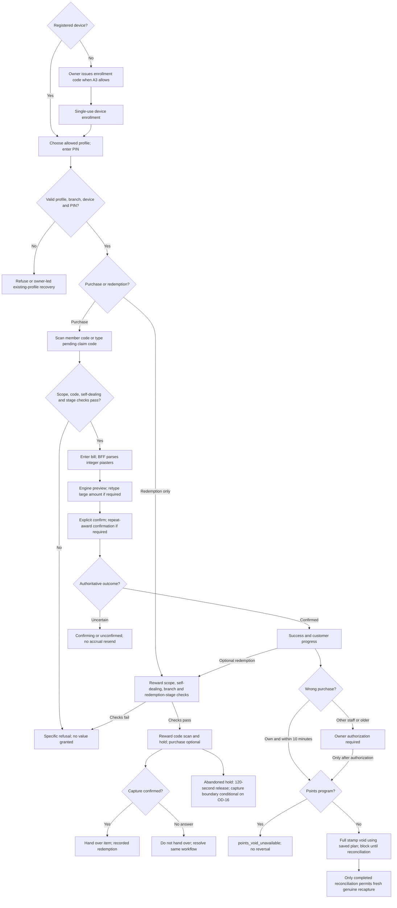

# Roadmap 1.3 — Cashier journey

**PD-047/U-b adoption (2026-11-15):** The 1.3(b) criterion remains ≤2 taps for each cashier step on an owner-approved cheap-Android reference device/convention; T085 owns measurement on the implemented real-staging app, including camera/device evidence. JG-11/F-11 stays unresolved and no result is scored until its protocol is approved. The earlier prototype references below are retained as historical protocol notes; measurement remains **NOT RUN**.

**Status**: Draft completed 2026-11-13. **Part (a), the journey documentation, was accepted 2026-11-13 as a conditional draft (PD-045).** Part (b), prototype/tap/device measurement, is NOT RUN. This document grants no implementation or accounting permission. The owner's [JG](README.md) decisions are recorded in PD-041 (2026-11-13) and the consolidation assessment; JG-11 (tap criterion) stays unresolved; OD-01–OD-18 remain unresolved; FP-003 remains unauthorized.

**Sources**: [PRD](../spec.md), US2/US3/US5/US6/US7/US11, FR-014/016/020–032/050–056/060–074/080–086/112/132/150; [staff contract](../contracts/staff-api.md), [error model](../contracts/README.md); [decisions](../../../docs/context/01-decisions.md), PD-003/008 A1/014/020/030/039 and PD-005 A2–A4. PIN/profile/code lifetimes are OD-01, not guessed defaults.

## Owner JG decisions (PD-041) affecting the cashier

**JG-11 is unresolved (PD-041).** The existing roadmap 1.3 criterion stands unchanged: each step ≤ 2 taps on a cheap Android phone. The proposed authenticated-primary-transaction benchmark and the synthetic Android profile in the [consolidation assessment](jg-consolidation-review.md) remain proposals; they neither replace nor narrow the criterion. Record actual deliberate screen taps (including digits), per-step and whole-path counts, and login/setup separately. No device was tested and no passing count is invented.

- **JG-09 (approved, PD-040 C4; recorded as PD-005 A4):** customers cannot create new pending claims while the café is suspended. This cancels no existing claim. It does not alter what A2/A3 allow (voids, corrections, redemptions, existing authorized access recovery) or what A3 denies (new device enrollment when suspended).
- **JG-10 (approved principle):** customer access, privacy and recovery rights never bypass cashier value-stage guards. The exact customer cells remain F-10.
- **JG-05 (approved):** a suspected duplicate never justifies an adjustment transfer or a fabricated recapture.
- **JG-12:** no wizard range is chosen.
- OD-01–OD-18 remain open, and points void stays unavailable while FP-003 is unauthorized.

## Actor, prerequisites and information boundary

Ordinary cashier: active verified staff profile, own allowed branch, registered active branch device, PIN session. The owner uses the single dedicated owner staff profile at a registered café branch; its PIN grants no owner-only privilege. Owner overrides require fresh owner-phone authentication, explicit authorization and audit carrying both owner and acting staff. Customer-facing data is first name and progress only; no phone lookup, raw phone, export, program editing or cashier manual adjustment.

Customer and staff devices are distinct. Customer member/reward codes can display offline after prior online PWA use; staff validation and every award/redemption require online service. No offline award queue or retroactive cashier grant is introduced. Unexpected state or missing policy is escalated, never compensated by a fresh purchase.

## Flow diagram

The diagram is a review model, not a chosen button layout. OD-12 claim-code attribution, OD-13 capture lifetime/supersession, OD-16 hold boundary and OD-10/15/17 uncertain-award handling remain conditional branches; the prototype must expose those undecided cases rather than implement a recommendation.

## Ordered normal path and recovery

| Step | Actor action / system result | Permission and expected outcome | Failure / recovery |
| --- | --- | --- | --- |
| S1 | Owner creates staff and verifies staff phone; sets up or recovers PIN on enrolled device | Staff activation needs phone OTP. First/reset/unlock uses valid device, profile-bound setup code and pre-session CSRF; no existing staff session required for that bootstrap | New staff creation denied in read-only/suspended. Existing-profile recovery follows A3. OD-01 controls unknown PIN/lockout/code/session values and some step-up decisions |
| S2 | Owner issues branch enrollment code; staff device redeems it once | Device binds server-side to one café/branch; no caller-supplied scope is trusted | Enrollment permitted active/grace/read-only, refused suspended. Suspended replacement cannot be called “recovery” of an old device. Expired/invalid/single-use checks apply per future OD-01 values |
| S3 | Cashier selects allowed profile and enters PIN | Device and PIN session must agree on café and allowed branch. Owner staff profile can act at active café branches, with its own identity/audit | `409 pin_not_set`/`profile_locked`; `403 device_revoked`/`branch_inactive`/`staff_inactive`; reauthenticate or owner-led recovery, no bypass |
| S4 | Scan member QR, or type claim code from same branch | Server validates single-use ≤60s member code, active customer device/card scope, no void block and ordinary self-dealing rules. Assign one order identity for scan session | `410 code_expired`/`code_used`, `403 self_dealing_forbidden`, `404 not_found` for invisible café object. Claims: one open per customer/branch, expire15min; third attributed wrong attempt cancels; format/attribution OD-12 remains open |
| S5 | Enter the bill amount, not items or customer-supplied spend | BFF authoritative parser normalizes digits and accepts digits with optional `.`/`٫` and1–2 decimals (PD-039). `٤٥٫٥٠` is4550 piasters; no floats or client earn math | Reject signs/grouping/spaces/`.5`/`45.`/>2 decimals under PD-039; UI may trim before parser, but no parser guessing. Keep entered value visible for correction before confirm |
| S6 | Review engine preview and confirm amount | Default large-bill threshold2000 EGP; strictly above threshold must be typed again. Strictly above5× threshold refused for ordinary cashier. Display LIP-calculated earn only | `409 amount_retype_required` or `amount_over_cashier_limit`; equality at boundary is not “above.” Owner above5× classification/stamp behavior is OD-18, not a hidden privileged confirm |
| S7 | Confirm purchase; acknowledge genuinely new repeat within10min | Explicit repeat confirmation shows only first name/progress. Record staff/device/branch and authoritative result once; SC-004 customer-update target2s | `409 repeat_award_confirmation_required`; altered amount `409 conflict`. Duplicate submission/new HTTP key for same business operation never awards again. Capture lifetime/supersession remains OD-13 |
| S8 | Observe result | Show success only after confirmed. `202 confirming` may progress to `unconfirmed`, visible on needs-attention/operator surfaces | Never resend uncertain accrual, interactively or background. Same submission returns current state. No fresh capture or classified correction is assumed to resolve it: OD-10/15/17. Outage gives no retroactive cashier award |
| S9 | Scan reward code; review hold terms/cost | Staff alone reserves. Stamp reward uses issued reward; points uses held cost; max one reward/order, no negative redemption balance; immutable terms | `409 insufficient_balance`/`one_reward_per_order`; mismatched refreshed terms release via workflow and give `reward_terms_changed`. Predictable `stamp-...` ID is not a bearer code |
| S10 | Explicitly capture; hand over only when captured | One capture under concurrent attempts. Redemption-only order is zero-value, never accrued and never a qualifying analytics visit | `202`/lost response: do not hand over; resolve same forward workflow/key/body and never dispatch competing capture/release effects. The proposed rule that a pre-120s capture intent prevents timer release is **conditional on unresolved OD-16**, not a settled journey policy. Definite failed capture proceeds to release; `410 reservation_expired` is not capture success |
| S11 | Cancel/abandon hold without capture intent | Release so reward/points become available; normal timeout120s, no double release | Exact “submitted before120s” interpretation remains OD-16. Do not adopt the recommendation as final. System cleanup after branch deactivation is authorized by that workflow, not the revoked staff session |
| S12 | Correct a purchase | Cashier may full-void only own purchase within10min; other/older purchase requires owner. No direct partial refund or customer-absent amount correction | `409 void_not_own_purchase`/`void_window_expired`; dashboard fresh-auth detail is OD-11. Points immediately refuse `points_void_unavailable` while FP-003 is unauthorized |

## Stamp void, correction and owner-only adjuncts

For stamps, the saved authoritative earned amount and purchase marker govern a one-time plan. Preconditions include unchanged program revision, current balance in `[0,t)`, enough cancellable stamp rewards and no conflicting member work/hold. Under the approved plan, compute once `k=max(0,ceil((a-cur)/t))`; cancel newest eligible k rewards above marker, claw back original purchase, then system-restore `k*t` only if needed. This system correction is never a cashier-entered manual grant. The final balance must be in `[0,t)`; the plan is persisted and replayed, never recomputed after a crash (PD-008 A1).

All unrelated member balance/reward writes remain blocked until authoritative reward/ledger reconciliation verifies every expected effect. Owner settlement, escalation or administrative closure alone never clears the block. Interrupted voids recover forward with the same identifiers/body: needs-owner at15min, operator escalation at24h. `member_busy`, `void_in_progress` and `void_needs_owner` have distinct meanings; do not turn a retry into another business operation. Points use no stamp formula and remain unavailable, with no member block created by a refused disabled points void.

If the customer is present, only after the original full void completes and reconciles may a genuine fresh customer-code/claim capture with new identity record the corrected bill; audit links original, void and re-capture (FR-171). If the customer left, P0 has no purchase amount correction, including a `service_recovery` adjustment labelled as equivalent (PD-030). A wrong stamp bill amount alone does not change stamps if the purchase should still have earned.

Paper migration is owner-only from the owner staff profile on a registered device after fresh owner authentication. Show pending request separately, not as an award: customer accepts/declines; owner attests paper collected/VOID; only both confirmations plus the atomic60-day/stage/balance/one-time/void checks can post. First60days, stamps only, balance+grant≤t−1, pending15min; no generic `migration` adjustment shortcut. The customer accept/decline stage cell waits for F-10 (JG-10).

## Stage matrix for counter operations

| Action | Grace | Read-only | Suspended |
| --- | --- | --- | --- |
| Award / confirm pending claim | Allowed | Allowed | Denied |
| Redeem, permitted full void, correction/service_recovery | Allowed | Allowed | Allowed through existing authorized access |
| Owner bonus/gift/migration | Allowed | Denied | Denied |
| Add staff | Allowed | Denied | Denied |
| Issue new/replacement device enrollment | Allowed | Allowed | Denied |
| Recover existing staff profile / existing owner-profile PIN access | Allowed | Allowed | Allowed only for access authorized before suspension |
| First-time owner staff profile setup | Allowed | Allowed | Denied |
| Revoke staff/device/session or rotate leaked branch QR | Allowed | Allowed | Allowed |

Active means ordinary full service subject to every role/security/accounting check. All denied approved A2–A4 cells use `403 stage_forbidden` (this includes the JG-09 suspended-claim cell (PD-005 A4), while the JG-08 refusal contract is not yet specified (PD-041) and this code does not imply it); A3 never makes new-device enrollment a suspended recovery action. A2 fixes suspended claim **confirmation** denial; PD-005 A4 (JG-09) denies customer claim **creation** while suspended with `403 stage_forbidden`.

## Tap/device acceptance protocol — draft, NOT RUN

Roadmap1.3 requires ≤2 taps per step on a cheap Android phone; SC-003 separately measures real pilot scan-to-confirm median≤10s. **JG-11** is unresolved: the counting convention and reference device(s) are not decided, and the criterion stands unchanged. Do not silently exempt keypad digits, camera aiming, retype, PIN or owner step-up. The historical README recommendation to omit digit taps is superseded as a candidate by the new owner proposal to count every deliberate screen tap; no criterion amendment is approved.

For each S3–S12 prototype step, record device/model/browser, prototype version, all touch events, selection/commit events, typed characters, camera/permission actions, errors and assistance separately. Include both normal and repeat/large-bill/refusal paths. The proposed authenticated-primary-transaction metric is additional until F-11 explicitly reconciles the original per-step scope. Count deliberate digit taps as well as select/confirm/permission/retype taps; elapsed automatic processing is not a tap. Use the proposed synthetic profile and required physical-device manifest in the consolidation assessment, subject to owner approval. Until JG-11 is decided, the reference profile is approved and a **versioned, testable 1.5 measurement prototype** is identified, the result is **NOT SCORED**, never PASS. The measurement prototype is not the final 1.5 acceptance. Prototype runs assess navigation and tap counts only provisionally; device performance and camera operation need later real-app verification (PD-045). Owner step-up/migration adjuncts are shown separately, not omitted to claim a two-tap result. No layout or exemption is implemented by this document.

Future independent evidence covers E3–E9/E11/E18/E19: expired/replayed/cross-café/self-dealing code, revoked branch/device, duplicate confirm, uncertain response, held reward race,120s boundary, stamp void crash, points refusal and concurrent migration. No execution is claimed; roadmap1.3 remains unapproved.
