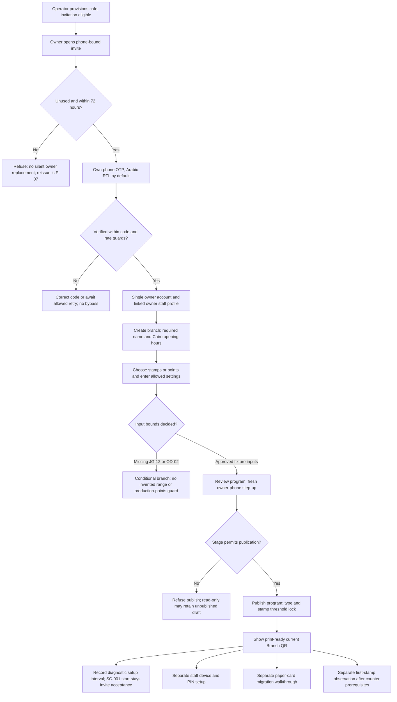

# Roadmap 1.4 — Owner onboarding and draft timed walkthrough

**PD-047/U-b adoption (2026-11-15):** The 1.4(b) acceptance target remains under 15 minutes from the owner-approved F-02 invite-acceptance event, including OTP waits/errors/assistance; the separate wizard remains under 3 minutes, with OWN-08 inside SC-001 and outside SC-002. T085 owns real-staging measurement after final UI and live OTP integration. F-02, F-12 and M-01-staging stay unresolved; no result is scored before protocol approval. Prototype-based wording below is historical, and all existing raw fields remain **NOT RUN/NOT SCORED**.

**Status**: Draft completed 2026-11-13. **Part (a), the journey documentation, was accepted 2026-11-13 as a conditional draft (PD-045).** The timed walkthrough, part (b), is a protocol only, run on a versioned, testable 1.5 measurement prototype. No timed run, first-stamp result, SC-001/002 PASS or roadmap1.4 completion is claimed. The owner's [JG](README.md) decisions are recorded in PD-041 (2026-11-13) and the consolidation assessment; OD-01–OD-18 and FP-003 gates remain unchanged. **Amended in place 2026-11-13 for PD-046:** step O4a (brand colours) was added; pending independent review.

**Sources**: [PRD](../spec.md), US4/US7/US11/US13, FR-012–016/040–049/070–074/080–086/090–095/130–133 and SC-001/002/009; [owner contract](../contracts/owner-api.md); [decisions](../../../docs/context/01-decisions.md), PD-005 A2–A4, PD-007/010/011/012/020/021/022/025/026/029/039; [roadmap](../../../docs/context/06-roadmap.md),1.4/1.5/1.6. Contracts do not decide a JG question merely because a route is sketched.

## Owner JG decisions (PD-041) affecting onboarding

See the [consolidation assessment](jg-consolidation-review.md) and PD-041.

**JG-01 (approved principle; window approved by PD-042):** at most 5 OTP sends per phone number in any rolling 60 minutes, shared across WhatsApp and SMS and all OTP purposes; a purpose may have a stricter limit.
- The other approved PD-004/PD-020 values are unchanged: 10/day per number, 60 s resend, one active code, 5 wrong attempts.
- Nothing raises a budget or permits extra WhatsApp sends.
- Transport and failure accounting (F-01) is open.
- Do not reuse OTP or step-up authority to reduce send counts. OD-01/05 remain open.

**JG-02 (approved principle):** SC-001, PD-011 and roadmap 1.4 keep invite acceptance as the start.
- The authenticated-setup interval (setup entry → published program + print-ready QR) is recorded only as a separate diagnostic, and the first successful stamp separately. Neither substitutes for SC-001 or SC-009.
- The exact invite-acceptance event and PD-011's first-stamp wording remain F-02.
- Invite-acceptance duration, all OTP/wait/error time and separate first-stamp/SC-009 observations remain visible.
- No shorter interval produces a substituted PASS.

- **JG-06 (approved principle):** owner recovery needs verified café ownership plus independent security checks, and an approved mechanism (F-06, blocked).
- **JG-07 (approved, PD-040 C2):** no invitation silently replaces an existing owner. Reissue behavior remains F-07.
- **JG-08 (approved, PD-040 C3):** no pre-publication active join, real accrual or redemption; any preview is non-transactional.
- **JG-09/10:** the suspended-claim refusal (approved; PD-005 A4) and the customer-rights principle (approved; cells F-10) never alter A2/A3 value permissions.

**JG-12 (partly approved):** the owner approved in principle an in-app indicator for issued rewards expiring within 7 days, with no external reminder (PD-016/FR-140 unchanged). Its window semantics remain F-12.
- Still unresolved: stamp threshold min/max/integer bounds, points earn-rate form/units/bounds/precision, and the maximum positive whole reward cost/storage bound.
- The existing PD-020/PD-024 values below stay binding; no new range is chosen.
- Unchanged: points warning_days:[30], reward expiry 30d default/7–90d, stamps never expire.
- OD-02 and all FP-003/points-pilot gates remain open.

## Actor and operator preconditions

The platform operator provisions a café through operator tools, waits for provisioning readiness and the verified server-held merchant credential, then issues a72-hour single-use hashed invite bound to the owner's phone (PD-011, R-02). There is no P0 self-service café signup or new owner role gained from a cashier PIN. Live invitation/OTP delivery waits on0.11; fake-channel rehearsal is not live delivery proof.

Normal onboarding assumes no owner yet, a valid invite, an active café subscription, a working network and a prepared stamp-program test scenario. If an owner already exists, the invite must not silently replace them (**JG-07**, PD-040 C2): the conflict goes to a separately authorized ownership-management process. Reissue of an unused invite remains F-07; do not choose duplicate-owner creation or previous-invite invalidation behavior. Lost-owner-number recovery is **JG-06**, not another first-time invitation.

## Flow diagram

## Ordered onboarding and expected outcomes

| Step | Owner/operator action | Expected result / permission | Failure and recovery |
| --- | --- | --- | --- |
| O1 | Operator provisions café and issues invite | One café/program environment; invite eligible only after provisioning ready. Single-use hashed invite, bound phone and72h validity | Interrupted provisioning resumes its operation, not another café. An existing owner cannot be silently replaced (JG-07 approved); reissue is F-07; no second owner account is created |
| O2 | Owner opens invite and starts acceptance | Show café and bound-phone confirmation within approved privacy limits; language ar/RTL, en optional | Expired/used/unknown invite refuses `410 invite_expired`; mismatched phone cannot accept. Timer start events are recorded separately; the exact acceptance event is F-02 |
| O3 | Request/verify owner OTP | Own bound phone proves acceptance; create single owner with exactly one linked owner staff profile record, no duplicate account |5min code,60s resend,5 wrong attempts, phone limits 5 sends in any rolling 60 minutes across WhatsApp, SMS and all purposes (PD-042) and 10/day. JG-01 transport/failure accounting is F-01; OD-05 extra limits remain open. Rate/circuit refusal is not bypassed for timing |
| O4 | Create branch name and opening hours | Required café main-language name; optional second-language fallback. Weekly Africa/Cairo intervals, overnight/closed days; hours affect alerts only | Creation only in allowed stage; no capacity-limit enforcement in P0. Main name missing is validation failure; do not silently change hours to permit a purchase |
| O4a | Choose brand colours (PD-046) | Three colours prefilled with the platform default; a preview in `ar` and `en` with accessible derived colours; keeping the default takes one action (FR-135, FR-136, FR-139) | An invalid value is refused and nothing changes (FR-137). A later change is allowed in every stage, with no fresh one-time code in a valid owner session and re-sign-in when the session is expired, invalid or revoked; at most 10 saved changes per merchant and 30 attempts per owner account per rolling hour, this onboarding save included (MB-03, U-1, U-2, U-6, PD-005 A5). The step is inside the timed SC-001 path, before "wizard opened", so SC-002 excludes it |
| O5 | Choose stamps or points and complete wizard | Stamp: one free-item reward, reset on issue, stamps never expire. Points: suggestion5 points/100EGP, at most5 active free-item rewards with positive whole cost; expiry180/365(default)/545/730/never. Minimum eligible spend≥1piaster; reward expiry30days(default),7–90 range | No tiers/exclusions/discount rewards/multiple programs. **JG-12** threshold/earn-rate/cost ranges remain unspecified, so any demonstration values are labeled scenario fixtures, not new defaults or chosen validation policy |
| O6 | Enter program/reward texts and review | Main language required; optional second language falls back. Reward names/descriptions can later change without republishing; prior issued/held terms immutable | Correct input before publish. Future type/stamp threshold changes are refused; expiry mode locks after first purchase. **OD-02** non-test production points publishing guard remains unresolved; no points café pilots before FP-003/V5/V6/SC-017 |
| O7 | Fresh owner step-up, then publish | OTP to owner's own phone bound to action/target, never customer's OTP or staff PIN; publish authorized/audited. Gate remains denied read-only/suspended | `401 step_up_required`, OTP errors/rate limits, `403 stage_forbidden` or publish conflict: do not claim success or fabricate another publish. Grant/code lifetimes remain OD-01; send budget JG-01 (F-01 open) |
| O8 | Display current print-ready Branch QR | One current printed branch credential serves both join and explicit claim. Rotation later invalidates new scans of old QR without cancelling valid open claims | Old/rotated credential is never printed as current; inactive branch refuses new scans. JG-08 (PD-040 C3, approved) refuses active-program join/real accrual/redemption before first publish; the refusal contract is not yet specified |
| O9 | Review separate counter-access setup | Verify staff phone, registered branch device and PIN. Owner counter work uses linked owner staff profile; owner-only actions need fresh owner authority | Staff creation step-up approved; enrollment/PIN-code step-up details and validity remain OD-01. A3 stage restrictions distinguish first setup/recovery/new devices. Additional OTPs count against the JG-01 shared budget; they are not omitted from a “full setup” demonstration |
| O10 | Review paper-card migration outside timed core | From owner staff profile on registered device with fresh owner authentication; customer accept/decline + owner paper-collected/VOID attestation before atomic checks/posting | First60days, stamps only, one successful migration/member/program,15min pending, final balance≤t−1, allowed stage and no void conflict; no direct generic migration adjustment shortcut |

Owner sees exactly8 dashboard pages (Overview, Customers, Programs, Transactions, Rewards, Branches, Staff, Settings), with plan/period/stage on Overview/Settings. Operator payment/plan changes are not owner payment editing. No live payments, settings mutation or dashboard is implemented by writing this flow.

## Subscription-stage behavior for onboarding and maintenance

Active is ordinary full service with all permissions/security/accounting checks; end-date day0 remains active, grace1–7, read-only8–37 and suspended38+ use Cairo calendar days.

| Action | Grace | Read-only | Suspended | Authority |
| --- | --- | --- | --- | --- |
| Create branch or reactivate branch | Allowed | Denied | Denied | PD-005 A3 |
| Update branch names/hours; deactivate branch | Allowed | Allowed | Allowed | A3; deactivation cancels claims/revokes access and journals safe hold cleanup |
| Edit unpublished program draft | Allowed | Allowed | Denied | A3 exception; draft change has no effect until permitted publish |
| Publish or change active program/rewards, including reward expiry | Allowed | Denied | Denied | A2/A3, FR-048 |
| Main language, amount label, large-bill threshold settings | Allowed | Allowed | Allowed | A3; does not make accrual allowed when suspended |
| Brand colours: change or reset | Allowed | Allowed | Allowed | PD-005 A5 (2026-11-14); owner only, audited, rate-limited (U-2, U-6), re-sign-in on an invalid session (U-1) |
| Add staff | Allowed | Denied | Denied | A2 |
| New device enrollment / first-time owner staff setup | Allowed | Allowed | Denied | A3; cannot be relabelled existing-access recovery |
| Existing staff/owner-profile access recovery on previously authorized access | Allowed | Allowed | Allowed | A3; identity rebinding still JG-06 |
| Rotate Branch QR; revoke staff/device/session | Allowed | Allowed | Allowed | A2; ordinary authorization still required |
| Owner paper migration / bonus / gift | Allowed | Denied | Denied | A2; no payment-stage bypass |

A denial in an approved A2–A4 cell uses `403 stage_forbidden` with stage detail; this includes the JG-09 suspended-claim cell (PD-005 A4), while the JG-08 refusal contract is not yet specified (PD-041) and this code does not imply it. Recovery/revocation and payment restoration preserve balances. Plan capacity limits are monitored, not enforced; stage restrictions still apply. Under suspension, replacing a broken device with a **new** enrollment waits for payment/allowed stage or uses another already-authorized device, as A3 explicitly requires.

## Timed walkthrough protocol — draft, run on a testable 1.5 measurement prototype

**All measurements: NOT RUN.** No testable prototype exists yet. Under PD-045 and PD-029 A1, task 1.5 starts after the documentation acceptance of 1.2, 1.3 (a) and 1.4 (a), using the working name; the final name is needed before the prototype is accepted. Execute only against a recorded, versioned measurement prototype and scenario fixtures. Prototype runs provisionally assess navigation, tap counts and path time; OTP delivery and service-dependent timing need later real-app verification (PD-045). A prototype rehearsal is not an implemented-system, legal, live-OTP or pilot verification.

1. Before a future run, record prototype/version, name state (PD-043 working name or final name), language, device/browser, network/test channel, published scenario inputs, participant experience and any assistance. JG-12 determines accepted wizard bounds; do not call the “5 drinks→1 free” scenario a global default.
2. **JG-02 (approved principle; F-02 open):** instrument invite link opened, acceptance interaction started, acceptance/OTP committed, wizard opened, publish committed, print-ready QR displayed and first stamp separately. The original invite-open recommendation is historical. The owner approved recording authenticated café-setup entry → published + printable QR as a separate diagnostic. It cannot replace invite-acceptance SC-001 unless the events are shown equivalent (F-02) or the owner explicitly amends the approved sources. Do not replace PD-011's accepted wording or silently choose the scored start/stop.
3. Preserve raw wall-clock observations, including OTP wait, re-send/cooldown, step-up, errors and assistance. Do not subtract them to get a passing total. Any future owner-approved alternative scoring rule must be recorded separately from raw elapsed data; JG-01 cannot be solved by weakening rate limits.
4. SC-001 target is **under15min** from the eventual approved invite-acceptance event to the defined onboarding outcome; roadmap1.4 requires a published program and print-ready QR. SC-002 is separately **under3min** for the stamp wizard. First-stamp timing is separately recorded (JG-02); F-02 reconciles PD-011's wording. No PASS/FAIL score until endpoint rule and prototype exist.
5. Keep staff/device/PIN setup, paper migration and first purchase visibly documented but **outside the proposed SC-001 core**, with the exact timed boundary event still F-02. Their time/events remain visible; do not present an incomplete counter setup as a ready-to-operate café or claim SC-009 just because QR is printable.
6. Record each refusal/recovery in addition to the happy path: invite expiration, wrong OTP, rate limit, stage-denied branch/publish, retained read-only draft, missing required name, publish conflict, points-production uncertainty and interrupted print/rotation. Prototype target values are scenarios only; payment/recovery paths follow approved authority and JG gates.

| Run record field | Current value |
| --- | --- |
| Measurement prototype/version and participant/device | Not available / NOT RUN |
| JG-02 scored endpoints | SC-001 from invite acceptance (exact event F-02); approved diagnostic setup interval recorded separately |
| Invite-open / accept-start / accept-commit timestamps | NOT RUN / NOT RUN / NOT RUN |
| Wizard-open / publish-commit / print-ready timestamps | NOT RUN / NOT RUN / NOT RUN |
| First-stamp / staff-ready / migration demonstration time | NOT RUN; separate observations |
| Raw elapsed and OTP/wait/error/assistance log | NOT RUN; no invented numbers |
| SC-001 / SC-002 / SC-009 result | NOT SCORED / NOT SCORED / NOT RUN |
| Reviewer and owner approval | Pending; no roadmap1.4 approval |

## Remaining decisions and entry gates

JG-01/02/06/07/08/11/12 and OD-01/02/05/08 affect these paths directly; their PD-041 status is in the consolidation assessment, and blocked mechanisms and ODs stay open, not resolved by omission. Recovery uses [1.2-recovery-procedures.md](1.2-recovery-procedures.md). A paper migration's customer response cell depends on F-10 (JG-10). Points void is still `409 points_void_unavailable`; no onboarding/program choice authorizes FP-003 or a points pilot.

Roadmap 1.3 (b)/1.4 (b) measurements (documentation of 1.2, 1.3 (a) and 1.4 (a) conditionally accepted 2026-11-13, PD-045) remain entry gates, together with:
- the unresolved recovery, tap and timing policy;
- the final name before prototype acceptance (PD-029 A1) and the accepted prototype 1.5;
- the plan values 1.6;
- the feature checklist and T001 evidence;
- separate named implementation authorization.

Preserve the historical scoped Gate 2 approval in plan.md/tasks.md (2026-11-13: six content-only cards, T059–T078 gate records, other cards blocked structure). This draft grants no additional approval or permission to implement. Live messaging/company 0.11, legal 0.10, cost/deployment authorization and the technical verification gates apply to their tagged downstream work. This draft closes none of them.
