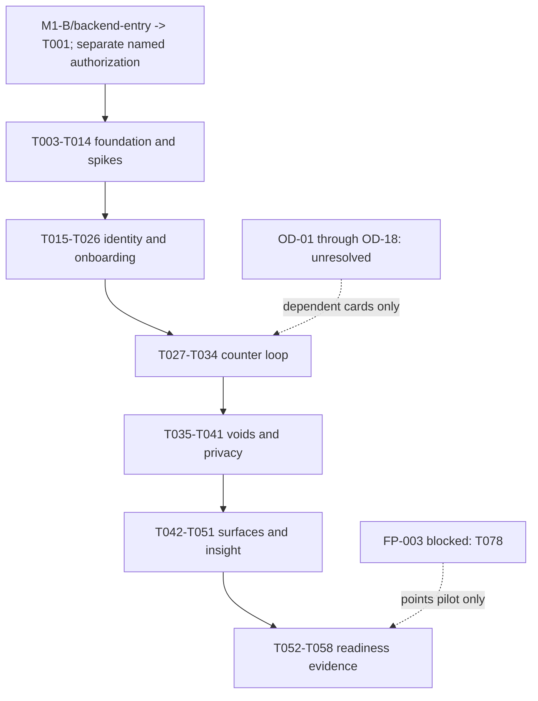

# Tasks: [Product] P0 MVP

**Status**: **Gate 2 (scoped) approved by the project owner on 2026-11-13.** **Implementation authorization (owner, 2026-11-16): T001 and T002 only, within their previously reviewed and approved scope. Recorded from the owner's message "Explicit implementation authorization: T001 and T002, within their previously reviewed and approved scope." This is not a gate approval; every other gate and prerequisite is unchanged.** **Gate 2 content approval and implementation authorization (owner, 2026-11-16): T003, T004, T005, T008, T079 only, within their reviewed Spec Kit task-card scope. Recorded from the owner message "Gate 2 content approval and implementation authorization (owner, 2026-11-16): T003, T004, T005, T008, T079 only, within their reviewed Spec Kit task-card scope." Prerequisites and every other gate are unchanged; no other card is approved or authorized.** **Implementation authorization (owner, 2026-11-16): T003, T004, T005, T008, T079 only, within their approved scope.** **Implementation authorization (owner, 2026-11-14): T010, T035 and T048 only, within their approved scope; their prerequisites are not approved. All three remain blocked by T001/backend-entry; feature-checklist run/disposition is met by the separate BE-5 record below, and no other card is authorized.** Approved as content only, still subject to prerequisites and separate implementation authorization: T001, T002, T010, T035, T048, T058. Approved as gate records: T059–T078. All other cards (including the new T079) are approved as blocked structure only. No implementation authorization. Owner decisions recorded: PD-005 A3, PD-039, PD-005 A4, PD-042 (field 13 added to T001/T002/T010/T035/T048/T058 as a review-only addition; scope unchanged). Refined in place 2026-11-13. Planning Gate approved and task generation separately authorized by the owner on 2026-11-12, reconciled in [plan.md](plan.md). No implementation/staging/commit/push/deploy authorization. Codex author checks are not an independent review verdict. Gate wording amended 2026-11-13 with owner approval: `final-name` timing (PD-029 A1); new `accessibility` gate (PD-044). **PD-046 (2026-11-13, merchant branding):** T080–T082 were added in place as blocked cards. They are **not** Gate 2-approved, as content or as structure. Gates `branding-decisions` and `branding-contracts` were added. No existing card changed. Pending independent review. **2026-11-14:** the owner approved MB-01–MB-05 and PD-005 A5 (decisions only), so `branding-decisions` is satisfied; `branding-contracts` stays open and T080–T082 stay blocked and not Gate 2-approved.

**PD-047 Revision 3 adoption — owner approved 2026-11-15; revised Gate 2 package separately approved 2026-11-15.** The approved content/structure scope is the M1-B/M1-UI/M1-done entry/completion split; the exact task/gate/dependency edits, including T001/T002/T010/T035/T048/T058, T027/T040/T043/T046/T047, T055/T056, and T083–T085; and the PM-S/PM-1–PM-9 backend-entry/full-completion split recorded in `plan.md` and `docs/context/06-roadmap.md`. T083–T085 are added as blocked cards. The approval excludes T080–T082 branding content/structure, checklist disposition, implementation and operational authorization. Existing per-card decisions and gates remain. At that approval, BE-5 CHK001–CHK082 owner disposition and BE-7 G01 independent review remained open; no implementation task is authorized by this Gate 2 approval.

**BE-5 owner disposition — approved 2026-11-15:** The owner approved the CHK001–CHK082 disposition as presented in the Wanees decision package dated 2026-11-15; see [entry-gate-assessment.md §G](checklists/entry-gate-assessment.md#g-be-5-owner-disposition--approved-2026-11-15). BE-5's checklist-run and explicit-disposition requirement is met. Original evidence, item-level classifications and all 82 unchecked markers are preserved; evidence-qualified Satisfied assessments do not close Partial, unresolved, Deferred or Consistency items or their named gates. No underlying open product decision is resolved, no gate is waived, and no implementation or operational action is authorized. Separate named T001 authorization remains outstanding; BE-8 remains T001's unproduced output. (BE-7's separate G01 independent review, outstanding at this record, closed 2026-11-16 (PD-048 item 6).)

**G02 temporary Claude-led governance — owner-authorized 2026-11-16 (PD-048):** Claude Opus 5.5 High orchestrates; independent review follows AGENTS §5 G02; the final-verdict gate is retired; Codex Sol is not invoked. Review references reconciled from G01 to G02:
- the standard Review clause in 81 cards (mechanical replacement). Superseded G01 clause, quoted verbatim once: "independent plan-review (Sol High, separate session, enforced read-only); mandatory for HIGH/CRITICAL, findings resolved only with evidence and applicable tests; independent final-verdict (Sol High) required only for a material technical disagreement unresolved after two follow-up rounds, or before any push (AGENTS §5 G01), plus owner gates; no self-verdict."
- the hand-edited review wording of T080, T083, T084 and T085;
- the acceptance-criteria review wording of T081 and T082;
- the routing summary;
- the Review-risk line;
- the review sentence in the closing review note.

Other superseded G01 wording is quoted inline at each edit. No card scope, prerequisite, gate, readiness state or authorization changed, apart from the BE-7 annotations in the backend-entry register row and T001's Readiness line. BE-7: the owner directed on 2026-11-16 that "If the independent review passes, reconcile BE-7 documentation and close the gate according to the updated policy" (PD-048 item 6). **BE-7 closed 2026-11-16 by this reconciliation:** G02 passed independent review in follow-up round 2, and the BE-7 delta review passed (PD-048 item 6). This direction closes no other gate. T001 remains blocked on its separate named authorization (G-IMPLEMENT).

**Input**: [spec.md](spec.md), [plan.md](plan.md), [research.md](research.md), [data-model.md](data-model.md), [contracts/README.md](contracts/README.md), [quickstart.md](quickstart.md). Installed Spec Kit setup resolved the project override; rule 05 and mandatory tests override generic optional-test text.

**Review risk**: HIGH — this package governs authorization, tenant isolation, accounting and recovery. Required under AGENTS §5 (G02, PD-048): independent read-only review (`plan-review` Sonnet 5.5 XHigh for Opus-authored work; cross-model Opus `migration-review` for Sonnet-authored work) in a separate session with enforced read-only permissions and evidence-backed resolution; a material technical disagreement unresolved after two follow-up rounds stays blocked for the owner; the final-verdict gate is retired. No author self-review, even across sessions. (Superseded G01 text named Sol High for plan-review and final-verdict.) A Fable read-only review of this package and the governance changes ran on 2026-11-13 (APPROVED WITH CONDITIONS; see analysis-report.md). Neither verdict is claimed here.

**PD-047 / revised Gate 2 recorded 2026-11-15:** Owner approval covers the bounded card/dependency scope in Revision 3 and `specs/002-p0-prd/evidence/backend-first-20261115-revision3/gate2-approval-package.md`. It does not disposition CHK001-CHK082, satisfy the separate G01 independent review, or authorize any implementation. T083-T085 and all implementation cards remain blocked until their individual gates and named authorizations close. T080-T082 branding remains outside Gate 2.

## Readiness summary

| ready | blocked | draft | mechanical (currently assignable) | reasoning (currently assignable) |
| --- | --- | --- | --- | --- |
| 0 | 85 | 0 | 0 | 0 |

The revised Gate 2 content/structure is approved, but every implementation card remains blocked by its separate named implementation authorization and any listed prerequisites. These cards are not an execution schedule. Cards also name task-level decisions, evidence and missing execution briefs; completion of generation cannot clear them. Exact pure-seam briefs are incorporated for T010/T035/T048. Missing schema/provider/full-module briefs remain explicit blocks for affected reasoning cards and require review before rule-05 readiness. This is a reviewable task package, not a claim that any card is ready to execute.

Planned routing after gates: 7 mechanical, 58 reasoning, 20 gate-only records, and 0 currently assignable. Routing uses the fleet as amended by G02/PD-048: 20 active lanes, `plan-review` on Sonnet 5.5 XHigh, `final-verdict` retired. (G01 text: "This preserves the approved 21-lane fleet routing; no lane assignment changed.") T010/T035/T048 have exact pure-seam briefs; full routing/PWA/dashboard cards remain reasoning. Actual executor class is blocked for every implementation card. Mechanically routed security/accounting functions are limited to the completely pinned algorithm and tests named in their card.

**Refinement sources**: [execution-briefs.md](execution-briefs.md) pins approved-source guard/type/stage interpretation and three isolated pure seams. Task IDs are T001-T085, including T079 (PD-039), T080-T082 (PD-046; excluded from revised Gate 2 approval), and T083-T085 (PD-047). This file was not regenerated. The original generation script is a historical snapshot and must not be used to overwrite these refinements.

## Gate register

Every implementation card inherits all gates on its prerequisite chain. The direct-blocker column below is a compact index, not permission to ignore inherited gates. OD recommendations in research §5 are Proposed; each research row is the authoritative question and affected roadmap scope. No OD is resolved by this document.

| Gate | Source / required evidence | Direct cards |
| --- | --- | --- |
| FP-003-V5 | docs/context/07-fork-patches.md §FP-003; ordered gates and pilot proof exactly as T078. | T078 |
| FP-003-V6 | docs/context/07-fork-patches.md §FP-003; ordered gates and pilot proof exactly as T078. | T078 |
| FP-003-a | docs/context/07-fork-patches.md §FP-003; ordered gates and pilot proof exactly as T078. | T078 |
| FP-003-b | docs/context/07-fork-patches.md §FP-003; ordered gates and pilot proof exactly as T078. | T078 |
| FP-003-c | docs/context/07-fork-patches.md §FP-003; ordered gates and pilot proof exactly as T078. | T078 |
| FP-003-d | docs/context/07-fork-patches.md §FP-003; ordered gates and pilot proof exactly as T078. | T078 |
| FP-003-e | docs/context/07-fork-patches.md §FP-003; ordered gates and pilot proof exactly as T078. | T078 |
| G-IMPLEMENT | Historical scoped Gate 2 approval recorded 2026-11-13. Revised Gate 2 content/structure approval recorded 2026-11-15 for exactly §§2-4 of `specs/002-p0-prd/evidence/backend-first-20261115-revision3/gate2-approval-package.md`; §5 exclusions remain binding. Separate named implementation authorization remains outstanding except T010, T035 and T048, whose prior scope is unchanged; all remain blocked by prerequisites, including T001/backend-entry and feature-checklist. | all cards |
| backend-ready | W1-W5 backend task/test exit evidence; no UI completion prerequisite. | M1-UI |
| backend-entry | PD-047 M1-B BE-1–BE-7; G01 independent review and PD-047 review evidence are separate requirements (both satisfied: PD-047 review PASS 2026-11-15; G01 review closed 2026-11-16 (PD-048 item 6)); T001 produces BE-8, not a prerequisite to itself. | T001 |
| M1-UI | Backend-ready W1–W5; T084 reviewed; final name; approved D1–D4 implementation brief; A11Y-01 and UI-card content/AA review. | ui-entry |
| ui-entry | M1-UI conditions are met; T084 is a predecessor, not a consumer of this gate. | T011, T026, T042, T045, T058, T082, T083 |
| M1-done | T085 real-staging evidence; journeys (a); final 1.5 acceptance; plans-values; final name. | T056 |
| OD-01 | research.md §5 OD-01; owner decision with dated scope required; recommendation is not default. | T020, T021, T022, T027, T037, T043, T050, T059 |
| OD-02 | research.md §5 OD-02; owner decision with dated scope required; recommendation is not default. | T027, T050, T060 |
| OD-03 | research.md §5 OD-03; owner decision with dated scope required; recommendation is not default. | T049, T061 |
| OD-04 | research.md §5 OD-04; owner decision with dated scope required; recommendation is not default. | T044, T054, T062, T077 |
| OD-05 | research.md §5 OD-05; owner decision with dated scope required; recommendation is not default. | T016, T063 |
| OD-06 | research.md §5 OD-06; owner decision with dated scope required; recommendation is not default. | T018, T019, T064 |
| OD-07 | research.md §5 OD-07; owner decision with dated scope required; recommendation is not default. | T044, T065 |
| OD-08 | research.md §5 OD-08; owner decision with dated scope required; recommendation is not default. | T015, T040, T066 |
| OD-09 | research.md §5 OD-09; owner decision with dated scope required; recommendation is not default. | T067 |
| OD-09-if-S1-fails | Conditional owner decision OD-09 if S-1 fails; a measured S-1 pass does not silently resolve OD-09. | T030 |
| OD-10 | research.md §5 OD-10; owner decision with dated scope required; recommendation is not default. | T030, T068 |
| OD-11 | research.md §5 OD-11; owner decision with dated scope required; recommendation is not default. | T036, T069 |
| OD-12 | research.md §5 OD-12; owner decision with dated scope required; recommendation is not default. | T033, T070 |
| OD-13 | research.md §5 OD-13; owner decision with dated scope required; recommendation is not default. | T029, T030, T071 |
| OD-14 | research.md §5 OD-14; owner decision with dated scope required; recommendation is not default. | T047, T072 |
| OD-15 | research.md §5 OD-15; owner decision with dated scope required; recommendation is not default. | T030, T032, T036, T037, T043, T073 |
| OD-16 | research.md §5 OD-16; owner decision with dated scope required; recommendation is not default. | T032, T074 |
| OD-17 | research.md §5 OD-17; owner decision with dated scope required; recommendation is not default. | T030, T075 |
| OD-18 | research.md §5 OD-18; owner decision with dated scope required; recommendation is not default. | T076 |
| SC-017 | docs/context/07-fork-patches.md §FP-003; ordered gates and pilot proof exactly as T078. | T078 |
| bff-money-home | Closed 2026-11-13 by PD-039 item 1: authoritative parser in `apps/bff/src/money/` (T079), same T010 vectors. | none (T029, T044 now depend on T079) |
| benchmark-pass | S-1 meets SC-005 at projected size, or OD-09 remedy is separately decided/authorized and proven. No FP-004 code is authorized here. | T030 |
| benchmark-profile | Confirmed budgeted workload/service-size profile and measurements for S-1; no guessed peak rate or future dataset. | T009 |
| company-registration | Roadmap0.11 and subsequent sender-ID/Meta business/template approvals for live messages/support/pilot. | T051, T056, T057 |
| dependency-brief | T002 produces reviewed dependency/file/command manifest; it is not a prerequisite of itself. Pinned pure files are in plan.md File-level task refinement; other module/version choices remain unresolved before their affected implementation. | affected module cards via T002 |
| deployment-authorization | Separate owner authorization for staging/service creation, secrets and deployment; configuration preparation is not deployment. | T053, T054 |
| data-use-authorization | Explicit scope/permission for staging fixtures, test identities, real numbers and data used by T085; no production data. | T085 |
| deployment-cost | PD-006 itemized Render/service/seats/PG/storage/PITR/OIDC/prober/OTP total <=$100/month approved by owner, or approved fallback. | T018, T049, T053 |
| feature-checklist | Checklist runs recorded 2026-11-13/14; BE-5 owner disposition of CHK001–CHK082 approved 2026-11-15 (checklists/entry-gate-assessment.md §G). Run/disposition requirement met; original item statuses, evidence and named gates remain. T001 records BE-8 only after its remaining gates and separate authorization close; requirements.md is not evidence of a technical checklist run. | T001 |
| final-name | PD-029 final Arabic+Latin name before 1.5 acceptance/rebrand (PD-029 A1, 2026-11-13); [Product] remains placeholder until then. The working name ونيس — Wanees (PD-043, 2026-11-13) does not satisfy this gate. | T058 |
| journal-execution-brief | Guard mismatch corrected from approved R-07; pin remaining worker/source/timeout/file details without inventing values (execution-briefs.md Journal outcome guards). | T013 |
| legal-fields | Roadmap0.10 legal review for real-data display/search; synthetic-only testing does not assert legal clearance. | T045 |
| legal-support | Roadmap0.10 counsel findings covering support/recovery and foreign provider data. | T051 |
| legal-texts | Roadmap0.10 counsel opinion and task5.4 Arabic legal text finalization. | T055, T056 |
| live-messaging-authorization | Explicit authorization for real-number delivery test and approved recipient; fake-channel tests grant none. | T057 |
| oidc-provider | Task2.2 approved provider with device flow and an MFA claim; otherwise OD-06 remains blocking. | T019 |
| pilot-authorization | Explicit owner pilot/production authorization after5.1–5.5,0.10,0.11 and fresh0.12 readiness evidence. | T056 |
| plans-values | Roadmap1.6 owner-approved plan limits/prices; proposed numbers never become a seed default. | T046 |
| ux-brief | Owner-approved implementation brief mapping preserved D1–D4 states/flows, final name, locales, acceptance criteria, and T084's component/file/test manifest; no runnable prototype is required. | T011, T026, T042, T045, T082, T083 |
| accessibility | PD-044: WCAG 2.2 AA for shipped UI (FR-134, SC-018); every UI card has reviewed AA criteria/tests under field 13. A11Y-01 staff-PIN decision remains open; no PIN-step AA claim. | T011, T026, T042, T045, T082, T083 |
| A11Y-01 | Owner decision on staff PIN SC 3.3.8 mechanism/alternative and shared-device accountability; no inferred choice. | T021 |
| F-12 | JG-12/CHK015: wizard bounds and reward-cost/expiry indicator semantics; preserve approved PD-020/PD-024 values. | T027, T050, T083 |
| F-10 | JG-10: owner-approved per-stage customer-operation permission cells. | T024, T025, T040, T041, T043 |
| JG-08-refusal | Approved JG-08 pre-first-publication refusal contract; no invented API error. | T024 |
| F-11 | JG-11 reference device, tap convention and device/camera protocol; no measurement default. | T085 |
| F-02 | Exact invite-acceptance start and first-stamp interpretation within existing thresholds. | T085 |
| M-01-staging | Owner-ratified T085 staging placement/protocol, including F-02/F-11/A11Y-01/data-use and protocol evidence. | T085 |
| M-01-M5 | Owner decision whether M5 reuses staging onboarding evidence or requires pilot re-measurement; SC-003 still requires real pilot data. | T056 |
| M4 | Original unassisted staging acceptance, evidenced through T085. | T055 |
| PM-6-backend-entry | M1-B/T001 plus named backend task prerequisites. | T040, T041, T043 |
| PM-6-UI-entry | M1-UI/ui-entry for actual PM-6 UI cards. | T026, T042, T045, T082, T083 |
| PM-9-backend-entry | M1-B/T001 plus named backend prerequisites. | T054 |
| PM-9-final-entry | M4 and complete original PM-6/PM-7/PM-8 exits. | T055 |
| PM-6-complete | Original PM-6 card and roadmap exit evidence, including T085. | T055 |
| PM-7-complete | Original PM-7 card and roadmap exit evidence, including plan values and display. | T055 |
| PM-8-complete | Original PM-8 card and roadmap exit evidence, including separately authorized roadmap 2.7 where required. | T055 |
| branding-decisions | PD-046 decisions MB-01 (themed surfaces beyond customer screens), MB-02 (platform and sign-in screens), MB-03 (stage and step-up rule for a palette change; PD-005 A5), MB-04 (branch-level palettes) and MB-05 (logo upload). **Satisfied 2026-11-14:** the owner approved MB-01–MB-05 and PD-005 A5. MB-01 keeps the counter and dashboard on the platform theme, so T042 and T045 need no revision; MB-05 adds no card. The MB-03 open details (risk trigger, rate-limit value) moved to `branding-contracts` and were decided by the owner on 2026-11-14 (U-1–U-6, corrections A–C). | T081, T082 |
| branding-contracts | Drafted 2026-11-13 as "Proposed amendment (PD-046), not approved at Gate 2" blocks in plan.md, data-model.md §4, contracts/owner-api.md, contracts/customer-api.md and execution-briefs.md § T080; the gate stays open until Gate 2 approves them. The MB-03 open details were decided by the owner on 2026-11-14 (U-1–U-6, corrections A–C). The proposed Gate 2 revision package, v2, is [gate2-branding-revision.md](gate2-branding-revision.md) (not approved, no Sol review). It lists design-review items D-1–D-7 that Gate 2 must resolve. Scope: the palette table with FORCE RLS, the owner read/update/reset contract, the customer card palette field, cache and offline rules, and the T080 derivation vectors in execution-briefs.md. These amendments need Gate 2 approval. | T080, T081, T082 |
| rebrand-brief | Reviewed exact file/fork-patch scope is T058 inventory output required before later shipped edits; not a prerequisite of the read-only inventory. | future rebrand implementation only |
| recovery-procedure | Roadmap1.2 customer/owner recovery procedure and resulting contract, approved before recovery implementation. | T051 |
| reservation-ttl | R-16 proposes600s but leaves exact LIP backstop TTL unapproved; pin it in a reviewed execution brief before reserve integration. | T032 |
| restore-authorization | Explicit authorization for PITR/service operations, with source/target isolation and no production-data modification by task generation. | T055 |
| schema-brief | Explicit UUID/text/ULID boundaries are clarified from existing table/contracts; missing per-column types/nullability and full policy matrix remain unresolved (execution-briefs.md Identifier boundaries). | T006, T012, T015 |
| security-review | Required independent security and risk-based reviews plus SC-013/SC-015 written dispositions; owner acceptance cannot waive critical accounting/isolation gate. | T055 |
| sms-provider | Approved Egyptian SMS provider and final domain; chosen under PD-004, not delegated as an implicit task choice. | T057 |
| stage-cells | Closed 2026-11-13: PD-005 A2 (30 cells), A3 (39 cells) and A4 (3 cells, added 2026-11-13 by PD-042) are owner-approved and transcribed in execution-briefs.md. Any action outside A2–A4 still goes to the owner. PD-005 A5 (3 cells, owner-approved 2026-11-14) awaits the Gate 2 revision in [gate2-branding-revision.md](gate2-branding-revision.md) §5.3. | none (was T023, T046) |
| stamp-characterization | PD-008 A1 checks(a)–(f) executed on LinuxPG17, plus two-instance/crash proof; source reads alone do not pass. | T036 |
| upstream-authorization | Separate owner scope/authorization and fork-patch log for roadmap2.7; no scheduler or platform migration is scheduled by this list. | T077 |

## Phase 1: Setup — entry evidence and exact execution briefs

**Goal / checkpoint**: plan.md Entry gates; M1's full completion evidence remains open while M1-B defines the separate backend-entry condition. Each card supplies its independent test and evidence. No phase is complete until its task and roadmap dependencies pass.

- [x] T001 Record implementation entry evidence in specs/002-p0-prd/quickstart.md
  - Readiness: Revised Gate 2 content/structure approved 2026-11-15; still blocked (G-IMPLEMENT; backend-entry). BE-5 CHK001–CHK082 run/disposition requirement met by separate owner disposition on 2026-11-15 (checklists/entry-gate-assessment.md §G); original item statuses and gates preserved. BE-7 closed 2026-11-16 (PD-048 item 6), so BE-1–BE-7 are all met. T001's remaining entry blocker is its separate named owner authorization (G-IMPLEMENT); recording the checklist run is part of T001's own output. BE-8 not produced. Field 13 added 2026-11-13 as a review-only addition (PD-042); approved scope unchanged.
  - Executor: blocked; planned target: mechanical. Risk: LOW. Review: independent review under AGENTS §5 G02 (`plan-review` Sonnet 5.5 XHigh for Opus-authored work, or the cross-model Opus `migration-review` lane for Sonnet-authored work; separate session, enforced read-only); mandatory for HIGH/CRITICAL, findings resolved only with evidence and applicable tests; a material technical disagreement unresolved after two follow-up rounds keeps the task blocked for the owner (final-verdict retired, PD-048), plus owner gates; no self-verdict.
  - Objective: Record implementation entry evidence; implements/verifies SC-007 SC-009 SC-015. plan.md § Entry gates; docs/context/06-roadmap.md § Phase 1.
  - Scope: specs/002-p0-prd/quickstart.md (existing, verified); the named document and its verification evidence only.  Untouched: upstream packages/* and apps/cloud source, spec/, existing FP-001 migrators, historical docs, routing/Delegate config, hooks, Git settings and staged .gitattributes. No LICENSE/NOTICE changes.
  - Prerequisites: no task prerequisites; G-IMPLEMENT ; backend-entry, feature-checklist. Every task inherits prerequisites/gates transitively; roadmap completion rules in plan Milestones apply.
  - Implementation steps: Verify the cited evidence before changing the document; perform these ordered documentation steps:
    1. Attach dated completion evidence for roadmap 1.2–1.6, approved prototype and final name; retain the recorded 0.7/0.8 engineering baseline. Record the feature checklist run and separate Gate 2/implementation authorizations without marking unfinished work done.
    2. Run the seam tests and retain expected-outcome evidence. Stop on any difference from the cited contract; update only the named product-layer scope after all authorizations.
  - Contracts: plan.md § Entry gates; docs/context/06-roadmap.md § Phase 1. Document inputs are the named evidence/approvals; output is the dated record, not new authorization. HTTP/DB changes: n/a.
  - Invariants: constitution Articles II–VIII; rules01/02/03/05; tenant/branch from verified principal only (PD-014), directory-only PII (FR-004), integer piasters/points, immutable ledger, stable IDs+idempotency. R-07/R-16a/data-model §6 pin branch→ascending member→slot/block→other lock order. FR-069 forbids uncertain-accrual re-send. No FP-003 reversal/enablement.
  - Edge cases and required outcomes: Documentation verification: missing BE-1 to BE-7 element leaves entry blocked; each unfinished UX/plan/name element remains open at its own gate; legal/company gates stay restricted to their tagged work.
  - Tests: Documentation verification: missing BE-1 to BE-7 element leaves entry blocked; each unfinished UX/plan/name element remains open at its own gate; legal/company gates stay restricted to their tagged work. Gate/document records require document/evidence checks only, not invented application tests.
  - Acceptance criteria: every expected outcome above is demonstrated, named requirements trace to evidence, no scope expansion or silent decision, and source-read claims are distinguished from execution. Evidence: failing-before/passing-after seam results, integration logs and reviewed diff; no ready status while any prerequisite is open.
  - Verification: document gate/requirement/link/dependency checks; do not run blocked production operations. npm run typecheck; npm run docs:check; npm run launch:check; npm run public-safety:check → exit0. Required change verification also npm test; PG/auth/isolation work executes tenant-isolation-live, storage-postgres tenant-isolation and postgres-lease-conformance on LinuxPG17 with zero mandatory skips. Report environment and exact pass/fail/skip counts, including any intentionally unrun browser/load/live checks; commands introduced later must be marked new, never claimed executed here.
  - Failure handling: STOP and escalate if any contract is ambiguous or contradictory; a file/symbol/behavior differs from this card; an invariant or test cannot be met; scope would expand to an untouched area, unnamed upstream file or unresolved gate. Never guess a business rule or architecture, change routing, or clear a gate.
  - Compatibility and evolution (rule 01 §5, rule 05 field 13): Impact — specs/002-p0-prd/quickstart.md only, by adding a dated entry-evidence record; no module, API (/lip/v1, BFF, Admin, platform, operator), schema, migration, contract, configuration or runtime behaviour changes. The affected existing behaviour is the existing quickstart content (validation scenarios and setup), which must stay unchanged. Compatibility — additive documentation; no existing text is deleted or rewritten, and no approval status is recorded except with dated owner evidence. Data evolution — no schema change. Performance and operations — n/a: a documentation record with no runtime path. Failure and rollback — a wrong or premature record is reverted with the edit; nothing else is persisted, and entry stays blocked. Regression mapping — preserving the existing quickstart content is checked by the reviewed diff required in Acceptance criteria. Copy specs/002-p0-prd/quickstart.md to a task-entry snapshot outside the repository before editing. Then run `git diff --no-index <snapshot> specs/002-p0-prd/quickstart.md`. Its hunks must show only the dated record added and no existing scenario or setup text changed. The file is untracked, so a plain `git diff` shows nothing; no staging or commit is needed. (`npm run docs:check` does not cover this file.)

- [x] T002 Pin dependency and module-file execution briefs in specs/002-p0-prd/plan.md
  - Readiness: Gate 2 content approved 2026-11-13 (scoped); still blocked (G-IMPLEMENT; T001). Produces the dependency/file brief; it does not require its own completed output as a prerequisite. Field 13 added 2026-11-13 as a review-only addition (PD-042); approved scope unchanged.
  - Executor: blocked; planned target: reasoning. Risk: HIGH. Review: independent review under AGENTS §5 G02 (`plan-review` Sonnet 5.5 XHigh for Opus-authored work, or the cross-model Opus `migration-review` lane for Sonnet-authored work; separate session, enforced read-only); mandatory for HIGH/CRITICAL, findings resolved only with evidence and applicable tests; a material technical disagreement unresolved after two follow-up rounds keeps the task blocked for the owner (final-verdict retired, PD-048), plus owner gates; no self-verdict.
  - Objective: Pin the backend dependency and module-file execution manifest; implements/verifies SC-015. UI dependencies and the component/state/file/test manifest are assigned to T084. research.md § R-03, R-04, R-24; plan.md § Project Structure.
  - Scope: specs/002-p0-prd/plan.md (existing, verified); the named document and its verification evidence only.  Untouched: upstream packages/* and apps/cloud source, spec/, existing FP-001 migrators, historical docs, routing/Delegate config, hooks, Git settings and staged .gitattributes. No LICENSE/NOTICE changes.
  - Prerequisites: T001; G-IMPLEMENT. No dependency-brief self-gate. Existing approved Hono pins are retained; choosing unapproved Next.js/i18n/QR/Playwright versions remains reasoning/proposed until reviewed in its output.
  - Implementation steps: Verify the cited evidence before changing the document; perform these ordered documentation steps:
    1. Record the audited backend dependency and module-internal file/test manifest, keeping the Hono pins. Record Next.js, i18n, QR and Playwright as unresolved for T084; do not choose UI versions here. Keep Hono 4.13.17 and @hono/node-server 2.1.6 as planned. Obtain approval for any architectural departure instead of choosing one in an implementation task.
    2. Run the seam tests and retain expected-outcome evidence. Stop on any difference from the cited contract; update only the named product-layer scope after all authorizations.
  - Contracts: research.md § R-03, R-04, R-24; plan.md § Project Structure. Document inputs are the named evidence/approvals; output is the dated record, not new authorization. HTTP/DB changes: n/a.
  - Invariants: constitution Articles II–VIII; rules01/02/03/05; tenant/branch from verified principal only (PD-014), directory-only PII (FR-004), integer piasters/points, immutable ledger, stable IDs+idempotency. R-07/R-16a/data-model §6 pin branch→ascending member→slot/block→other lock order. FR-069 forbids uncertain-accrual re-send. No FP-003 reversal/enablement.
  - Edge cases and required outcomes: Manifest check: every new file is a descendant of an approved module; existing paths exist; production dependency audit has no unaccepted critical/high exposure; unpinned library choices keep affected cards draft.
  - Tests: Manifest check: every new file is a descendant of an approved module; existing paths exist; production dependency audit has no unaccepted critical/high exposure; unpinned library choices keep affected cards draft. Gate/document records require document/evidence checks only, not invented application tests.
  - Acceptance criteria: Dated execution-brief manifest lists exact new dependency versions with audit evidence, source/test paths under plan modules, and runnable commands; unresolved choices are marked unresolved, never defaults. The output gates affected implementation cards, not this documentation task itself.
  - Verification: document gate/requirement/link/dependency checks; do not run blocked production operations. npm run typecheck; npm run docs:check; npm run launch:check; npm run public-safety:check → exit0. Required change verification also npm test; PG/auth/isolation work executes tenant-isolation-live, storage-postgres tenant-isolation and postgres-lease-conformance on LinuxPG17 with zero mandatory skips. Report environment and exact pass/fail/skip counts, including any intentionally unrun browser/load/live checks; commands introduced later must be marked new, never claimed executed here.
  - Failure handling: STOP and escalate if any contract is ambiguous or contradictory; a file/symbol/behavior differs from this card; an invariant or test cannot be met; scope would expand to an untouched area, unnamed upstream file or unresolved gate. Never guess a business rule or architecture, change routing, or clear a gate.
  - Compatibility and evolution (rule 01 §5, rule 05 field 13): Impact — specs/002-p0-prd/plan.md only (execution-brief manifest); no package.json, lockfile, source, schema, migration, API or contract changes in this task. Its output constrains later code cards, so the affected existing behaviours are: the approved Hono 4.13.17 and @hono/node-server 2.1.6 pins, the existing workspace layout under plan.md § Project Structure, and the existing plan sections. Compatibility — additive; existing pins and paths stay. A version that does not work with Node 22.22.0 or the existing npm workspace is recorded as unresolved and escalated (Failure handling), never chosen silently. Data evolution — no schema change. Performance and operations — n/a for this documentation task; the dependency audit evidence it records is the operational input for later cards. Failure and rollback — revert the manifest edit; affected cards stay draft. Regression mapping — existing paths are checked by the manifest check in Tests. The unchanged Hono pins, workspace structure and existing plan sections are checked by a diff review recorded with the Verification document checks. Copy specs/002-p0-prd/plan.md to a task-entry snapshot outside the repository before editing, then run `git diff --no-index <snapshot> specs/002-p0-prd/plan.md`. The file is untracked, so a plain `git diff` shows nothing; no staging or commit is needed. That review must show the manifest added and no existing pin or section changed.

## Phase 2: Foundational — PM-1, PM-S

**Goal / checkpoint**: Scaffolding and spikes only; PM-3 waits S-1/S-2. Each card supplies its independent test and evidence. No phase is complete until its task and roadmap dependencies pass.

- [x] T003 Wire BFF configuration and HTTP skeleton in apps/bff/src/server.ts
  - Readiness: Gate 2 content approved 2026-11-16 (owner); G-IMPLEMENT authorization recorded 2026-11-16; still blocked until its prerequisites are done.
  - Executor: blocked; planned target: reasoning. Risk: HIGH. Review: independent review under AGENTS §5 G02 (`plan-review` Sonnet 5.5 XHigh for Opus-authored work, or the cross-model Opus `migration-review` lane for Sonnet-authored work; separate session, enforced read-only); mandatory for HIGH/CRITICAL, findings resolved only with evidence and applicable tests; a material technical disagreement unresolved after two follow-up rounds keeps the task blocked for the owner (final-verdict retired, PD-048), plus owner gates; no self-verdict.
  - Objective: Wire BFF configuration and HTTP skeleton; implements/verifies FR-001 FR-004 SC-007. research.md § R-03, R-05, R-25; contracts/README.md § Transport and authentication, Error model.
  - Scope: apps/bff/src/server.ts (new module boundary from plan.md Project Structure); only the named planned module and its contract-bound tests; exact internal files must be pinned by T002 before delegation. Additional new scope: apps/bff/src/config.ts. Existing package.json and tsconfig.json changes require the T002 manifest. Untouched: upstream packages/* and apps/cloud source, spec/, existing FP-001 migrators, historical docs, routing/Delegate config, hooks, Git settings and staged .gitattributes. No LICENSE/NOTICE changes.
  - Prerequisites: T002; G-IMPLEMENT. Every task inherits prerequisites/gates transitively; roadmap completion rules in plan Milestones apply.
  - Implementation steps: First write the listed failing tests at the named seam; then perform these ordered domain steps:
    1. Add the Hono entry point and config.ts using the approved private-hop topology. Register the four audience mounts without business handlers. Validate secret presence and session-mode database URLs at startup; return localized error keys and request IDs, never raw upstream errors. Add package/build references only as enumerated by T002.
    2. Run the seam tests and retain expected-outcome evidence. Stop on any difference from the cited contract; update only the named product-layer scope after all authorizations.
  - Contracts: research.md § R-03, R-05, R-25; contracts/README.md § Transport and authentication, Error model. Inputs/outputs, HTTP statuses/error codes, tables/constraints/indexes/RLS and transaction/lock rules are by exact named section reference. Apply contracts/README.md Error model; do not invent unspecified route schemas or statuses. Schema additions use data-model §§1–6; no DB transaction spans a LIP read or write.
  - Invariants: constitution Articles II–VIII; rules01/02/03/05; tenant/branch from verified principal only (PD-014), directory-only PII (FR-004), integer piasters/points, immutable ledger, stable IDs+idempotency. R-07/R-16a/data-model §6 pin branch→ascending member→slot/block→other lock order. FR-069 forbids uncertain-accrual re-send. No FP-003 reversal/enablement.
  - Edge cases and required outcomes: Unit: missing secrets or transaction-pooler URL prevents startup; foreign Origin gets 403 csrf_failed; thrown upstream error never leaks its text. Integration: customer/owner/staff hosts cannot invoke the operator mount.
  - Tests: Unit: missing secrets or transaction-pooler URL prevents startup; foreign Origin gets 403 csrf_failed; thrown upstream error never leaks its text. Integration: customer/owner/staff hosts cannot invoke the operator mount. Unit tests for pure policy; Linux Node22.22.0 + PostgreSQL17 integration/negative/concurrency where database/auth/storage applies. Browser paths add Playwright against disposable compose, Arabic RTL+English. New test files must be explicitly pinned in T002.
  - Acceptance criteria: every expected outcome above is demonstrated, named requirements trace to evidence, no scope expansion or silent decision, and source-read claims are distinguished from execution. Evidence: failing-before/passing-after seam results, integration logs and reviewed diff; no ready status while any prerequisite is open.
  - Verification: npx --no-install vitest run apps/bff (after T002 pins test files and they exist); use the directory filter, not a production .ts filename that would miss .test.ts files. npm run typecheck; npm run docs:check; npm run launch:check; npm run public-safety:check → exit0. Required change verification also npm test; PG/auth/isolation work executes tenant-isolation-live, storage-postgres tenant-isolation and postgres-lease-conformance on LinuxPG17 with zero mandatory skips. Report environment and exact pass/fail/skip counts, including any intentionally unrun browser/load/live checks; commands introduced later must be marked new, never claimed executed here.
  - Failure handling: STOP and escalate if any contract is ambiguous or contradictory; a file/symbol/behavior differs from this card; an invariant or test cannot be met; scope would expand to an untouched area, unnamed upstream file or unresolved gate. Never guess a business rule or architecture, change routing, or clear a gate.

- [x] T004 Build disposable two-instance integration fixtures in apps/bff/test/
  - Readiness: Gate 2 content approved 2026-11-16 (owner); G-IMPLEMENT authorization recorded 2026-11-16; still blocked until its prerequisites are done.
  - Executor: blocked; planned target: reasoning. Risk: HIGH. Review: independent review under AGENTS §5 G02 (`plan-review` Sonnet 5.5 XHigh for Opus-authored work, or the cross-model Opus `migration-review` lane for Sonnet-authored work; separate session, enforced read-only); mandatory for HIGH/CRITICAL, findings resolved only with evidence and applicable tests; a material technical disagreement unresolved after two follow-up rounds keeps the task blocked for the owner (final-verdict retired, PD-048), plus owner gates; no self-verdict.
  - Objective: Build disposable two-instance integration fixtures; implements/verifies SC-007 SC-016. research.md § R-24; quickstart.md § 1, § 3, E18/E19.
  - Scope: apps/bff/test/ (new module boundary from plan.md Project Structure); only the named planned module and its contract-bound tests; exact internal files must be pinned by T002 before delegation. Existing files allowed: vitest.config.ts and .github/workflows/ci.yml, only harness/coverage integration. Do not deploy services. Untouched: upstream packages/* and apps/cloud source, spec/, existing FP-001 migrators, historical docs, routing/Delegate config, hooks, Git settings and staged .gitattributes. No LICENSE/NOTICE changes.
  - Prerequisites: T003; G-IMPLEMENT. Every task inherits prerequisites/gates transitively; roadmap completion rules in plan Milestones apply.
  - Implementation steps: First write the listed failing tests at the named seam; then perform these ordered domain steps:
    1. Start two independently configured BFF instances against one disposable PostgreSQL 17 database and a real managed data plane. Provide two cafes, two branches each, customers/staff and deterministic clock/crash controls. Extend Vitest coverage to BFF source while preserving existing thresholds and zero-skip CI.
    2. Run the seam tests and retain expected-outcome evidence. Stop on any difference from the cited contract; update only the named product-layer scope after all authorizations.
  - Contracts: research.md § R-24; quickstart.md § 1, § 3, E18/E19. Inputs/outputs, HTTP statuses/error codes, tables/constraints/indexes/RLS and transaction/lock rules are by exact named section reference. Apply contracts/README.md Error model; do not invent unspecified route schemas or statuses. Schema additions use data-model §§1–6; no DB transaction spans a LIP read or write.
  - Invariants: constitution Articles II–VIII; rules01/02/03/05; tenant/branch from verified principal only (PD-014), directory-only PII (FR-004), integer piasters/points, immutable ledger, stable IDs+idempotency. R-07/R-16a/data-model §6 pin branch→ascending member→slot/block→other lock order. FR-069 forbids uncertain-accrual re-send. No FP-003 reversal/enablement.
  - Edge cases and required outcomes: Harness integration: each instance has independent process/lease identity, shares durable state and can be killed separately; no real phone or credential is seeded. Existing isolation and lease suites run with zero skips.
  - Tests: Harness integration: each instance has independent process/lease identity, shares durable state and can be killed separately; no real phone or credential is seeded. Existing isolation and lease suites run with zero skips. Unit tests for pure policy; Linux Node22.22.0 + PostgreSQL17 integration/negative/concurrency where database/auth/storage applies. Browser paths add Playwright against disposable compose, Arabic RTL+English. New test files must be explicitly pinned in T002.
  - Acceptance criteria: every expected outcome above is demonstrated, named requirements trace to evidence, no scope expansion or silent decision, and source-read claims are distinguished from execution. Evidence: failing-before/passing-after seam results, integration logs and reviewed diff; no ready status while any prerequisite is open.
  - Verification: npx --no-install vitest run apps/bff (after T002 pins test files and they exist); use the directory filter, not a production .ts filename that would miss .test.ts files. npm run typecheck; npm run docs:check; npm run launch:check; npm run public-safety:check → exit0. Required change verification also npm test; PG/auth/isolation work executes tenant-isolation-live, storage-postgres tenant-isolation and postgres-lease-conformance on LinuxPG17 with zero mandatory skips. Report environment and exact pass/fail/skip counts, including any intentionally unrun browser/load/live checks; commands introduced later must be marked new, never claimed executed here.
  - Failure handling: STOP and escalate if any contract is ambiguous or contradictory; a file/symbol/behavior differs from this card; an invariant or test cannot be met; scope would expand to an untouched area, unnamed upstream file or unresolved gate. Never guess a business rule or architecture, change routing, or clear a gate.

- [x] T005 Implement BFF and directory migration runners in apps/bff/src/db/
  - Readiness: Gate 2 content approved 2026-11-16 (owner); G-IMPLEMENT authorization recorded 2026-11-16; still blocked until its prerequisites are done.
  - Executor: blocked; planned target: reasoning. Risk: HIGH. Review: independent review under AGENTS §5 G02 (`plan-review` Sonnet 5.5 XHigh for Opus-authored work, or the cross-model Opus `migration-review` lane for Sonnet-authored work; separate session, enforced read-only); mandatory for HIGH/CRITICAL, findings resolved only with evidence and applicable tests; a material technical disagreement unresolved after two follow-up rounds keeps the task blocked for the owner (final-verdict retired, PD-048), plus owner gates; no self-verdict.
  - Objective: Implement BFF and directory migration runners; implements/verifies FR-001 SC-007. research.md § R-23; data-model.md § 1; constitution Article VI.
  - Scope: apps/bff/src/db/ (new module boundary from plan.md Project Structure); only the named planned module and its contract-bound tests; exact internal files must be pinned by T002 before delegation. New scope: apps/bff/migrations/bff/ and apps/bff/migrations/directory/. Existing three FP-001 migrators remain untouched. Untouched: upstream packages/* and apps/cloud source, spec/, existing FP-001 migrators, historical docs, routing/Delegate config, hooks, Git settings and staged .gitattributes. No LICENSE/NOTICE changes.
  - Prerequisites: T004; G-IMPLEMENT. Every task inherits prerequisites/gates transitively; roadmap completion rules in plan Milestones apply.
  - Implementation steps: First write the listed failing tests at the named seam; then perform these ordered domain steps:
    1. Acquire the transaction advisory lock before migration-table DDL: lip:bff:schema-migrations and lip:directory:schema-migrations respectively. Apply forward numbered SQL in the two planned migration directories with separate migrator credentials. Refuse startup with pending migrations.
    2. Run the seam tests and retain expected-outcome evidence. Stop on any difference from the cited contract; update only the named product-layer scope after all authorizations.
  - Contracts: research.md § R-23; data-model.md § 1; constitution Article VI. Inputs/outputs, HTTP statuses/error codes, tables/constraints/indexes/RLS and transaction/lock rules are by exact named section reference. Apply contracts/README.md Error model; do not invent unspecified route schemas or statuses. Schema additions use data-model §§1–6; no DB transaction spans a LIP read or write.
  - Invariants: constitution Articles II–VIII; rules01/02/03/05; tenant/branch from verified principal only (PD-014), directory-only PII (FR-004), integer piasters/points, immutable ledger, stable IDs+idempotency. R-07/R-16a/data-model §6 pin branch→ascending member→slot/block→other lock order. FR-069 forbids uncertain-accrual re-send. No FP-003 reversal/enablement.
  - Edge cases and required outcomes: PG17: eight simultaneous cold starts produce one schema version and no DDL race; rollback a failed migration without marking it applied; repeat startup applies nothing twice; transaction-pooler configuration is refused.
  - Tests: PG17: eight simultaneous cold starts produce one schema version and no DDL race; rollback a failed migration without marking it applied; repeat startup applies nothing twice; transaction-pooler configuration is refused. Unit tests for pure policy; Linux Node22.22.0 + PostgreSQL17 integration/negative/concurrency where database/auth/storage applies. Browser paths add Playwright against disposable compose, Arabic RTL+English. New test files must be explicitly pinned in T002.
  - Acceptance criteria: every expected outcome above is demonstrated, named requirements trace to evidence, no scope expansion or silent decision, and source-read claims are distinguished from execution. Evidence: failing-before/passing-after seam results, integration logs and reviewed diff; no ready status while any prerequisite is open.
  - Verification: npx --no-install vitest run apps/bff (after T002 pins test files and they exist); use the directory filter, not a production .ts filename that would miss .test.ts files. npm run typecheck; npm run docs:check; npm run launch:check; npm run public-safety:check → exit0. Required change verification also npm test; PG/auth/isolation work executes tenant-isolation-live, storage-postgres tenant-isolation and postgres-lease-conformance on LinuxPG17 with zero mandatory skips. Report environment and exact pass/fail/skip counts, including any intentionally unrun browser/load/live checks; commands introduced later must be marked new, never claimed executed here.
  - Failure handling: STOP and escalate if any contract is ambiguous or contradictory; a file/symbol/behavior differs from this card; an invariant or test cannot be met; scope would expand to an untouched area, unnamed upstream file or unresolved gate. Never guess a business rule or architecture, change routing, or clear a gate.

- [ ] T006 Create and prove the per-table RLS policy matrix in apps/bff/migrations/bff/
  - Readiness: blocked (G-IMPLEMENT ; schema-brief).
  - Executor: blocked; planned target: reasoning. Risk: HIGH. Review: independent review under AGENTS §5 G02 (`plan-review` Sonnet 5.5 XHigh for Opus-authored work, or the cross-model Opus `migration-review` lane for Sonnet-authored work; separate session, enforced read-only); mandatory for HIGH/CRITICAL, findings resolved only with evidence and applicable tests; a material technical disagreement unresolved after two follow-up rounds keeps the task blocked for the owner (final-verdict retired, PD-048), plus owner gates; no self-verdict.
  - Objective: Create and prove the per-table RLS policy matrix; implements/verifies FR-001 FR-004 FR-007 SC-007. data-model.md § 1 Stores, schemas and roles; research.md § R-23.
  - Scope: apps/bff/migrations/bff/ (new module boundary from plan.md Project Structure); only the named planned module and its contract-bound tests; exact internal files must be pinned by T002 before delegation. New schema definitions remain bounded by data-model §1; unresolved identifier/grant details must be pinned by a reviewed schema brief, not guessed. Untouched: upstream packages/* and apps/cloud source, spec/, existing FP-001 migrators, historical docs, routing/Delegate config, hooks, Git settings and staged .gitattributes. No LICENSE/NOTICE changes.
  - Prerequisites: T005; G-IMPLEMENT ; schema-brief. Every task inherits prerequisites/gates transitively; roadmap completion rules in plan Milestones apply.
  - Implementation steps: First write the listed failing tests at the named seam; then perform these ordered domain steps:
    1. Enumerate every table in data-model §§2–4 by ownership, runtime role and permitted operation. Add roles, scope helpers, hardened exact-hash resolvers and due_work with no PUBLIC EXECUTE. Use schema-qualified SQL and pg_temp last; grant no directory access to the product login. Add the startup FORCE-RLS/non-bypass probe.
    2. Run the seam tests and retain expected-outcome evidence. Stop on any difference from the cited contract; update only the named product-layer scope after all authorizations.
  - Contracts: data-model.md § 1 Stores, schemas and roles; research.md § R-23. Inputs/outputs, HTTP statuses/error codes, tables/constraints/indexes/RLS and transaction/lock rules are by exact named section reference. Apply contracts/README.md Error model; do not invent unspecified route schemas or statuses. Schema additions use data-model §§1–6; no DB transaction spans a LIP read or write. Identifier clarification: explicit UUID keys/current_customer cast, text LIP/business IDs and fresh ULID admission token are pinned in execution-briefs Identifier boundaries; missing column types/nullability/policy matrix remain schema-brief, not a license to use universal ULIDs.
  - Invariants: constitution Articles II–VIII; rules01/02/03/05; tenant/branch from verified principal only (PD-014), directory-only PII (FR-004), integer piasters/points, immutable ledger, stable IDs+idempotency. R-07/R-16a/data-model §6 pin branch→ascending member→slot/block→other lock order. FR-069 forbids uncertain-accrual re-send. No FP-003 reversal/enablement.
  - Edge cases and required outcomes: PG17 positive/negative matrix: unset GUC sees nothing; tenant A cannot select/insert/update B; auth/sweeper roles have no table grants; only granted resolver calls work; valid hash resolves its intended principal; removing FORCE RLS causes boot refusal; temporary objects cannot shadow resolver tables.
  - Tests: PG17 positive/negative matrix: unset GUC sees nothing; tenant A cannot select/insert/update B; auth/sweeper roles have no table grants; only granted resolver calls work; valid hash resolves its intended principal; removing FORCE RLS causes boot refusal; temporary objects cannot shadow resolver tables. Unit tests for pure policy; Linux Node22.22.0 + PostgreSQL17 integration/negative/concurrency where database/auth/storage applies. Browser paths add Playwright against disposable compose, Arabic RTL+English. New test files must be explicitly pinned in T002.
  - Acceptance criteria: every expected outcome above is demonstrated, named requirements trace to evidence, no scope expansion or silent decision, and source-read claims are distinguished from execution. Evidence: failing-before/passing-after seam results, integration logs and reviewed diff; no ready status while any prerequisite is open.
  - Verification: npx --no-install vitest run apps/bff (after T002 pins test files and they exist); use the directory filter, not a production .ts filename that would miss .test.ts files. npm run typecheck; npm run docs:check; npm run launch:check; npm run public-safety:check → exit0. Required change verification also npm test; PG/auth/isolation work executes tenant-isolation-live, storage-postgres tenant-isolation and postgres-lease-conformance on LinuxPG17 with zero mandatory skips. Report environment and exact pass/fail/skip counts, including any intentionally unrun browser/load/live checks; commands introduced later must be marked new, never claimed executed here.
  - Failure handling: STOP and escalate if any contract is ambiguous or contradictory; a file/symbol/behavior differs from this card; an invariant or test cannot be met; scope would expand to an untouched area, unnamed upstream file or unresolved gate. Never guess a business rule or architecture, change routing, or clear a gate.

- [ ] T007 Implement scoped transactions, audit and API idempotency in apps/bff/src/db/
  - Readiness: blocked (G-IMPLEMENT).
  - Executor: blocked; planned target: reasoning. Risk: HIGH. Review: independent review under AGENTS §5 G02 (`plan-review` Sonnet 5.5 XHigh for Opus-authored work, or the cross-model Opus `migration-review` lane for Sonnet-authored work; separate session, enforced read-only); mandatory for HIGH/CRITICAL, findings resolved only with evidence and applicable tests; a material technical disagreement unresolved after two follow-up rounds keeps the task blocked for the owner (final-verdict retired, PD-048), plus owner gates; no self-verdict.
  - Objective: Implement scoped transactions, audit and API idempotency; implements/verifies FR-001 FR-067 FR-150 FR-151 FR-152. data-model.md § 1, § 4 Fraud, audit and idempotency; contracts/README.md § Idempotency, Audit.
  - Scope: apps/bff/src/db/ (new module boundary from plan.md Project Structure); only the named planned module and its contract-bound tests; exact internal files must be pinned by T002 before delegation.  Untouched: upstream packages/* and apps/cloud source, spec/, existing FP-001 migrators, historical docs, routing/Delegate config, hooks, Git settings and staged .gitattributes. No LICENSE/NOTICE changes.
  - Prerequisites: T006; G-IMPLEMENT. Every task inherits prerequisites/gates transitively; roadmap completion rules in plan Milestones apply.
  - Implementation steps: First write the listed failing tests at the named seam; then perform these ordered domain steps:
    1. Set runtime role and scope GUC transaction-locally from the verified principal. Persist audit atomically with every domain write. Store tenant/actor/key plus request digest and response; operator idempotency uses operator subject. Keep audit and payment/consent histories append-only with runtime grants and triggers.
    2. Run the seam tests and retain expected-outcome evidence. Stop on any difference from the cited contract; update only the named product-layer scope after all authorizations.
  - Contracts: data-model.md § 1, § 4 Fraud, audit and idempotency; contracts/README.md § Idempotency, Audit. Inputs/outputs, HTTP statuses/error codes, tables/constraints/indexes/RLS and transaction/lock rules are by exact named section reference. Apply contracts/README.md Error model; do not invent unspecified route schemas or statuses. Schema additions use data-model §§1–6; no DB transaction spans a LIP read or write.
  - Invariants: constitution Articles II–VIII; rules01/02/03/05; tenant/branch from verified principal only (PD-014), directory-only PII (FR-004), integer piasters/points, immutable ledger, stable IDs+idempotency. R-07/R-16a/data-model §6 pin branch→ascending member→slot/block→other lock order. FR-069 forbids uncertain-accrual re-send. No FP-003 reversal/enablement.
  - Edge cases and required outcomes: PG17: same key/body returns original response; changed body gives 409 idempotency_conflict; actor/tenant isolation prevents cache collisions; pooled connection cannot retain previous GUC; transaction rollback leaves neither domain row nor audit; runtime UPDATE/DELETE of append-only history is refused.
  - Tests: PG17: same key/body returns original response; changed body gives 409 idempotency_conflict; actor/tenant isolation prevents cache collisions; pooled connection cannot retain previous GUC; transaction rollback leaves neither domain row nor audit; runtime UPDATE/DELETE of append-only history is refused. Unit tests for pure policy; Linux Node22.22.0 + PostgreSQL17 integration/negative/concurrency where database/auth/storage applies. Browser paths add Playwright against disposable compose, Arabic RTL+English. New test files must be explicitly pinned in T002.
  - Acceptance criteria: every expected outcome above is demonstrated, named requirements trace to evidence, no scope expansion or silent decision, and source-read claims are distinguished from execution. Evidence: failing-before/passing-after seam results, integration logs and reviewed diff; no ready status while any prerequisite is open.
  - Verification: npx --no-install vitest run apps/bff (after T002 pins test files and they exist); use the directory filter, not a production .ts filename that would miss .test.ts files. npm run typecheck; npm run docs:check; npm run launch:check; npm run public-safety:check → exit0. Required change verification also npm test; PG/auth/isolation work executes tenant-isolation-live, storage-postgres tenant-isolation and postgres-lease-conformance on LinuxPG17 with zero mandatory skips. Report environment and exact pass/fail/skip counts, including any intentionally unrun browser/load/live checks; commands introduced later must be marked new, never claimed executed here.
  - Failure handling: STOP and escalate if any contract is ambiguous or contradictory; a file/symbol/behavior differs from this card; an invariant or test cannot be met; scope would expand to an untouched area, unnamed upstream file or unresolved gate. Never guess a business rule or architecture, change routing, or clear a gate.

- [ ] T008 Characterize pinned LIP through the managed data plane in tests/characterization/
  - Readiness: Gate 2 content approved 2026-11-16 (owner); G-IMPLEMENT authorization recorded 2026-11-16; still blocked until its prerequisites are done.
  - Executor: blocked; planned target: reasoning. Risk: HIGH. Review: independent review under AGENTS §5 G02 (`plan-review` Sonnet 5.5 XHigh for Opus-authored work, or the cross-model Opus `migration-review` lane for Sonnet-authored work; separate session, enforced read-only); mandatory for HIGH/CRITICAL, findings resolved only with evidence and applicable tests; a material technical disagreement unresolved after two follow-up rounds keeps the task blocked for the owner (final-verdict retired, PD-048), plus owner gates; no self-verdict.
  - Objective: Characterize pinned LIP through the managed data plane; implements/verifies FR-041 FR-046 FR-051 FR-056 FR-061 FR-069 SC-007. contracts/lip-integration.md § Characterization tests; quickstart.md § 2 S-2.
  - Scope: tests/characterization/ (new module boundary from plan.md Project Structure); only the named planned module and its contract-bound tests; exact internal files must be pinned by T002 before delegation. Read-only consumers: packages/sdk/src/client.ts and existing engine/server/storage code; no changes to them. This is S-2 evidence, not FP-003 implementation. Untouched: upstream packages/* and apps/cloud source, spec/, existing FP-001 migrators, historical docs, routing/Delegate config, hooks, Git settings and staged .gitattributes. No LICENSE/NOTICE changes.
  - Prerequisites: T004; G-IMPLEMENT. Every task inherits prerequisites/gates transitively; roadmap completion rules in plan Milestones apply.
  - Implementation steps: First write the listed failing tests at the named seam; then perform these ordered domain steps:
    1. Write tests for every behavior enumerated in the integration contract, calling LipClient with the managed runtime prefix. Record observations and source revision. Characterize stamp naming/reset, expiry/idempotency commit, inactive location, zero-value order, hold cost/response, ledger pagination/order_id, zero accrual and delayed refused re-send. A mismatch raises a decision; it never patches upstream.
    2. Run the seam tests and retain expected-outcome evidence. Stop on any difference from the cited contract; update only the named product-layer scope after all authorizations.
  - Contracts: contracts/lip-integration.md § Characterization tests; quickstart.md § 2 S-2. Inputs/outputs, HTTP statuses/error codes, tables/constraints/indexes/RLS and transaction/lock rules are by exact named section reference. Apply contracts/README.md Error model; do not invent unspecified route schemas or statuses. Schema additions use data-model §§1–6; no DB transaction spans a LIP read or write.
  - Invariants: constitution Articles II–VIII; rules01/02/03/05; tenant/branch from verified principal only (PD-014), directory-only PII (FR-004), integer piasters/points, immutable ledger, stable IDs+idempotency. R-07/R-16a/data-model §6 pin branch→ascending member→slot/block→other lock order. FR-069 forbids uncertain-accrual re-send. No FP-003 reversal/enablement.
  - Edge cases and required outcomes: Linux PG17: tests execute with zero skips; reserve/capture after expiry restores value once; delayed original after an expired same-key response cannot cause a new effect. Until all four R-07 expiry conditions pass, expired does not end uncertainty while another attempt is unanswered.
  - Tests: Linux PG17: tests execute with zero skips; reserve/capture after expiry restores value once; delayed original after an expired same-key response cannot cause a new effect. Until all four R-07 expiry conditions pass, expired does not end uncertainty while another attempt is unanswered. Unit tests for pure policy; Linux Node22.22.0 + PostgreSQL17 integration/negative/concurrency where database/auth/storage applies. Browser paths add Playwright against disposable compose, Arabic RTL+English. New test files must be explicitly pinned in T002.
  - Acceptance criteria: every expected outcome above is demonstrated, named requirements trace to evidence, no scope expansion or silent decision, and source-read claims are distinguished from execution. Evidence: failing-before/passing-after seam results, integration logs and reviewed diff; no ready status while any prerequisite is open.
  - Verification: npx --no-install vitest run tests/characterization (after T002 pins test files and they exist); use the directory filter, not a production .ts filename that would miss .test.ts files. npm run typecheck; npm run docs:check; npm run launch:check; npm run public-safety:check → exit0. Required change verification also npm test; PG/auth/isolation work executes tenant-isolation-live, storage-postgres tenant-isolation and postgres-lease-conformance on LinuxPG17 with zero mandatory skips. Report environment and exact pass/fail/skip counts, including any intentionally unrun browser/load/live checks; commands introduced later must be marked new, never claimed executed here.
  - Failure handling: STOP and escalate if any contract is ambiguous or contradictory; a file/symbol/behavior differs from this card; an invariant or test cannot be met; scope would expand to an untouched area, unnamed upstream file or unresolved gate. Never guess a business rule or architecture, change routing, or clear a gate.

- [ ] T009 Benchmark complete projected persistence workload in tests/characterization/
  - Readiness: blocked (G-IMPLEMENT ; benchmark-profile).
  - Executor: blocked; planned target: reasoning. Risk: HIGH. Review: independent review under AGENTS §5 G02 (`plan-review` Sonnet 5.5 XHigh for Opus-authored work, or the cross-model Opus `migration-review` lane for Sonnet-authored work; separate session, enforced read-only); mandatory for HIGH/CRITICAL, findings resolved only with evidence and applicable tests; a material technical disagreement unresolved after two follow-up rounds keeps the task blocked for the owner (final-verdict retired, PD-048), plus owner gates; no self-verdict.
  - Objective: Benchmark complete projected persistence workload; implements/verifies SC-005. research.md § R-08; quickstart.md § 2 S-1.
  - Scope: tests/characterization/ (new module boundary from plan.md Project Structure); only the named planned module and its contract-bound tests; exact internal files must be pinned by T002 before delegation. Any new bench command is added only through the T002 file/command brief; do not invoke an invented npm script. Budgeted Render execution needs separately authorized staging access. Untouched: upstream packages/* and apps/cloud source, spec/, existing FP-001 migrators, historical docs, routing/Delegate config, hooks, Git settings and staged .gitattributes. No LICENSE/NOTICE changes.
  - Prerequisites: T008; G-IMPLEMENT ; benchmark-profile. Every task inherits prerequisites/gates transitively; roadmap completion rules in plan Milestones apply.
  - Implementation steps: First write the listed failing tests at the named seam; then perform these ordered domain steps:
    1. Build a synthetic workload for 100 cafes, 1k/10k/50k members and twelve months of ledger/idempotency growth. Include preview+award, reserve+capture, multi-card reads/polling, dashboard reads and minute probes. Record latency, CPU, memory and DB connections at the budgeted service sizes; retain raw workload and results.
    2. Run the seam tests and retain expected-outcome evidence. Stop on any difference from the cited contract; update only the named product-layer scope after all authorizations.
  - Contracts: research.md § R-08; quickstart.md § 2 S-1. Inputs/outputs, HTTP statuses/error codes, tables/constraints/indexes/RLS and transaction/lock rules are by exact named section reference. Apply contracts/README.md Error model; do not invent unspecified route schemas or statuses. Schema additions use data-model §§1–6; no DB transaction spans a LIP read or write.
  - Invariants: constitution Articles II–VIII; rules01/02/03/05; tenant/branch from verified principal only (PD-014), directory-only PII (FR-004), integer piasters/points, immutable ledger, stable IDs+idempotency. R-07/R-16a/data-model §6 pin branch→ascending member→slot/block→other lock order. FR-069 forbids uncertain-accrual re-send. No FP-003 reversal/enablement.
  - Edge cases and required outcomes: Linux PG17 performance evidence: p95 award below 500ms at projected twelve-month size and resource limits within budget. A failed bound blocks Phase 3 and sends OD-09 to the owner; no incremental-persistence patch is inferred.
  - Tests: Linux PG17 performance evidence: p95 award below 500ms at projected twelve-month size and resource limits within budget. A failed bound blocks Phase 3 and sends OD-09 to the owner; no incremental-persistence patch is inferred. Unit tests for pure policy; Linux Node22.22.0 + PostgreSQL17 integration/negative/concurrency where database/auth/storage applies. Browser paths add Playwright against disposable compose, Arabic RTL+English. New test files must be explicitly pinned in T002.
  - Acceptance criteria: every expected outcome above is demonstrated, named requirements trace to evidence, no scope expansion or silent decision, and source-read claims are distinguished from execution. Evidence: failing-before/passing-after seam results, integration logs and reviewed diff; no ready status while any prerequisite is open.
  - Verification: npx --no-install vitest run tests/characterization (after T002 pins test files and they exist); use the directory filter, not a production .ts filename that would miss .test.ts files. npm run typecheck; npm run docs:check; npm run launch:check; npm run public-safety:check → exit0. Required change verification also npm test; PG/auth/isolation work executes tenant-isolation-live, storage-postgres tenant-isolation and postgres-lease-conformance on LinuxPG17 with zero mandatory skips. Report environment and exact pass/fail/skip counts, including any intentionally unrun browser/load/live checks; commands introduced later must be marked new, never claimed executed here.
  - Failure handling: STOP and escalate if any contract is ambiguous or contradictory; a file/symbol/behavior differs from this card; an invariant or test cannot be met; scope would expand to an untouched area, unnamed upstream file or unresolved gate. Never guess a business rule or architecture, change routing, or clear a gate.

- [x] T010 Prove pure digit and piaster primitives in apps/web/src/lib/money/piasters.ts
  - Readiness: Gate 2 content approved 2026-11-13 (scoped); still blocked (G-IMPLEMENT; T001/backend-entry and feature-checklist evidence). File and pure algorithm brief pinned; no unresolved OD or new dependency is selected by this seam. Field 13 added 2026-11-13 as a review-only addition (PD-042); approved scope unchanged. **Implemented 2026-11-16** under the owner implementation authorization of 2026-11-14 (this card only; T001 done and T002 done first). Evidence: delivery commit; Windows host unit tests and strict `tsc --ignoreConfig` (TypeScript 6 requires `--ignoreConfig` for the card's standalone command); independent review `migration-review` PASS.
  - Executor: blocked; planned target: mechanical. Risk: HIGH (integer-money invariant; AGENTS §5). Review: independent review under AGENTS §5 G02 (`plan-review` Sonnet 5.5 XHigh for Opus-authored work, or the cross-model Opus `migration-review` lane for Sonnet-authored work; separate session, enforced read-only); mandatory for HIGH/CRITICAL, findings resolved only with evidence and applicable tests; a material technical disagreement unresolved after two follow-up rounds keeps the task blocked for the owner (final-verdict retired, PD-048), plus owner gates; no self-verdict.
  - Objective: Prove pure digit and piaster primitives; implements/verifies FR-132 . docs/context/01-decisions.md § PD-007; contracts/README.md § Money, Time; quickstart.md § 2 S-4.
  - Scope: apps/web/src/lib/digits/normalize.ts, apps/web/src/lib/digits/normalize.test.ts, apps/web/src/lib/money/piasters.ts, apps/web/src/lib/money/piasters.test.ts (all NEW; plan.md File-level task refinement). Untouched: API handlers, project/package config, schema/migrations, journal/locks, engine, real data, governance/routing/hooks and staged .gitattributes. No new dependency. Only these files and their exact test seam are permitted.
  - Prerequisites: T001; G-IMPLEMENT. Follow plan Entry gates; source file manifest is now pinned in plan.md and execution-briefs.md. No dependency on unrelated database work, a live award or an unchosen UI framework.
  - Implementation steps: Write exact execution-briefs T010 vector tests, including Arabic/Persian digits, decimal precision and PD-007 output strings; implement only digit mapping, decimal-string bigint conversion and formatting, in that order. Preserve non-digit characters in normalizer. Never use Number/parseFloat for piaster arithmetic or calculate earn amounts. No phone parser, raw-input UX policy, route, package/config or time-zone probe is added.
  - Contracts: execution-briefs.md § T010 — pure digits and piaster seam gives the exact local typed input/output, errors and algorithm, citing approved PD/FR/SC sources. HTTP/status/DB/RLS/migration changes: n/a; this is an isolated pure helper, not an endpoint. Never infer raw-input UX policy or wire payloads from this internal function.
  - Invariants: The approved requirement IDs on this card and the exact source/brief govern. Use strict TypeScript/.js imports, bigint for integer policy arithmetic, no any, no PII/network or side effects. T035 is stamp-only; T048 never treats a gap as uptime. The absence of PG integration here does not close any live storage/auth/accounting gate.
  - Edge cases and required outcomes: Unit: 45/45.5/45.50 ->4500/4550/4550; Arabic ٤٥٫٥٠ and Persian counterpart ->4550; 0 ->0; >2 decimals/malformed core input fail without truncation. Large integers preserve bigint precision. 4500 ->45 ج.م or EGP 45;4550 ->45.50 ج.م or EGP 45.50; output digits Western. Normalizer preserves other characters; no bidi control characters. Live DST/PG proof remains reasoning T044/T054.
  - Tests: Unit: 45/45.5/45.50 ->4500/4550/4550; Arabic ٤٥٫٥٠ and Persian counterpart ->4550; 0 ->0; >2 decimals/malformed core input fail without truncation. Large integers preserve bigint precision. 4500 ->45 ج.م or EGP 45;4550 ->45.50 ج.م or EGP 45.50; output digits Western. Normalizer preserves other characters; no bidi control characters. Live DST/PG proof remains reasoning T044/T054. No mocked integration result is reported as target PG17/browser proof. Exact filenames are the scoped .test.ts files.
  - Acceptance criteria: All exact vectors and strict typecheck pass; sources/tests confined to the file manifest; pure outputs match execution-briefs without hidden infrastructure changes. Record failing-before/passing-after unit results and reviewed diff. Eligibility is mechanical only for this pinned pure seam; global authorization gates remain outstanding.
  - Verification: npx --no-install vitest run apps/web/src/lib/digits/normalize.test.ts apps/web/src/lib/money/piasters.test.ts; npx --no-install tsc --noEmit --strict --target ES2022 --module NodeNext --moduleResolution NodeNext --noUncheckedIndexedAccess --exactOptionalPropertyTypes --noUnusedLocals --noUnusedParameters --noImplicitOverride --noFallthroughCasesInSwitch apps/web/src/lib/digits/normalize.ts apps/web/src/lib/money/piasters.ts ->exit0 and exact vector results, zero skipped unit tests. Then npm run typecheck; npm run docs:check; npm run launch:check; npm run public-safety:check: all exit 0. Report Node/OS and exact test pass/fail/skip counts. Standalone tsc explicitly checks the new pure sources even before package project references exist. Root checks alone do not prove new-file type coverage.
  - Failure handling: STOP and escalate if the cited source is ambiguous or contradictory; an expected file/symbol/behavior differs; an invariant or test cannot be satisfied; or the change requires an untouched item, unnamed upstream file, new dependency, missing owner decision or unresolved gate. Do not change routing, API contracts or business policy; no implementation without G-IMPLEMENT.
  - Compatibility and evolution (rule 01 §5, rule 05 field 13): Impact — four new files under apps/web/src/lib/digits/ and apps/web/src/lib/money/; apps/web does not exist yet, so no existing module, export, API, wire format, schema, migration or configuration is touched. Affected existing behaviour: none. The files are new, nothing existing imports them, and vitest.config.ts is not modified (its root include `apps/**/*.test.ts` only adds the new tests to discovery). T079 (PD-039) later mirrors this pinned algorithm, so execution-briefs.md § T010 is a shared contract and any deviation from it is a STOP. Compatibility — purely additive. Data evolution — no schema change. Performance and operations — n/a: pure functions, linear in input length, on no runtime path until a later card wires them. Failure and rollback — delete the four new files; nothing else references them. Regression mapping — no existing behaviour is affected (stated above), so no regression test is owed. The new seam is covered by the vectors in Tests.

- [x] T079 Mirror the pinned money parser as the authoritative BFF module in apps/bff/src/money/piasters.ts
  - Readiness: blocked (G-IMPLEMENT; T010). Added in place 2026-11-13 for PD-039 item 1; Gate 2 content approved 2026-11-16 (owner); G-IMPLEMENT authorization recorded 2026-11-16; prerequisite T010 done.
  - Executor: blocked; planned target: mechanical. Risk: HIGH (integer-money invariant; AGENTS §5). Review: independent review under AGENTS §5 G02 (`plan-review` Sonnet 5.5 XHigh for Opus-authored work, or the cross-model Opus `migration-review` lane for Sonnet-authored work; separate session, enforced read-only); mandatory for HIGH/CRITICAL, findings resolved only with evidence and applicable tests; a material technical disagreement unresolved after two follow-up rounds keeps the task blocked for the owner (final-verdict retired, PD-048), plus owner gates; no self-verdict.
  - Objective: Provide the authoritative server-side amount parser and formatter; implements/verifies FR-132 and contracts/README Money (server-side normalization). docs/context/01-decisions.md § PD-039 items 1–3, § PD-007; execution-briefs.md § T079 and § T010.
  - Scope: apps/bff/src/money/normalize.ts, apps/bff/src/money/normalize.test.ts, apps/bff/src/money/piasters.ts, apps/bff/src/money/piasters.test.ts (all NEW; plan.md Project Structure `money/`, File-level task refinement). Untouched: apps/web (no import from it), packages/* (no shared package), API handlers, project/package config, schema/migrations, real data, governance/routing/hooks and staged .gitattributes. No new dependency.
  - Prerequisites: T010; G-IMPLEMENT. T010's pinned vectors must exist first so they can be copied verbatim. Entry gates in plan.md apply.
  - Implementation steps: Copy T010's complete vector tables (original and pinned) verbatim into the two BFF test files and run them red. In the BFF tests, import subjects as `./normalize.js` and `./piasters.js`; the composed vectors import `normalizeDigits` from `./normalize.js` (not T010's `../digits/normalize.js`); implement the same three exports with the same algorithm as execution-briefs § T010 (digit mapping; strict grammar; bigint conversion; PD-007 format without grouping); run green. Do not import from apps/web or create a shared package.
  - Contracts: execution-briefs.md § T079 and § T010 (exact exports, grammar, failures, vectors). HTTP/status/DB/RLS/migration changes: n/a; the endpoint mapping of parse failures belongs to T029.
  - Invariants: integer piasters, no floating point (golden rule 2); BFF result authoritative for recorded amounts (PD-039 item 1); strict TypeScript/.js imports, no any, no side effects.
  - Edge cases and required outcomes: every T010 vector with the identical outcome, including rejected `45.`/`.5`/grouping/signs/spaces, bigint precision beyond 2^53 and the no-grouping format; a difference between the T010 and T079 vector tables is a failure.
  - Tests: Unit: the complete T010 vector set, unchanged, in apps/bff/src/money/*.test.ts → identical results; reviewer diff of both vector tables → identical. No mocked integration result is reported as live proof.
  - Acceptance criteria: all vectors and strict typecheck pass; files confined to the manifest; vector tables identical to T010; reviewed diff. Evidence: failing-before/passing-after unit output and the vector-table diff.
  - Verification: npx --no-install vitest run apps/bff/src/money/normalize.test.ts apps/bff/src/money/piasters.test.ts; npx --no-install tsc --noEmit --strict --target ES2022 --module NodeNext --moduleResolution NodeNext --noUncheckedIndexedAccess --exactOptionalPropertyTypes --noUnusedLocals --noUnusedParameters --noImplicitOverride --noFallthroughCasesInSwitch apps/bff/src/money/normalize.ts apps/bff/src/money/piasters.ts ->exit0, zero skipped. Then npm run typecheck; npm run docs:check; npm run launch:check; npm run public-safety:check: all exit 0. Report Node/OS and exact pass/fail/skip counts.
  - Failure handling: STOP and escalate if the cited source is ambiguous or contradictory; an expected file/symbol/behavior differs from this card or from T010; T010's vectors are absent or differ from execution-briefs; an invariant or test cannot be satisfied; or the change requires an untouched item, an import from apps/web, a shared package or anything under packages/*, an unnamed upstream file, a new dependency, a missing owner decision or an unresolved gate. Do not change routing, API contracts or business policy; no implementation without G-IMPLEMENT.
- [ ] T080 Prove pure merchant-palette validation and AA derivation in apps/web/src/lib/theme/derive.ts
  - Readiness: blocked (G-IMPLEMENT; branding-contracts). Added in place 2026-11-13 for PD-046; not approved at Gate 2, as content or as structure.
  - Executor: blocked; planned target: mechanical once execution-briefs.md pins the vectors. Risk: MEDIUM (a pure function with no data, auth or accounting; a defect would ship non-AA colours). Review: independent review optional for MEDIUM (the AGENTS §5 G02 author→reviewer table; G01 text: "Sol optional for MEDIUM"); the package-level HIGH review of PD-046 still applies; no self-verdict.
  - Objective: Validate `#RRGGBB` input and derive the on-colour and strong variant per role, so every themed pair meets FR-139. Implements/verifies FR-137 (input form) and FR-139; PD-046; prototype D2 §1a (proposed rule).
  - Scope: apps/web/src/lib/theme/derive.ts and apps/web/src/lib/theme/derive.test.ts (both NEW; the path must be added to plan.md Project Structure under branding-contracts). Untouched: apps/bff, packages/*, API handlers, schema/migrations, styling frameworks, project config, governance and the staged .gitattributes. No new dependency.
  - Prerequisites: G-IMPLEMENT; branding-contracts (the derivation rule and vectors approved into execution-briefs.md § T080). Entry gates in plan.md apply; T001
  - Implementation steps: 1. Copy the approved vector table into derive.test.ts and run it red. The table holds the default palette, Demo Cafés A and B (D2 §1a) and the hard cases #FFFFFF, #000000, #777777, #BE64A0 and #FFFF00. 2. Implement `parseHex(input)`, returning `{ ok: true, hex }` (upper case) only for /^#[0-9A-Fa-f]{6}$/, otherwise `{ ok: false, reason: 'invalid_colour' }`. 3. Implement `contrast(a, b)` with the WCAG 2.x formula exactly as D2 §1 (0.03928 linearisation constant). 4. Implement `deriveTheme({ primary, secondary, accent })`. Per role it returns the colour; `on`, which is #FFFFFF or #1F1B16, falling back to #FFFFFF or #000000 below 4.5 : 1; and `strong`, the colour darkened toward black in 1 % steps until it reaches 4.5 : 1 on #FFFFFF and #F6F4EF. 5. Run green.
  - Contracts: execution-briefs.md § T080 (to be added under branding-contracts); D2 §1a. HTTP/status/DB/RLS/migration: n/a.
  - Invariants: pure and deterministic, with no side effects. No input string reaches CSS except a parsed `#RRGGBB` (FR-137). Platform status, focus and QR colours are never outputs (FR-139). Strict TypeScript, .js relative imports, no any.
  - Edge cases and required outcomes: `#abc`, `abc123`, `#GGGGGG`, ` #3A2419`, `#3A2419;`, `red`, `url(x)`, `var(--x)` and the empty string → `invalid_colour`; lower case is accepted and upper-cased; a colour already at 4.5 : 1 keeps `strong` equal to itself; every `on` is at least 4.5 : 1.
  - Tests: Unit: every vector → the exact expected tokens, with ratios at or above the thresholds. Property sweep over sampled sRGB (step 5 per channel) → every `on` ≥ 4.5 and every `strong` ≥ 4.5 on both surfaces. Rejection list → `invalid_colour`.
  - Acceptance criteria: all vectors and the sweep pass; the files stay within scope; the diff is reviewed. Evidence: failing-before and passing-after output.
  - Verification: npx --no-install vitest run apps/web/src/lib/theme; npm run typecheck; npm run docs:check; npm run launch:check; npm run public-safety:check → exit 0. Report Node/OS and exact pass/fail/skip counts.
  - Failure handling: STOP and escalate if the vectors are absent or differ from D2 §1a; if a colour cannot reach the thresholds under the rule; or if the change needs an untouched item, a new dependency or an unresolved gate. Never change the rule to make a test pass.
  - Compatibility and evolution: Impact: a new module only; no existing API, schema or behaviour changes. Compatibility: additive. Data evolution: no schema change. Performance and operations: n/a, at most about 100 iterations per role, client-side, only when a palette changes. Failure and rollback: revert the two files; nothing is persisted.

- [ ] T011 Provide Arabic-first surface transport and catalogs in apps/web/src/lib/i18n/
  - Readiness: blocked (G-IMPLEMENT ; prototype).
  - Executor: blocked; planned target: reasoning. Risk: MEDIUM. Review: independent review under AGENTS §5 G02 (`plan-review` Sonnet 5.5 XHigh for Opus-authored work, or the cross-model Opus `migration-review` lane for Sonnet-authored work; separate session, enforced read-only); mandatory for HIGH/CRITICAL, findings resolved only with evidence and applicable tests; a material technical disagreement unresolved after two follow-up rounds keeps the task blocked for the owner (final-verdict retired, PD-048), plus owner gates; no self-verdict.
  - Objective: Provide Arabic-first surface transport and catalogs; implements/verifies FR-130 FR-131. research.md § R-04, R-05; contracts/README.md § Transport and authentication.
  - Scope: apps/web/src/lib/i18n/ (new module boundary from plan.md Project Structure); only the named planned module and its contract-bound tests; exact internal files must be pinned by T002 before delegation. New siblings: apps/web/src/lib/api/ and planned route groups. Exact route/component files and visual states must match the approved prototype/T002 manifest. Untouched: upstream packages/* and apps/cloud source, spec/, existing FP-001 migrators, historical docs, routing/Delegate config, hooks, Git settings and staged .gitattributes. No LICENSE/NOTICE changes.
  - Prerequisites: T003, T010; G-IMPLEMENT ; ux-brief. Every task inherits prerequisites/gates transitively; roadmap completion rules in plan Milestones apply; T084; ui-entry
  - Implementation steps: First write the listed failing tests at the named seam; then perform these ordered domain steps:
    1. Use the approved i18n dependency and route hosts to the customer, staff and owner surfaces. Rewrite same-origin /api privately to BFF; keep host-only sessions separate. Set ar/RTL on first request regardless of browser language, remember en/LTR, and fall back content to cafe main language. Isolate bidirectional codes and money.
    2. Run the seam tests and retain expected-outcome evidence. Stop on any difference from the cited contract; update only the named product-layer scope after all authorizations.
  - Contracts: research.md § R-04, R-05; contracts/README.md § Transport and authentication. Inputs/outputs, HTTP statuses/error codes, tables/constraints/indexes/RLS and transaction/lock rules are by exact named section reference. Apply contracts/README.md Error model; do not invent unspecified route schemas or statuses. Schema additions use data-model §§1–6; no DB transaction spans a LIP read or write.
  - Invariants: constitution Articles II–VIII; rules01/02/03/05; tenant/branch from verified principal only (PD-014), directory-only PII (FR-004), integer piasters/points, immutable ledger, stable IDs+idempotency. R-07/R-16a/data-model §6 pin branch→ascending member→slot/block→other lock order. FR-069 forbids uncertain-accrual re-send. No FP-003 reversal/enablement.
  - Edge cases and required outcomes: Unit/render: absent preference means ar/RTL; en persists and does not leak between accounts; missing secondary translation uses main content; same browser can hold three distinct surface sessions. Browser test rejects cross-surface operator access.
  - Tests: Unit/render: absent preference means ar/RTL; en persists and does not leak between accounts; missing secondary translation uses main content; same browser can hold three distinct surface sessions. Browser test rejects cross-surface operator access. Unit tests for pure policy; Linux Node22.22.0 + PostgreSQL17 integration/negative/concurrency where database/auth/storage applies. Browser paths add Playwright against disposable compose, Arabic RTL+English. New test files must be explicitly pinned in T002.
  - Acceptance criteria: The stated behavior and expected tests are evidenced, but the complete interface/PWA/host-routing work is reasoning, not Flash-ready: exact prototype/state/source/test manifest and a single-context vertical decomposition must be reviewed before assignment. No browser implements authorization or accounting. All common and inherited gates remain open.
  - Verification: npx --no-install vitest run apps/web (after T002 pins test files and they exist); use the directory filter, not a production .ts filename that would miss .test.ts files. npm run typecheck; npm run docs:check; npm run launch:check; npm run public-safety:check → exit0. Required change verification also npm test; PG/auth/isolation work executes tenant-isolation-live, storage-postgres tenant-isolation and postgres-lease-conformance on LinuxPG17 with zero mandatory skips. Report environment and exact pass/fail/skip counts, including any intentionally unrun browser/load/live checks; commands introduced later must be marked new, never claimed executed here.
  - Failure handling: STOP and escalate if any contract is ambiguous or contradictory; a file/symbol/behavior differs from this card; an invariant or test cannot be met; scope would expand to an untouched area, unnamed upstream file or unresolved gate. Never guess a business rule or architecture, change routing, or clear a gate.

- [ ] T012 Implement durable member admission and reclaim in apps/bff/src/locks/
  - Readiness: blocked (G-IMPLEMENT ; schema-brief).
  - Executor: blocked; planned target: reasoning. Risk: HIGH. Review: independent review under AGENTS §5 G02 (`plan-review` Sonnet 5.5 XHigh for Opus-authored work, or the cross-model Opus `migration-review` lane for Sonnet-authored work; separate session, enforced read-only); mandatory for HIGH/CRITICAL, findings resolved only with evidence and applicable tests; a material technical disagreement unresolved after two follow-up rounds keeps the task blocked for the owner (final-verdict retired, PD-048), plus owner gates; no self-verdict.
  - Objective: Implement durable member admission and reclaim; implements/verifies FR-026 FR-063 FR-073 SC-006 SC-016. research.md § R-07 step 1; data-model.md § 4 member_ops, members, member_blocks; § 6 Global lock order.
  - Scope: apps/bff/src/locks/ (new module boundary from plan.md Project Structure); only the named planned module and its contract-bound tests; exact internal files must be pinned by T002 before delegation. Use temporary OD-15 B baseline only; do not add not_after, deadline headers or an operator force-release path. Untouched: upstream packages/* and apps/cloud source, spec/, existing FP-001 migrators, historical docs, routing/Delegate config, hooks, Git settings and staged .gitattributes. No LICENSE/NOTICE changes.
  - Prerequisites: T007, T008; G-IMPLEMENT ; schema-brief. Every task inherits prerequisites/gates transitively; roadmap completion rules in plan Milestones apply.
  - Implementation steps: First write the listed failing tests at the named seam; then perform these ordered domain steps:
    1. Under branch then member-row lock, insert a fresh unique admission_id for each admission. Do pre-call reads without a DB transaction. In 1c re-lock, recheck branch/device/session and exact token plus admitting status before intent/snapshot commit. Delete slots only by observed token. Reclaim only expired admitting slots without an intent for that token; void handover inserts its block atomically.
    2. Run the seam tests and retain expected-outcome evidence. Stop on any difference from the cited contract; update only the named product-layer scope after all authorizations.
  - Contracts: research.md § R-07 step 1; data-model.md § 4 member_ops, members, member_blocks; § 6 Global lock order. Inputs/outputs, HTTP statuses/error codes, tables/constraints/indexes/RLS and transaction/lock rules are by exact named section reference. Apply contracts/README.md Error model; do not invent unspecified route schemas or statuses. Schema additions use data-model §§1–6; no DB transaction spans a LIP read or write. Identifier clarification: explicit UUID keys/current_customer cast, text LIP/business IDs and fresh ULID admission token are pinned in execution-briefs Identifier boundaries; missing column types/nullability/policy matrix remain schema-brief, not a license to use universal ULIDs.
  - Invariants: constitution Articles II–VIII; rules01/02/03/05; tenant/branch from verified principal only (PD-014), directory-only PII (FR-004), integer piasters/points, immutable ledger, stable IDs+idempotency. R-07/R-16a/data-model §6 pin branch→ascending member→slot/block→other lock order. FR-069 forbids uncertain-accrual re-send. No FP-003 reversal/enablement.
  - Edge cases and required outcomes: Two-instance PG17 E18 vi-c/vi-d/vi-e/vi-f: exactly one concurrent admission succeeds; slow same-op_ref read cannot commit after reclaim and re-admission; stale delete cannot remove new slot; inactive branch at 1c sends no call; erased member yields 410 member_erased. No transaction spans HTTP.
  - Tests: Two-instance PG17 E18 vi-c/vi-d/vi-e/vi-f: exactly one concurrent admission succeeds; slow same-op_ref read cannot commit after reclaim and re-admission; stale delete cannot remove new slot; inactive branch at 1c sends no call; erased member yields 410 member_erased. No transaction spans HTTP. Unit tests for pure policy; Linux Node22.22.0 + PostgreSQL17 integration/negative/concurrency where database/auth/storage applies. Browser paths add Playwright against disposable compose, Arabic RTL+English. New test files must be explicitly pinned in T002.
  - Acceptance criteria: every expected outcome above is demonstrated, named requirements trace to evidence, no scope expansion or silent decision, and source-read claims are distinguished from execution. Evidence: failing-before/passing-after seam results, integration logs and reviewed diff; no ready status while any prerequisite is open.
  - Verification: npx --no-install vitest run apps/bff (after T002 pins test files and they exist); use the directory filter, not a production .ts filename that would miss .test.ts files. npm run typecheck; npm run docs:check; npm run launch:check; npm run public-safety:check → exit0. Required change verification also npm test; PG/auth/isolation work executes tenant-isolation-live, storage-postgres tenant-isolation and postgres-lease-conformance on LinuxPG17 with zero mandatory skips. Report environment and exact pass/fail/skip counts, including any intentionally unrun browser/load/live checks; commands introduced later must be marked new, never claimed executed here.
  - Failure handling: STOP and escalate if any contract is ambiguous or contradictory; a file/symbol/behavior differs from this card; an invariant or test cannot be met; scope would expand to an untouched area, unnamed upstream file or unresolved gate. Never guess a business rule or architecture, change routing, or clear a gate.

- [ ] T013 Journal dispatch, definitive outcomes and recovery in apps/bff/src/lip/
  - Readiness: blocked (G-IMPLEMENT; T012; journal-execution-brief). The journal guard documentation mismatch is resolved by approved R-07; remaining worker/file/source/timeout details are not selected here.
  - Executor: blocked; planned target: reasoning. Risk: HIGH. Review: independent review under AGENTS §5 G02 (`plan-review` Sonnet 5.5 XHigh for Opus-authored work, or the cross-model Opus `migration-review` lane for Sonnet-authored work; separate session, enforced read-only); mandatory for HIGH/CRITICAL, findings resolved only with evidence and applicable tests; a material technical disagreement unresolved after two follow-up rounds keeps the task blocked for the owner (final-verdict retired, PD-048), plus owner gates; no self-verdict.
  - Objective: Journal dispatch, definitive outcomes and recovery; implements/verifies FR-026 FR-063 FR-064 FR-069 FR-151 SC-016. research.md § R-07 steps 3–6; data-model.md § 4 lip_calls/lip_call_attempts; § 6.
  - Scope: apps/bff/src/lip/ (new module boundary from plan.md Project Structure); only the named planned module and its contract-bound tests; exact internal files must be pinned by T002 before delegation. The schema/research lease_generation guard ambiguity must be reconciled in an approved execution brief first. No FP-005 code; no release based solely on timeout. Untouched: upstream packages/* and apps/cloud source, spec/, existing FP-001 migrators, historical docs, routing/Delegate config, hooks, Git settings and staged .gitattributes. No LICENSE/NOTICE changes.
  - Prerequisites: T012; G-IMPLEMENT; journal-execution-brief. No journal-guard-brief contradiction gate remains; execution-briefs.md Journal outcome guards is the approved-source interpretation. All inherited admission/schema and roadmap gates remain.
  - Implementation steps: Follow execution-briefs.md Journal outcome guards in order: lease-authorized dispatch commits intent/attempt before HTTP; record late reply against its exact attempt; derive call outcome from all attempts and R-07 definitive evidence under the nonterminal status guard, not generation; commit outcome/domain effect atomically; delete slot only by intent admission_id. Never authorize new work solely from an old lease and never discard real attempt evidence solely for lease mismatch. Keep pinned source.system/SDK safeToRetry false and no uncertain-accrual resend; missing execution constants stop assignment.
  - Contracts: research.md R-07 steps1/3/4/5; data-model.md §4 lip_calls and §6; execution-briefs.md Journal outcome guards. Lease generation authorizes worker/dispatch; actual attempt evidence plus nonterminal status guards call completion. Exact lease/source constants and filenames remain blocked technical execution detail, not implicit defaults.
  - Invariants: constitution Articles II–VIII; rules01/02/03/05; tenant/branch from verified principal only (PD-014), directory-only PII (FR-004), integer piasters/points, immutable ledger, stable IDs+idempotency. R-07/R-16a/data-model §6 pin branch→ascending member→slot/block→other lock order. FR-069 forbids uncertain-accrual re-send. No FP-003 reversal/enablement.
  - Edge cases and required outcomes: execution-briefs.md Journal outcome guards vectors1-7 are exhaustive required outcomes for late replies/leases/replays/slot deletion. No callback is ignored merely for generation mismatch, and no arbitrary stale-worker transition is accepted without valid attempt evidence.
  - Tests: Two-instance Linux Node22.22.0/PG17: execute all seven execution-briefs Journal outcome guards vectors. In particular, refused attempt2 plus unanswered1 remains uncertain; late success1 after lease change records and applies effect exactly once; terminal replay cannot regress/duplicate; all refusals can end call; stale worker without valid evidence cannot dispatch/overwrite; dispatched-before-send crash uncertain; expired exception only after S-2 evidence; exact admission token protects a newer slot.
  - Acceptance criteria: every expected outcome above is demonstrated, named requirements trace to evidence, no scope expansion or silent decision, and source-read claims are distinguished from execution. Evidence: failing-before/passing-after seam results, integration logs and reviewed diff; no ready status while any prerequisite is open.
  - Verification: npx --no-install vitest run apps/bff (after T002 pins test files and they exist); use the directory filter, not a production .ts filename that would miss .test.ts files. npm run typecheck; npm run docs:check; npm run launch:check; npm run public-safety:check → exit0. Required change verification also npm test; PG/auth/isolation work executes tenant-isolation-live, storage-postgres tenant-isolation and postgres-lease-conformance on LinuxPG17 with zero mandatory skips. Report environment and exact pass/fail/skip counts, including any intentionally unrun browser/load/live checks; commands introduced later must be marked new, never claimed executed here.
  - Failure handling: STOP and escalate if any contract is ambiguous or contradictory; a file/symbol/behavior differs from this card; an invariant or test cannot be met; scope would expand to an untouched area, unnamed upstream file or unresolved gate. Never guess a business rule or architecture, change routing, or clear a gate.

- [ ] T014 Build safe cross-tenant sweeper discovery in apps/bff/src/sweepers/
  - Readiness: blocked (G-IMPLEMENT).
  - Executor: blocked; planned target: reasoning. Risk: HIGH. Review: independent review under AGENTS §5 G02 (`plan-review` Sonnet 5.5 XHigh for Opus-authored work, or the cross-model Opus `migration-review` lane for Sonnet-authored work; separate session, enforced read-only); mandatory for HIGH/CRITICAL, findings resolved only with evidence and applicable tests; a material technical disagreement unresolved after two follow-up rounds keeps the task blocked for the owner (final-verdict retired, PD-048), plus owner gates; no self-verdict.
  - Objective: Build safe cross-tenant sweeper discovery; implements/verifies FR-064 SC-016. research.md § R-15; data-model.md § 1 due_work; quickstart.md E16/E18.
  - Scope: apps/bff/src/sweepers/ (new module boundary from plan.md Project Structure); only the named planned module and its contract-bound tests; exact internal files must be pinned by T002 before delegation.  Untouched: upstream packages/* and apps/cloud source, spec/, existing FP-001 migrators, historical docs, routing/Delegate config, hooks, Git settings and staged .gitattributes. No LICENSE/NOTICE changes.
  - Prerequisites: T013; G-IMPLEMENT. Every task inherits prerequisites/gates transitively; roadmap completion rules in plan Milestones apply.
  - Implementation steps: First write the listed failing tests at the named seam; then perform these ordered domain steps:
    1. Discover only tenant/id pairs through due_work; process each in its own tenant transaction using SKIP LOCKED. Schedule slot reclaim, ordered call recovery, claim/migration expiry and void escalation through their domain transitions. Use no timer or session lease as correctness authority.
    2. Run the seam tests and retain expected-outcome evidence. Stop on any difference from the cited contract; update only the named product-layer scope after all authorizations.
  - Contracts: research.md § R-15; data-model.md § 1 due_work; quickstart.md E16/E18. Inputs/outputs, HTTP statuses/error codes, tables/constraints/indexes/RLS and transaction/lock rules are by exact named section reference. Apply contracts/README.md Error model; do not invent unspecified route schemas or statuses. Schema additions use data-model §§1–6; no DB transaction spans a LIP read or write.
  - Invariants: constitution Articles II–VIII; rules01/02/03/05; tenant/branch from verified principal only (PD-014), directory-only PII (FR-004), integer piasters/points, immutable ledger, stable IDs+idempotency. R-07/R-16a/data-model §6 pin branch→ascending member→slot/block→other lock order. FR-069 forbids uncertain-accrual re-send. No FP-003 reversal/enablement.
  - Edge cases and required outcomes: Two instances race on one due item: one transition/effect is committed; killed claimant can be reclaimed; discovery returns no PII; sweeper role cannot query tenant tables. At 15min requested voids need owner, at 24h escalate without clearing blocks.
  - Tests: Two instances race on one due item: one transition/effect is committed; killed claimant can be reclaimed; discovery returns no PII; sweeper role cannot query tenant tables. At 15min requested voids need owner, at 24h escalate without clearing blocks. Unit tests for pure policy; Linux Node22.22.0 + PostgreSQL17 integration/negative/concurrency where database/auth/storage applies. Browser paths add Playwright against disposable compose, Arabic RTL+English. New test files must be explicitly pinned in T002.
  - Acceptance criteria: every expected outcome above is demonstrated, named requirements trace to evidence, no scope expansion or silent decision, and source-read claims are distinguished from execution. Evidence: failing-before/passing-after seam results, integration logs and reviewed diff; no ready status while any prerequisite is open.
  - Verification: npx --no-install vitest run apps/bff (after T002 pins test files and they exist); use the directory filter, not a production .ts filename that would miss .test.ts files. npm run typecheck; npm run docs:check; npm run launch:check; npm run public-safety:check → exit0. Required change verification also npm test; PG/auth/isolation work executes tenant-isolation-live, storage-postgres tenant-isolation and postgres-lease-conformance on LinuxPG17 with zero mandatory skips. Report environment and exact pass/fail/skip counts, including any intentionally unrun browser/load/live checks; commands introduced later must be marked new, never claimed executed here.
  - Failure handling: STOP and escalate if any contract is ambiguous or contradictory; a file/symbol/behavior differs from this card; an invariant or test cannot be met; scope would expand to an untouched area, unnamed upstream file or unresolved gate. Never guess a business rule or architecture, change routing, or clear a gate.

## Phase 3: Identity and onboarding — PM-2, early PM-6

**Goal / checkpoint**: Use fake messaging and synthetic identities; no live activation. Each card supplies its independent test and evidence. No phase is complete until its task and roadmap dependencies pass.

- [ ] T015 [US1] Implement phone identities and directory boundary in apps/bff/src/directory/
  - Readiness: blocked (G-IMPLEMENT ; OD-08, schema-brief).
  - Executor: blocked; planned target: reasoning. Risk: HIGH. Review: independent review under AGENTS §5 G02 (`plan-review` Sonnet 5.5 XHigh for Opus-authored work, or the cross-model Opus `migration-review` lane for Sonnet-authored work; separate session, enforced read-only); mandatory for HIGH/CRITICAL, findings resolved only with evidence and applicable tests; a material technical disagreement unresolved after two follow-up rounds keeps the task blocked for the owner (final-verdict retired, PD-048), plus owner gates; no self-verdict.
  - Objective: Implement phone identities and directory boundary; implements/verifies FR-002 FR-003 FR-004 FR-006 FR-019 FR-028. research.md § R-06; data-model.md § 2 Schema directory.
  - Scope: apps/bff/src/directory/ (new module boundary from plan.md Project Structure); only the named planned module and its contract-bound tests; exact internal files must be pinned by T002 before delegation.  Untouched: upstream packages/* and apps/cloud source, spec/, existing FP-001 migrators, historical docs, routing/Delegate config, hooks, Git settings and staged .gitattributes. No LICENSE/NOTICE changes.
  - Prerequisites: T006, T007; G-IMPLEMENT ; OD-08, schema-brief. Every task inherits prerequisites/gates transitively; roadmap completion rules in plan Milestones apply.
  - Implementation steps: First write the listed failing tests at the named seam; then perform these ordered domain steps:
    1. Use the isolated directory pool/interface for phone identities, customers and staff people. Normalize Egyptian mobile prefixes 10/11/12/15 and enforce unique active phone/customer identities. Return role-limited name/progress/last3 projections and same-person booleans; copy no raw phone/name into BFF or LIP tables.
    2. Run the seam tests and retain expected-outcome evidence. Stop on any difference from the cited contract; update only the named product-layer scope after all authorizations.
  - Contracts: research.md § R-06; data-model.md § 2 Schema directory. Inputs/outputs, HTTP statuses/error codes, tables/constraints/indexes/RLS and transaction/lock rules are by exact named section reference. Apply contracts/README.md Error model; do not invent unspecified route schemas or statuses. Schema additions use data-model §§1–6; no DB transaction spans a LIP read or write. Identifier clarification: explicit UUID keys/current_customer cast, text LIP/business IDs and fresh ULID admission token are pinned in execution-briefs Identifier boundaries; missing column types/nullability/policy matrix remain schema-brief, not a license to use universal ULIDs.
  - Invariants: constitution Articles II–VIII; rules01/02/03/05; tenant/branch from verified principal only (PD-014), directory-only PII (FR-004), integer piasters/points, immutable ledger, stable IDs+idempotency. R-07/R-16a/data-model §6 pin branch→ascending member→slot/block→other lock order. FR-069 forbids uncertain-accrual re-send. No FP-003 reversal/enablement.
  - Edge cases and required outcomes: PG17: concurrent registration of one normalized phone yields one customer; another cafe cannot see memberships; invalid/non-Egyptian input sends no OTP; ordinary product login cannot read directory; no birthday/email/last-name field accepted; malformed names are not silently given new business rules.
  - Tests: PG17: concurrent registration of one normalized phone yields one customer; another cafe cannot see memberships; invalid/non-Egyptian input sends no OTP; ordinary product login cannot read directory; no birthday/email/last-name field accepted; malformed names are not silently given new business rules. Unit tests for pure policy; Linux Node22.22.0 + PostgreSQL17 integration/negative/concurrency where database/auth/storage applies. Browser paths add Playwright against disposable compose, Arabic RTL+English. New test files must be explicitly pinned in T002.
  - Acceptance criteria: every expected outcome above is demonstrated, named requirements trace to evidence, no scope expansion or silent decision, and source-read claims are distinguished from execution. Evidence: failing-before/passing-after seam results, integration logs and reviewed diff; no ready status while any prerequisite is open.
  - Verification: npx --no-install vitest run apps/bff (after T002 pins test files and they exist); use the directory filter, not a production .ts filename that would miss .test.ts files. npm run typecheck; npm run docs:check; npm run launch:check; npm run public-safety:check → exit0. Required change verification also npm test; PG/auth/isolation work executes tenant-isolation-live, storage-postgres tenant-isolation and postgres-lease-conformance on LinuxPG17 with zero mandatory skips. Report environment and exact pass/fail/skip counts, including any intentionally unrun browser/load/live checks; commands introduced later must be marked new, never claimed executed here.
  - Failure handling: STOP and escalate if any contract is ambiguous or contradictory; a file/symbol/behavior differs from this card; an invariant or test cannot be met; scope would expand to an untouched area, unnamed upstream file or unresolved gate. Never guess a business rule or architecture, change routing, or clear a gate.

- [ ] T016 [US1] Implement OTP challenge state with fake delivery in apps/bff/src/directory/
  - Readiness: blocked (G-IMPLEMENT ; OD-05 ; F-01 send accounting, PD-042).
  - Executor: blocked; planned target: reasoning. Risk: HIGH. Review: independent review under AGENTS §5 G02 (`plan-review` Sonnet 5.5 XHigh for Opus-authored work, or the cross-model Opus `migration-review` lane for Sonnet-authored work; separate session, enforced read-only); mandatory for HIGH/CRITICAL, findings resolved only with evidence and applicable tests; a material technical disagreement unresolved after two follow-up rounds keeps the task blocked for the owner (final-verdict retired, PD-048), plus owner gates; no self-verdict.
  - Objective: Implement OTP challenge state with fake delivery; implements/verifies FR-009 FR-010 FR-012 FR-140. research.md § R-09; data-model.md § 2 otp_challenges/rate_counters/otp_circuit; contracts/customer-api.md § Sign-in and session.
  - Scope: apps/bff/src/directory/ (new module boundary from plan.md Project Structure); only the named planned module and its contract-bound tests; exact internal files must be pinned by T002 before delegation. Do not choose per-IP/device limits or circuit spend caps from recommendations. Live providers are a separate blocked track. Untouched: upstream packages/* and apps/cloud source, spec/, existing FP-001 migrators, historical docs, routing/Delegate config, hooks, Git settings and staged .gitattributes. No LICENSE/NOTICE changes.
  - Prerequisites: T015; G-IMPLEMENT ; OD-05 ; F-01 (JG-01 transport/failure accounting and the per-phone rolling-window storage brief, data-model.md § 2 rate_counters). Every task inherits prerequisites/gates transitively; roadmap completion rules in plan Milestones apply.
  - Implementation steps: First write the listed failing tests at the named seam; then perform these ordered domain steps:
    1. Create six-digit random challenges, HMAC with pepper/challenge/phone/code, compare constant-time, and supersede previous active phone challenge under a lock. Enforce five-minute lifetime, 60s resend cooldown, five wrong attempts, at most five phone sends in any rolling 60 minutes shared across WhatsApp, SMS and all purposes (PD-042) and ten/day. Verify Turnstile before send. Implement purpose separation, and fixed-window shared per-IP/per-device counters, with the fake channel only. Do not choose how fallback, failed or uncertain dispatches or concurrent reservations count toward the per-phone limit: STOP until F-01 is decided.
    2. Run the seam tests and retain expected-outcome evidence. Stop on any difference from the cited contract; update only the named product-layer scope after all authorizations.
  - Contracts: research.md § R-09; data-model.md § 2 otp_challenges/rate_counters/otp_circuit; contracts/customer-api.md § Sign-in and session. Inputs/outputs, HTTP statuses/error codes, tables/constraints/indexes/RLS and transaction/lock rules are by exact named section reference. Apply contracts/README.md Error model; do not invent unspecified route schemas or statuses. Schema additions use data-model §§1–6; no DB transaction spans a LIP read or write.
  - Invariants: constitution Articles II–VIII; rules01/02/03/05; tenant/branch from verified principal only (PD-014), directory-only PII (FR-004), integer piasters/points, immutable ledger, stable IDs+idempotency. R-07/R-16a/data-model §6 pin branch→ascending member→slot/block→other lock order. FR-069 forbids uncertain-accrual re-send. No FP-003 reversal/enablement.
  - Edge cases and required outcomes: Unit+PG17: boundary expiry and resend, sixth wrong attempt refused, concurrent supersession leaves one active challenge, customer code cannot satisfy owner_step_up, two instances enforce one shared rate count, rolling per-phone limit (PD-042): five successful fake-channel sends labelled WhatsApp and SMS across different purposes make the sixth within 60 minutes refused, including across a clock-hour boundary (for example 10:50–11:05), and a send becomes allowed again only once the earliest counted send is more than 60 minutes old; 10/day cap, 60 s resend cooldown and fresh action-bound step-up still enforced; fallback, failed or uncertain dispatch and concurrent-reservation counting are not tested until F-01 decides them, circuit trip gives 503 otp_paused, logs and fake evidence expose no code/phone.
  - Tests: Unit+PG17: boundary expiry and resend, sixth wrong attempt refused, concurrent supersession leaves one active challenge, customer code cannot satisfy owner_step_up, two instances enforce one shared rate count, rolling per-phone limit (PD-042): five successful fake-channel sends labelled WhatsApp and SMS across different purposes make the sixth within 60 minutes refused, including across a clock-hour boundary (for example 10:50–11:05), and a send becomes allowed again only once the earliest counted send is more than 60 minutes old; 10/day cap, 60 s resend cooldown and fresh action-bound step-up still enforced; fallback, failed or uncertain dispatch and concurrent-reservation counting are not tested until F-01 decides them, circuit trip gives 503 otp_paused, logs and fake evidence expose no code/phone. Unit tests for pure policy; Linux Node22.22.0 + PostgreSQL17 integration/negative/concurrency where database/auth/storage applies. Browser paths add Playwright against disposable compose, Arabic RTL+English. New test files must be explicitly pinned in T002.
  - Acceptance criteria: every expected outcome above is demonstrated, named requirements trace to evidence, no scope expansion or silent decision, and source-read claims are distinguished from execution. Evidence: failing-before/passing-after seam results, integration logs and reviewed diff; no ready status while any prerequisite is open.
  - Verification: npx --no-install vitest run apps/bff (after T002 pins test files and they exist); use the directory filter, not a production .ts filename that would miss .test.ts files. npm run typecheck; npm run docs:check; npm run launch:check; npm run public-safety:check → exit0. Required change verification also npm test; PG/auth/isolation work executes tenant-isolation-live, storage-postgres tenant-isolation and postgres-lease-conformance on LinuxPG17 with zero mandatory skips. Report environment and exact pass/fail/skip counts, including any intentionally unrun browser/load/live checks; commands introduced later must be marked new, never claimed executed here.
  - Failure handling: STOP and escalate if any contract is ambiguous or contradictory; a file/symbol/behavior differs from this card; an invariant or test cannot be met; scope would expand to an untouched area, unnamed upstream file or unresolved gate. Never guess a business rule or architecture, change routing, or clear a gate.

- [ ] T017 [US1] Implement sessions and pre/post sign-in CSRF in apps/bff/src/auth/
  - Readiness: blocked (G-IMPLEMENT).
  - Executor: blocked; planned target: reasoning. Risk: HIGH. Review: independent review under AGENTS §5 G02 (`plan-review` Sonnet 5.5 XHigh for Opus-authored work, or the cross-model Opus `migration-review` lane for Sonnet-authored work; separate session, enforced read-only); mandatory for HIGH/CRITICAL, findings resolved only with evidence and applicable tests; a material technical disagreement unresolved after two follow-up rounds keeps the task blocked for the owner (final-verdict retired, PD-048), plus owner gates; no self-verdict.
  - Objective: Implement sessions and pre/post sign-in CSRF; implements/verifies FR-010 FR-011 FR-017 FR-018. research.md § R-10; contracts/README.md § Transport and authentication; data-model.md § 2 customer_sessions, § 3 owner_sessions.
  - Scope: apps/bff/src/auth/ (new module boundary from plan.md Project Structure); only the named planned module and its contract-bound tests; exact internal files must be pinned by T002 before delegation.  Untouched: upstream packages/* and apps/cloud source, spec/, existing FP-001 migrators, historical docs, routing/Delegate config, hooks, Git settings and staged .gitattributes. No LICENSE/NOTICE changes.
  - Prerequisites: T016; G-IMPLEMENT. Every task inherits prerequisites/gates transitively; roadmap completion rules in plan Milestones apply.
  - Implementation steps: First write the listed failing tests at the named seam; then perform these ordered domain steps:
    1. Generate 32-byte IDs, store only SHA-256 hashes, set Secure/HttpOnly/Path=/SameSite=Lax host-only cookies. Issue __Host-pre double-submit CSRF before sign-in and rotate to a new authenticated session after verification. Enforce same-origin and CSRF on mutations. Slide customer 90 days and owner 30 days; revoke-all and phone change revoke session/device secrets.
    2. Run the seam tests and retain expected-outcome evidence. Stop on any difference from the cited contract; update only the named product-layer scope after all authorizations.
  - Contracts: research.md § R-10; contracts/README.md § Transport and authentication; data-model.md § 2 customer_sessions, § 3 owner_sessions. Inputs/outputs, HTTP statuses/error codes, tables/constraints/indexes/RLS and transaction/lock rules are by exact named section reference. Apply contracts/README.md Error model; do not invent unspecified route schemas or statuses. Schema additions use data-model §§1–6; no DB transaction spans a LIP read or write.
  - Invariants: constitution Articles II–VIII; rules01/02/03/05; tenant/branch from verified principal only (PD-014), directory-only PII (FR-004), integer piasters/points, immutable ledger, stable IDs+idempotency. R-07/R-16a/data-model §6 pin branch→ascending member→slot/block→other lock order. FR-069 forbids uncertain-accrual re-send. No FP-003 reversal/enablement.
  - Edge cases and required outcomes: Unit+route integration: missing/mismatched CSRF or foreign Origin yields 403 csrf_failed, stale cookie gives 401 unauthenticated, sign-in never reuses pre-session ID, session hashes cannot authenticate as raw IDs, expiry slides only within approved lifetime and revoked session fails next request.
  - Tests: Unit+route integration: missing/mismatched CSRF or foreign Origin yields 403 csrf_failed, stale cookie gives 401 unauthenticated, sign-in never reuses pre-session ID, session hashes cannot authenticate as raw IDs, expiry slides only within approved lifetime and revoked session fails next request. Unit tests for pure policy; Linux Node22.22.0 + PostgreSQL17 integration/negative/concurrency where database/auth/storage applies. Browser paths add Playwright against disposable compose, Arabic RTL+English. New test files must be explicitly pinned in T002.
  - Acceptance criteria: every expected outcome above is demonstrated, named requirements trace to evidence, no scope expansion or silent decision, and source-read claims are distinguished from execution. Evidence: failing-before/passing-after seam results, integration logs and reviewed diff; no ready status while any prerequisite is open.
  - Verification: npx --no-install vitest run apps/bff (after T002 pins test files and they exist); use the directory filter, not a production .ts filename that would miss .test.ts files. npm run typecheck; npm run docs:check; npm run launch:check; npm run public-safety:check → exit0. Required change verification also npm test; PG/auth/isolation work executes tenant-isolation-live, storage-postgres tenant-isolation and postgres-lease-conformance on LinuxPG17 with zero mandatory skips. Report environment and exact pass/fail/skip counts, including any intentionally unrun browser/load/live checks; commands introduced later must be marked new, never claimed executed here.
  - Failure handling: STOP and escalate if any contract is ambiguous or contradictory; a file/symbol/behavior differs from this card; an invariant or test cannot be met; scope would expand to an untouched area, unnamed upstream file or unresolved gate. Never guess a business rule or architecture, change routing, or clear a gate.

- [ ] T018 [US4] Provision cafes resumably with encrypted credentials in apps/bff/src/lip/
  - Readiness: blocked (G-IMPLEMENT ; OD-06, deployment-cost).
  - Executor: blocked; planned target: reasoning. Risk: HIGH. Review: independent review under AGENTS §5 G02 (`plan-review` Sonnet 5.5 XHigh for Opus-authored work, or the cross-model Opus `migration-review` lane for Sonnet-authored work; separate session, enforced read-only); mandatory for HIGH/CRITICAL, findings resolved only with evidence and applicable tests; a material technical disagreement unresolved after two follow-up rounds keeps the task blocked for the owner (final-verdict retired, PD-048), plus owner gates; no self-verdict.
  - Objective: Provision cafes resumably with encrypted credentials; implements/verifies FR-001 FR-013 FR-015. research.md § R-02; contracts/operator-api.md § POST /cafes; data-model.md § 3 cafes.
  - Scope: apps/bff/src/lip/ (new module boundary from plan.md Project Structure); only the named planned module and its contract-bound tests; exact internal files must be pinned by T002 before delegation.  Untouched: upstream packages/* and apps/cloud source, spec/, existing FP-001 migrators, historical docs, routing/Delegate config, hooks, Git settings and staged .gitattributes. No LICENSE/NOTICE changes.
  - Prerequisites: T007, T008; G-IMPLEMENT ; OD-06, deployment-cost. Every task inherits prerequisites/gates transitively; roadmap completion rules in plan Milestones apply.
  - Implementation steps: First write the listed failing tests at the named seam; then perform these ordered domain steps:
    1. Persist cafe_request_id and provisioning_step across create/environment-ready/credential-issued/credential-stored/provisioned. Obtain credentials via rotation because webhook-free provisioning returns none. Encrypt AES-256-GCM with managed secret and verify a read-only runtime call before invites. Resume same request without a second cafe; rotate/revoke an issued-but-unpersisted key on recovery.
    2. Run the seam tests and retain expected-outcome evidence. Stop on any difference from the cited contract; update only the named product-layer scope after all authorizations.
  - Contracts: research.md § R-02; contracts/operator-api.md § POST /cafes; data-model.md § 3 cafes. Inputs/outputs, HTTP statuses/error codes, tables/constraints/indexes/RLS and transaction/lock rules are by exact named section reference. Apply contracts/README.md Error model; do not invent unspecified route schemas or statuses. Schema additions use data-model §§1–6; no DB transaction spans a LIP read or write.
  - Invariants: constitution Articles II–VIII; rules01/02/03/05; tenant/branch from verified principal only (PD-014), directory-only PII (FR-004), integer piasters/points, immutable ledger, stable IDs+idempotency. R-07/R-16a/data-model §6 pin branch→ascending member→slot/block→other lock order. FR-069 forbids uncertain-accrual re-send. No FP-003 reversal/enablement.
  - Edge cases and required outcomes: Integration E1: crash after each step resumes once; lost credential storage cannot mark provisioned; invitations before provisioned are refused; key for A cannot act on B; neither plaintext key nor raw upstream error reaches a browser/log.
  - Tests: Integration E1: crash after each step resumes once; lost credential storage cannot mark provisioned; invitations before provisioned are refused; key for A cannot act on B; neither plaintext key nor raw upstream error reaches a browser/log. Unit tests for pure policy; Linux Node22.22.0 + PostgreSQL17 integration/negative/concurrency where database/auth/storage applies. Browser paths add Playwright against disposable compose, Arabic RTL+English. New test files must be explicitly pinned in T002.
  - Acceptance criteria: every expected outcome above is demonstrated, named requirements trace to evidence, no scope expansion or silent decision, and source-read claims are distinguished from execution. Evidence: failing-before/passing-after seam results, integration logs and reviewed diff; no ready status while any prerequisite is open.
  - Verification: npx --no-install vitest run apps/bff (after T002 pins test files and they exist); use the directory filter, not a production .ts filename that would miss .test.ts files. npm run typecheck; npm run docs:check; npm run launch:check; npm run public-safety:check → exit0. Required change verification also npm test; PG/auth/isolation work executes tenant-isolation-live, storage-postgres tenant-isolation and postgres-lease-conformance on LinuxPG17 with zero mandatory skips. Report environment and exact pass/fail/skip counts, including any intentionally unrun browser/load/live checks; commands introduced later must be marked new, never claimed executed here.
  - Failure handling: STOP and escalate if any contract is ambiguous or contradictory; a file/symbol/behavior differs from this card; an invariant or test cannot be met; scope would expand to an untouched area, unnamed upstream file or unresolved gate. Never guess a business rule or architecture, change routing, or clear a gate.

- [ ] T019 [US14] Authorize operator tokens and reasoned reads in apps/bff/src/operator-cli.ts
  - Readiness: blocked (G-IMPLEMENT ; OD-06, oidc-provider).
  - Executor: blocked; planned target: reasoning. Risk: HIGH. Review: independent review under AGENTS §5 G02 (`plan-review` Sonnet 5.5 XHigh for Opus-authored work, or the cross-model Opus `migration-review` lane for Sonnet-authored work; separate session, enforced read-only); mandatory for HIGH/CRITICAL, findings resolved only with evidence and applicable tests; a material technical disagreement unresolved after two follow-up rounds keeps the task blocked for the owner (final-verdict retired, PD-048), plus owner gates; no self-verdict.
  - Objective: Authorize operator tokens and reasoned reads; implements/verifies FR-007 FR-013 FR-141 FR-152. research.md § R-13; contracts/operator-api.md; data-model.md § 3 operators.
  - Scope: apps/bff/src/operator-cli.ts (new module boundary from plan.md Project Structure); only the named planned module and its contract-bound tests; exact internal files must be pinned by T002 before delegation. Read-only reuse: packages/identity/src/oidc.ts. Bootstrap first operator only through separately approved operational provisioning, never a guessed identity. Untouched: upstream packages/* and apps/cloud source, spec/, existing FP-001 migrators, historical docs, routing/Delegate config, hooks, Git settings and staged .gitattributes. No LICENSE/NOTICE changes.
  - Prerequisites: T017, T018; G-IMPLEMENT ; OD-06, oidc-provider. Every task inherits prerequisites/gates transitively; roadmap completion rules in plan Milestones apply.
  - Implementation steps: First write the listed failing tests at the named seam; then perform these ordered domain steps:
    1. Authenticate provider signature/issuer/audience/exp/nbf/MFA, then separately authorize active issuer+subject allowlist. Implement device-flow CLI and next-request revocation; accept bearer only on api host. Require a nonempty reason for directory reads and audit before returning approved fields; no support balance-changing command.
    2. Run the seam tests and retain expected-outcome evidence. Stop on any difference from the cited contract; update only the named product-layer scope after all authorizations.
  - Contracts: research.md § R-13; contracts/operator-api.md; data-model.md § 3 operators. Inputs/outputs, HTTP statuses/error codes, tables/constraints/indexes/RLS and transaction/lock rules are by exact named section reference. Apply contracts/README.md Error model; do not invent unspecified route schemas or statuses. Schema additions use data-model §§1–6; no DB transaction spans a LIP read or write.
  - Invariants: constitution Articles II–VIII; rules01/02/03/05; tenant/branch from verified principal only (PD-014), directory-only PII (FR-004), integer piasters/points, immutable ledger, stable IDs+idempotency. R-07/R-16a/data-model §6 pin branch→ascending member→slot/block→other lock order. FR-069 forbids uncertain-accrual re-send. No FP-003 reversal/enablement.
  - Edge cases and required outcomes: E19: valid MFA token for non-allowlisted subject, revoked subject, wrong audience, missing MFA all refused; cookies never grant operator access; reasonless read fails and legitimate read leaves access log; support cannot adjust/award/redeem.
  - Tests: E19: valid MFA token for non-allowlisted subject, revoked subject, wrong audience, missing MFA all refused; cookies never grant operator access; reasonless read fails and legitimate read leaves access log; support cannot adjust/award/redeem. Unit tests for pure policy; Linux Node22.22.0 + PostgreSQL17 integration/negative/concurrency where database/auth/storage applies. Browser paths add Playwright against disposable compose, Arabic RTL+English. New test files must be explicitly pinned in T002.
  - Acceptance criteria: every expected outcome above is demonstrated, named requirements trace to evidence, no scope expansion or silent decision, and source-read claims are distinguished from execution. Evidence: failing-before/passing-after seam results, integration logs and reviewed diff; no ready status while any prerequisite is open.
  - Verification: npx --no-install vitest run apps/bff (after T002 pins test files and they exist); use the directory filter, not a production .ts filename that would miss .test.ts files. npm run typecheck; npm run docs:check; npm run launch:check; npm run public-safety:check → exit0. Required change verification also npm test; PG/auth/isolation work executes tenant-isolation-live, storage-postgres tenant-isolation and postgres-lease-conformance on LinuxPG17 with zero mandatory skips. Report environment and exact pass/fail/skip counts, including any intentionally unrun browser/load/live checks; commands introduced later must be marked new, never claimed executed here.
  - Failure handling: STOP and escalate if any contract is ambiguous or contradictory; a file/symbol/behavior differs from this card; an invariant or test cannot be met; scope would expand to an untouched area, unnamed upstream file or unresolved gate. Never guess a business rule or architecture, change routing, or clear a gate.

- [ ] T020 [US4] Accept owner invites and bind fresh step-up grants in apps/bff/src/auth/
  - Readiness: blocked (G-IMPLEMENT ; OD-01).
  - Executor: blocked; planned target: reasoning. Risk: HIGH. Review: independent review under AGENTS §5 G02 (`plan-review` Sonnet 5.5 XHigh for Opus-authored work, or the cross-model Opus `migration-review` lane for Sonnet-authored work; separate session, enforced read-only); mandatory for HIGH/CRITICAL, findings resolved only with evidence and applicable tests; a material technical disagreement unresolved after two follow-up rounds keeps the task blocked for the owner (final-verdict retired, PD-048), plus owner gates; no self-verdict.
  - Objective: Accept owner invites and bind fresh step-up grants; implements/verifies FR-012 FR-015 FR-016. research.md § R-12, R-13; contracts/owner-api.md § Sign-in and invite; data-model.md § 3 owner_invites/step_up_grants.
  - Scope: apps/bff/src/auth/ (new module boundary from plan.md Project Structure); only the named planned module and its contract-bound tests; exact internal files must be pinned by T002 before delegation.  Untouched: upstream packages/* and apps/cloud source, spec/, existing FP-001 migrators, historical docs, routing/Delegate config, hooks, Git settings and staged .gitattributes. No LICENSE/NOTICE changes.
  - Prerequisites: T017, T018; G-IMPLEMENT ; OD-01. Every task inherits prerequisites/gates transitively; roadmap completion rules in plan Milestones apply.
  - Implementation steps: First write the listed failing tests at the named seam; then perform these ordered domain steps:
    1. Store 32-byte invite hashes bound to verified owner phone, 72h single-use. Accept after correct-purpose OTP and atomically create one owner and exactly one linked owner staff profile. Bind fresh owner-phone OTP grant to action+target, consume with action transaction; never accept customer OTP or staff PIN for owner privilege.
    2. Run the seam tests and retain expected-outcome evidence. Stop on any difference from the cited contract; update only the named product-layer scope after all authorizations.
  - Contracts: research.md § R-12, R-13; contracts/owner-api.md § Sign-in and invite; data-model.md § 3 owner_invites/step_up_grants. Inputs/outputs, HTTP statuses/error codes, tables/constraints/indexes/RLS and transaction/lock rules are by exact named section reference. Apply contracts/README.md Error model; do not invent unspecified route schemas or statuses. Schema additions use data-model §§1–6; no DB transaction spans a LIP read or write.
  - Invariants: constitution Articles II–VIII; rules01/02/03/05; tenant/branch from verified principal only (PD-014), directory-only PII (FR-004), integer piasters/points, immutable ledger, stable IDs+idempotency. R-07/R-16a/data-model §6 pin branch→ascending member→slot/block→other lock order. FR-069 forbids uncertain-accrual re-send. No FP-003 reversal/enablement.
  - Edge cases and required outcomes: PG17: expired/used/unknown invite gives 410 invite_expired; concurrent acceptance creates one account/profile; wrong phone cannot accept; grant for another target/action or used/expired grant yields 401 step_up_required; audit carries owner and acting staff when applicable.
  - Tests: PG17: expired/used/unknown invite gives 410 invite_expired; concurrent acceptance creates one account/profile; wrong phone cannot accept; grant for another target/action or used/expired grant yields 401 step_up_required; audit carries owner and acting staff when applicable. Unit tests for pure policy; Linux Node22.22.0 + PostgreSQL17 integration/negative/concurrency where database/auth/storage applies. Browser paths add Playwright against disposable compose, Arabic RTL+English. New test files must be explicitly pinned in T002.
  - Acceptance criteria: every expected outcome above is demonstrated, named requirements trace to evidence, no scope expansion or silent decision, and source-read claims are distinguished from execution. Evidence: failing-before/passing-after seam results, integration logs and reviewed diff; no ready status while any prerequisite is open.
  - Verification: npx --no-install vitest run apps/bff (after T002 pins test files and they exist); use the directory filter, not a production .ts filename that would miss .test.ts files. npm run typecheck; npm run docs:check; npm run launch:check; npm run public-safety:check → exit0. Required change verification also npm test; PG/auth/isolation work executes tenant-isolation-live, storage-postgres tenant-isolation and postgres-lease-conformance on LinuxPG17 with zero mandatory skips. Report environment and exact pass/fail/skip counts, including any intentionally unrun browser/load/live checks; commands introduced later must be marked new, never claimed executed here.
  - Failure handling: STOP and escalate if any contract is ambiguous or contradictory; a file/symbol/behavior differs from this card; an invariant or test cannot be met; scope would expand to an untouched area, unnamed upstream file or unresolved gate. Never guess a business rule or architecture, change routing, or clear a gate.

- [ ] T021 [US7] Manage staff phone verification and PIN lifecycle in apps/bff/src/staff/
  - Readiness: blocked (G-IMPLEMENT ; OD-01).
  - Executor: blocked; planned target: reasoning. Risk: HIGH. Review: independent review under AGENTS §5 G02 (`plan-review` Sonnet 5.5 XHigh for Opus-authored work, or the cross-model Opus `migration-review` lane for Sonnet-authored work; separate session, enforced read-only); mandatory for HIGH/CRITICAL, findings resolved only with evidence and applicable tests; a material technical disagreement unresolved after two follow-up rounds keeps the task blocked for the owner (final-verdict retired, PD-048), plus owner gates; no self-verdict.
  - Objective: Manage staff phone verification and PIN lifecycle; implements/verifies FR-014 FR-016 FR-028 FR-085 FR-086. research.md § R-12; contracts/owner-api.md § Cafe, branches, staff, devices; contracts/staff-api.md § Device and sign-in.
  - Scope: apps/bff/src/staff/ (new module boundary from plan.md Project Structure); only the named planned module and its contract-bound tests; exact internal files must be pinned by T002 before delegation.  Untouched: upstream packages/* and apps/cloud source, spec/, existing FP-001 migrators, historical docs, routing/Delegate config, hooks, Git settings and staged .gitattributes. No LICENSE/NOTICE changes.
  - Prerequisites: T020; G-IMPLEMENT ; OD-01. Every task inherits prerequisites/gates transitively; roadmap completion rules in plan Milestones apply; A11Y-01
  - Implementation steps: First write the listed failing tests at the named seam; then perform these ordered domain steps:
    1. Create staff profile with directory person reference only after staff-phone OTP verification. Hash PIN using scrypt+per-profile salt. Complete first/reset/unlock from device credential+profile-bound setup code+pre-CSRF without requiring an existing staff session. Reset clears failures and revokes profile sessions; ordinary staff never inherit owner privileges.
    2. Run the seam tests and retain expected-outcome evidence. Stop on any difference from the cited contract; update only the named product-layer scope after all authorizations.
  - Contracts: research.md § R-12; contracts/owner-api.md § Cafe, branches, staff, devices; contracts/staff-api.md § Device and sign-in. Inputs/outputs, HTTP statuses/error codes, tables/constraints/indexes/RLS and transaction/lock rules are by exact named section reference. Apply contracts/README.md Error model; do not invent unspecified route schemas or statuses. Schema additions use data-model §§1–6; no DB transaction spans a LIP read or write.
  - Invariants: constitution Articles II–VIII; rules01/02/03/05; tenant/branch from verified principal only (PD-014), directory-only PII (FR-004), integer piasters/points, immutable ledger, stable IDs+idempotency. R-07/R-16a/data-model §6 pin branch→ascending member→slot/block→other lock order. FR-069 forbids uncertain-accrual re-send. No FP-003 reversal/enablement.
  - Edge cases and required outcomes: Unit+PG17: unset PIN gives pin_not_set, locked gives profile_locked, wrong branch/profile/setup code rejected, one setup consumption under races, deactivation/reset revokes sessions immediately in every stage; owner profile remains unique and no raw name enters staff_profiles.
  - Tests: Unit+PG17: unset PIN gives pin_not_set, locked gives profile_locked, wrong branch/profile/setup code rejected, one setup consumption under races, deactivation/reset revokes sessions immediately in every stage; owner profile remains unique and no raw name enters staff_profiles. Unit tests for pure policy; Linux Node22.22.0 + PostgreSQL17 integration/negative/concurrency where database/auth/storage applies. Browser paths add Playwright against disposable compose, Arabic RTL+English. New test files must be explicitly pinned in T002.
  - Acceptance criteria: every expected outcome above is demonstrated, named requirements trace to evidence, no scope expansion or silent decision, and source-read claims are distinguished from execution. Evidence: failing-before/passing-after seam results, integration logs and reviewed diff; no ready status while any prerequisite is open.
  - Verification: npx --no-install vitest run apps/bff (after T002 pins test files and they exist); use the directory filter, not a production .ts filename that would miss .test.ts files. npm run typecheck; npm run docs:check; npm run launch:check; npm run public-safety:check → exit0. Required change verification also npm test; PG/auth/isolation work executes tenant-isolation-live, storage-postgres tenant-isolation and postgres-lease-conformance on LinuxPG17 with zero mandatory skips. Report environment and exact pass/fail/skip counts, including any intentionally unrun browser/load/live checks; commands introduced later must be marked new, never claimed executed here.
  - Failure handling: STOP and escalate if any contract is ambiguous or contradictory; a file/symbol/behavior differs from this card; an invariant or test cannot be met; scope would expand to an untouched area, unnamed upstream file or unresolved gate. Never guess a business rule or architecture, change routing, or clear a gate.

- [ ] T022 [US7] Register branch devices and enforce cashier scope in apps/bff/src/auth/
  - Readiness: blocked (G-IMPLEMENT ; OD-01).
  - Executor: blocked; planned target: reasoning. Risk: HIGH. Review: independent review under AGENTS §5 G02 (`plan-review` Sonnet 5.5 XHigh for Opus-authored work, or the cross-model Opus `migration-review` lane for Sonnet-authored work; separate session, enforced read-only); mandatory for HIGH/CRITICAL, findings resolved only with evidence and applicable tests; a material technical disagreement unresolved after two follow-up rounds keeps the task blocked for the owner (final-verdict retired, PD-048), plus owner gates; no self-verdict.
  - Objective: Register branch devices and enforce cashier scope; implements/verifies FR-014 FR-016 FR-020 FR-030 FR-084 FR-086 SC-007. research.md § R-12; contracts/staff-api.md § Scope, Gate order, Device and sign-in.
  - Scope: apps/bff/src/auth/ (new module boundary from plan.md Project Structure); only the named planned module and its contract-bound tests; exact internal files must be pinned by T002 before delegation.  Untouched: upstream packages/* and apps/cloud source, spec/, existing FP-001 migrators, historical docs, routing/Delegate config, hooks, Git settings and staged .gitattributes. No LICENSE/NOTICE changes.
  - Prerequisites: T021; G-IMPLEMENT ; OD-01. Every task inherits prerequisites/gates transitively; roadmap completion rules in plan Milestones apply.
  - Implementation steps: First write the listed failing tests at the named seam; then perform these ordered domain steps:
    1. Redeem single-use branch enrollment credential into a hashed 32-byte device token. Require valid same-cafe device plus allowed branch staff PIN session. Recheck session/device/staff/branch on each request; owner profile is allowed across active branches of its cafe only. Implement revocation and prevent phone lookup, export, program edits or manual adjustments by ordinary cashier.
    2. Run the seam tests and retain expected-outcome evidence. Stop on any difference from the cited contract; update only the named product-layer scope after all authorizations.
  - Contracts: research.md § R-12; contracts/staff-api.md § Scope, Gate order, Device and sign-in. Inputs/outputs, HTTP statuses/error codes, tables/constraints/indexes/RLS and transaction/lock rules are by exact named section reference. Apply contracts/README.md Error model; do not invent unspecified route schemas or statuses. Schema additions use data-model §§1–6; no DB transaction spans a LIP read or write.
  - Invariants: constitution Articles II–VIII; rules01/02/03/05; tenant/branch from verified principal only (PD-014), directory-only PII (FR-004), integer piasters/points, immutable ledger, stable IDs+idempotency. R-07/R-16a/data-model §6 pin branch→ascending member→slot/block→other lock order. FR-069 forbids uncertain-accrual re-send. No FP-003 reversal/enablement.
  - Edge cases and required outcomes: Two-instance: concurrent enrollment code redeem gives one device; revoked device/session/staff fails immediately; cross-branch and tenant operation refused; owner staff PIN alone cannot grant step-up. Spoofed branch/tenant body cannot change scope.
  - Tests: Two-instance: concurrent enrollment code redeem gives one device; revoked device/session/staff fails immediately; cross-branch and tenant operation refused; owner staff PIN alone cannot grant step-up. Spoofed branch/tenant body cannot change scope. Unit tests for pure policy; Linux Node22.22.0 + PostgreSQL17 integration/negative/concurrency where database/auth/storage applies. Browser paths add Playwright against disposable compose, Arabic RTL+English. New test files must be explicitly pinned in T002.
  - Acceptance criteria: every expected outcome above is demonstrated, named requirements trace to evidence, no scope expansion or silent decision, and source-read claims are distinguished from execution. Evidence: failing-before/passing-after seam results, integration logs and reviewed diff; no ready status while any prerequisite is open.
  - Verification: npx --no-install vitest run apps/bff (after T002 pins test files and they exist); use the directory filter, not a production .ts filename that would miss .test.ts files. npm run typecheck; npm run docs:check; npm run launch:check; npm run public-safety:check → exit0. Required change verification also npm test; PG/auth/isolation work executes tenant-isolation-live, storage-postgres tenant-isolation and postgres-lease-conformance on LinuxPG17 with zero mandatory skips. Report environment and exact pass/fail/skip counts, including any intentionally unrun browser/load/live checks; commands introduced later must be marked new, never claimed executed here.
  - Failure handling: STOP and escalate if any contract is ambiguous or contradictory; a file/symbol/behavior differs from this card; an invariant or test cannot be met; scope would expand to an untouched area, unnamed upstream file or unresolved gate. Never guess a business rule or architecture, change routing, or clear a gate.

- [ ] T023 [US7] Implement branch names, hours and QR rotation in apps/bff/src/branches/
  - Readiness: blocked (G-IMPLEMENT). Stage cells fixed by PD-005 A2–A4 (execution-briefs.md).
  - Executor: blocked; planned target: reasoning. Risk: HIGH. Review: independent review under AGENTS §5 G02 (`plan-review` Sonnet 5.5 XHigh for Opus-authored work, or the cross-model Opus `migration-review` lane for Sonnet-authored work; separate session, enforced read-only); mandatory for HIGH/CRITICAL, findings resolved only with evidence and applicable tests; a material technical disagreement unresolved after two follow-up rounds keeps the task blocked for the owner (final-verdict retired, PD-048), plus owner gates; no self-verdict.
  - Objective: Implement branch names, hours and QR rotation; implements/verifies FR-031 FR-032 FR-080 FR-082 FR-083 FR-131. data-model.md § 4 Cafe setup; contracts/owner-api.md § Cafe, branches, staff, devices.
  - Scope: apps/bff/src/branches/ (new module boundary from plan.md Project Structure); only the named planned module and its contract-bound tests; exact internal files must be pinned by T002 before delegation. Branch create, update, deactivate and reactivate stage cells are fixed by PD-005 A3 (execution-briefs.md Stage-policy cells); capacity limits are monitored, never enforced (FR-095). Untouched: upstream packages/* and apps/cloud source, spec/, existing FP-001 migrators, historical docs, routing/Delegate config, hooks, Git settings and staged .gitattributes. No LICENSE/NOTICE changes.
  - Prerequisites: T020, T007; G-IMPLEMENT. Stage cells: PD-005 A2–A4 as transcribed in execution-briefs.md. Every task inherits prerequisites/gates transitively; roadmap completion rules in plan Milestones apply.
  - Implementation steps: First write the listed failing tests at the named seam; then perform these ordered domain steps:
    1. Store required main-language branch name plus optional fallback and weekly Cairo hours, multiple intervals, closed days and overnight spans. Rotate branch credential atomically to exactly one active QR; reject rotated credentials for new joins/claims. Keep already-open claims and their original expiry. Do not use hours to deny a counter purchase.
    2. Run the seam tests and retain expected-outcome evidence. Stop on any difference from the cited contract; update only the named product-layer scope after all authorizations.
  - Contracts: data-model.md § 4 Cafe setup; contracts/owner-api.md § Cafe, branches, staff, devices. Inputs/outputs, HTTP statuses/error codes, tables/constraints/indexes/RLS and transaction/lock rules are by exact named section reference. Apply contracts/README.md Error model; do not invent unspecified route schemas or statuses. Schema additions use data-model §§1–6; no DB transaction spans a LIP read or write.
  - Invariants: constitution Articles II–VIII; rules01/02/03/05; tenant/branch from verified principal only (PD-014), directory-only PII (FR-004), integer piasters/points, immutable ledger, stable IDs+idempotency. R-07/R-16a/data-model §6 pin branch→ascending member→slot/block→other lock order. FR-069 forbids uncertain-accrual re-send. No FP-003 reversal/enablement.
  - Edge cases and required outcomes: PG17: simultaneous rotation leaves one active credential; old QR gives 410 qr_rotated; open claim survives rotation; missing main-language name rejected; overnight/closed day round-trips; QR rotation works in every billing stage; branch create and reactivate refused in read-only and suspended, update and deactivate allowed in every stage (PD-005 A3).
  - Tests: PG17: simultaneous rotation leaves one active credential; old QR gives 410 qr_rotated; open claim survives rotation; missing main-language name rejected; overnight/closed day round-trips; QR rotation works in every billing stage; branch create and reactivate refused in read-only and suspended (403 stage_forbidden), update and deactivate allowed in every stage (PD-005 A3). Unit tests for pure policy; Linux Node22.22.0 + PostgreSQL17 integration/negative/concurrency where database/auth/storage applies. Browser paths add Playwright against disposable compose, Arabic RTL+English. New test files must be explicitly pinned in T002.
  - Acceptance criteria: every expected outcome above is demonstrated, named requirements trace to evidence, no scope expansion or silent decision, and source-read claims are distinguished from execution. Evidence: failing-before/passing-after seam results, integration logs and reviewed diff; no ready status while any prerequisite is open.
  - Verification: npx --no-install vitest run apps/bff (after T002 pins test files and they exist); use the directory filter, not a production .ts filename that would miss .test.ts files. npm run typecheck; npm run docs:check; npm run launch:check; npm run public-safety:check → exit0. Required change verification also npm test; PG/auth/isolation work executes tenant-isolation-live, storage-postgres tenant-isolation and postgres-lease-conformance on LinuxPG17 with zero mandatory skips. Report environment and exact pass/fail/skip counts, including any intentionally unrun browser/load/live checks; commands introduced later must be marked new, never claimed executed here.
  - Failure handling: STOP and escalate if any contract is ambiguous or contradictory; a file/symbol/behavior differs from this card; an invariant or test cannot be met; scope would expand to an untouched area, unnamed upstream file or unresolved gate. Never guess a business rule or architecture, change routing, or clear a gate. For stage mapping, use only the 72 owner-approved cells in execution-briefs (PD-005 A2, A3 and A4); escalate any action outside them. Capacity monitoring and absent RO labels do not decide stage cells.

- [ ] T024 [US1] Enroll membership and consent from Branch QR in apps/bff/src/directory/
  - Readiness: blocked (G-IMPLEMENT).
  - Executor: blocked; planned target: reasoning. Risk: HIGH. Review: independent review under AGENTS §5 G02 (`plan-review` Sonnet 5.5 XHigh for Opus-authored work, or the cross-model Opus `migration-review` lane for Sonnet-authored work; separate session, enforced read-only); mandatory for HIGH/CRITICAL, findings resolved only with evidence and applicable tests; a material technical disagreement unresolved after two follow-up rounds keeps the task blocked for the owner (final-verdict retired, PD-048), plus owner gates; no self-verdict.
  - Objective: Enroll membership and consent from Branch QR; implements/verifies FR-001 FR-002 FR-003 FR-005 FR-031 FR-032 FR-095. contracts/customer-api.md § Joining and cards; data-model.md § 2 memberships/consents; contracts/lip-integration.md § Calls.
  - Scope: apps/bff/src/directory/ (new module boundary from plan.md Project Structure); only the named planned module and its contract-bound tests; exact internal files must be pinned by T002 before delegation.  Untouched: upstream packages/* and apps/cloud source, spec/, existing FP-001 migrators, historical docs, routing/Delegate config, hooks, Git settings and staged .gitattributes. No LICENSE/NOTICE changes.
  - Prerequisites: T015, T017, T023, T013; G-IMPLEMENT. Every task inherits prerequisites/gates transitively; roadmap completion rules in plan Milestones apply; F-10; JG-08-refusal
  - Implementation steps: First write the listed failing tests at the named seam; then perform these ordered domain steps:
    1. Resolve active QR, derive cafe/branch server-side, create one membership/card and bff member mirror, and enroll opaque m+26-Crockford member in LIP with enroll:membership_id. Consent defaults false and appends purpose/version/source/time. Joining another cafe reuses first name and grants no purchase or value; limit counts never gate enrollment.
    2. Run the seam tests and retain expected-outcome evidence. Stop on any difference from the cited contract; update only the named product-layer scope after all authorizations.
  - Contracts: contracts/customer-api.md § Joining and cards; data-model.md § 2 memberships/consents; contracts/lip-integration.md § Calls. Inputs/outputs, HTTP statuses/error codes, tables/constraints/indexes/RLS and transaction/lock rules are by exact named section reference. Apply contracts/README.md Error model; do not invent unspecified route schemas or statuses. Schema additions use data-model §§1–6; no DB transaction spans a LIP read or write.
  - Invariants: constitution Articles II–VIII; rules01/02/03/05; tenant/branch from verified principal only (PD-014), directory-only PII (FR-004), integer piasters/points, immutable ledger, stable IDs+idempotency. R-07/R-16a/data-model §6 pin branch→ascending member→slot/block→other lock order. FR-069 forbids uncertain-accrual re-send. No FP-003 reversal/enablement.
  - Edge cases and required outcomes: E2: one phone joins A and B with independent cards; A cannot read B; repeated join creates no second membership/award; declining consent still joins; suspended join gives 403 stage_forbidden; rotated/deactivated QR creates nothing; concurrent deletion fence prevents a late join.
  - Tests: E2: one phone joins A and B with independent cards; A cannot read B; repeated join creates no second membership/award; declining consent still joins; suspended join gives 403 stage_forbidden; rotated/deactivated QR creates nothing; concurrent deletion fence prevents a late join. Unit tests for pure policy; Linux Node22.22.0 + PostgreSQL17 integration/negative/concurrency where database/auth/storage applies. Browser paths add Playwright against disposable compose, Arabic RTL+English. New test files must be explicitly pinned in T002.
  - Acceptance criteria: every expected outcome above is demonstrated, named requirements trace to evidence, no scope expansion or silent decision, and source-read claims are distinguished from execution. Evidence: failing-before/passing-after seam results, integration logs and reviewed diff; no ready status while any prerequisite is open.
  - Verification: npx --no-install vitest run apps/bff (after T002 pins test files and they exist); use the directory filter, not a production .ts filename that would miss .test.ts files. npm run typecheck; npm run docs:check; npm run launch:check; npm run public-safety:check → exit0. Required change verification also npm test; PG/auth/isolation work executes tenant-isolation-live, storage-postgres tenant-isolation and postgres-lease-conformance on LinuxPG17 with zero mandatory skips. Report environment and exact pass/fail/skip counts, including any intentionally unrun browser/load/live checks; commands introduced later must be marked new, never claimed executed here.
  - Failure handling: STOP and escalate if any contract is ambiguous or contradictory; a file/symbol/behavior differs from this card; an invariant or test cannot be met; scope would expand to an untouched area, unnamed upstream file or unresolved gate. Never guess a business rule or architecture, change routing, or clear a gate.

- [ ] T025 [US2] Implement device secrets and member/reward QR verification in apps/bff/src/directory/
  - Readiness: blocked (G-IMPLEMENT).
  - Executor: blocked; planned target: reasoning. Risk: HIGH. Review: independent review under AGENTS §5 G02 (`plan-review` Sonnet 5.5 XHigh for Opus-authored work, or the cross-model Opus `migration-review` lane for Sonnet-authored work; separate session, enforced read-only); mandatory for HIGH/CRITICAL, findings resolved only with evidence and applicable tests; a material technical disagreement unresolved after two follow-up rounds keeps the task blocked for the owner (final-verdict retired, PD-048), plus owner gates; no self-verdict.
  - Objective: Implement device secrets and member/reward QR verification; implements/verifies FR-021 FR-022 FR-028 FR-121. research.md § R-11; data-model.md § 2 customer_devices/code_counters; contracts/customer-api.md § Devices and member code.
  - Scope: apps/bff/src/directory/ (new module boundary from plan.md Project Structure); only the named planned module and its contract-bound tests; exact internal files must be pinned by T002 before delegation. Browser generation is T026; verification and secret storage stay server-side, PII-free, with no payload logging. Untouched: upstream packages/* and apps/cloud source, spec/, existing FP-001 migrators, historical docs, routing/Delegate config, hooks, Git settings and staged .gitattributes. No LICENSE/NOTICE changes.
  - Prerequisites: T024; G-IMPLEMENT. Every task inherits prerequisites/gates transitively; roadmap completion rules in plan Milestones apply; F-10
  - Implementation steps: First write the listed failing tests at the named seam; then perform these ordered domain steps:
    1. Issue encrypted 32-byte device secrets with 3-device limit under customer lock. Generate/verify exactly the R-11 v1/member and v1r/reward MAC strings, 16-byte MAC truncation and 30s counter. Accept current/previous counter only and consume per device/card/purpose atomically. Rotation retains previous secret only through the current+next step; revocation invalidates future verification.
    2. Run the seam tests and retain expected-outcome evidence. Stop on any difference from the cited contract; update only the named product-layer scope after all authorizations.
  - Contracts: research.md § R-11; data-model.md § 2 customer_devices/code_counters; contracts/customer-api.md § Devices and member code. Inputs/outputs, HTTP statuses/error codes, tables/constraints/indexes/RLS and transaction/lock rules are by exact named section reference. Apply contracts/README.md Error model; do not invent unspecified route schemas or statuses. Schema additions use data-model §§1–6; no DB transaction spans a LIP read or write.
  - Invariants: constitution Articles II–VIII; rules01/02/03/05; tenant/branch from verified principal only (PD-014), directory-only PII (FR-004), integer piasters/points, immutable ledger, stable IDs+idempotency. R-07/R-16a/data-model §6 pin branch→ascending member→slot/block→other lock order. FR-069 forbids uncertain-accrual re-send. No FP-003 reversal/enablement.
  - Edge cases and required outcomes: Unit vectors+PG17 races: duplicate scan yields 410 code_used; out-of-window gives code_expired; A use does not consume B counter in same step; purpose swap fails; fourth active device gives 409 device_limit; rotation boundary old secret succeeds only during overlap; predictable stamp ID never authenticates.
  - Tests: Unit vectors+PG17 races: duplicate scan yields 410 code_used; out-of-window gives code_expired; A use does not consume B counter in same step; purpose swap fails; fourth active device gives 409 device_limit; rotation boundary old secret succeeds only during overlap; predictable stamp ID never authenticates. Unit tests for pure policy; Linux Node22.22.0 + PostgreSQL17 integration/negative/concurrency where database/auth/storage applies. Browser paths add Playwright against disposable compose, Arabic RTL+English. New test files must be explicitly pinned in T002.
  - Acceptance criteria: every expected outcome above is demonstrated, named requirements trace to evidence, no scope expansion or silent decision, and source-read claims are distinguished from execution. Evidence: failing-before/passing-after seam results, integration logs and reviewed diff; no ready status while any prerequisite is open.
  - Verification: npx --no-install vitest run apps/bff (after T002 pins test files and they exist); use the directory filter, not a production .ts filename that would miss .test.ts files. npm run typecheck; npm run docs:check; npm run launch:check; npm run public-safety:check → exit0. Required change verification also npm test; PG/auth/isolation work executes tenant-isolation-live, storage-postgres tenant-isolation and postgres-lease-conformance on LinuxPG17 with zero mandatory skips. Report environment and exact pass/fail/skip counts, including any intentionally unrun browser/load/live checks; commands introduced later must be marked new, never claimed executed here.
  - Failure handling: STOP and escalate if any contract is ambiguous or contradictory; a file/symbol/behavior differs from this card; an invariant or test cannot be met; scope would expand to an untouched area, unnamed upstream file or unresolved gate. Never guess a business rule or architecture, change routing, or clear a gate.

- [ ] T026 [US1] Render customer join, cards and offline QR in apps/web/src/app/(customer)/
  - Readiness: blocked (G-IMPLEMENT ; prototype).
  - Executor: blocked; planned target: reasoning. Risk: MEDIUM. Review: independent review under AGENTS §5 G02 (`plan-review` Sonnet 5.5 XHigh for Opus-authored work, or the cross-model Opus `migration-review` lane for Sonnet-authored work; separate session, enforced read-only); mandatory for HIGH/CRITICAL, findings resolved only with evidence and applicable tests; a material technical disagreement unresolved after two follow-up rounds keeps the task blocked for the owner (final-verdict retired, PD-048), plus owner gates; no self-verdict.
  - Objective: Render customer join, cards and offline QR; implements/verifies FR-002 FR-003 FR-005 FR-006 FR-019 FR-021 FR-022 FR-120 FR-121 FR-130 FR-131. research.md § R-04, R-11; contracts/customer-api.md § Joining and cards, Devices and member code.
  - Scope: apps/web/src/app/(customer)/ (new module boundary from plan.md Project Structure); only the named planned module and its contract-bound tests; exact internal files must be pinned by T002 before delegation. New siblings: apps/web/src/lib/qr/ and apps/web/public/. Exact component, service-worker and E2E files await T002/prototype mapping. Untouched: upstream packages/* and apps/cloud source, spec/, existing FP-001 migrators, historical docs, routing/Delegate config, hooks, Git settings and staged .gitattributes. No LICENSE/NOTICE changes.
  - Prerequisites: T011, T025; G-IMPLEMENT ; ux-brief. Every task inherits prerequisites/gates transitively; roadmap completion rules in plan Milestones apply; T084; T040; T043; ui-entry; PM-6-UI-entry
  - Implementation steps: First write the listed failing tests at the named seam; then perform these ordered domain steps:
    1. Render approved OTP/join/consent/card states and current progress/reward snapshots from BFF only. Import secret as non-extractable WebCrypto HMAC key in IndexedDB; render member/reward code offline after an online opening. Cache only approved installed-PWA assets; no queued award or customer redemption mutation exists.
    2. Run the seam tests and retain expected-outcome evidence. Stop on any difference from the cited contract; update only the named product-layer scope after all authorizations.
  - Contracts: research.md § R-04, R-11; contracts/customer-api.md § Joining and cards, Devices and member code. Inputs/outputs, HTTP statuses/error codes, tables/constraints/indexes/RLS and transaction/lock rules are by exact named section reference. Apply contracts/README.md Error model; do not invent unspecified route schemas or statuses. Schema additions use data-model §§1–6; no DB transaction spans a LIP read or write.
  - Invariants: constitution Articles II–VIII; rules01/02/03/05; tenant/branch from verified principal only (PD-014), directory-only PII (FR-004), integer piasters/points, immutable ledger, stable IDs+idempotency. R-07/R-16a/data-model §6 pin branch→ascending member→slot/block→other lock order. FR-069 forbids uncertain-accrual re-send. No FP-003 reversal/enablement.
  - Edge cases and required outcomes: Playwright E2/E3: ar/RTL default, en remembered, consent unchecked; cafe B does not ask name again; offline display rotates code and scanner still requires network; after sign-out/revocation codes cannot be used; multi-card polling displays confirmed balance within 2s.
  - Tests: Playwright E2/E3: ar/RTL default, en remembered, consent unchecked; cafe B does not ask name again; offline display rotates code and scanner still requires network; after sign-out/revocation codes cannot be used; multi-card polling displays confirmed balance within 2s. Unit tests for pure policy; Linux Node22.22.0 + PostgreSQL17 integration/negative/concurrency where database/auth/storage applies. Browser paths add Playwright against disposable compose, Arabic RTL+English. New test files must be explicitly pinned in T002.
  - Acceptance criteria: The stated behavior and expected tests are evidenced, but the complete interface/PWA/host-routing work is reasoning, not Flash-ready: exact prototype/state/source/test manifest and a single-context vertical decomposition must be reviewed before assignment. No browser implements authorization or accounting. All common and inherited gates remain open.
  - Verification: npx --no-install vitest run apps/web (after T002 pins test files and they exist); use the directory filter, not a production .ts filename that would miss .test.ts files. npm run typecheck; npm run docs:check; npm run launch:check; npm run public-safety:check → exit0. Required change verification also npm test; PG/auth/isolation work executes tenant-isolation-live, storage-postgres tenant-isolation and postgres-lease-conformance on LinuxPG17 with zero mandatory skips. Report environment and exact pass/fail/skip counts, including any intentionally unrun browser/load/live checks; commands introduced later must be marked new, never claimed executed here.
  - Failure handling: STOP and escalate if any contract is ambiguous or contradictory; a file/symbol/behavior differs from this card; an invariant or test cannot be met; scope would expand to an untouched area, unnamed upstream file or unresolved gate. Never guess a business rule or architecture, change routing, or clear a gate.

- [ ] T081 Store and serve the per-merchant brand palette with RLS, audit and owner update in apps/bff/src/branding/
  - Readiness: blocked (G-IMPLEMENT; branding-contracts; T028 revision for PD-005 A5). Added in place 2026-11-13 for PD-046; not approved at Gate 2.
  - Executor: blocked; planned target: reasoning (new tenant table, RLS, authorization, API contract). Risk: HIGH (tenant isolation, authorization and API contract). Review: independent review under AGENTS §5 G02 (`plan-review` Sonnet 5.5 XHigh for Opus-authored work, or the cross-model Opus `migration-review` lane for Sonnet-authored work; separate session, enforced read-only); mandatory for HIGH/CRITICAL, findings resolved only with evidence and applicable tests; a material technical disagreement unresolved after two follow-up rounds keeps the task blocked for the owner (final-verdict retired, PD-048), plus owner gates; no self-verdict.
  - Objective: Persist at most one palette per merchant and serve it to owner and customer contexts. Implements/verifies FR-135, FR-136 (server), FR-137 (authoritative validation), FR-138 (server-side resolution) and the server parts of SC-019; PD-046.
  - Scope (exact paths pinned in plan.md under branding-contracts): NEW apps/bff/src/branding/ (palette repository, server `parseHex`, owner handlers); a NEW migration under apps/bff/migrations/bff/ that creates the palette table, the owner limiter table and the limiter function (U-2); an additive palette field on the customer card, Branch QR join, claim (`GET /claims/{id}`, T033's handler) and pending-migration (`GET /migrations/pending`, T043's handler) responses; owner read, update and reset under Settings. T006's RLS policy-matrix test is extended with the new table. Untouched: packages/*, apps/cloud, /lip/v1 and LIP calls, ledger tables, the directory schema and every other contract.
  - Prerequisites: T080, T005, T006, T007, T017, T020; T024 (serves customer-api § Joining and cards: `GET /branch-qr/{token}` and `GET /cards`); T033 (`GET /claims/{id}`, correction A); T043 (`GET /migrations/pending`, U-4); T028 revised at Gate 2 to include the PD-005 A5 cells; G-IMPLEMENT; branding-contracts (the Gate 2 revision package, [gate2-branding-revision.md](gate2-branding-revision.md), with design-review items D-1–D-7 resolved).
  - Implementation steps: 1. Write the failing tests below. 2. Migration: create `bff.brand_palettes` with `tenant_id` PK; `primary_hex`, `secondary_hex` and `accent_hex` (nullable; each CHECK `~ '^#[0-9A-F]{6}$'` when not null; all three null or all three set); `version int NOT NULL ≥ 0`, `updated_by` and `updated_at` (data-model.md §4, Merchant branding draft). Enable and FORCE RLS on `lip.tenant_id`. The migration is additive and idempotent, and runs under the FP-001-preserving runner. 3. Owner read returns `{primary, secondary, accent, version, is_default}`: the stored palette, or the PD-046 default with `is_default: true` and version 0 when no row exists (owner-api draft). 4. Owner update takes an expected version and an idempotency key, validates all three colours with `parseHex`, and writes in one tenant-scoped transaction with an audit entry (FR-150). A stale version is a conflict and changes nothing. 5. Owner reset sets the three colours to null and increments the version in the same way (the row is never deleted), audited. 6. Customer card, Branch QR, claim and pending-migration responses resolve `palette` from the merchant of the validated membership, QR credential, claim or migration of the signed-in customer (correction C); a client-supplied palette, tenant or unverified merchant context is never accepted. 7. Responses that carry a palette are private and never shared-cached (exact headers per the contract). 8. Apply the save policy exactly as approved from gate2-branding-revision.md §2 (P1–P9) and §3.3 (check order): the owner attempt limiter (`bff.owner_mutation_limits` and `bff.consume_owner_attempt`, §3.1; 30 per owner account per rolling hour), the per-merchant success cap counted from `audit_log` after the row lock (§3.2; 10 per rolling hour), the 401/403 split (correction B), rejection of unknown body fields, and no idempotency storage of 401, 403 or 429 (U-3). 9. Run green.
  - Contracts: contracts/owner-api.md and contracts/customer-api.md branding sections, and the data-model.md §4 Café setup row, all to be added under branding-contracts; contracts/README.md Error model, including the 429 row as amended by the Gate 2 package §5.7 (until then, its proposed-amendment note); the save policy P1–P9 in gate2-branding-revision.md §2 and the design and check order in §3.1–§3.3. Invent no field or status beyond the approved amendment.
  - Invariants: the tenant comes from the verified principal only (PD-014, rule 02 §1); FORCE RLS on the new table; no PII in palette rows, logs or URLs; idempotent writes with stable keys (rule 02 §6); additive contract change only (rule 01 §5); both limits enforced atomically and keyed from the verified session, never from the request (U-2, U-6); 401, 403 and 429 never stored as completed idempotency results (U-3).
  - Edge cases and required outcomes: no row → the default; an invalid value in any of the three → 400 `invalid_colour` (name per contract), nothing changes; a stale version → 409, nothing changes; a replayed idempotency key → the same result; no request field can address another merchant's palette; stage behaviour exactly per the PD-005 A5 cells (allowed in every stage), with every other cell unchanged; the 11th successful save (resets and the onboarding save included) in a rolling hour → 429; the 31st mutation attempt by the owner account → 429, also from a new session or device; replays of a completed result and previews do not count; no valid owner session (including staff, owner staff profile, customer and operator callers) → 401; an authenticated owner-surface principal without the branding permission → 403; an extra body field → 400; 401, 403 and 429 are not stored under the idempotency key, and a same-key retry is processed against the current state; a different body under a completed key → 409 idempotency_conflict; concurrent saves and attempts never exceed either cap; another customer's claim id → 404 and no palette; the pending-migration list holds only the customer's own; erasing a customer leaves palettes untouched.
  - Tests: Linux node:22.22.0 + postgres:17-alpine: tenant-isolation-live including the new table (a café A session cannot read or write café B rows; no row is visible without `lip.tenant_id`); the extended RLS matrix test; handler unit tests; contract tests proving existing card, Branch QR, claim and pending-migration responses still validate for old clients (the field is additive) and the owner endpoints match the contract; negative tests for every invalid input; one audit entry per change; the security, rate-limit, idempotency and tenant-isolation tests BT-01–BT-23 in [gate2-branding-revision.md](gate2-branding-revision.md) §6.
  - Acceptance criteria: every test passes with zero skipped mandatory tests; the migration is idempotent on re-run; the contract diff is additive; the diff is reviewed and the independent review under the AGENTS §5 G02 author→reviewer table recorded (G01 text: "the Sol review recorded").
  - Verification: npx --no-install vitest run apps/bff; npm test; tenant-isolation-live, PostgreSQL storage tenant isolation and postgres-lease-conformance on Linux + PostgreSQL 17; npm run typecheck; npm run docs:check; npm run launch:check; npm run public-safety:check → exit 0. Report exact counts and the environment.
  - Failure handling: STOP and escalate if the approved contract or data model is missing or ambiguous; any design-review item D-1–D-7 (package §8) is unresolved at Gate 2; T028 lacks the A5 cells; the change needs an upstream LIP file, a /lip/v1 change, a non-additive response change or an untouched item; or any RLS or isolation test cannot pass.
  - Compatibility and evolution: Impact: new tables `bff.brand_palettes` (tenant) and `bff.owner_mutation_limits` (platform), the `bff.consume_owner_attempt` definer function and its grants, and a module; additive fields on the card, Branch QR, claim and pending-migration responses; new owner endpoints; T006's matrix test; the README 429 cause list (additive); one new stage action (PD-005 A5) whose regression is that the 72 existing cells are unchanged. Compatibility: additive; clients that ignore `palette` keep working; no existing field changes. Data evolution: an additive table with no backfill (absence means the default). Performance and operations: one primary-key read per merchant-context response, inside the existing tenant transaction; one indexed count over the merchant's last hour of audit rows per save, under the row lock; one locked single-row limiter update per attempt. Load assumption: one row per merchant (FR-135), at most 10 saves per merchant and 30 attempts per owner per hour (U-6, U-2). Failure and rollback: revert the code; the migration reverses by dropping the new tables and function, which no other data depends on (rate-limit history is non-critical); a missing row means the default palette.

- [ ] T082 Theme customer merchant screens and the owner colour step, with isolation proof, in apps/web/src/lib/theme/
  - Readiness: blocked (G-IMPLEMENT; branding-contracts; prototype; accessibility). Added in place 2026-11-13 for PD-046; not approved at Gate 2.
  - Executor: blocked; planned target: reasoning. Risk: HIGH (cross-tenant leakage through caches and offline state; AA conformance). Review: independent review under AGENTS §5 G02 (`plan-review` Sonnet 5.5 XHigh for Opus-authored work, or the cross-model Opus `migration-review` lane for Sonnet-authored work; separate session, enforced read-only); mandatory for HIGH/CRITICAL, findings resolved only with evidence and applicable tests; a material technical disagreement unresolved after two follow-up rounds keeps the task blocked for the owner (final-verdict retired, PD-048), plus owner gates; no self-verdict.
  - Objective: Apply the merchant palette on merchant-context customer screens, keep platform screens neutral, and give the owner the OWN-08 step and the Settings section. Implements/verifies FR-136 (UI), FR-138, FR-139, SC-019, US1.8, US4.9 and US4.10; PD-046; prototype D3 §4b.
  - Scope: NEW apps/web/src/lib/theme/apply.ts and its test, which apply T080 tokens as CSS custom properties through the CSSOM on the merchant-context root, never through string-built style sheets. Also the customer merchant-context screens from T026 and the owner onboarding step and Settings section from T027 and T045; exact files are pinned by T002 and the prototype mapping. Service-worker cache keys include the account, merchant and palette version. Untouched: apps/bff (T081 owns the server), packages/*, and the counter (CSH) and dashboard pages, which keep the platform theme (MB-01, owner-approved 2026-11-14).
  - Prerequisites: T080, T081, T026, T027, T045; G-IMPLEMENT; branding-contracts; ux-brief; accessibility; T084; T083; ui-entry; PM-6-UI-entry
  - Implementation steps: 1. Write the failing tests below. 2. On entering a merchant context, take that merchant's palette from the BFF response, derive the tokens with T080 and set them on the merchant-context root. On leaving, remove them before the next context renders. 3. Platform page chrome (per MB-02) applies no merchant palette; on CUS-05 each card tile applies only its own card's palette, inside the tile. 4. Key every cached or offline view (service worker, IndexedDB, memory) by account, merchant and palette version. Clear merchant palettes with the other merchant data on sign-out or device revocation. 5. OWN-08 and Settings: three labelled `#RRGGBB` fields with swatches, a live preview through T080, keep-default in one action, and server errors shown per field. No free CSS. 6. Re-run T027's E1 onboarding walkthrough with OWN-08 included and record the raw time; the SC-001 threshold is unchanged.
  - Contracts: contracts/customer-api.md and contracts/owner-api.md branding sections (branding-contracts); D2 §1a; D3 §4b.
  - Invariants: no merchant palette appears in another merchant's context or on platform screens (FR-138); status, focus and QR colours are fixed (FR-139); no merchant string becomes CSS other than a parsed `#RRGGBB` (FR-137); the browser never sends a palette or a tenant or authorization claim; any merchant identifier it sends (membership, claim, migration, link, Branch QR) is validated and resolved by the server, and an unresolved context shows the platform theme (correction C, PD-014); WCAG 2.2 AA (FR-134).
  - Edge cases and required outcomes: merchant A → merchant B → merchant A, with the network off after the first visit, shows each merchant's own palette; a palette the owner changes while the card is open shows on the next refresh; a merchant with no palette shows the default; an invalid server value (defensive check) shows the default palette and logs a PII-free warning; an installed offline app shows the last palette of the same merchant only; CUS-02 and CUS-03 show the platform identity even when reached from a merchant QR; CUS-01 shows the platform theme until the server response, and on a rotated, inactive or unknown token or an error; CUS-04 re-resolves the palette with a fresh server call after sign-in; CUS-09 and CUS-10 restore the merchant identity after a reload from `GET /claims/{id}` and `GET /migrations/pending`, and show the platform theme when the claim or migration is missing, not the customer's or the call fails (correction A, U-4), never a previously shown merchant's palette; an OWN-17 preview sends nothing until the owner saves.
  - Tests: Playwright E2E with two merchants on demo palettes A and B plus a default merchant: switching shows only the selected palette on the CUS-05 tiles, CUS-06, CUS-07 and CUS-08, online and offline; computed-style assertions show no merchant A token in merchant B's context; an axe-core AA scan of the themed screens for all three palettes; OWN-08 keep-default, change and invalid value; an E1 onboarding regression run with OWN-08; unit tests for apply and remove; browser tests BT-24–BT-29 in [gate2-branding-revision.md](gate2-branding-revision.md) §6.
  - Acceptance criteria: SC-019 (all three parts) is evidenced; the SC-018 scan shows no new AA failure; the E1 walkthrough is recorded; the diff is reviewed and the independent review under the AGENTS §5 G02 author→reviewer table recorded (G01 text: "the Sol review recorded").
  - Verification: npx --no-install vitest run apps/web; the Playwright suites named by T002; npm test; npm run typecheck; npm run docs:check; npm run launch:check; npm run public-safety:check → exit 0. Report exact counts and the environment.
  - Failure handling: STOP and escalate if a screen's platform or merchant classification is missing from D1/D3 (MB-02); a palette cannot be applied without string-built CSS; any cross-merchant token is observed; a themed screen fails AA; or the change touches counter or dashboard pages without an MB-01 decision and a card revision.
  - Compatibility and evolution: Impact: the customer merchant-context screens (T026), one added onboarding step (T027) and the Settings page (T045). Compatibility: no UI has shipped, so nothing existing breaks; no API field is removed. Data evolution: no schema change (T081 owns it); client caches gain a merchant key, and older caches are invalidated by a cache-version bump. Performance and operations: one pure derivation per merchant switch; no extra request, because the palette rides on the card response. Failure and rollback: revert the web changes; older clients ignore the server field; the failure mode is the default palette.

## Phase 4: Counter loop — PM-3

**Goal / checkpoint**: Stamps first; unresolved OD-15 prevents PM-3 exit. Each card supplies its independent test and evidence. No phase is complete until its task and roadmap dependencies pass.

- [ ] T027 [US4] Publish the constrained stamps/points program wizard in apps/bff/src/program/
  - Readiness: blocked (G-IMPLEMENT ; OD-01, OD-02, prototype).
  - Executor: blocked; planned target: reasoning. Risk: HIGH. Review: independent review under AGENTS §5 G02 (`plan-review` Sonnet 5.5 XHigh for Opus-authored work, or the cross-model Opus `migration-review` lane for Sonnet-authored work; separate session, enforced read-only); mandatory for HIGH/CRITICAL, findings resolved only with evidence and applicable tests; a material technical disagreement unresolved after two follow-up rounds keeps the task blocked for the owner (final-verdict retired, PD-048), plus owner gates; no self-verdict.
  - Objective: Publish the constrained stamps/points program wizard; implements/verifies FR-040 FR-041 FR-042 FR-043 FR-044 FR-045 FR-048 FR-049 FR-131 SC-001 SC-002. contracts/owner-api.md § Program and rewards; contracts/lip-integration.md § Calls; data-model.md § 4 Cafe setup.
  - Scope: apps/bff/src/program/ (new module boundary from plan.md Project Structure); only the named planned module and its contract-bound tests; exact internal files must be pinned by T002 before delegation. Owner UI/browser scope is moved to T083; keep this task API/backend-only. Stamp-only publish may be split from the production-points guard only by a separately approved task revision; do not decide OD-02. Untouched: upstream packages/* and apps/cloud source, spec/, existing FP-001 migrators, historical docs, routing/Delegate config, hooks, Git settings and staged .gitattributes. No LICENSE/NOTICE changes.
  - Prerequisites: T020, T008; G-IMPLEMENT; OD-01, OD-02. Every task inherits prerequisites/gates transitively; roadmap completion rules in plan Milestones apply; T003; T010; F-12
  - Implementation steps: First write the listed failing tests at the named seam; then perform these ordered domain steps:
    1. Map stamps to reset_on_issue=true with one reward cost equal to threshold and minimum spend >=1. Map points to positive integer costs, <=5 active rewards, suggestion 5/100 EGP, expiry 180/365/545/730/never and warning_days [30]. Publish via draft/validate/expected-version publish under owner step-up; never expose tiers, discounts, exclusions or multiple programs. Refuse type/threshold changes after first publication; points production publish waits OD-02.
    2. Run the seam tests and retain expected-outcome evidence. Stop on any difference from the cited contract; update only the named product-layer scope after all authorizations.
  - Contracts: contracts/owner-api.md § Program and rewards; contracts/lip-integration.md § Calls; data-model.md § 4 Cafe setup. Inputs/outputs, HTTP statuses/error codes, tables/constraints/indexes/RLS and transaction/lock rules are by exact named section reference. Apply contracts/README.md Error model; do not invent unspecified route schemas or statuses. Schema additions use data-model §§1–6; no DB transaction spans a LIP read or write.
  - Invariants: constitution Articles II–VIII; rules01/02/03/05; tenant/branch from verified principal only (PD-014), directory-only PII (FR-004), integer piasters/points, immutable ledger, stable IDs+idempotency. R-07/R-16a/data-model §6 pin branch→ascending member→slot/block→other lock order. FR-069 forbids uncertain-accrual re-send. No FP-003 reversal/enablement.
  - Edge cases and required outcomes: Unit+integration: stale draft conflict changes nothing; missing main-language name rejected; zero minimum/sixth active reward rejected; default expiry 365 and reward 30d, bounds 7/90 accepted; type/threshold immutable after publish; read-only/suspended publish refused. E1/E1b stamp walkthrough under 15min/3min.
  - Tests: Unit+integration: stale draft conflict changes nothing; missing main-language name rejected; zero minimum/sixth active reward rejected; default expiry 365 and reward 30d, bounds 7/90 accepted; type/threshold immutable after publish; read-only/suspended publish refused. E1/E1b stamp walkthrough under 15min/3min. Unit tests for pure policy; Linux Node22.22.0 + PostgreSQL17 integration/negative/concurrency where database/auth/storage applies. Browser paths add Playwright against disposable compose, Arabic RTL+English. New test files must be explicitly pinned in T002.
  - Acceptance criteria: every expected outcome above is demonstrated, named requirements trace to evidence, no scope expansion or silent decision, and source-read claims are distinguished from execution. Evidence: failing-before/passing-after seam results, integration logs and reviewed diff; no ready status while any prerequisite is open.
  - Verification: npx --no-install vitest run apps/bff (after T002 pins test files and they exist); use the directory filter, not a production .ts filename that would miss .test.ts files. npm run typecheck; npm run docs:check; npm run launch:check; npm run public-safety:check → exit0. Required change verification also npm test; PG/auth/isolation work executes tenant-isolation-live, storage-postgres tenant-isolation and postgres-lease-conformance on LinuxPG17 with zero mandatory skips. Report environment and exact pass/fail/skip counts, including any intentionally unrun browser/load/live checks; commands introduced later must be marked new, never claimed executed here.
  - Failure handling: STOP and escalate if any contract is ambiguous or contradictory; a file/symbol/behavior differs from this card; an invariant or test cannot be met; scope would expand to an untouched area, unnamed upstream file or unresolved gate. Never guess a business rule or architecture, change routing, or clear a gate.

- [ ] T028 [US9] Compute stages and enumerate fixed policy cells in apps/bff/src/billing/
  - Readiness: blocked (G-IMPLEMENT; T007). PD-005 A2 (30), A3 (39) and A4 (3) cells are pinned; actions outside A2–A4 remain excluded, not defaulted. *Pending Gate 2 revision (PD-005 A5, owner-approved 2026-11-14; not approved at Gate 2): 72 → 75 cells, [gate2-branding-revision.md](gate2-branding-revision.md) §5.1. Until approved, this card is unchanged.*
  - Executor: blocked; planned target: reasoning. Risk: HIGH. Review: independent review under AGENTS §5 G02 (`plan-review` Sonnet 5.5 XHigh for Opus-authored work, or the cross-model Opus `migration-review` lane for Sonnet-authored work; separate session, enforced read-only); mandatory for HIGH/CRITICAL, findings resolved only with evidence and applicable tests; a material technical disagreement unresolved after two follow-up rounds keeps the task blocked for the owner (final-verdict retired, PD-048), plus owner gates; no self-verdict.
  - Objective: Compute stages and enumerate fixed policy cells; implements/verifies FR-133 FR-092 FR-093 FR-095 SC-008. research.md § R-19; docs/context/01-decisions.md § PD-005 A2, A3 and A4; contracts/owner-api.md § Cafe, branches, staff, devices.
  - Scope: apps/bff/src/billing/ (new module boundary from plan.md Project Structure); only the named planned module and its contract-bound tests; exact internal files must be pinned by T002 before delegation. This task defines shared stage scaffolding; full roadmap 5.5 completion is T046 after dashboard and approved plan numbers. Unknown cells cannot inherit an invented default. Untouched: upstream packages/* and apps/cloud source, spec/, existing FP-001 migrators, historical docs, routing/Delegate config, hooks, Git settings and staged .gitattributes. No LICENSE/NOTICE changes.
  - Prerequisites: T007; G-IMPLEMENT. This fixed-policy task does not wait for unknown branch/settings mappings. T028 implements and tests the A2 (30), A3 (39) and A4 (3) cells; actions outside A2–A4 are not wired by inference.
  - Implementation steps: Compute Cairo day stage using R-19 and test days0/1/7/8/37/38. Transcribe exactly the 72 approved cells in execution-briefs Stage-policy cells (PD-005 A2: 30; PD-005 A3: 39; PD-005 A4: 3); unit-test every cell. Return the existing stage_forbidden contract when an explicitly denied action is wired later. Do not add any action outside A2–A4 or select an allow/deny fallback; escalate such an action to the orchestrator. Keep stage computed on read; never suspend Cloud or remove balances.
  - Contracts: research.md R-19; approved PD-005 A2, A3 and A4; contracts/README Error model403 stage_forbidden/details.stage; execution-briefs.md Stage-policy cells. Database changes:none for the pure table; per-request enforcement/storage remains separately scoped reasoning work. Actions outside A2–A4 go to the owner; none is wired by inference.
  - Invariants: constitution Articles II–VIII; rules01/02/03/05; tenant/branch from verified principal only (PD-014), directory-only PII (FR-004), integer piasters/points, immutable ledger, stable IDs+idempotency. R-07/R-16a/data-model §6 pin branch→ascending member→slot/block→other lock order. FR-069 forbids uncertain-accrual re-send. No FP-003 reversal/enablement.
  - Edge cases and required outcomes: Unit: days 0/1/7/8/37/38 including Cairo midnight and DST; exhaustive 100% of the 72 A2–A4 cells. Integration: extend period then next request restores allowed actions; no Cloud suspension/write-freeze/usage event is sent, and balances never change merely from stage transitions.
  - Tests: Table-driven test of all 72 grace/read-only/suspended cells (PD-005 A2: 30; A3: 39; A4: 3), plus R-19 active/day0 and day1/7/8/37/38 boundaries at Cairo midnight/DST. An endpoint action outside A2–A4 is surfaced to the orchestrator before integration, not classified by URL/RO-marker absence. Integration later proves immediate period-extension restoration and no Cloud suspension/write-freeze/usage-event gate.
  - Acceptance criteria: every expected outcome above is demonstrated, named requirements trace to evidence, no scope expansion or silent decision, and source-read claims are distinguished from execution. Evidence: failing-before/passing-after seam results, integration logs and reviewed diff; no ready status while any prerequisite is open.
  - Verification: npx --no-install vitest run apps/bff (after T002 pins test files and they exist); use the directory filter, not a production .ts filename that would miss .test.ts files. npm run typecheck; npm run docs:check; npm run launch:check; npm run public-safety:check → exit0. Required change verification also npm test; PG/auth/isolation work executes tenant-isolation-live, storage-postgres tenant-isolation and postgres-lease-conformance on LinuxPG17 with zero mandatory skips. Report environment and exact pass/fail/skip counts, including any intentionally unrun browser/load/live checks; commands introduced later must be marked new, never claimed executed here.
  - Failure handling: STOP and escalate if any contract is ambiguous or contradictory; a file/symbol/behavior differs from this card; an invariant or test cannot be met; scope would expand to an untouched area, unnamed upstream file or unresolved gate. Never guess a business rule or architecture, change routing, or clear a gate.

- [ ] T029 [US2] Build bill-amount preview orders in apps/bff/src/capture/
  - Readiness: blocked (G-IMPLEMENT ; OD-13).
  - Executor: blocked; planned target: reasoning. Risk: HIGH. Review: independent review under AGENTS §5 G02 (`plan-review` Sonnet 5.5 XHigh for Opus-authored work, or the cross-model Opus `migration-review` lane for Sonnet-authored work; separate session, enforced read-only); mandatory for HIGH/CRITICAL, findings resolved only with evidence and applicable tests; a material technical disagreement unresolved after two follow-up rounds keeps the task blocked for the owner (final-verdict retired, PD-048), plus owner gates; no self-verdict.
  - Objective: Build bill-amount preview orders; implements/verifies FR-023 FR-024 FR-025 FR-043 FR-055 FR-112 FR-132. research.md § R-14 steps 1–2; contracts/staff-api.md § Awarding a purchase; contracts/lip-integration.md § Identifier formats.
  - Scope: apps/bff/src/capture/ (new module boundary from plan.md Project Structure); only the named planned module and its contract-bound tests; exact internal files must be pinned by T002 before delegation. No above-5x owner path is implemented here; OD-18 gates that path separately. Untouched: upstream packages/* and apps/cloud source, spec/, existing FP-001 migrators, historical docs, routing/Delegate config, hooks, Git settings and staged .gitattributes. No LICENSE/NOTICE changes.
  - Prerequisites: T079, T025, T028; G-IMPLEMENT ; OD-13. Amount parsing uses `apps/bff/src/money/` (T079, PD-039); STOP if any change would import `apps/web` code into `apps/bff`. Every task inherits prerequisites/gates transitively; roadmap completion rules in plan Milestones apply.
  - Implementation steps: First write the listed failing tests at the named seam; then perform these ordered domain steps:
    1. Assign one server p_ULID order to a scan session; build a single loyalty-eligible counter line from integer piasters, never item/POS math. Return only orders/evaluate earn preview. Default threshold 200000 piasters; greater than threshold requires matching retype; greater than five times refuses cashier. Redemption-only uses separate r_ULID zero-value order and is never accrued.
    2. Run the seam tests and retain expected-outcome evidence. Stop on any difference from the cited contract; update only the named product-layer scope after all authorizations.
  - Contracts: research.md § R-14 steps 1–2; contracts/staff-api.md § Awarding a purchase; contracts/lip-integration.md § Identifier formats. Inputs/outputs, HTTP statuses/error codes, tables/constraints/indexes/RLS and transaction/lock rules are by exact named section reference. Apply contracts/README.md Error model; do not invent unspecified route schemas or statuses. Schema additions use data-model §§1–6; no DB transaction spans a LIP read or write.
  - Invariants: constitution Articles II–VIII; rules01/02/03/05; tenant/branch from verified principal only (PD-014), directory-only PII (FR-004), integer piasters/points, immutable ledger, stable IDs+idempotency. R-07/R-16a/data-model §6 pin branch→ascending member→slot/block→other lock order. FR-069 forbids uncertain-accrual re-send. No FP-003 reversal/enablement.
  - Edge cases and required outcomes: Unit+route: 250000 without matching retype gives 409 amount_retype_required; 1000001 gives amount_over_cashier_limit; threshold equality does not retype, 5x equality remains within cap; zero earns nothing; preview exactly matches LIP; reused order identity cannot grant twice.
  - Tests: Unit+route: 250000 without matching retype gives 409 amount_retype_required; 1000001 gives amount_over_cashier_limit; threshold equality does not retype, 5x equality remains within cap; zero earns nothing; preview exactly matches LIP; reused order identity cannot grant twice. Unit tests for pure policy; Linux Node22.22.0 + PostgreSQL17 integration/negative/concurrency where database/auth/storage applies. Browser paths add Playwright against disposable compose, Arabic RTL+English. New test files must be explicitly pinned in T002.
  - Acceptance criteria: every expected outcome above is demonstrated, named requirements trace to evidence, no scope expansion or silent decision, and source-read claims are distinguished from execution. Evidence: failing-before/passing-after seam results, integration logs and reviewed diff; no ready status while any prerequisite is open.
  - Verification: npx --no-install vitest run apps/bff (after T002 pins test files and they exist); use the directory filter, not a production .ts filename that would miss .test.ts files. npm run typecheck; npm run docs:check; npm run launch:check; npm run public-safety:check → exit0. Required change verification also npm test; PG/auth/isolation work executes tenant-isolation-live, storage-postgres tenant-isolation and postgres-lease-conformance on LinuxPG17 with zero mandatory skips. Report environment and exact pass/fail/skip counts, including any intentionally unrun browser/load/live checks; commands introduced later must be marked new, never claimed executed here.
  - Failure handling: STOP and escalate if any contract is ambiguous or contradictory; a file/symbol/behavior differs from this card; an invariant or test cannot be met; scope would expand to an untouched area, unnamed upstream file or unresolved gate. Never guess a business rule or architecture, change routing, or clear a gate.

- [ ] T030 [US2] Confirm purchases once with immutable snapshots in apps/bff/src/capture/
  - Readiness: blocked (G-IMPLEMENT ; OD-10, OD-13, OD-15, OD-17, benchmark-pass, OD-09-if-S1-fails).
  - Executor: blocked; planned target: reasoning. Risk: HIGH. Review: independent review under AGENTS §5 G02 (`plan-review` Sonnet 5.5 XHigh for Opus-authored work, or the cross-model Opus `migration-review` lane for Sonnet-authored work; separate session, enforced read-only); mandatory for HIGH/CRITICAL, findings resolved only with evidence and applicable tests; a material technical disagreement unresolved after two follow-up rounds keeps the task blocked for the owner (final-verdict retired, PD-048), plus owner gates; no self-verdict.
  - Objective: Confirm purchases once with immutable snapshots; implements/verifies FR-020 FR-021 FR-024 FR-026 FR-027 FR-028 FR-112 SC-003 SC-004 SC-006. research.md § R-14, R-07, R-16a; contracts/staff-api.md § Awarding a purchase; data-model.md § 6 Confirm award.
  - Scope: apps/bff/src/capture/ (new module boundary from plan.md Project Structure); only the named planned module and its contract-bound tests; exact internal files must be pinned by T002 before delegation. OD-15 B development baseline can be verified before the decision, but PM-3 cannot exit or ship its unresolved freeze/release policy. Do not add an operator force-release. Untouched: upstream packages/* and apps/cloud source, spec/, existing FP-001 migrators, historical docs, routing/Delegate config, hooks, Git settings and staged .gitattributes. No LICENSE/NOTICE changes.
  - Prerequisites: T013, T022, T029, T009; G-IMPLEMENT ; OD-10, OD-13, OD-15, OD-17, benchmark-pass, OD-09-if-S1-fails. Every task inherits prerequisites/gates transitively; roadmap completion rules in plan Milestones apply.
  - Implementation steps: First write the listed failing tests at the named seam; then perform these ordered domain steps:
    1. Consume valid member code and deny self-dealing except audited owner-profile self-award. On confirm follow 1a/1b/1c exactly: capture balance, highest stamp marker, threshold, revision, text versions and minimum spend with intent. Dispatch accrue:order_id once; atomically save authoritative purchase/outcome/audit and confirmed state. Duplicate BFF confirm returns state; changed amount conflicts. Keep uncertain calls unconfirmed, visible and unsent again; use temporary OD-15 B freeze only.
    2. Run the seam tests and retain expected-outcome evidence. Stop on any difference from the cited contract; update only the named product-layer scope after all authorizations.
  - Contracts: research.md § R-14, R-07, R-16a; contracts/staff-api.md § Awarding a purchase; data-model.md § 6 Confirm award. Inputs/outputs, HTTP statuses/error codes, tables/constraints/indexes/RLS and transaction/lock rules are by exact named section reference. Apply contracts/README.md Error model; do not invent unspecified route schemas or statuses. Schema additions use data-model §§1–6; no DB transaction spans a LIP read or write.
  - Invariants: constitution Articles II–VIII; rules01/02/03/05; tenant/branch from verified principal only (PD-014), directory-only PII (FR-004), integer piasters/points, immutable ledger, stable IDs+idempotency. R-07/R-16a/data-model §6 pin branch→ascending member→slot/block→other lock order. FR-069 forbids uncertain-accrual re-send. No FP-003 reversal/enablement.
  - Edge cases and required outcomes: E3/E4/E5/E18: double confirm one accrual; dropped response never triggers a second accrual; same session with new HTTP key still single business effect; branch deactivation during 1b sends nothing; distinct award within 10min needs repeat flag; owner self-award audit has owner+staff; ordinary cashier self-award 403.
  - Tests: E3/E4/E5/E18: double confirm one accrual; dropped response never triggers a second accrual; same session with new HTTP key still single business effect; branch deactivation during 1b sends nothing; distinct award within 10min needs repeat flag; owner self-award audit has owner+staff; ordinary cashier self-award 403. Unit tests for pure policy; Linux Node22.22.0 + PostgreSQL17 integration/negative/concurrency where database/auth/storage applies. Browser paths add Playwright against disposable compose, Arabic RTL+English. New test files must be explicitly pinned in T002.
  - Acceptance criteria: every expected outcome above is demonstrated, named requirements trace to evidence, no scope expansion or silent decision, and source-read claims are distinguished from execution. Evidence: failing-before/passing-after seam results, integration logs and reviewed diff; no ready status while any prerequisite is open.
  - Verification: npx --no-install vitest run apps/bff (after T002 pins test files and they exist); use the directory filter, not a production .ts filename that would miss .test.ts files. npm run typecheck; npm run docs:check; npm run launch:check; npm run public-safety:check → exit0. Required change verification also npm test; PG/auth/isolation work executes tenant-isolation-live, storage-postgres tenant-isolation and postgres-lease-conformance on LinuxPG17 with zero mandatory skips. Report environment and exact pass/fail/skip counts, including any intentionally unrun browser/load/live checks; commands introduced later must be marked new, never claimed executed here.
  - Failure handling: STOP and escalate if any contract is ambiguous or contradictory; a file/symbol/behavior differs from this card; an invariant or test cannot be met; scope would expand to an untouched area, unnamed upstream file or unresolved gate. Never guess a business rule or architecture, change routing, or clear a gate.

- [ ] T031 [US3] Materialize immutable issued-reward terms in apps/bff/src/rewards/
  - Readiness: blocked (G-IMPLEMENT).
  - Executor: blocked; planned target: reasoning. Risk: HIGH. Review: independent review under AGENTS §5 G02 (`plan-review` Sonnet 5.5 XHigh for Opus-authored work, or the cross-model Opus `migration-review` lane for Sonnet-authored work; separate session, enforced read-only); mandatory for HIGH/CRITICAL, findings resolved only with evidence and applicable tests; a material technical disagreement unresolved after two follow-up rounds keeps the task blocked for the owner (final-verdict retired, PD-048), plus owner gates; no self-verdict.
  - Objective: Materialize immutable issued-reward terms; implements/verifies FR-044 FR-046 FR-047 FR-056. research.md § R-16 Issued-reward terms snapshot; data-model.md § 4 issued_reward_terms/reward_text_versions.
  - Scope: apps/bff/src/rewards/ (new module boundary from plan.md Project Structure); only the named planned module and its contract-bound tests; exact internal files must be pinned by T002 before delegation.  Untouched: upstream packages/* and apps/cloud source, spec/, existing FP-001 migrators, historical docs, routing/Delegate config, hooks, Git settings and staged .gitattributes. No LICENSE/NOTICE changes.
  - Prerequisites: T027, T030; G-IMPLEMENT. Every task inherits prerequisites/gates transitively; roadmap completion rules in plan Milestones apply.
  - Implementation steps: First write the listed failing tests at the named seam; then perform these ordered domain steps:
    1. After confirmed accrual list issued rewards before releasing member slot; create unguessable reward_ref and immutable terms from the text-version IDs stored in the capture snapshot. Recover missing snapshots through the same saved IDs. Never reconstruct issuance text from current program revision or expose predictable stamp IDs as credentials.
    2. Run the seam tests and retain expected-outcome evidence. Stop on any difference from the cited contract; update only the named product-layer scope after all authorizations.
  - Contracts: research.md § R-16 Issued-reward terms snapshot; data-model.md § 4 issued_reward_terms/reward_text_versions. Inputs/outputs, HTTP statuses/error codes, tables/constraints/indexes/RLS and transaction/lock rules are by exact named section reference. Apply contracts/README.md Error model; do not invent unspecified route schemas or statuses. Schema additions use data-model §§1–6; no DB transaction spans a LIP read or write.
  - Invariants: constitution Articles II–VIII; rules01/02/03/05; tenant/branch from verified principal only (PD-014), directory-only PII (FR-004), integer piasters/points, immutable ledger, stable IDs+idempotency. R-07/R-16a/data-model §6 pin branch→ascending member→slot/block→other lock order. FR-069 forbids uncertain-accrual re-send. No FP-003 reversal/enablement.
  - Edge cases and required outcomes: Integration: rename text during delayed accrual leaves old issued reward terms; post-commit crash and sweeper materialization produce same terms; gift IDs never become stamp candidates; each issued reward has one stable random reference; all language snapshots remain immutable.
  - Tests: Integration: rename text during delayed accrual leaves old issued reward terms; post-commit crash and sweeper materialization produce same terms; gift IDs never become stamp candidates; each issued reward has one stable random reference; all language snapshots remain immutable. Unit tests for pure policy; Linux Node22.22.0 + PostgreSQL17 integration/negative/concurrency where database/auth/storage applies. Browser paths add Playwright against disposable compose, Arabic RTL+English. New test files must be explicitly pinned in T002.
  - Acceptance criteria: every expected outcome above is demonstrated, named requirements trace to evidence, no scope expansion or silent decision, and source-read claims are distinguished from execution. Evidence: failing-before/passing-after seam results, integration logs and reviewed diff; no ready status while any prerequisite is open.
  - Verification: npx --no-install vitest run apps/bff (after T002 pins test files and they exist); use the directory filter, not a production .ts filename that would miss .test.ts files. npm run typecheck; npm run docs:check; npm run launch:check; npm run public-safety:check → exit0. Required change verification also npm test; PG/auth/isolation work executes tenant-isolation-live, storage-postgres tenant-isolation and postgres-lease-conformance on LinuxPG17 with zero mandatory skips. Report environment and exact pass/fail/skip counts, including any intentionally unrun browser/load/live checks; commands introduced later must be marked new, never claimed executed here.
  - Failure handling: STOP and escalate if any contract is ambiguous or contradictory; a file/symbol/behavior differs from this card; an invariant or test cannot be met; scope would expand to an untouched area, unnamed upstream file or unresolved gate. Never guess a business rule or architecture, change routing, or clear a gate.

- [ ] T032 [US3] Reserve, capture and release rewards as one workflow in apps/bff/src/rewards/
  - Readiness: blocked (G-IMPLEMENT ; OD-15, OD-16, reservation-ttl).
  - Executor: blocked; planned target: reasoning. Risk: HIGH. Review: independent review under AGENTS §5 G02 (`plan-review` Sonnet 5.5 XHigh for Opus-authored work, or the cross-model Opus `migration-review` lane for Sonnet-authored work; separate session, enforced read-only); mandatory for HIGH/CRITICAL, findings resolved only with evidence and applicable tests; a material technical disagreement unresolved after two follow-up rounds keeps the task blocked for the owner (final-verdict retired, PD-048), plus owner gates; no self-verdict.
  - Objective: Reserve, capture and release rewards as one workflow; implements/verifies FR-046 FR-050 FR-051 FR-052 FR-053 FR-054 FR-055 FR-056 SC-006. research.md § R-16; contracts/staff-api.md § Redemption; data-model.md § 5 Redemption, § 6.
  - Scope: apps/bff/src/rewards/ (new module boundary from plan.md Project Structure); only the named planned module and its contract-bound tests; exact internal files must be pinned by T002 before delegation. The 600s LIP TTL is only proposed in R-16; exact backstop must be pinned before this card is assignable. Untouched: upstream packages/* and apps/cloud source, spec/, existing FP-001 migrators, historical docs, routing/Delegate config, hooks, Git settings and staged .gitattributes. No LICENSE/NOTICE changes.
  - Prerequisites: T031, T013, T028; G-IMPLEMENT ; OD-15, OD-16, reservation-ttl. Every task inherits prerequisites/gates transitively; roadmap completion rules in plan Milestones apply.
  - Implementation steps: First write the listed failing tests at the named seam; then perform these ordered domain steps:
    1. Accept only device reward codes and staff scope. Reserve stamp via issued_reward_id, points via catalog reward; persist actual reservation terms. A points displayed-cost mismatch journals release and returns 409 reward_terms_changed. Serialize capture/release steps; immediate release after definite capture failure, no timer release after capture intent, same-key forward resolution of uncertain captures. No customer reserve/capture route.
    2. Run the seam tests and retain expected-outcome evidence. Stop on any difference from the cited contract; update only the named product-layer scope after all authorizations.
  - Contracts: research.md § R-16; contracts/staff-api.md § Redemption; data-model.md § 5 Redemption, § 6. Inputs/outputs, HTTP statuses/error codes, tables/constraints/indexes/RLS and transaction/lock rules are by exact named section reference. Apply contracts/README.md Error model; do not invent unspecified route schemas or statuses. Schema additions use data-model §§1–6; no DB transaction spans a LIP read or write.
  - Invariants: constitution Articles II–VIII; rules01/02/03/05; tenant/branch from verified principal only (PD-014), directory-only PII (FR-004), integer piasters/points, immutable ledger, stable IDs+idempotency. R-07/R-16a/data-model §6 pin branch→ascending member→slot/block→other lock order. FR-069 forbids uncertain-accrual re-send. No FP-003 reversal/enablement.
  - Edge cases and required outcomes: E6: concurrent cashiers capture once; second reward same order returns one_reward_per_order; insufficient points never go negative; redemption allowed suspended; abandoned hold releases at 120s per approved boundary; capture at 119s with dropped answer is never timer-released; expired outcomes obey S-2 conditions.
  - Tests: E6: concurrent cashiers capture once; second reward same order returns one_reward_per_order; insufficient points never go negative; redemption allowed suspended; abandoned hold releases at 120s per approved boundary; capture at 119s with dropped answer is never timer-released; expired outcomes obey S-2 conditions. Unit tests for pure policy; Linux Node22.22.0 + PostgreSQL17 integration/negative/concurrency where database/auth/storage applies. Browser paths add Playwright against disposable compose, Arabic RTL+English. New test files must be explicitly pinned in T002.
  - Acceptance criteria: every expected outcome above is demonstrated, named requirements trace to evidence, no scope expansion or silent decision, and source-read claims are distinguished from execution. Evidence: failing-before/passing-after seam results, integration logs and reviewed diff; no ready status while any prerequisite is open.
  - Verification: npx --no-install vitest run apps/bff (after T002 pins test files and they exist); use the directory filter, not a production .ts filename that would miss .test.ts files. npm run typecheck; npm run docs:check; npm run launch:check; npm run public-safety:check → exit0. Required change verification also npm test; PG/auth/isolation work executes tenant-isolation-live, storage-postgres tenant-isolation and postgres-lease-conformance on LinuxPG17 with zero mandatory skips. Report environment and exact pass/fail/skip counts, including any intentionally unrun browser/load/live checks; commands introduced later must be marked new, never claimed executed here.
  - Failure handling: STOP and escalate if any contract is ambiguous or contradictory; a file/symbol/behavior differs from this card; an invariant or test cannot be met; scope would expand to an untouched area, unnamed upstream file or unresolved gate. Never guess a business rule or architecture, change routing, or clear a gate.

- [ ] T033 [US6] Implement explicit Branch QR claims in apps/bff/src/capture/
  - Readiness: blocked (G-IMPLEMENT ; OD-12).
  - Executor: blocked; planned target: reasoning. Risk: HIGH. Review: independent review under AGENTS §5 G02 (`plan-review` Sonnet 5.5 XHigh for Opus-authored work, or the cross-model Opus `migration-review` lane for Sonnet-authored work; separate session, enforced read-only); mandatory for HIGH/CRITICAL, findings resolved only with evidence and applicable tests; a material technical disagreement unresolved after two follow-up rounds keeps the task blocked for the owner (final-verdict retired, PD-048), plus owner gates; no self-verdict.
  - Objective: Implement explicit Branch QR claims; implements/verifies FR-029 FR-030 FR-031 FR-032. contracts/customer-api.md § Pending claims; contracts/staff-api.md § Awarding a purchase; data-model.md § 5 Pending claim.
  - Scope: apps/bff/src/capture/ (new module boundary from plan.md Project Structure); only the named planned module and its contract-bound tests; exact internal files must be pinned by T002 before delegation.  Untouched: upstream packages/* and apps/cloud source, spec/, existing FP-001 migrators, historical docs, routing/Delegate config, hooks, Git settings and staged .gitattributes. No LICENSE/NOTICE changes.
  - Prerequisites: T023, T028 (stage policy incl. PD-005 A4), T030; G-IMPLEMENT ; OD-12. Every task inherits prerequisites/gates transitively; roadmap completion rules in plan Milestones apply.
  - Implementation steps: First write the listed failing tests at the named seam; then perform these ordered domain steps:
    1. After explicit customer action create one open claim per membership+branch, expiring at 15min and granting nothing. Confirm only from staff device branch through the same preview/award workflow; cancel after third attributed wrong attempt using the owner-decided code scheme. Rotate QR only for new scans; deactivation cancels claims.
    2. Run the seam tests and retain expected-outcome evidence. Stop on any difference from the cited contract; update only the named product-layer scope after all authorizations.
  - Contracts: contracts/customer-api.md § Pending claims; contracts/staff-api.md § Awarding a purchase; data-model.md § 5 Pending claim. Inputs/outputs, HTTP statuses/error codes, tables/constraints/indexes/RLS and transaction/lock rules are by exact named section reference. Apply contracts/README.md Error model; do not invent unspecified route schemas or statuses. Schema additions use data-model §§1–6; no DB transaction spans a LIP read or write.
  - Invariants: constitution Articles II–VIII; rules01/02/03/05; tenant/branch from verified principal only (PD-014), directory-only PII (FR-004), integer piasters/points, immutable ledger, stable IDs+idempotency. R-07/R-16a/data-model §6 pin branch→ascending member→slot/block→other lock order. FR-069 forbids uncertain-accrual re-send. No FP-003 reversal/enablement.
  - Edge cases and required outcomes: E9: two wrong attempts then correct succeeds once; third wrong cancels only intended claim; nonmatching branch code cannot reveal a customer; duplicate concurrent create leaves one open claim; exactly at expiry cannot confirm; joining alone creates no claim; suspended confirmation denied; suspended creation refused with `403 stage_forbidden` and `details.stage` while an already-open claim is not cancelled (PD-005 A4).
  - Tests: E9: two wrong attempts then correct succeeds once; third wrong cancels only intended claim; nonmatching branch code cannot reveal a customer; duplicate concurrent create leaves one open claim; exactly at expiry cannot confirm; joining alone creates no claim; suspended confirmation denied; suspended creation refused with `403 stage_forbidden` and `details.stage` while an already-open claim is not cancelled (PD-005 A4). Unit tests for pure policy; Linux Node22.22.0 + PostgreSQL17 integration/negative/concurrency where database/auth/storage applies. Browser paths add Playwright against disposable compose, Arabic RTL+English. New test files must be explicitly pinned in T002.
  - Acceptance criteria: every expected outcome above is demonstrated, named requirements trace to evidence, no scope expansion or silent decision, and source-read claims are distinguished from execution. Evidence: failing-before/passing-after seam results, integration logs and reviewed diff; no ready status while any prerequisite is open.
  - Verification: npx --no-install vitest run apps/bff (after T002 pins test files and they exist); use the directory filter, not a production .ts filename that would miss .test.ts files. npm run typecheck; npm run docs:check; npm run launch:check; npm run public-safety:check → exit0. Required change verification also npm test; PG/auth/isolation work executes tenant-isolation-live, storage-postgres tenant-isolation and postgres-lease-conformance on LinuxPG17 with zero mandatory skips. Report environment and exact pass/fail/skip counts, including any intentionally unrun browser/load/live checks; commands introduced later must be marked new, never claimed executed here.
  - Failure handling: STOP and escalate if any contract is ambiguous or contradictory; a file/symbol/behavior differs from this card; an invariant or test cannot be met; scope would expand to an untouched area, unnamed upstream file or unresolved gate. Never guess a business rule or architecture, change routing, or clear a gate.

- [ ] T034 [US7] Deactivate branches with journaled cleanup in apps/bff/src/branches/
  - Readiness: blocked (G-IMPLEMENT).
  - Executor: blocked; planned target: reasoning. Risk: HIGH. Review: independent review under AGENTS §5 G02 (`plan-review` Sonnet 5.5 XHigh for Opus-authored work, or the cross-model Opus `migration-review` lane for Sonnet-authored work; separate session, enforced read-only); mandatory for HIGH/CRITICAL, findings resolved only with evidence and applicable tests; a material technical disagreement unresolved after two follow-up rounds keeps the task blocked for the owner (final-verdict retired, PD-048), plus owner gates; no self-verdict.
  - Objective: Deactivate branches with journaled cleanup; implements/verifies FR-032 FR-081 FR-084 FR-086 SC-006. research.md § R-16a; data-model.md § 6 Branch deactivation; contracts/owner-api.md § Cafe, branches, staff, devices.
  - Scope: apps/bff/src/branches/ (new module boundary from plan.md Project Structure); only the named planned module and its contract-bound tests; exact internal files must be pinned by T002 before delegation.  Untouched: upstream packages/* and apps/cloud source, spec/, existing FP-001 migrators, historical docs, routing/Delegate config, hooks, Git settings and staged .gitattributes. No LICENSE/NOTICE changes.
  - Prerequisites: T032, T033; G-IMPLEMENT. Every task inherits prerequisites/gates transitively; roadmap completion rules in plan Milestones apply.
  - Implementation steps: First write the listed failing tests at the named seam; then perform these ordered domain steps:
    1. Under branch FOR UPDATE atomically mark inactive, revoke devices/sessions/QR and cancel claims. Enqueue release for held-no-capture and in-flight reserve release_pending; do not acquire member slots inside that transaction. Each cleanup workflow resolves admitted work forward under system authority exempt from active-device checks. New counter intent must recheck branch before commit.
    2. Run the seam tests and retain expected-outcome evidence. Stop on any difference from the cited contract; update only the named product-layer scope after all authorizations.
  - Contracts: research.md § R-16a; data-model.md § 6 Branch deactivation; contracts/owner-api.md § Cafe, branches, staff, devices. Inputs/outputs, HTTP statuses/error codes, tables/constraints/indexes/RLS and transaction/lock rules are by exact named section reference. Apply contracts/README.md Error model; do not invent unspecified route schemas or statuses. Schema additions use data-model §§1–6; no DB transaction spans a LIP read or write.
  - Invariants: constitution Articles II–VIII; rules01/02/03/05; tenant/branch from verified principal only (PD-014), directory-only PII (FR-004), integer piasters/points, immutable ledger, stable IDs+idempotency. R-07/R-16a/data-model §6 pin branch→ascending member→slot/block→other lock order. FR-069 forbids uncertain-accrual re-send. No FP-003 reversal/enablement.
  - Edge cases and required outcomes: E9/E18: deactivate between validation and 1c refuses without dispatch; earlier reserve resolves then releases once; earlier capture is never released by deactivation; lost device cannot act after revocation; no deadlock from branch/member inversion; balances/history persist.
  - Tests: E9/E18: deactivate between validation and 1c refuses without dispatch; earlier reserve resolves then releases once; earlier capture is never released by deactivation; lost device cannot act after revocation; no deadlock from branch/member inversion; balances/history persist. Unit tests for pure policy; Linux Node22.22.0 + PostgreSQL17 integration/negative/concurrency where database/auth/storage applies. Browser paths add Playwright against disposable compose, Arabic RTL+English. New test files must be explicitly pinned in T002.
  - Acceptance criteria: every expected outcome above is demonstrated, named requirements trace to evidence, no scope expansion or silent decision, and source-read claims are distinguished from execution. Evidence: failing-before/passing-after seam results, integration logs and reviewed diff; no ready status while any prerequisite is open.
  - Verification: npx --no-install vitest run apps/bff (after T002 pins test files and they exist); use the directory filter, not a production .ts filename that would miss .test.ts files. npm run typecheck; npm run docs:check; npm run launch:check; npm run public-safety:check → exit0. Required change verification also npm test; PG/auth/isolation work executes tenant-isolation-live, storage-postgres tenant-isolation and postgres-lease-conformance on LinuxPG17 with zero mandatory skips. Report environment and exact pass/fail/skip counts, including any intentionally unrun browser/load/live checks; commands introduced later must be marked new, never claimed executed here.
  - Failure handling: STOP and escalate if any contract is ambiguous or contradictory; a file/symbol/behavior differs from this card; an invariant or test cannot be met; scope would expand to an untouched area, unnamed upstream file or unresolved gate. Never guess a business rule or architecture, change routing, or clear a gate.

## Phase 5: Integrity and self-service — PM-4, PM-5, PM-6

**Goal / checkpoint**: Points void remains unavailable; stamp paths proceed independently of FP-003. Each card supplies its independent test and evidence. No phase is complete until its task and roadmap dependencies pass.

- [x] T035 [US5] Calculate the pure stamp-void plan in apps/bff/src/voids/stamp-plan.ts
  - Readiness: Gate 2 content approved 2026-11-13 (scoped); still blocked (G-IMPLEMENT; T001/backend-entry and feature-checklist evidence). File and pure algorithm brief pinned; no unresolved OD or new dependency is selected by this seam. Field 13 added 2026-11-13 as a review-only addition (PD-042); approved scope unchanged. **Implemented 2026-11-16** under the owner implementation authorization of 2026-11-14 (this card only; T001 done and T002 done first). Evidence: delivery commit; Windows host unit tests and strict `tsc --ignoreConfig` (TypeScript 6 requires `--ignoreConfig` for the card's standalone command); independent review `migration-review` PASS.
  - Executor: blocked; planned target: mechanical. Risk: HIGH. Review: independent review under AGENTS §5 G02 (`plan-review` Sonnet 5.5 XHigh for Opus-authored work, or the cross-model Opus `migration-review` lane for Sonnet-authored work; separate session, enforced read-only); mandatory for HIGH/CRITICAL, findings resolved only with evidence and applicable tests; a material technical disagreement unresolved after two follow-up rounds keeps the task blocked for the owner (final-verdict retired, PD-048), plus owner gates; no self-verdict.
  - Objective: Calculate the pure stamp-void plan; implements/verifies FR-061 FR-062 SC-006. docs/context/01-decisions.md § PD-008 A1 Plan, Preconditions, C1–C8; research.md § R-17.
  - Scope: apps/bff/src/voids/stamp-plan.ts, apps/bff/src/voids/stamp-plan.test.ts (all NEW; plan.md File-level task refinement). Untouched: API handlers, project/package config, schema/migrations, journal/locks, engine, real data, governance/routing/hooks and staged .gitattributes. No new dependency. Only these files and their exact test seam are permitted.
  - Prerequisites: T001; G-IMPLEMENT. Follow plan Entry gates/; source file manifest is now pinned in plan.md and execution-briefs.md. No dependency on unrelated database work, a live award or an unchosen UI framework.
  - Implementation steps: Write pure authoritative-fact fixture tests first. Reject invalid threshold/earned amount, republish or cur outside[0,t); filter exact member stamp IDs, sequence>marker, issued/unreserved; sort descending sequence. For d=a-cur use k=0 when d<=0 else bigint(d+t-1)/t; restore=k*t; final=cur+restore-a. Fail if too few candidates; return typed success plan or precondition failure. Do not fetch data, build LIP wire bodies, persist a plan or execute a void.
  - Contracts: execution-briefs.md § T035 — pure stamp-void planning seam gives the exact local typed input/output, errors and algorithm, citing approved PD/FR/SC sources. HTTP/status/DB/RLS/migration changes: n/a; this is an isolated pure helper, not an endpoint. Never infer raw-input UX policy or wire payloads from this internal function.
  - Invariants: The approved requirement IDs on this card and the exact source/brief govern. Use strict TypeScript/.js imports, bigint for integer policy arithmetic, no any, no PII/network or side effects. T035 is stamp-only; T048 never treats a gap as uptime. The absence of PG integration here does not close any live storage/auth/accounting gate.
  - Edge cases and required outcomes: Unit: t5/a1/cur2 ->k0/restore0/final1;t5/a1/cur0 ->k1/restore5/final4;t5/a11/cur0 ->k3/restore15/final4 with3 free candidates. Skip reserved/redeemed newest candidates if enough others remain; exclude gift/exact marker/confusable member prefix; use sequence not timestamps. Invalid cur, republish, insufficient candidates fail. Inputs unchanged; repeated equal inputs yield identical plan. Live C6-C8/crash/replay remains T036, not proven here.
  - Tests: Unit: t5/a1/cur2 ->k0/restore0/final1;t5/a1/cur0 ->k1/restore5/final4;t5/a11/cur0 ->k3/restore15/final4 with3 free candidates. Skip reserved/redeemed newest candidates if enough others remain; exclude gift/exact marker/confusable member prefix; use sequence not timestamps. Invalid cur, republish, insufficient candidates fail. Inputs unchanged; repeated equal inputs yield identical plan. Live C6-C8/crash/replay remains T036, not proven here. No mocked integration result is reported as target PG17/browser proof. Exact filenames are the scoped .test.ts files.
  - Acceptance criteria: All exact vectors and strict typecheck pass; sources/tests confined to the file manifest; pure outputs match execution-briefs without hidden infrastructure changes. Record failing-before/passing-after unit results and reviewed diff. Eligibility is mechanical only for this pinned pure seam; global authorization gates remain outstanding.
  - Verification: npx --no-install vitest run apps/bff/src/voids/stamp-plan.test.ts; npx --no-install tsc --noEmit --strict --target ES2022 --module NodeNext --moduleResolution NodeNext --noUncheckedIndexedAccess --exactOptionalPropertyTypes --noUnusedLocals --noUnusedParameters --noImplicitOverride --noFallthroughCasesInSwitch apps/bff/src/voids/stamp-plan.ts ->exit0 and exact vector results, zero skipped unit tests. Then npm run typecheck; npm run docs:check; npm run launch:check; npm run public-safety:check: all exit 0. Report Node/OS and exact test pass/fail/skip counts. Standalone tsc explicitly checks the new pure sources even before package project references exist. Root checks alone do not prove new-file type coverage.
  - Failure handling: STOP and escalate if the cited source is ambiguous or contradictory; an expected file/symbol/behavior differs; an invariant or test cannot be satisfied; or the change requires an untouched item, unnamed upstream file, new dependency, missing owner decision or unresolved gate. Do not change routing, API contracts or business policy; no implementation without G-IMPLEMENT.
  - Compatibility and evolution (rule 01 §5, rule 05 field 13): Impact — two new files under apps/bff/src/voids/; apps/bff does not exist yet, so no existing module, API, LIP call, ledger write, schema, migration or configuration is touched. The plan semantics are the approved PD-008 A1 contract, later consumed by T036 (not in this task). Affected existing behaviour: none beyond test discovery. The files are new, nothing existing imports them, and vitest.config.ts is not modified. Compatibility — purely additive; the function never builds LIP wire bodies or writes, so ledger immutability and /lip/v1 semantics cannot change. Data evolution — no schema change. Performance and operations — n/a for a pure helper: one descending sort of a member's candidate stamps per void, on no runtime path until T036. Failure and rollback — delete the two new files. Regression mapping — no existing behaviour is affected (stated above), so no regression test is owed. The approved PD-008 A1 behaviour is covered by the vectors in Tests.

- [ ] T036 [US5] Execute stamp void admission, handover and reconciliation in apps/bff/src/voids/
  - Readiness: blocked (G-IMPLEMENT ; OD-11, OD-15, stamp-characterization).
  - Executor: blocked; planned target: reasoning. Risk: HIGH. Review: independent review under AGENTS §5 G02 (`plan-review` Sonnet 5.5 XHigh for Opus-authored work, or the cross-model Opus `migration-review` lane for Sonnet-authored work; separate session, enforced read-only); mandatory for HIGH/CRITICAL, findings resolved only with evidence and applicable tests; a material technical disagreement unresolved after two follow-up rounds keeps the task blocked for the owner (final-verdict retired, PD-048), plus owner gates; no self-verdict.
  - Objective: Execute stamp void admission, handover and reconciliation; implements/verifies FR-060 FR-061 FR-062 FR-063 FR-064 FR-066 FR-067 SC-006. research.md § R-17 V-a/V-b/V-c; data-model.md § 5 Void, § 6 Stamp void; contracts/staff-api.md § Voids.
  - Scope: apps/bff/src/voids/ (new module boundary from plan.md Project Structure); only the named planned module and its contract-bound tests; exact internal files must be pinned by T002 before delegation.  Untouched: upstream packages/* and apps/cloud source, spec/, existing FP-001 migrators, historical docs, routing/Delegate config, hooks, Git settings and staged .gitattributes. No LICENSE/NOTICE changes.
  - Prerequisites: T035, T032, T034, T014; G-IMPLEMENT ; OD-11, OD-15, stamp-characterization. Every task inherits prerequisites/gates transitively; roadmap completion rules in plan Milestones apply.
  - Implementation steps: First write the listed failing tests at the named seam; then perform these ordered domain steps:
    1. Admit requested void with fresh token after own/10min or owner authorization, no slot/block/open hold. Read preconditions outside transaction; repeat locks/token/branch/hold checks in V-c. Atomically save plan+step intents, insert durable block, delete exact slot; execute cancels then clawback then conditional restore using saved bodies. Reconcile authoritative reward/ledger effects before completed+block deletion. Re-admit requested/no-slot within 15min; mark needs_owner at 15min and escalated at24h without clearing block.
    2. Run the seam tests and retain expected-outcome evidence. Stop on any difference from the cited contract; update only the named product-layer scope after all authorizations.
  - Contracts: research.md § R-17 V-a/V-b/V-c; data-model.md § 5 Void, § 6 Stamp void; contracts/staff-api.md § Voids. Inputs/outputs, HTTP statuses/error codes, tables/constraints/indexes/RLS and transaction/lock rules are by exact named section reference. Apply contracts/README.md Error model; do not invent unspecified route schemas or statuses. Schema additions use data-model §§1–6; no DB transaction spans a LIP read or write.
  - Invariants: constitution Articles II–VIII; rules01/02/03/05; tenant/branch from verified principal only (PD-014), directory-only PII (FR-004), integer piasters/points, immutable ledger, stable IDs+idempotency. R-07/R-16a/data-model §6 pin branch→ascending member→slot/block→other lock order. FR-069 forbids uncertain-accrual re-send. No FP-003 reversal/enablement.
  - Edge cases and required outcomes: E7/E18 C1–C8 and checks a–f: crash after clawback restores once, delayed same-op_ref V-c cannot use new token, open hold gives member_busy, branch-inactive re-admission becomes blocked_needs_owner with no block, every unrelated balance write refused until reconciliation, gift excluded and no force-close clears block.
  - Tests: E7/E18 C1–C8 and checks a–f: crash after clawback restores once, delayed same-op_ref V-c cannot use new token, open hold gives member_busy, branch-inactive re-admission becomes blocked_needs_owner with no block, every unrelated balance write refused until reconciliation, gift excluded and no force-close clears block. Unit tests for pure policy; Linux Node22.22.0 + PostgreSQL17 integration/negative/concurrency where database/auth/storage applies. Browser paths add Playwright against disposable compose, Arabic RTL+English. New test files must be explicitly pinned in T002.
  - Acceptance criteria: every expected outcome above is demonstrated, named requirements trace to evidence, no scope expansion or silent decision, and source-read claims are distinguished from execution. Evidence: failing-before/passing-after seam results, integration logs and reviewed diff; no ready status while any prerequisite is open.
  - Verification: npx --no-install vitest run apps/bff (after T002 pins test files and they exist); use the directory filter, not a production .ts filename that would miss .test.ts files. npm run typecheck; npm run docs:check; npm run launch:check; npm run public-safety:check → exit0. Required change verification also npm test; PG/auth/isolation work executes tenant-isolation-live, storage-postgres tenant-isolation and postgres-lease-conformance on LinuxPG17 with zero mandatory skips. Report environment and exact pass/fail/skip counts, including any intentionally unrun browser/load/live checks; commands introduced later must be marked new, never claimed executed here.
  - Failure handling: STOP and escalate if any contract is ambiguous or contradictory; a file/symbol/behavior differs from this card; an invariant or test cannot be met; scope would expand to an untouched area, unnamed upstream file or unresolved gate. Never guess a business rule or architecture, change routing, or clear a gate.

- [ ] T037 [US5] Post classified owner corrections and genuine re-capture in apps/bff/src/adjustments/
  - Readiness: blocked (G-IMPLEMENT ; OD-01, OD-15).
  - Executor: blocked; planned target: reasoning. Risk: HIGH. Review: independent review under AGENTS §5 G02 (`plan-review` Sonnet 5.5 XHigh for Opus-authored work, or the cross-model Opus `migration-review` lane for Sonnet-authored work; separate session, enforced read-only); mandatory for HIGH/CRITICAL, findings resolved only with evidence and applicable tests; a material technical disagreement unresolved after two follow-up rounds keeps the task blocked for the owner (final-verdict retired, PD-048), plus owner gates; no self-verdict.
  - Objective: Post classified owner corrections and genuine re-capture; implements/verifies FR-065 FR-067 FR-151 FR-170 FR-171 FR-172 FR-173 FR-174. contracts/owner-api.md § Corrections; contracts/staff-api.md § Voids; data-model.md § 6 Owner adjustment.
  - Scope: apps/bff/src/adjustments/ (new module boundary from plan.md Project Structure); only the named planned module and its contract-bound tests; exact internal files must be pinned by T002 before delegation. The above-5x owner adjustment classification/stamp rule stays OD-18; this task cannot supply that missing policy. Untouched: upstream packages/* and apps/cloud source, spec/, existing FP-001 migrators, historical docs, routing/Delegate config, hooks, Git settings and staged .gitattributes. No LICENSE/NOTICE changes.
  - Prerequisites: T036, T020, T028; G-IMPLEMENT ; OD-01, OD-15. Every task inherits prerequisites/gates transitively; roadmap completion rules in plan Milestones apply.
  - Implementation steps: First write the listed failing tests at the named seam; then perform these ordered domain steps:
    1. Require owner step-up, reason, classification and stable adj_ULID; refuse migration classification outside migration workflow. Read stamp balance under admission, enforce final [0,t), journal once. Owner settlement stays tied to void and never lifts block until verified. Re-capture only after completed reconciliation using a fresh customer code/new order, with audit linkage. No partial-refund or customer-absent amount-correction path.
    2. Run the seam tests and retain expected-outcome evidence. Stop on any difference from the cited contract; update only the named product-layer scope after all authorizations.
  - Contracts: contracts/owner-api.md § Corrections; contracts/staff-api.md § Voids; data-model.md § 6 Owner adjustment. Inputs/outputs, HTTP statuses/error codes, tables/constraints/indexes/RLS and transaction/lock rules are by exact named section reference. Apply contracts/README.md Error model; do not invent unspecified route schemas or statuses. Schema additions use data-model §§1–6; no DB transaction spans a LIP read or write.
  - Invariants: constitution Articles II–VIII; rules01/02/03/05; tenant/branch from verified principal only (PD-014), directory-only PII (FR-004), integer piasters/points, immutable ledger, stable IDs+idempotency. R-07/R-16a/data-model §6 pin branch→ascending member→slot/block→other lock order. FR-069 forbids uncertain-accrual re-send. No FP-003 reversal/enablement.
  - Edge cases and required outcomes: PG17: concurrent adjustment/accrual/void cannot interleave; missing reason/step-up refused; cashier cap stays0; generic migration gives409 migration_classification_reserved; duplicate stable id one effect; re-capture during unresolved void gives void_in_progress; wrong stamp amount alone changes no stamps.
  - Tests: PG17: concurrent adjustment/accrual/void cannot interleave; missing reason/step-up refused; cashier cap stays0; generic migration gives409 migration_classification_reserved; duplicate stable id one effect; re-capture during unresolved void gives void_in_progress; wrong stamp amount alone changes no stamps. Unit tests for pure policy; Linux Node22.22.0 + PostgreSQL17 integration/negative/concurrency where database/auth/storage applies. Browser paths add Playwright against disposable compose, Arabic RTL+English. New test files must be explicitly pinned in T002.
  - Acceptance criteria: every expected outcome above is demonstrated, named requirements trace to evidence, no scope expansion or silent decision, and source-read claims are distinguished from execution. Evidence: failing-before/passing-after seam results, integration logs and reviewed diff; no ready status while any prerequisite is open.
  - Verification: npx --no-install vitest run apps/bff (after T002 pins test files and they exist); use the directory filter, not a production .ts filename that would miss .test.ts files. npm run typecheck; npm run docs:check; npm run launch:check; npm run public-safety:check → exit0. Required change verification also npm test; PG/auth/isolation work executes tenant-isolation-live, storage-postgres tenant-isolation and postgres-lease-conformance on LinuxPG17 with zero mandatory skips. Report environment and exact pass/fail/skip counts, including any intentionally unrun browser/load/live checks; commands introduced later must be marked new, never claimed executed here.
  - Failure handling: STOP and escalate if any contract is ambiguous or contradictory; a file/symbol/behavior differs from this card; an invariant or test cannot be met; scope would expand to an untouched area, unnamed upstream file or unresolved gate. Never guess a business rule or architecture, change routing, or clear a gate.

- [ ] T038 [US5] Provide the disabled points-void shell in apps/bff/src/voids/
  - Readiness: blocked (G-IMPLEMENT).
  - Executor: blocked; planned target: reasoning. Risk: HIGH. Review: independent review under AGENTS §5 G02 (`plan-review` Sonnet 5.5 XHigh for Opus-authored work, or the cross-model Opus `migration-review` lane for Sonnet-authored work; separate session, enforced read-only); mandatory for HIGH/CRITICAL, findings resolved only with evidence and applicable tests; a material technical disagreement unresolved after two follow-up rounds keeps the task blocked for the owner (final-verdict retired, PD-048), plus owner gates; no self-verdict.
  - Objective: Provide the disabled points-void shell; implements/verifies FR-060 FR-062 FR-068 FR-069. research.md § R-18; plan.md § FP-003 restriction; quickstart.md E8.
  - Scope: apps/bff/src/voids/ (new module boundary from plan.md Project Structure); only the named planned module and its contract-bound tests; exact internal files must be pinned by T002 before delegation. This task does not depend on FP-003 implementation; enabling execution is a distinct blocked track. Untouched: upstream packages/* and apps/cloud source, spec/, existing FP-001 migrators, historical docs, routing/Delegate config, hooks, Git settings and staged .gitattributes. No LICENSE/NOTICE changes.
  - Prerequisites: T007, T020; G-IMPLEMENT. Every task inherits prerequisites/gates transitively; roadmap completion rules in plan Milestones apply.
  - Implementation steps: First write the listed failing tests at the named seam; then perform these ordered domain steps:
    1. Keep points_void_execution off in every configuration. Authorize request, audit refusal and return409 points_void_unavailable before admission. Define evidence-state/reconciliation seams without executing a reversal or calculating candidate formula. No block, journaled balance change or upstream modification follows the disabled request.
    2. Run the seam tests and retain expected-outcome evidence. Stop on any difference from the cited contract; update only the named product-layer scope after all authorizations.
  - Contracts: research.md § R-18; plan.md § FP-003 restriction; quickstart.md E8. Inputs/outputs, HTTP statuses/error codes, tables/constraints/indexes/RLS and transaction/lock rules are by exact named section reference. Apply contracts/README.md Error model; do not invent unspecified route schemas or statuses. Schema additions use data-model §§1–6; no DB transaction spans a LIP read or write.
  - Invariants: constitution Articles II–VIII; rules01/02/03/05; tenant/branch from verified principal only (PD-014), directory-only PII (FR-004), integer piasters/points, immutable ledger, stable IDs+idempotency. R-07/R-16a/data-model §6 pin branch→ascending member→slot/block→other lock order. FR-069 forbids uncertain-accrual re-send. No FP-003 reversal/enablement.
  - Edge cases and required outcomes: E8: points void after accrual/redemption/republish returns points_void_unavailable; assert zero LIP writes, zero member_ops/blocks created and one appropriate audit. No client flag/environment can bypass the gate; stamp-only preconditions do not accidentally become points policy.
  - Tests: E8: points void after accrual/redemption/republish returns points_void_unavailable; assert zero LIP writes, zero member_ops/blocks created and one appropriate audit. No client flag/environment can bypass the gate; stamp-only preconditions do not accidentally become points policy. Unit tests for pure policy; Linux Node22.22.0 + PostgreSQL17 integration/negative/concurrency where database/auth/storage applies. Browser paths add Playwright against disposable compose, Arabic RTL+English. New test files must be explicitly pinned in T002.
  - Acceptance criteria: every expected outcome above is demonstrated, named requirements trace to evidence, no scope expansion or silent decision, and source-read claims are distinguished from execution. Evidence: failing-before/passing-after seam results, integration logs and reviewed diff; no ready status while any prerequisite is open.
  - Verification: npx --no-install vitest run apps/bff (after T002 pins test files and they exist); use the directory filter, not a production .ts filename that would miss .test.ts files. npm run typecheck; npm run docs:check; npm run launch:check; npm run public-safety:check → exit0. Required change verification also npm test; PG/auth/isolation work executes tenant-isolation-live, storage-postgres tenant-isolation and postgres-lease-conformance on LinuxPG17 with zero mandatory skips. Report environment and exact pass/fail/skip counts, including any intentionally unrun browser/load/live checks; commands introduced later must be marked new, never claimed executed here.
  - Failure handling: STOP and escalate if any contract is ambiguous or contradictory; a file/symbol/behavior differs from this card; an invariant or test cannot be met; scope would expand to an untouched area, unnamed upstream file or unresolved gate. Never guess a business rule or architecture, change routing, or clear a gate.

- [ ] T039 [US5] Build the FR-069 evidence verification harness only in tests/characterization/
  - Readiness: blocked (G-IMPLEMENT).
  - Executor: blocked; planned target: reasoning. Risk: HIGH. Review: independent review under AGENTS §5 G02 (`plan-review` Sonnet 5.5 XHigh for Opus-authored work, or the cross-model Opus `migration-review` lane for Sonnet-authored work; separate session, enforced read-only); mandatory for HIGH/CRITICAL, findings resolved only with evidence and applicable tests; a material technical disagreement unresolved after two follow-up rounds keeps the task blocked for the owner (final-verdict retired, PD-048), plus owner gates; no self-verdict.
  - Objective: Build the FR-069 evidence verification harness only; implements/verifies FR-069 SC-017. contracts/lip-integration.md § Characterization tests; docs/context/07-fork-patches.md § FP-003 V2–V4/V7.
  - Scope: tests/characterization/ (new module boundary from plan.md Project Structure); only the named planned module and its contract-bound tests; exact internal files must be pinned by T002 before delegation. Any unresolved V4 observation returns to owner; no source patch or candidate attribution algorithm is written. Untouched: upstream packages/* and apps/cloud source, spec/, existing FP-001 migrators, historical docs, routing/Delegate config, hooks, Git settings and staged .gitattributes. No LICENSE/NOTICE changes.
  - Prerequisites: T008; G-IMPLEMENT. Every task inherits prerequisites/gates transitively; roadmap completion rules in plan Milestones apply.
  - Implementation steps: First write the listed failing tests at the named seam; then perform these ordered domain steps:
    1. Under a blocked test member read all ledger accrual pages to end and validate authoritative order/member/program/unit matching. Record page count, entry ID, amount and consistency with stored result. Classify verified positive/zero only when evidence is complete+unique; otherwise uncertain. Use solely to verify V4, not to enable production points void.
    2. Run the seam tests and retain expected-outcome evidence. Stop on any difference from the cited contract; update only the named product-layer scope after all authorizations.
  - Contracts: contracts/lip-integration.md § Characterization tests; docs/context/07-fork-patches.md § FP-003 V2–V4/V7. Inputs/outputs, HTTP statuses/error codes, tables/constraints/indexes/RLS and transaction/lock rules are by exact named section reference. Apply contracts/README.md Error model; do not invent unspecified route schemas or statuses. Schema additions use data-model §§1–6; no DB transaction spans a LIP read or write.
  - Invariants: constitution Articles II–VIII; rules01/02/03/05; tenant/branch from verified principal only (PD-014), directory-only PII (FR-004), integer piasters/points, immutable ledger, stable IDs+idempotency. R-07/R-16a/data-model §6 pin branch→ascending member→slot/block→other lock order. FR-069 forbids uncertain-accrual re-send. No FP-003 reversal/enablement.
  - Edge cases and required outcomes: Zero found, >1 found, missing order_id, missing points entry, failed page, inconsistent stored result and completeness failure all yield uncertain/no posting. One verified zero yields zero only after V4 evidence; partly spent/expired lots are evidence cases, never a selected reversal formula.
  - Tests: Zero found, >1 found, missing order_id, missing points entry, failed page, inconsistent stored result and completeness failure all yield uncertain/no posting. One verified zero yields zero only after V4 evidence; partly spent/expired lots are evidence cases, never a selected reversal formula. Unit tests for pure policy; Linux Node22.22.0 + PostgreSQL17 integration/negative/concurrency where database/auth/storage applies. Browser paths add Playwright against disposable compose, Arabic RTL+English. New test files must be explicitly pinned in T002.
  - Acceptance criteria: every expected outcome above is demonstrated, named requirements trace to evidence, no scope expansion or silent decision, and source-read claims are distinguished from execution. Evidence: failing-before/passing-after seam results, integration logs and reviewed diff; no ready status while any prerequisite is open.
  - Verification: npx --no-install vitest run tests/characterization (after T002 pins test files and they exist); use the directory filter, not a production .ts filename that would miss .test.ts files. npm run typecheck; npm run docs:check; npm run launch:check; npm run public-safety:check → exit0. Required change verification also npm test; PG/auth/isolation work executes tenant-isolation-live, storage-postgres tenant-isolation and postgres-lease-conformance on LinuxPG17 with zero mandatory skips. Report environment and exact pass/fail/skip counts, including any intentionally unrun browser/load/live checks; commands introduced later must be marked new, never claimed executed here.
  - Failure handling: STOP and escalate if any contract is ambiguous or contradictory; a file/symbol/behavior differs from this card; an invariant or test cannot be met; scope would expand to an untouched area, unnamed upstream file or unresolved gate. Never guess a business rule or architecture, change routing, or clear a gate.

- [ ] T040 [US10] Implement customer account and device self-service in apps/bff/src/directory/
  - Readiness: blocked (G-IMPLEMENT ; OD-08).
  - Executor: blocked; planned target: reasoning. Risk: HIGH. Review: independent review under AGENTS §5 G02 (`plan-review` Sonnet 5.5 XHigh for Opus-authored work, or the cross-model Opus `migration-review` lane for Sonnet-authored work; separate session, enforced read-only); mandatory for HIGH/CRITICAL, findings resolved only with evidence and applicable tests; a material technical disagreement unresolved after two follow-up rounds keeps the task blocked for the owner (final-verdict retired, PD-048), plus owner gates; no self-verdict.
  - Objective: Implement customer account and device self-service; implements/verifies FR-017 FR-018 FR-019 FR-022 FR-120 FR-130. contracts/customer-api.md § Sign-in and session, Devices and member code, Joining and cards.
  - Scope: apps/bff/src/directory/ (new module boundary from plan.md Project Structure); only the named planned module and its contract-bound tests; exact internal files must be pinned by T002 before delegation. New browser scope: apps/web/src/app/(customer)/. No new name rule or phone-reuse recovery procedure may be inferred. Untouched: upstream packages/* and apps/cloud source, spec/, existing FP-001 migrators, historical docs, routing/Delegate config, hooks, Git settings and staged .gitattributes. No LICENSE/NOTICE changes.
  - Prerequisites: T017; G-IMPLEMENT ; OD-08. Every task inherits prerequisites/gates transitively; roadmap completion rules in plan Milestones apply; T003; T010; T025; F-10; PM-6-backend-entry
  - Implementation steps: First write the listed failing tests at the named seam; then perform these ordered domain steps:
    1. Expose own-device list/revoke, universal first-name edit/language, revoke-all and signed-in phone-change with OTP to new number. Revoke every old session and device secret upon successful change. Return exact lot/reward expiry moments from LIP with Cairo zone, never guessed end-of-day. Mirror these states in approved customer screens.
    2. Run the seam tests and retain expected-outcome evidence. Stop on any difference from the cited contract; update only the named product-layer scope after all authorizations.
  - Contracts: contracts/customer-api.md § Sign-in and session, Devices and member code, Joining and cards. Inputs/outputs, HTTP statuses/error codes, tables/constraints/indexes/RLS and transaction/lock rules are by exact named section reference. Apply contracts/README.md Error model; do not invent unspecified route schemas or statuses. Schema additions use data-model §§1–6; no DB transaction spans a LIP read or write.
  - Invariants: constitution Articles II–VIII; rules01/02/03/05; tenant/branch from verified principal only (PD-014), directory-only PII (FR-004), integer piasters/points, immutable ledger, stable IDs+idempotency. R-07/R-16a/data-model §6 pin branch→ascending member→slot/block→other lock order. FR-069 forbids uncertain-accrual re-send. No FP-003 reversal/enablement.
  - Edge cases and required outcomes: E15/device tests: revoke another customer device gives404; fourth device refused; wrong/expired new-phone code leaves identity unchanged; successful phone change immediately invalidates old code/secrets/sessions; name stored once across cafes; expiry display survives DST and sends no reminder message.
  - Tests: E15/device tests: revoke another customer device gives404; fourth device refused; wrong/expired new-phone code leaves identity unchanged; successful phone change immediately invalidates old code/secrets/sessions; name stored once across cafes; expiry display survives DST and sends no reminder message. Unit tests for pure policy; Linux Node22.22.0 + PostgreSQL17 integration/negative/concurrency where database/auth/storage applies. Browser paths add Playwright against disposable compose, Arabic RTL+English. New test files must be explicitly pinned in T002.
  - Acceptance criteria: every expected outcome above is demonstrated, named requirements trace to evidence, no scope expansion or silent decision, and source-read claims are distinguished from execution. Evidence: failing-before/passing-after seam results, integration logs and reviewed diff; no ready status while any prerequisite is open.
  - Verification: npx --no-install vitest run apps/bff (after T002 pins test files and they exist); use the directory filter, not a production .ts filename that would miss .test.ts files. npm run typecheck; npm run docs:check; npm run launch:check; npm run public-safety:check → exit0. Required change verification also npm test; PG/auth/isolation work executes tenant-isolation-live, storage-postgres tenant-isolation and postgres-lease-conformance on LinuxPG17 with zero mandatory skips. Report environment and exact pass/fail/skip counts, including any intentionally unrun browser/load/live checks; commands introduced later must be marked new, never claimed executed here.
  - Failure handling: STOP and escalate if any contract is ambiguous or contradictory; a file/symbol/behavior differs from this card; an invariant or test cannot be met; scope would expand to an untouched area, unnamed upstream file or unresolved gate. Never guess a business rule or architecture, change routing, or clear a gate.

- [ ] T041 [US10] Erase customer PII with durable join and void fences in apps/bff/src/directory/
  - Readiness: blocked (G-IMPLEMENT).
  - Executor: blocked; planned target: reasoning. Risk: HIGH. Review: independent review under AGENTS §5 G02 (`plan-review` Sonnet 5.5 XHigh for Opus-authored work, or the cross-model Opus `migration-review` lane for Sonnet-authored work; separate session, enforced read-only); mandatory for HIGH/CRITICAL, findings resolved only with evidence and applicable tests; a material technical disagreement unresolved after two follow-up rounds keeps the task blocked for the owner (final-verdict retired, PD-048), plus owner gates; no self-verdict.
  - Objective: Erase customer PII with durable join and void fences; implements/verifies FR-004 FR-008 FR-009 FR-017 FR-152. data-model.md § 2 Erasure; § 6 Account deletion; contracts/customer-api.md § Sign-in and session.
  - Scope: apps/bff/src/directory/ (new module boundary from plan.md Project Structure); only the named planned module and its contract-bound tests; exact internal files must be pinned by T002 before delegation.  Untouched: upstream packages/* and apps/cloud source, spec/, existing FP-001 migrators, historical docs, routing/Delegate config, hooks, Git settings and staged .gitattributes. No LICENSE/NOTICE changes.
  - Prerequisites: T040, T036, T014; G-IMPLEMENT. Every task inherits prerequisites/gates transitively; roadmap completion rules in plan Milestones apply; F-10; PM-6-backend-entry
  - Implementation steps: First write the listed failing tests at the named seam; then perform these ordered domain steps:
    1. Require fresh customer_delete OTP before queued deletion under customer lock. Fence joins; lock all customer member rows ascending member_id and wait for any nonterminal void, including requested/no-slot and blocked_needs_owner. Mark erasing, run directory scrub then erased/closed membership states; resume each phase after crash. Preserve pseudonymous purchase/ledger and append-only consent records.
    2. Run the seam tests and retain expected-outcome evidence. Stop on any difference from the cited contract; update only the named product-layer scope after all authorizations.
  - Contracts: data-model.md § 2 Erasure; § 6 Account deletion; contracts/customer-api.md § Sign-in and session. Inputs/outputs, HTTP statuses/error codes, tables/constraints/indexes/RLS and transaction/lock rules are by exact named section reference. Apply contracts/README.md Error model; do not invent unspecified route schemas or statuses. Schema additions use data-model §§1–6; no DB transaction spans a LIP read or write.
  - Invariants: constitution Articles II–VIII; rules01/02/03/05; tenant/branch from verified principal only (PD-014), directory-only PII (FR-004), integer piasters/points, immutable ledger, stable IDs+idempotency. R-07/R-16a/data-model §6 pin branch→ascending member→slot/block→other lock order. FR-069 forbids uncertain-accrual re-send. No FP-003 reversal/enablement.
  - Edge cases and required outcomes: E15: deletion waits for requested/planned/needs_owner/escalated void; completed/refused_unavailable is terminal. Race admission vs erasure never erases under an unfinished void; future admission410 member_erased. Erase first_name_fold, all matching OTP rows and device secrets; shared owner/staff identity retains only its necessary noncustomer link. Restart resumes once.
  - Tests: E15: deletion waits for requested/planned/needs_owner/escalated void; completed/refused_unavailable is terminal. Race admission vs erasure never erases under an unfinished void; future admission410 member_erased. Erase first_name_fold, all matching OTP rows and device secrets; shared owner/staff identity retains only its necessary noncustomer link. Restart resumes once. Unit tests for pure policy; Linux Node22.22.0 + PostgreSQL17 integration/negative/concurrency where database/auth/storage applies. Browser paths add Playwright against disposable compose, Arabic RTL+English. New test files must be explicitly pinned in T002.
  - Acceptance criteria: every expected outcome above is demonstrated, named requirements trace to evidence, no scope expansion or silent decision, and source-read claims are distinguished from execution. Evidence: failing-before/passing-after seam results, integration logs and reviewed diff; no ready status while any prerequisite is open.
  - Verification: npx --no-install vitest run apps/bff (after T002 pins test files and they exist); use the directory filter, not a production .ts filename that would miss .test.ts files. npm run typecheck; npm run docs:check; npm run launch:check; npm run public-safety:check → exit0. Required change verification also npm test; PG/auth/isolation work executes tenant-isolation-live, storage-postgres tenant-isolation and postgres-lease-conformance on LinuxPG17 with zero mandatory skips. Report environment and exact pass/fail/skip counts, including any intentionally unrun browser/load/live checks; commands introduced later must be marked new, never claimed executed here.
  - Failure handling: STOP and escalate if any contract is ambiguous or contradictory; a file/symbol/behavior differs from this card; an invariant or test cannot be met; scope would expand to an untouched area, unnamed upstream file or unresolved gate. Never guess a business rule or architecture, change routing, or clear a gate.

## Phase 6: Surfaces, migration, billing and insight — PM-6 to PM-8

**Goal / checkpoint**: Roadmap4.5 completion still requires upstream2.7; missing OD decisions block their dimensions. Each card supplies its independent test and evidence. No phase is complete until its task and roadmap dependencies pass.

- [ ] T042 [US2] Deliver the online-only cashier PWA in apps/web/src/app/(staff)/
  - Readiness: blocked (G-IMPLEMENT ; prototype).
  - Executor: blocked; planned target: reasoning. Risk: MEDIUM. Review: independent review under AGENTS §5 G02 (`plan-review` Sonnet 5.5 XHigh for Opus-authored work, or the cross-model Opus `migration-review` lane for Sonnet-authored work; separate session, enforced read-only); mandatory for HIGH/CRITICAL, findings resolved only with evidence and applicable tests; a material technical disagreement unresolved after two follow-up rounds keeps the task blocked for the owner (final-verdict retired, PD-048), plus owner gates; no self-verdict.
  - Objective: Deliver the online-only cashier PWA; implements/verifies FR-014 FR-020 FR-024 FR-027 FR-030 FR-050 FR-060 SC-003 SC-004 SC-009. contracts/staff-api.md; research.md § R-04, R-14, R-16; quickstart.md E3–E7/E9.
  - Scope: apps/web/src/app/(staff)/ (new module boundary from plan.md Project Structure); only the named planned module and its contract-bound tests; exact internal files must be pinned by T002 before delegation.  Untouched: upstream packages/* and apps/cloud source, spec/, existing FP-001 migrators, historical docs, routing/Delegate config, hooks, Git settings and staged .gitattributes. No LICENSE/NOTICE changes.
  - Prerequisites: T030, T032, T036, T033; G-IMPLEMENT ; ux-brief. Every task inherits prerequisites/gates transitively; roadmap completion rules in plan Milestones apply; T084; T043; ui-entry; PM-6-UI-entry
  - Implementation steps: First write the listed failing tests at the named seam; then perform these ordered domain steps:
    1. Render approved enrollment/PIN/scan/preview/retype/confirm/redeem/void screens. Display only first name/progress. Poll202 and show confirming/unconfirmed without success promise or automatic re-send. Display do-not-hand-over until captured. Disable write actions offline and provide explicit error; never queue purchases or phone lookup.
    2. Run the seam tests and retain expected-outcome evidence. Stop on any difference from the cited contract; update only the named product-layer scope after all authorizations.
  - Contracts: contracts/staff-api.md; research.md § R-04, R-14, R-16; quickstart.md E3–E7/E9. Inputs/outputs, HTTP statuses/error codes, tables/constraints/indexes/RLS and transaction/lock rules are by exact named section reference. Apply contracts/README.md Error model; do not invent unspecified route schemas or statuses. Schema additions use data-model §§1–6; no DB transaction spans a LIP read or write.
  - Invariants: constitution Articles II–VIII; rules01/02/03/05; tenant/branch from verified principal only (PD-014), directory-only PII (FR-004), integer piasters/points, immutable ledger, stable IDs+idempotency. R-07/R-16a/data-model §6 pin branch→ascending member→slot/block→other lock order. FR-069 forbids uncertain-accrual re-send. No FP-003 reversal/enablement.
  - Edge cases and required outcomes: Playwright on cheap-Android viewport: duplicate tap awards once, uncertain confirm remains visibly unresolved, offline action sends no later queued request, 5x boundary errors localized, ordinary cashier cannot access owner paths, confirmed balance seen within2s; timed pilot captures measure median<=10s.
  - Tests: Playwright on cheap-Android viewport: duplicate tap awards once, uncertain confirm remains visibly unresolved, offline action sends no later queued request, 5x boundary errors localized, ordinary cashier cannot access owner paths, confirmed balance seen within2s; timed pilot captures measure median<=10s. Unit tests for pure policy; Linux Node22.22.0 + PostgreSQL17 integration/negative/concurrency where database/auth/storage applies. Browser paths add Playwright against disposable compose, Arabic RTL+English. New test files must be explicitly pinned in T002.
  - Acceptance criteria: The stated behavior and expected tests are evidenced, but the complete interface/PWA/host-routing work is reasoning, not Flash-ready: exact prototype/state/source/test manifest and a single-context vertical decomposition must be reviewed before assignment. No browser implements authorization or accounting. All common and inherited gates remain open.
  - Verification: npx --no-install vitest run apps/web (after T002 pins test files and they exist); use the directory filter, not a production .ts filename that would miss .test.ts files. npm run typecheck; npm run docs:check; npm run launch:check; npm run public-safety:check → exit0. Required change verification also npm test; PG/auth/isolation work executes tenant-isolation-live, storage-postgres tenant-isolation and postgres-lease-conformance on LinuxPG17 with zero mandatory skips. Report environment and exact pass/fail/skip counts, including any intentionally unrun browser/load/live checks; commands introduced later must be marked new, never claimed executed here.
  - Failure handling: STOP and escalate if any contract is ambiguous or contradictory; a file/symbol/behavior differs from this card; an invariant or test cannot be met; scope would expand to an untouched area, unnamed upstream file or unresolved gate. Never guess a business rule or architecture, change routing, or clear a gate.

- [ ] T043 [US11] Migrate paper stamps with two confirmations in apps/bff/src/migrations-paper/
  - Readiness: blocked (G-IMPLEMENT ; OD-01, OD-15).
  - Executor: blocked; planned target: reasoning. Risk: HIGH. Review: independent review under AGENTS §5 G02 (`plan-review` Sonnet 5.5 XHigh for Opus-authored work, or the cross-model Opus `migration-review` lane for Sonnet-authored work; separate session, enforced read-only); mandatory for HIGH/CRITICAL, findings resolved only with evidence and applicable tests; a material technical disagreement unresolved after two follow-up rounds keeps the task blocked for the owner (final-verdict retired, PD-048), plus owner gates; no self-verdict.
  - Objective: Migrate paper stamps with two confirmations; implements/verifies FR-070 FR-071 FR-072 FR-073 FR-074 FR-122 FR-151. contracts/staff-api.md § Owner-only actions; contracts/customer-api.md § Paper-card migration; data-model.md § 5 Paper migration, § 6 Paper migration posting.
  - Scope: apps/bff/src/migrations-paper/ (new module boundary from plan.md Project Structure); only the named planned module and its contract-bound tests; exact internal files must be pinned by T002 before delegation.  New browser scope: apps/web/src/app/(customer)/ and apps/web/src/app/(staff)/ for customer consent and owner attestation; do not merge the two actor permissions. Untouched: upstream packages/* and apps/cloud source, spec/, existing FP-001 migrators, historical docs, routing/Delegate config, hooks, Git settings and staged .gitattributes. No LICENSE/NOTICE changes.
  - Prerequisites: T037, T041; G-IMPLEMENT ; OD-01, OD-15. Every task inherits prerequisites/gates transitively; roadmap completion rules in plan Milestones apply; T030; T032; T033; T036; F-10; PM-6-backend-entry
  - Implementation steps: First write the listed failing tests at the named seam; then perform these ordered domain steps:
    1. Allow owner staff profile on registered device with step-up, stamp-only in first60days and allowed stage. Create pending without granting; require customer accept and owner collected/marked_void attestation. Under admission recheck window/stage/limit/balance/void and both confirmations before one mig_ULID posting. Guard pending/posted uniqueness; expire at15min, preserve every outcome audit.
    2. Run the seam tests and retain expected-outcome evidence. Stop on any difference from the cited contract; update only the named product-layer scope after all authorizations.
  - Contracts: contracts/staff-api.md § Owner-only actions; contracts/customer-api.md § Paper-card migration; data-model.md § 5 Paper migration, § 6 Paper migration posting. Inputs/outputs, HTTP statuses/error codes, tables/constraints/indexes/RLS and transaction/lock rules are by exact named section reference. Apply contracts/README.md Error model; do not invent unspecified route schemas or statuses. Schema additions use data-model §§1–6; no DB transaction spans a LIP read or write.
  - Invariants: constitution Articles II–VIII; rules01/02/03/05; tenant/branch from verified principal only (PD-014), directory-only PII (FR-004), integer piasters/points, immutable ledger, stable IDs+idempotency. R-07/R-16a/data-model §6 pin branch→ascending member→slot/block→other lock order. FR-069 forbids uncertain-accrual re-send. No FP-003 reversal/enablement.
  - Edge cases and required outcomes: E11: accept-only and attest-only send nothing; decline/expiry/day61/points/read-only/suspended refuse; balance+n=t refuses, t-1 accepts; two instances post once; generic adjustment cannot bypass migration checks; audit records both balances, actor/device/branch/reference/confirmations and outcome.
  - Tests: E11: accept-only and attest-only send nothing; decline/expiry/day61/points/read-only/suspended refuse; balance+n=t refuses, t-1 accepts; two instances post once; generic adjustment cannot bypass migration checks; audit records both balances, actor/device/branch/reference/confirmations and outcome. Unit tests for pure policy; Linux Node22.22.0 + PostgreSQL17 integration/negative/concurrency where database/auth/storage applies. Browser paths add Playwright against disposable compose, Arabic RTL+English. New test files must be explicitly pinned in T002.
  - Acceptance criteria: every expected outcome above is demonstrated, named requirements trace to evidence, no scope expansion or silent decision, and source-read claims are distinguished from execution. Evidence: failing-before/passing-after seam results, integration logs and reviewed diff; no ready status while any prerequisite is open.
  - Verification: npx --no-install vitest run apps/bff (after T002 pins test files and they exist); use the directory filter, not a production .ts filename that would miss .test.ts files. npm run typecheck; npm run docs:check; npm run launch:check; npm run public-safety:check → exit0. Required change verification also npm test; PG/auth/isolation work executes tenant-isolation-live, storage-postgres tenant-isolation and postgres-lease-conformance on LinuxPG17 with zero mandatory skips. Report environment and exact pass/fail/skip counts, including any intentionally unrun browser/load/live checks; commands introduced later must be marked new, never claimed executed here.
  - Failure handling: STOP and escalate if any contract is ambiguous or contradictory; a file/symbol/behavior differs from this card; an invariant or test cannot be met; scope would expand to an untouched area, unnamed upstream file or unresolved gate. Never guess a business rule or architecture, change routing, or clear a gate.

- [ ] T044 [US8] Derive visits, branch attribution and acquisition cohorts in apps/bff/src/analytics/
  - Readiness: blocked (G-IMPLEMENT ; OD-07, OD-04).
  - Executor: blocked; planned target: reasoning. Risk: HIGH. Review: independent review under AGENTS §5 G02 (`plan-review` Sonnet 5.5 XHigh for Opus-authored work, or the cross-model Opus `migration-review` lane for Sonnet-authored work; separate session, enforced read-only); mandatory for HIGH/CRITICAL, findings resolved only with evidence and applicable tests; a material technical disagreement unresolved after two follow-up rounds keeps the task blocked for the owner (final-verdict retired, PD-048), plus owner gates; no self-verdict.
  - Objective: Derive visits, branch attribution and acquisition cohorts; implements/verifies FR-133 FR-101 FR-102 FR-103 FR-159 FR-160 FR-161 FR-162 FR-163 SC-010. research.md § R-22 Visits; docs/context/01-decisions.md § PD-032, PD-038 P2–P5; data-model.md § 1 Views.
  - Scope: apps/bff/src/analytics/ (new module boundary from plan.md Project Structure); only the named planned module and its contract-bound tests; exact internal files must be pinned by T002 before delegation. Roadmap4.5 cannot be marked done until separately authorized2.7 track passes (OD-04). OD-07 gates only its report dimension, not the fixed visit calculations. Untouched: upstream packages/* and apps/cloud source, spec/, existing FP-001 migrators, historical docs, routing/Delegate config, hooks, Git settings and staged .gitattributes. No LICENSE/NOTICE changes.
  - Prerequisites: T030, T036, T079; G-IMPLEMENT ; OD-07, OD-04. Amount parsing uses `apps/bff/src/money/` (T079, PD-039); STOP if any change would import `apps/web` code into `apps/bff`. Every task inherits prerequisites/gates transitively; roadmap completion rules in plan Milestones apply.
  - Implementation steps: First write the listed failing tests at the named seam; then perform these ordered domain steps:
    1. Build security_invoker views of confirmed/nonvoid real purchases meeting stored minimum spend; group cafe/customer/Cairo day. Attribute each day by minimum capture_at,purchase_id and recompute after void. Acquisition-branch cohort uses first cafe visit; later any-branch visit on a different day within30days is repeat. Exclude redemption-only, adjustments/migration and test cafe. Keep first-capture-method report gated by OD-07.
    2. Run the seam tests and retain expected-outcome evidence. Stop on any difference from the cited contract; update only the named product-layer scope after all authorizations.
  - Contracts: research.md § R-22 Visits; docs/context/01-decisions.md § PD-032, PD-038 P2–P5; data-model.md § 1 Views. Inputs/outputs, HTTP statuses/error codes, tables/constraints/indexes/RLS and transaction/lock rules are by exact named section reference. Apply contracts/README.md Error model; do not invent unspecified route schemas or statuses. Schema additions use data-model §§1–6; no DB transaction spans a LIP read or write.
  - Invariants: constitution Articles II–VIII; rules01/02/03/05; tenant/branch from verified principal only (PD-014), directory-only PII (FR-004), integer piasters/points, immutable ledger, stable IDs+idempotency. R-07/R-16a/data-model §6 pin branch→ascending member→slot/block→other lock order. FR-069 forbids uncertain-accrual re-send. No FP-003 reversal/enablement.
  - Edge cases and required outcomes: E13 PG17: two same-day branches one visit; void earliest reattributes or removes; ties use stable ID; Cairo-midnight/DST boundaries hold; branch totals equal cafe; first-visit void moves acquisition cohort; zero denominator -> NOT YET MEASURABLE, <100 eligible -> INCONCLUSIVE; cross-tenant view access empty.
  - Tests: E13 PG17: two same-day branches one visit; void earliest reattributes or removes; ties use stable ID; Cairo-midnight/DST boundaries hold; branch totals equal cafe; first-visit void moves acquisition cohort; zero denominator -> NOT YET MEASURABLE, <100 eligible -> INCONCLUSIVE; cross-tenant view access empty. Unit tests for pure policy; Linux Node22.22.0 + PostgreSQL17 integration/negative/concurrency where database/auth/storage applies. Browser paths add Playwright against disposable compose, Arabic RTL+English. New test files must be explicitly pinned in T002. Explicit S-4/window evidence: Node ICU and PostgreSQL17 must agree on Africa/Cairo midnight/DST conversions; use actual elapsed UTC minutes in08:00-02:00 windows, start-day/month attribution, pilot/elapsed-time clipping and distinct-minute deduplication. M1020/1140 count fixtures in T048 are not this live timezone proof.
  - Acceptance criteria: every expected outcome above is demonstrated, named requirements trace to evidence, no scope expansion or silent decision, and source-read claims are distinguished from execution. Evidence: failing-before/passing-after seam results, integration logs and reviewed diff; no ready status while any prerequisite is open.
  - Verification: npx --no-install vitest run apps/bff (after T002 pins test files and they exist); use the directory filter, not a production .ts filename that would miss .test.ts files. npm run typecheck; npm run docs:check; npm run launch:check; npm run public-safety:check → exit0. Required change verification also npm test; PG/auth/isolation work executes tenant-isolation-live, storage-postgres tenant-isolation and postgres-lease-conformance on LinuxPG17 with zero mandatory skips. Report environment and exact pass/fail/skip counts, including any intentionally unrun browser/load/live checks; commands introduced later must be marked new, never claimed executed here.
  - Failure handling: STOP and escalate if any contract is ambiguous or contradictory; a file/symbol/behavior differs from this card; an invariant or test cannot be met; scope would expand to an untouched area, unnamed upstream file or unresolved gate. Never guess a business rule or architecture, change routing, or clear a gate.

- [ ] T045 [US8] Deliver the eight-page owner dashboard in apps/web/src/app/(owner)/
  - Readiness: blocked (G-IMPLEMENT ; prototype, legal-fields).
  - Executor: blocked; planned target: reasoning. Risk: HIGH. Review: independent review under AGENTS §5 G02 (`plan-review` Sonnet 5.5 XHigh for Opus-authored work, or the cross-model Opus `migration-review` lane for Sonnet-authored work; separate session, enforced read-only); mandatory for HIGH/CRITICAL, findings resolved only with evidence and applicable tests; a material technical disagreement unresolved after two follow-up rounds keeps the task blocked for the owner (final-verdict retired, PD-048), plus owner gates; no self-verdict.
  - Objective: Deliver the eight-page owner dashboard; implements/verifies FR-006 FR-094 FR-100 FR-101 FR-102 FR-103 FR-131. contracts/owner-api.md § Customers, reports, alerts; docs/context/01-decisions.md § PD-018; spec.md § User Story 8.
  - Scope: apps/web/src/app/(owner)/ (new module boundary from plan.md Project Structure); only the named planned module and its contract-bound tests; exact internal files must be pinned by T002 before delegation. Legal-fields gate is roadmap0.10 for real-data use; synthetic fixtures remain usable. Backend projections remain in directory/analytics, not browser business rules. Untouched: upstream packages/* and apps/cloud source, spec/, existing FP-001 migrators, historical docs, routing/Delegate config, hooks, Git settings and staged .gitattributes. No LICENSE/NOTICE changes.
  - Prerequisites: T044, T027, T034, T042; G-IMPLEMENT ; ux-brief, legal-fields. Every task inherits prerequisites/gates transitively; roadmap completion rules in plan Milestones apply; T084; T046; T047; ui-entry; PM-6-UI-entry
  - Implementation steps: First write the listed failing tests at the named seam; then perform these ordered domain steps:
    1. Render exactly Overview/Customers/Programs/Transactions/Rewards/Branches/Staff/Settings. Show plan/period/stage in Overview+Settings, reconcile KPIs with confirmed redemptions and attributed visits, and keep acquisition cohort separately labeled. Search first-name prefix+last3 in POST body with no-store; no export. Show needs-attention for frozen/unconfirmed/void/alert states within approved fields.
    2. Run the seam tests and retain expected-outcome evidence. Stop on any difference from the cited contract; update only the named product-layer scope after all authorizations.
  - Contracts: contracts/owner-api.md § Customers, reports, alerts; docs/context/01-decisions.md § PD-018; spec.md § User Story 8. Inputs/outputs, HTTP statuses/error codes, tables/constraints/indexes/RLS and transaction/lock rules are by exact named section reference. Apply contracts/README.md Error model; do not invent unspecified route schemas or statuses. Schema additions use data-model §§1–6; no DB transaction spans a LIP read or write.
  - Invariants: constitution Articles II–VIII; rules01/02/03/05; tenant/branch from verified principal only (PD-014), directory-only PII (FR-004), integer piasters/points, immutable ledger, stable IDs+idempotency. R-07/R-16a/data-model §6 pin branch→ascending member→slot/block→other lock order. FR-069 forbids uncertain-accrual re-send. No FP-003 reversal/enablement.
  - Edge cases and required outcomes: Controlled PG17+Playwright: Overview reconciles seeded purchases/redemptions/voids; branch totals add up; history shows branch; raw phone never appears in DOM/network URL/log; fourth dashboard reports page is not invented; excluded test cafe changes no KPI; owner sees only own members.
  - Tests: Controlled PG17+Playwright: Overview reconciles seeded purchases/redemptions/voids; branch totals add up; history shows branch; raw phone never appears in DOM/network URL/log; fourth dashboard reports page is not invented; excluded test cafe changes no KPI; owner sees only own members. Unit tests for pure policy; Linux Node22.22.0 + PostgreSQL17 integration/negative/concurrency where database/auth/storage applies. Browser paths add Playwright against disposable compose, Arabic RTL+English. New test files must be explicitly pinned in T002.
  - Acceptance criteria: The stated behavior and expected tests are evidenced, but the complete interface/PWA/host-routing work is reasoning, not Flash-ready: exact prototype/state/source/test manifest and a single-context vertical decomposition must be reviewed before assignment. No browser implements authorization or accounting. All common and inherited gates remain open.
  - Verification: npx --no-install vitest run apps/web (after T002 pins test files and they exist); use the directory filter, not a production .ts filename that would miss .test.ts files. npm run typecheck; npm run docs:check; npm run launch:check; npm run public-safety:check → exit0. Required change verification also npm test; PG/auth/isolation work executes tenant-isolation-live, storage-postgres tenant-isolation and postgres-lease-conformance on LinuxPG17 with zero mandatory skips. Report environment and exact pass/fail/skip counts, including any intentionally unrun browser/load/live checks; commands introduced later must be marked new, never claimed executed here.
  - Failure handling: STOP and escalate if any contract is ambiguous or contradictory; a file/symbol/behavior differs from this card; an invariant or test cannot be met; scope would expand to an untouched area, unnamed upstream file or unresolved gate. Never guess a business rule or architecture, change routing, or clear a gate.

- [ ] T046 [US9] Record manual billing and exact uncapped usage in apps/bff/src/billing/
  - Readiness: blocked (G-IMPLEMENT ; plans-values). Stage cells fixed by PD-005 A2–A4. *(Pending Gate 2 revision to A2–A5: [gate2-branding-revision.md](gate2-branding-revision.md) §5.2.)*
  - Executor: blocked; planned target: reasoning. Risk: HIGH. Review: independent review under AGENTS §5 G02 (`plan-review` Sonnet 5.5 XHigh for Opus-authored work, or the cross-model Opus `migration-review` lane for Sonnet-authored work; separate session, enforced read-only); mandatory for HIGH/CRITICAL, findings resolved only with evidence and applicable tests; a material technical disagreement unresolved after two follow-up rounds keeps the task blocked for the owner (final-verdict retired, PD-048), plus owner gates; no self-verdict.
  - Objective: Record manual billing and exact uncapped usage; implements/verifies FR-090 FR-091 FR-092 FR-093 FR-094 FR-095 SC-008. research.md § R-19, R-20; contracts/operator-api.md § payments, subscription, usage; data-model.md § 3.
  - Scope: apps/bff/src/billing/ (new module boundary from plan.md Project Structure); only the named planned module and its contract-bound tests; exact internal files must be pinned by T002 before delegation. Preserve roadmap5.5 dependency on1.6,2.2,4.4; scaffold from T028 is not completion. No Stripe/Kashier paths. Untouched: upstream packages/* and apps/cloud source, spec/, existing FP-001 migrators, historical docs, routing/Delegate config, hooks, Git settings and staged .gitattributes. No LICENSE/NOTICE changes.
  - Prerequisites: T028, T019; G-IMPLEMENT ; plans-values. Stage cells: PD-005 A2–A4 as transcribed in execution-briefs.md. Every task inherits prerequisites/gates transitively; roadmap completion rules in plan Milestones apply; T027; T030; T032; T033; T034; T036; T044
  - Implementation steps: First write the listed failing tests at the named seam; then perform these ordered domain steps:
    1. Append operator-supplied stable payments in positive integer EGP piasters; same ID/body returns original, changed facts conflict; reversal is a new uniquely linked entry. Audit plan/period before-after; compute stage on every read. Count active memberships/branches/messages uncapped, exclude test cafe and platform OTP from plan message usage. Never read plan capacity in success paths.
    2. Run the seam tests and retain expected-outcome evidence. Stop on any difference from the cited contract; update only the named product-layer scope after all authorizations.
  - Contracts: research.md § R-19, R-20; contracts/operator-api.md § payments, subscription, usage; data-model.md § 3. Inputs/outputs, HTTP statuses/error codes, tables/constraints/indexes/RLS and transaction/lock rules are by exact named section reference. Apply contracts/README.md Error model; do not invent unspecified route schemas or statuses. Schema additions use data-model §§1–6; no DB transaction spans a LIP read or write.
  - Invariants: constitution Articles II–VIII; rules01/02/03/05; tenant/branch from verified principal only (PD-014), directory-only PII (FR-004), integer piasters/points, immutable ledger, stable IDs+idempotency. R-07/R-16a/data-model §6 pin branch→ascending member→slot/block→other lock order. FR-069 forbids uncertain-accrual re-send. No FP-003 reversal/enablement.
  - Edge cases and required outcomes: E10/E17: duplicate payment once, second reversal refuses, direct edit/delete denied; period extension restores next request; every fixed stage/action cell tested; exceeded caps do not refuse join/branch/staff/message; usage reconciles; active manual Cloud environment never402/429 due to unposted usage.
  - Tests: E10/E17: duplicate payment once, second reversal refuses, direct edit/delete denied; period extension restores next request; every fixed stage/action cell tested; exceeded caps do not refuse join/branch/staff/message; usage reconciles; active manual Cloud environment never402/429 due to unposted usage. Unit tests for pure policy; Linux Node22.22.0 + PostgreSQL17 integration/negative/concurrency where database/auth/storage applies. Browser paths add Playwright against disposable compose, Arabic RTL+English. New test files must be explicitly pinned in T002.
  - Acceptance criteria: every expected outcome above is demonstrated, named requirements trace to evidence, no scope expansion or silent decision, and source-read claims are distinguished from execution. Evidence: failing-before/passing-after seam results, integration logs and reviewed diff; no ready status while any prerequisite is open.
  - Verification: npx --no-install vitest run apps/bff (after T002 pins test files and they exist); use the directory filter, not a production .ts filename that would miss .test.ts files. npm run typecheck; npm run docs:check; npm run launch:check; npm run public-safety:check → exit0. Required change verification also npm test; PG/auth/isolation work executes tenant-isolation-live, storage-postgres tenant-isolation and postgres-lease-conformance on LinuxPG17 with zero mandatory skips. Report environment and exact pass/fail/skip counts, including any intentionally unrun browser/load/live checks; commands introduced later must be marked new, never claimed executed here.
  - Failure handling: STOP and escalate if any contract is ambiguous or contradictory; a file/symbol/behavior differs from this card; an invariant or test cannot be met; scope would expand to an untouched area, unnamed upstream file or unresolved gate. Never guess a business rule or architecture, change routing, or clear a gate. For stage mapping, use only the 72 owner-approved cells in execution-briefs (PD-005 A2, A3 and A4); escalate any action outside them. Capacity monitoring and absent RO labels do not decide stage cells.

- [ ] T047 [US12] Evaluate anomaly rules after commit in apps/bff/src/fraud/
  - Readiness: blocked (G-IMPLEMENT ; OD-14).
  - Executor: blocked; planned target: reasoning. Risk: HIGH. Review: independent review under AGENTS §5 G02 (`plan-review` Sonnet 5.5 XHigh for Opus-authored work, or the cross-model Opus `migration-review` lane for Sonnet-authored work; separate session, enforced read-only); mandatory for HIGH/CRITICAL, findings resolved only with evidence and applicable tests; a material technical disagreement unresolved after two follow-up rounds keeps the task blocked for the owner (final-verdict retired, PD-048), plus owner gates; no self-verdict.
  - Objective: Evaluate anomaly rules after commit; implements/verifies FR-110 FR-111 FR-112 FR-113. research.md § R-21; contracts/owner-api.md § Customers, reports, alerts; spec.md § User Story 12.
  - Scope: apps/bff/src/fraud/ (new module boundary from plan.md Project Structure); only the named planned module and its contract-bound tests; exact internal files must be pinned by T002 before delegation.  Untouched: upstream packages/* and apps/cloud source, spec/, existing FP-001 migrators, historical docs, routing/Delegate config, hooks, Git settings and staged .gitattributes. No LICENSE/NOTICE changes.
  - Prerequisites: T044, T014; G-IMPLEMENT ; OD-14. Every task inherits prerequisites/gates transitively; roadmap completion rules in plan Milestones apply; T027; T030; T032; T033; T034; T036
  - Implementation steps: First write the listed failing tests at the named seam; then perform these ordered domain steps:
    1. Read confirmed events asynchronously, not request path. Evaluate >3 awards/card/rolling60min; >30min outside Cairo branch hours; >=20 staff awards/7days with >40% top3 cards. Dedupe only after OD-14 is settled under tenant/rule/subject lock. Owner review appends audit and changes no accounting; no message delivery.
    2. Run the seam tests and retain expected-outcome evidence. Stop on any difference from the cited contract; update only the named product-layer scope after all authorizations.
  - Contracts: research.md § R-21; contracts/owner-api.md § Customers, reports, alerts; spec.md § User Story 12. Inputs/outputs, HTTP statuses/error codes, tables/constraints/indexes/RLS and transaction/lock rules are by exact named section reference. Apply contracts/README.md Error model; do not invent unspecified route schemas or statuses. Schema additions use data-model §§1–6; no DB transaction spans a LIP read or write.
  - Invariants: constitution Articles II–VIII; rules01/02/03/05; tenant/branch from verified principal only (PD-014), directory-only PII (FR-004), integer piasters/points, immutable ledger, stable IDs+idempotency. R-07/R-16a/data-model §6 pin branch→ascending member→slot/block→other lock order. FR-069 forbids uncertain-accrual re-send. No FP-003 reversal/enablement.
  - Edge cases and required outcomes: E12 unit+PG17: exactly3 awards no rapid alert, fourth alerts; exactly30min outside no alert,31 alerts;19 awards or40% concentration no alert;20 and >40% alerts; overnight/closed hours correct; retries create no trigger; concurrent sweeper produces one alert under approved dedupe.
  - Tests: E12 unit+PG17: exactly3 awards no rapid alert, fourth alerts; exactly30min outside no alert,31 alerts;19 awards or40% concentration no alert;20 and >40% alerts; overnight/closed hours correct; retries create no trigger; concurrent sweeper produces one alert under approved dedupe. Unit tests for pure policy; Linux Node22.22.0 + PostgreSQL17 integration/negative/concurrency where database/auth/storage applies. Browser paths add Playwright against disposable compose, Arabic RTL+English. New test files must be explicitly pinned in T002.
  - Acceptance criteria: every expected outcome above is demonstrated, named requirements trace to evidence, no scope expansion or silent decision, and source-read claims are distinguished from execution. Evidence: failing-before/passing-after seam results, integration logs and reviewed diff; no ready status while any prerequisite is open.
  - Verification: npx --no-install vitest run apps/bff (after T002 pins test files and they exist); use the directory filter, not a production .ts filename that would miss .test.ts files. npm run typecheck; npm run docs:check; npm run launch:check; npm run public-safety:check → exit0. Required change verification also npm test; PG/auth/isolation work executes tenant-isolation-live, storage-postgres tenant-isolation and postgres-lease-conformance on LinuxPG17 with zero mandatory skips. Report environment and exact pass/fail/skip counts, including any intentionally unrun browser/load/live checks; commands introduced later must be marked new, never claimed executed here.
  - Failure handling: STOP and escalate if any contract is ambiguous or contradictory; a file/symbol/behavior differs from this card; an invariant or test cannot be met; scope would expand to an untouched area, unnamed upstream file or unresolved gate. Never guess a business rule or architecture, change routing, or clear a gate.

- [x] T048 [US8] Classify pure per-operation SLO availability in apps/bff/src/slo/availability.ts
  - Readiness: Gate 2 content approved 2026-11-13 (scoped); still blocked (G-IMPLEMENT; T001/backend-entry and feature-checklist evidence). File and pure algorithm brief pinned; no unresolved OD or new dependency is selected by this seam. Field 13 added 2026-11-13 as a review-only addition (PD-042); approved scope unchanged. **Implemented 2026-11-16** under the owner implementation authorization of 2026-11-14 (this card only; T001 done and T002 done first). Evidence: delivery commit; Windows host unit tests and strict `tsc --ignoreConfig` (TypeScript 6 requires `--ignoreConfig` for the card's standalone command); independent review `migration-review` PASS.
  - Executor: blocked; planned target: mechanical. Risk: HIGH. Review: independent review under AGENTS §5 G02 (`plan-review` Sonnet 5.5 XHigh for Opus-authored work, or the cross-model Opus `migration-review` lane for Sonnet-authored work; separate session, enforced read-only); mandatory for HIGH/CRITICAL, findings resolved only with evidence and applicable tests; a material technical disagreement unresolved after two follow-up rounds keeps the task blocked for the owner (final-verdict retired, PD-048), plus owner gates; no self-verdict.
  - Objective: Classify pure per-operation SLO availability; implements/verifies SC-012. spec.md § SC-012; research.md § R-22 SLO probe; data-model.md § 3 slo_minutes/slo_outages.
  - Scope: apps/bff/src/slo/availability.ts, apps/bff/src/slo/availability.test.ts (all NEW; plan.md File-level task refinement). Untouched: API handlers, project/package config, schema/migrations, journal/locks, engine, real data, governance/routing/hooks and staged .gitattributes. No new dependency. Only these files and their exact test seam are permitted.
  - Prerequisites: T001; G-IMPLEMENT. Follow plan Entry gates/; source file manifest is now pinned in plan.md and execution-briefs.md. No dependency on unrelated database work, a live award or an unchosen UI framework.
  - Implementation steps: Write exact SC-012 count-classification vectors first. Input integer M/O/S with0<=S<=O<=M and partial flag; reject invalid core facts. M0 returns INSUFFICIENT DATA/null ratios. Otherwise use bigint comparisons: PASS iff1000*O>=995*M AND1000*S>=995*M; else FAIL iff1000*(S+M-O)<995*M; else INSUFFICIENT DATA. Return counts, gap M-O, exact numerator/denominator ratios and partial label. No timestamp enumeration, rounding, vendor, DB or probe work.
  - Contracts: execution-briefs.md § T048 — pure availability classification seam gives the exact local typed input/output, errors and algorithm, citing approved PD/FR/SC sources. HTTP/status/DB/RLS/migration changes: n/a; this is an isolated pure helper, not an endpoint. Never infer raw-input UX policy or wire payloads from this internal function.
  - Invariants: The approved requirement IDs on this card and the exact source/brief govern. Use strict TypeScript/.js imports, bigint for integer policy arithmetic, no any, no PII/network or side effects. T035 is stamp-only; T048 never treats a gap as uptime. The absence of PG integration here does not close any live storage/auth/accounting gate.
  - Edge cases and required outcomes: Unit: M1000/O1000/S995 PASS;1000/990/990 INSUFFICIENT DATA;1000/100/0 FAIL regardless of low coverage;1000/0/0 INSUFFICIENT DATA;0/0/0 no numeric ratio;1000/1000/994 FAIL. Test equality, large bigint counts, invalid order, operation separation and partial-label propagation. M1020/M1140 fixtures check math only; IANA windows/month clipping/deduplication remain reasoning T049 with T044/T054 timezone proof.
  - Tests: Unit: M1000/O1000/S995 PASS;1000/990/990 INSUFFICIENT DATA;1000/100/0 FAIL regardless of low coverage;1000/0/0 INSUFFICIENT DATA;0/0/0 no numeric ratio;1000/1000/994 FAIL. Test equality, large bigint counts, invalid order, operation separation and partial-label propagation. M1020/M1140 fixtures check math only; IANA windows/month clipping/deduplication remain reasoning T049 with T044/T054 timezone proof. No mocked integration result is reported as target PG17/browser proof. Exact filenames are the scoped .test.ts files.
  - Acceptance criteria: All exact vectors and strict typecheck pass; sources/tests confined to the file manifest; pure outputs match execution-briefs without hidden infrastructure changes. Record failing-before/passing-after unit results and reviewed diff. Eligibility is mechanical only for this pinned pure seam; global authorization gates remain outstanding.
  - Verification: npx --no-install vitest run apps/bff/src/slo/availability.test.ts; npx --no-install tsc --noEmit --strict --target ES2022 --module NodeNext --moduleResolution NodeNext --noUncheckedIndexedAccess --exactOptionalPropertyTypes --noUnusedLocals --noUnusedParameters --noImplicitOverride --noFallthroughCasesInSwitch apps/bff/src/slo/availability.ts ->exit0 and exact vector results, zero skipped unit tests. Then npm run typecheck; npm run docs:check; npm run launch:check; npm run public-safety:check: all exit 0. Report Node/OS and exact test pass/fail/skip counts. Standalone tsc explicitly checks the new pure sources even before package project references exist. Root checks alone do not prove new-file type coverage.
  - Failure handling: STOP and escalate if the cited source is ambiguous or contradictory; an expected file/symbol/behavior differs; an invariant or test cannot be satisfied; or the change requires an untouched item, unnamed upstream file, new dependency, missing owner decision or unresolved gate. Do not change routing, API contracts or business policy; no implementation without G-IMPLEMENT.
  - Compatibility and evolution (rule 01 §5, rule 05 field 13): Impact — two new files under apps/bff/src/slo/; no existing module, API, schema (the data-model § 3 slo tables are not created here), migration, probe or configuration is touched. The classification is the approved SC-012/PD-033 rule, later consumed by T049. Affected existing behaviour: none beyond test discovery. The files are new, nothing existing imports them, and vitest.config.ts is not modified. Compatibility — purely additive. Data evolution — no schema change. Performance and operations — n/a: constant-time bigint comparisons per operation-month, on no runtime path until T049. Failure and rollback — delete the two new files. Regression mapping — no existing behaviour is affected (stated above), so no regression test is owed. The approved SC-012 behaviour is covered by the vectors in Tests.

- [ ] T049 [US8] Integrate isolated minute probes and outage review in apps/bff/src/slo/
  - Readiness: blocked (G-IMPLEMENT ; OD-03, deployment-cost).
  - Executor: blocked; planned target: reasoning. Risk: HIGH. Review: independent review under AGENTS §5 G02 (`plan-review` Sonnet 5.5 XHigh for Opus-authored work, or the cross-model Opus `migration-review` lane for Sonnet-authored work; separate session, enforced read-only); mandatory for HIGH/CRITICAL, findings resolved only with evidence and applicable tests; a material technical disagreement unresolved after two follow-up rounds keeps the task blocked for the owner (final-verdict retired, PD-048), plus owner gates; no self-verdict.
  - Objective: Integrate isolated minute probes and outage review; implements/verifies FR-133 FR-155 FR-156 SC-012. research.md § R-22 SLO probe; contracts/operator-api.md § slo report/outages; quickstart.md E14.
  - Scope: apps/bff/src/slo/ (new module boundary from plan.md Project Structure); only the named planned module and its contract-bound tests; exact internal files must be pinned by T002 before delegation. No Cloudflare Worker/D1 file path is assumed before the owner chooses OD-03 and an approved task-specific file brief exists. Untouched: upstream packages/* and apps/cloud source, spec/, existing FP-001 migrators, historical docs, routing/Delegate config, hooks, Git settings and staged .gitattributes. No LICENSE/NOTICE changes.
  - Prerequisites: T048, T046, T042; G-IMPLEMENT ; OD-03, deployment-cost. Every task inherits prerequisites/gates transitively; roadmap completion rules in plan Milestones apply.
  - Implementation steps: First write the listed failing tests at the named seam; then perform these ordered domain steps:
    1. After OD-03 select only its approved transport; run each minute through public Cloudflare/web/BFF/LIP with threshold1 test-cafe stamps and test-only staff/device credentials. Import per-operation success/failure; absent results remain gaps. Exclude test cafe from billing/usage/all analytics. Expose operator report and weekly outage review; credentials cannot act on any real cafe.
    2. Run the seam tests and retain expected-outcome evidence. Stop on any difference from the cited contract; update only the named product-layer scope after all authorizations.
  - Contracts: research.md § R-22 SLO probe; contracts/operator-api.md § slo report/outages; quickstart.md E14. Inputs/outputs, HTTP statuses/error codes, tables/constraints/indexes/RLS and transaction/lock rules are by exact named section reference. Apply contracts/README.md Error model; do not invent unspecified route schemas or statuses. Schema additions use data-model §§1–6; no DB transaction spans a LIP read or write.
  - Invariants: constitution Articles II–VIII; rules01/02/03/05; tenant/branch from verified principal only (PD-014), directory-only PII (FR-004), integer piasters/points, immutable ledger, stable IDs+idempotency. R-07/R-16a/data-model §6 pin branch→ascending member→slot/block→other lock order. FR-069 forbids uncertain-accrual re-send. No FP-003 reversal/enablement.
  - Edge cases and required outcomes: E14/V6: probe tokens fail against all non-test cafes; failed reward handover/call is failure despite HTTP200; prober outage leaves gaps, never synthetic uptime; >5min outage contains required start/end/cafes/operations/recovery fields; duplicate import idempotent.
  - Tests: E14/V6: probe tokens fail against all non-test cafes; failed reward handover/call is failure despite HTTP200; prober outage leaves gaps, never synthetic uptime; >5min outage contains required start/end/cafes/operations/recovery fields; duplicate import idempotent. Unit tests for pure policy; Linux Node22.22.0 + PostgreSQL17 integration/negative/concurrency where database/auth/storage applies. Browser paths add Playwright against disposable compose, Arabic RTL+English. New test files must be explicitly pinned in T002. Explicit S-4/window evidence: Node ICU and PostgreSQL17 must agree on Africa/Cairo midnight/DST conversions; use actual elapsed UTC minutes in08:00-02:00 windows, start-day/month attribution, pilot/elapsed-time clipping and distinct-minute deduplication. M1020/1140 count fixtures in T048 are not this live timezone proof.
  - Acceptance criteria: every expected outcome above is demonstrated, named requirements trace to evidence, no scope expansion or silent decision, and source-read claims are distinguished from execution. Evidence: failing-before/passing-after seam results, integration logs and reviewed diff; no ready status while any prerequisite is open.
  - Verification: npx --no-install vitest run apps/bff (after T002 pins test files and they exist); use the directory filter, not a production .ts filename that would miss .test.ts files. npm run typecheck; npm run docs:check; npm run launch:check; npm run public-safety:check → exit0. Required change verification also npm test; PG/auth/isolation work executes tenant-isolation-live, storage-postgres tenant-isolation and postgres-lease-conformance on LinuxPG17 with zero mandatory skips. Report environment and exact pass/fail/skip counts, including any intentionally unrun browser/load/live checks; commands introduced later must be marked new, never claimed executed here.
  - Failure handling: STOP and escalate if any contract is ambiguous or contradictory; a file/symbol/behavior differs from this card; an invariant or test cannot be met; scope would expand to an untouched area, unnamed upstream file or unresolved gate. Never guess a business rule or architecture, change routing, or clear a gate.

- [ ] T050 [US13] Apply future-only program and reward edits in apps/bff/src/program/
  - Readiness: blocked (G-IMPLEMENT ; OD-01, OD-02).
  - Executor: blocked; planned target: reasoning. Risk: HIGH. Review: independent review under AGENTS §5 G02 (`plan-review` Sonnet 5.5 XHigh for Opus-authored work, or the cross-model Opus `migration-review` lane for Sonnet-authored work; separate session, enforced read-only); mandatory for HIGH/CRITICAL, findings resolved only with evidence and applicable tests; a material technical disagreement unresolved after two follow-up rounds keeps the task blocked for the owner (final-verdict retired, PD-048), plus owner gates; no self-verdict.
  - Objective: Apply future-only program and reward edits; implements/verifies FR-040 FR-042 FR-044 FR-046 FR-047 FR-048. contracts/owner-api.md § Program and rewards; research.md § R-16; data-model.md § 4 Cafe setup.
  - Scope: apps/bff/src/program/ (new module boundary from plan.md Project Structure); only the named planned module and its contract-bound tests; exact internal files must be pinned by T002 before delegation.  Untouched: upstream packages/* and apps/cloud source, spec/, existing FP-001 migrators, historical docs, routing/Delegate config, hooks, Git settings and staged .gitattributes. No LICENSE/NOTICE changes.
  - Prerequisites: T031, T032, T027; G-IMPLEMENT ; OD-01, OD-02. Every task inherits prerequisites/gates transitively; roadmap completion rules in plan Milestones apply; F-12
  - Implementation steps: First write the listed failing tests at the named seam; then perform these ordered domain steps:
    1. Append reward text versions without republishing LIP. Program publish/cost/activation changes require fresh owner grant and expected-version protection. Keep issued snapshots/open held_terms unchanged, deactivate only new holds, lock never-vs-expiring after first purchase and apply new expiry durations only to later points. Keep main-language required and <=5 active points rewards.
    2. Run the seam tests and retain expected-outcome evidence. Stop on any difference from the cited contract; update only the named product-layer scope after all authorizations.
  - Contracts: contracts/owner-api.md § Program and rewards; research.md § R-16; data-model.md § 4 Cafe setup. Inputs/outputs, HTTP statuses/error codes, tables/constraints/indexes/RLS and transaction/lock rules are by exact named section reference. Apply contracts/README.md Error model; do not invent unspecified route schemas or statuses. Schema additions use data-model §§1–6; no DB transaction spans a LIP read or write.
  - Invariants: constitution Articles II–VIII; rules01/02/03/05; tenant/branch from verified principal only (PD-014), directory-only PII (FR-004), integer piasters/points, immutable ledger, stable IDs+idempotency. R-07/R-16a/data-model §6 pin branch→ascending member→slot/block→other lock order. FR-069 forbids uncertain-accrual re-send. No FP-003 reversal/enablement.
  - Edge cases and required outcomes: US13: renamed reward leaves old snapshot and stamp-void republish precondition unaffected; open hold keeps cost across edit; sixth active reward refused atomically; toggling expiry mode after first purchase refused; previous point lots unchanged; read-only/suspended edit refused.
  - Tests: US13: renamed reward leaves old snapshot and stamp-void republish precondition unaffected; open hold keeps cost across edit; sixth active reward refused atomically; toggling expiry mode after first purchase refused; previous point lots unchanged; read-only/suspended edit refused. Unit tests for pure policy; Linux Node22.22.0 + PostgreSQL17 integration/negative/concurrency where database/auth/storage applies. Browser paths add Playwright against disposable compose, Arabic RTL+English. New test files must be explicitly pinned in T002.
  - Acceptance criteria: every expected outcome above is demonstrated, named requirements trace to evidence, no scope expansion or silent decision, and source-read claims are distinguished from execution. Evidence: failing-before/passing-after seam results, integration logs and reviewed diff; no ready status while any prerequisite is open.
  - Verification: npx --no-install vitest run apps/bff (after T002 pins test files and they exist); use the directory filter, not a production .ts filename that would miss .test.ts files. npm run typecheck; npm run docs:check; npm run launch:check; npm run public-safety:check → exit0. Required change verification also npm test; PG/auth/isolation work executes tenant-isolation-live, storage-postgres tenant-isolation and postgres-lease-conformance on LinuxPG17 with zero mandatory skips. Report environment and exact pass/fail/skip counts, including any intentionally unrun browser/load/live checks; commands introduced later must be marked new, never claimed executed here.
  - Failure handling: STOP and escalate if any contract is ambiguous or contradictory; a file/symbol/behavior differs from this card; an invariant or test cannot be met; scope would expand to an untouched area, unnamed upstream file or unresolved gate. Never guess a business rule or architecture, change routing, or clear a gate.

- [ ] T051 [US14] Implement approved support recovery procedures in apps/bff/src/operator-cli.ts
  - Readiness: blocked (G-IMPLEMENT ; recovery-procedure, legal-support, company-registration).
  - Executor: blocked; planned target: reasoning. Risk: HIGH. Review: independent review under AGENTS §5 G02 (`plan-review` Sonnet 5.5 XHigh for Opus-authored work, or the cross-model Opus `migration-review` lane for Sonnet-authored work; separate session, enforced read-only); mandatory for HIGH/CRITICAL, findings resolved only with evidence and applicable tests; a material technical disagreement unresolved after two follow-up rounds keeps the task blocked for the owner (final-verdict retired, PD-048), plus owner gates; no self-verdict.
  - Objective: Implement approved support recovery procedures; implements/verifies FR-007 FR-141 FR-142 FR-152. contracts/operator-api.md § owner-recovery, customer recovery; docs/context/01-decisions.md § PD-019.
  - Scope: apps/bff/src/operator-cli.ts (new module boundary from plan.md Project Structure); only the named planned module and its contract-bound tests; exact internal files must be pinned by T002 before delegation.  Untouched: upstream packages/* and apps/cloud source, spec/, existing FP-001 migrators, historical docs, routing/Delegate config, hooks, Git settings and staged .gitattributes. No LICENSE/NOTICE changes.
  - Prerequisites: T019, T040, T045; G-IMPLEMENT ; recovery-procedure, legal-support, company-registration. Every task inherits prerequisites/gates transitively; roadmap completion rules in plan Milestones apply.
  - Implementation steps: First write the listed failing tests at the named seam; then perform these ordered domain steps:
    1. Use only the owner-approved roadmap1.2 recovery procedure and0.10 legal findings. Record out-of-band identity evidence reference, revoke all owner sessions and audit recovery; require reasoned operator customer reads. Present platform WhatsApp contact plus phone fallback independently of OTP senders. Do not invent customer-recovery endpoints or support balance powers.
    2. Run the seam tests and retain expected-outcome evidence. Stop on any difference from the cited contract; update only the named product-layer scope after all authorizations.
  - Contracts: contracts/operator-api.md § owner-recovery, customer recovery; docs/context/01-decisions.md § PD-019. Inputs/outputs, HTTP statuses/error codes, tables/constraints/indexes/RLS and transaction/lock rules are by exact named section reference. Apply contracts/README.md Error model; do not invent unspecified route schemas or statuses. Schema additions use data-model §§1–6; no DB transaction spans a LIP read or write.
  - Invariants: constitution Articles II–VIII; rules01/02/03/05; tenant/branch from verified principal only (PD-014), directory-only PII (FR-004), integer piasters/points, immutable ledger, stable IDs+idempotency. R-07/R-16a/data-model §6 pin branch→ascending member→slot/block→other lock order. FR-069 forbids uncertain-accrual re-send. No FP-003 reversal/enablement.
  - Edge cases and required outcomes: Integration: no evidence/procedure means recovery refused; approved owner recovery revokes all sessions next request and audit is complete; support cannot change balances; customer recovery contract exists only after procedure sign-off; contacts match separately approved support identifiers.
  - Tests: Integration: no evidence/procedure means recovery refused; approved owner recovery revokes all sessions next request and audit is complete; support cannot change balances; customer recovery contract exists only after procedure sign-off; contacts match separately approved support identifiers. Unit tests for pure policy; Linux Node22.22.0 + PostgreSQL17 integration/negative/concurrency where database/auth/storage applies. Browser paths add Playwright against disposable compose, Arabic RTL+English. New test files must be explicitly pinned in T002.
  - Acceptance criteria: every expected outcome above is demonstrated, named requirements trace to evidence, no scope expansion or silent decision, and source-read claims are distinguished from execution. Evidence: failing-before/passing-after seam results, integration logs and reviewed diff; no ready status while any prerequisite is open.
  - Verification: npx --no-install vitest run apps/bff (after T002 pins test files and they exist); use the directory filter, not a production .ts filename that would miss .test.ts files. npm run typecheck; npm run docs:check; npm run launch:check; npm run public-safety:check → exit0. Required change verification also npm test; PG/auth/isolation work executes tenant-isolation-live, storage-postgres tenant-isolation and postgres-lease-conformance on LinuxPG17 with zero mandatory skips. Report environment and exact pass/fail/skip counts, including any intentionally unrun browser/load/live checks; commands introduced later must be marked new, never claimed executed here.
  - Failure handling: STOP and escalate if any contract is ambiguous or contradictory; a file/symbol/behavior differs from this card; an invariant or test cannot be met; scope would expand to an untouched area, unnamed upstream file or unresolved gate. Never guess a business rule or architecture, change routing, or clear a gate.

- [ ] T083 [US4] Build owner onboarding and program-wizard UI in apps/web/src/app/(owner)/
  - Objective: Implement the owner invitation/onboarding and stamp-program wizard path. Implements FR-040–FR-049, FR-130–FR-134, SC-001/SC-002/SC-018, US4 and the owner flow in `journeys/1.4-owner-onboarding-journey.md`; final official UX acceptance is T085.
  - Scope: Owner UI under `apps/web/src/app/(owner)/` and `apps/web/src/lib/`; exact files, components, dependencies and tests are pinned by T084 before this card can become ready. Includes OWN-01–OWN-07 and local browser flow; OWN-08 merchant theming remains T082. No BFF, database, contract, provider, deployment or real-message changes. Preserve existing project files outside the reviewed T084 manifest.
  - Prerequisites: T017, T020, T023, T027, T011 and T084; `G-IMPLEMENT`, `ui-entry`, `ux-brief`, `accessibility`, OD-01, OD-02 and F-12; final-name/UI-entry conditions in Revision 3 §6. Every unresolved policy stays blocked.
  - Implementation steps: (a) Map the approved D1 states and D3 journey to the T084 component/file/test manifest. (b) Implement invitation acceptance and owner onboarding against approved contracts. (c) Implement draft creation, validation, preview, publication confirmation and print-ready QR path using the existing API contracts. (d) Implement localized AR RTL and EN LTR states. (e) Add local/disposable-compose browser flows using fake services, explicitly label those results as local and non-final. (f) Include OWN-08 time only in the SC-001/T085 flow when T082 integrates; do not count OWN-08 toward SC-002's wizard timer.
  - Contracts: Inputs, responses and errors follow `contracts/owner-api.md` invitation, program and branch sections; no endpoint/error/schema change. T084 pins UI dependency versions and exact files/commands. No database changes.
  - Invariants: Preserve owner authorization and tenant identity from server-verified sessions (PD-014; rule 02); never accept client tenant IDs as authority. Preserve stage refusals (PD-005), idempotency and immutable published program rules. Preserve locale, accessibility and approved screen-state requirements (PD-044, FR-130–FR-134, SC-018); do not claim staff-PIN AA while A11Y-01 is unresolved.
  - Edge cases: Expired/reused invite, invalid/expired OTP, resend/wrong-code limits, network timeout/retry, duplicate submission, validation failures, stale draft, denied stage, and unsupported locale must display contract-defined outcomes without duplicate publication or data loss. No live OTP/send or real customer/owner data in local evidence.
  - Tests: Playwright on disposable compose for OWN-01–OWN-07: invite accept; fake OTP errors/resend; wizard invalid bounds and recoverable validation; draft save/reload; stale draft; denied publication; retry without duplicate effect. Assert AR RTL and EN LTR, 360/320px and 200% text, keyboard/focus/error semantics, OTP paste/autofill where applicable, and axe/WCAG 2.2 AA for implemented screens. Run on supported Linux/Node 22.22.0; no live staging, real send or real-device claim. Official timing/device tests remain T085.
  - Acceptance criteria: All named local browser, state and AA checks pass; each implemented D1 state maps to the approved T084 manifest; E1/E1b local results retain raw timestamps and fake-service label; no unresolved policy is guessed; no local result closes SC-001/SC-002 or roadmap 1.3(b)/1.4(b).
  - Verification: `npx --no-install vitest run apps/web`; run the exact T084-pinned Playwright command; `npm test`; `npm run typecheck`; `npm run docs:check`; `npm run launch:check`; `npm run public-safety:check`. Report environment and exact pass/fail/skip counts; no mandatory skip. T085 official staging measurements are explicitly unrun here.
  - Failure handling (STOP): Stop on missing/contradictory contract, file or D1/D3 state; unresolved OD/F/A11Y decision; any need to change API/schema or approved behavior; any AA failure; live data/send requirement; or any file outside T084 scope. Do not infer values or unblock a gate.
  - Risk and review: HIGH (authentication, tenant-facing screens and policy rendering). Independent review under the AGENTS §5 G02 author→reviewer table (Sonnet `ui`-lane work → Opus `migration-review`; Opus-authored work → Sonnet `plan-review`) in a separate enforced read-only session; resolve findings with evidence. (G01 text: "`plan-review` Sol High".) Executor class: `blocked` until every prerequisite, card approval and named authorization is recorded.
  - Compatibility and evolution: Impact is owner web UI and browser tests only, exact files pinned by T084; contracts remain unchanged. No existing shipped UI behavior is removed; new screens call existing contracts. No schema change. Performance is browser interaction and rendering under the supported 320px/200% text cases; no server/load claim. Roll back by reverting the scoped UI changes; no data migration. Regression coverage is the local browser and AA suite in field 8.

- [ ] T084 Pin UI dependency versions and component/state/file/test manifest in specs/002-p0-prd/plan.md
  - Objective: Produce the reviewed UI implementation manifest required by FR-130 and SC-015, mapping preserved D1–D4 and journey states to exact UI modules, files, components, tests and commands.
  - Scope: `specs/002-p0-prd/plan.md` and a scoped manifest section there; inspect existing `apps/web/` and package manifests read-only. No package installation/update, source/test creation, dependency changes, runtime edits or changes outside the named plan section.
  - Prerequisites: T002 complete; G-IMPLEMENT; T084 content approval, field 13 and separate named authorization.
  - Implementation steps: (a) Record current UI framework/i18n/QR/Playwright versions from lock/manifests. (b) For any needed version change, record proposed version/rationale and leave unresolved for its own approval; do not edit manifests. (c) Map every relevant D1 state and D3 flow to planned component, route, exact existing/new file path, test and requirement. (d) Identify AR RTL/EN LTR, responsive, 200% text, keyboard/AA and OTP paste/autofill coverage for each applicable screen. (e) Mark policy-dependent D4 items DD/GATED and cite their blocking gate. (f) Check that UI/backend boundaries and Revision 3 task prerequisites remain acyclic; report findings, do not silently alter the approved graph.
  - Contracts: Read `spec.md`, `contracts/README.md`, relevant owner/customer/staff API contracts and D1–D4. This is documentation only; it changes no HTTP request/response, status/error, database table, migration or dependency.
  - Invariants: Do not invent product policy or finalize unresolved OD/F/A11Y decisions; do not move UI entry ahead of backend-ready; T084 remains before and independent of ui-entry; maintain tenant/security/AA source rules and GATED annotations.
  - Edge cases: Missing state, absent/ambiguous API contract, proposed dependency absent from the lockfile, stale source version, duplicate state mapping, unowned test, or apparent dependency cycle is recorded as blocked/open and escalated; no default is selected.
  - Tests: Documentation assertions that every included D1 state maps to a component/file/test or has an explicit documented exclusion; all D4 DD/GATED states cite unresolved gates; versions match lock/manifests; graph has no cycles and matches Revision 3's exact dependency manifest; links resolve. No application test is run or represented as executed by this document-only card.
  - Acceptance criteria: Reviewed manifest in plan.md is complete, exact, traceable, and identifies unresolved values without choosing them; every UI card can use its file/test scope; dependency check is acyclic; review evidence is attached.
  - Verification: Run scoped document/link/graph checks and `npm run docs:check`; report commands, environment and exact pass/fail/skip counts. Do not install dependencies or modify lock/manifests. Application test suites are outside this card.
  - Failure handling (STOP): Stop if an exact path/version cannot be verified, a contract/state is ambiguous, a UI decision is unresolved, a check finds a cycle/missing gate, or scope requires changing code, package manifests, APIs, schema or historical artifacts.
  - Risk and review: HIGH because the manifest controls implementation scope and gate edges. Independent review under the AGENTS §5 G02 author→reviewer table in a separate enforced read-only session; findings require evidence. (G01 text: "`plan-review` Sol High".) Executor class: `blocked` until T002, Gate 2 approval, all prerequisites and named authorization close; then `reasoning` for the authoring/review.
  - Compatibility and evolution: Impact is the plan's UI manifest section and subsequent implementation scope; APIs, persisted data and runtime behavior remain unchanged. No compatibility change and no schema evolution. Performance/operations are n/a for documentation; the manifest must preserve existing run/test interfaces. Failure recovery is to revise the document and rerun graph/link checks; no data rollback. Each affected state-to-contract behavior has a mapping/test entry in field 8.

- [ ] T085 Validate final UI/UX on the real staging application in specs/002-p0-prd/quickstart.md
  - Objective: Measure and record the final implemented Arabic/English application against roadmap 1.3(b), 1.4(b), 1.5, SC-001/SC-002/SC-004/SC-009/SC-018 and D3 §6/§8/§9; retain all original thresholds and seven raw timing markers.
  - Scope: Dated evidence/protocol record in `specs/002-p0-prd/quickstart.md` and approved real-staging test execution only. Do not change application behavior, APIs, schema, test identities/data beyond the approved permission, or production settings. Target build, device, endpoints and exact evidence files must be named in the authorized run record.
  - Prerequisites: T026, T042, T045, T082, T083, T057 and T053; `G-IMPLEMENT`; F-02; F-11/JG-11; `data-use-authorization`; `M-01-staging`; `live-messaging-authorization`; `deployment-authorization`; inherited legal/company and all task-specific gates. F-02/data-use, F-11 and M-01-staging remain explicitly unresolved until owner-approved.
  - Implementation steps: (a) Record build/version, test accounts, device/browser/network, fixture provenance and approvals. (b) Run the invite-acceptance-to-owner-ready journey on versioned real staging with live OTP only to the explicitly authorized test recipient. (c) Capture every D3 §8 raw timing marker, including OTP waits/errors/assistance; preserve invite-acceptance start and separately time the <3-minute wizard. (d) Include OWN-08 in SC-001 elapsed time and exclude it from SC-002. (e) Measure each cashier step's taps on the approved cheap Android/reference convention; assess camera scan speed/reliability and rendering. (f) Test SC-004 balance visibility and SC-009 unaided journeys. (g) Audit every implemented screen for AR RTL/EN LTR, 360/320px, 200% text, WCAG 2.2 AA, keyboard/focus/errors and OTP paste/autofill; annotate any A11Y-01 exclusion and never claim its unresolved PIN path passed. (h) Record pass/fail/not-scored against protocol; do not turn missing data into a pass. (i) T056 remains responsible for real-pilot SC-003.
  - Contracts: Exercise the approved customer, staff, owner and OTP provider contracts as implemented; no contract modification. Use only authorized staging services and test identities/fixtures. No production database or end-user data.
  - Invariants: Preserve PII minimization, tenant isolation, server-authoritative tenant identity, no secret disclosure, no cross-tenant state, stage-policy refusal, no marketing/transactional messages, no production writes; follow data-use/legal approval and live-message authorization. WCAG 2.2 AA remains required; A11Y-01 unresolved means staff PIN is not scored as passing.
  - Edge cases: OTP delivery failure/latency and retries; invite expiry; assistance; interrupted network; camera permission denial/poor light; unsupported viewport/zoom; RTL layout overflow; AA failure; staging outage; incomplete timing samples. Report failure/NOT SCORED and stop if an authorization, fixture or protocol is absent; never substitute fake service/local result for real staging.
  - Tests: Controlled staging runs for SC-001 <15 minutes from the F-02-defined start, SC-002 <3-minute wizard, ≤2 taps per cashier step under F-11, SC-004 balance ≤2 seconds, SC-009 unaided journey and SC-018 WCAG 2.2 AA audit; camera and live OTP evidence; D3 seven raw markers and all responsive/locale/text-scale cases. Report sample count and each raw observation; no invented statistical minimum or protocol default. Run only after explicit staging/data/live-send authorizations.
  - Acceptance criteria: Evidence is reproducible from versioned build and authorized fixture/device; every result is scored only under the owner-approved protocol; all thresholds unchanged; failed/uncaptured criteria remain failed or not-scored, never waived. Evidence supports roadmap completion only where the owner accepts it. SC-003 is excluded and remains real-pilot evidence in T056.
  - Verification: Attach dated logs/screenshots/accessibility audit and raw timing/device results with PII redacted; report build, environment, device, sample counts, pass/fail/not-scored and any skipped checks. No source test command substitutes for this acceptance run. Do not access production.
  - Failure handling (STOP): Stop on missing consent/data-use/live-message/deployment permission, wrong or unapproved recipient, production routing, unexpected real-data exposure, security/tenant leak, protocol ambiguity, unresolved required policy, AA failure requiring code change, or staging/build mismatch. Escalate; do not retry sends or alter settings without authorization.
  - Risk and review: HIGH (real identities/messages, deployed staging, accessibility and customer/tenant behavior). Independent review under the AGENTS §5 G02 author→reviewer table for the acceptance protocol/card in enforced read-only mode (G01 text: "`plan-review` Sol High"); any implementation fix gets its own required review. Executor class: `blocked` until every precondition and explicit operation authorization closes; execution class `reasoning` due to real-service evidence and judgment.
  - Compatibility and evolution: Impact is acceptance evidence, not application modules, API/schema/migration or existing runtime behavior; no compatibility or data evolution change. Operational impact is controlled staging/live OTP/device use and must use named authorization and owner-approved spend limits. Rollback is stop the run, revoke/clean test fixture per approved procedure and preserve redacted evidence; no production data changes. Any defect maps to a separately authorized fix and regression/contract test; this card does not patch it.

## Phase 7: Polish and cross-cutting readiness — PM-9, PM-10

**Goal / checkpoint**: No deployment, restore, live messaging or pilot execution without its separate authorization. Each card supplies its independent test and evidence. No phase is complete until its task and roadmap dependencies pass.

- [ ] T052 Expose redacted observability and readiness in apps/bff/src/observability/
  - Readiness: blocked (G-IMPLEMENT).
  - Executor: blocked; planned target: reasoning. Risk: HIGH. Review: independent review under AGENTS §5 G02 (`plan-review` Sonnet 5.5 XHigh for Opus-authored work, or the cross-model Opus `migration-review` lane for Sonnet-authored work; separate session, enforced read-only); mandatory for HIGH/CRITICAL, findings resolved only with evidence and applicable tests; a material technical disagreement unresolved after two follow-up rounds keeps the task blocked for the owner (final-verdict retired, PD-048), plus owner gates; no self-verdict.
  - Objective: Expose redacted observability and readiness; implements/verifies FR-004 FR-150 FR-152 SC-015. research.md § R-25; plan.md § Test strategy.
  - Scope: apps/bff/src/observability/ (new module boundary from plan.md Project Structure); only the named planned module and its contract-bound tests; exact internal files must be pinned by T002 before delegation.  Untouched: upstream packages/* and apps/cloud source, spec/, existing FP-001 migrators, historical docs, routing/Delegate config, hooks, Git settings and staged .gitattributes. No LICENSE/NOTICE changes.
  - Prerequisites: T014, T038, T046; G-IMPLEMENT. Every task inherits prerequisites/gates transitively; roadmap completion rules in plan Milestones apply.
  - Implementation steps: First write the listed failing tests at the named seam; then perform these ordered domain steps:
    1. Emit structured request/tenant/actor/operation IDs without phone/name/OTP/code/token/QR. Expose private metrics for latency/call outcomes/uncertainty/blocks/voids/OTP/sweeper lag. Health is liveness; ready checks DB, applied migrations, RLS probe and LIP reachability. Preserve no-store responses and no raw upstream errors.
    2. Run the seam tests and retain expected-outcome evidence. Stop on any difference from the cited contract; update only the named product-layer scope after all authorizations.
  - Contracts: research.md § R-25; plan.md § Test strategy. Inputs/outputs, HTTP statuses/error codes, tables/constraints/indexes/RLS and transaction/lock rules are by exact named section reference. Apply contracts/README.md Error model; do not invent unspecified route schemas or statuses. Schema additions use data-model §§1–6; no DB transaction spans a LIP read or write.
  - Invariants: constitution Articles II–VIII; rules01/02/03/05; tenant/branch from verified principal only (PD-014), directory-only PII (FR-004), integer piasters/points, immutable ledger, stable IDs+idempotency. R-07/R-16a/data-model §6 pin branch→ascending member→slot/block→other lock order. FR-069 forbids uncertain-accrual re-send. No FP-003 reversal/enablement.
  - Edge cases and required outcomes: Unit+integration: sentinel PII in nested failures is absent from logs/metrics; metrics unavailable publicly; database/migration/RLS/runtime failures make readiness fail while liveness can remain up; request ID links audit and error without identity leakage.
  - Tests: Unit+integration: sentinel PII in nested failures is absent from logs/metrics; metrics unavailable publicly; database/migration/RLS/runtime failures make readiness fail while liveness can remain up; request ID links audit and error without identity leakage. Unit tests for pure policy; Linux Node22.22.0 + PostgreSQL17 integration/negative/concurrency where database/auth/storage applies. Browser paths add Playwright against disposable compose, Arabic RTL+English. New test files must be explicitly pinned in T002.
  - Acceptance criteria: every expected outcome above is demonstrated, named requirements trace to evidence, no scope expansion or silent decision, and source-read claims are distinguished from execution. Evidence: failing-before/passing-after seam results, integration logs and reviewed diff; no ready status while any prerequisite is open.
  - Verification: npx --no-install vitest run apps/bff (after T002 pins test files and they exist); use the directory filter, not a production .ts filename that would miss .test.ts files. npm run typecheck; npm run docs:check; npm run launch:check; npm run public-safety:check → exit0. Required change verification also npm test; PG/auth/isolation work executes tenant-isolation-live, storage-postgres tenant-isolation and postgres-lease-conformance on LinuxPG17 with zero mandatory skips. Report environment and exact pass/fail/skip counts, including any intentionally unrun browser/load/live checks; commands introduced later must be marked new, never claimed executed here.
  - Failure handling: STOP and escalate if any contract is ambiguous or contradictory; a file/symbol/behavior differs from this card; an invariant or test cannot be met; scope would expand to an untouched area, unnamed upstream file or unresolved gate. Never guess a business rule or architecture, change routing, or clear a gate.

- [ ] T053 Prepare deployment configuration behind cost approval in render.yaml
  - Readiness: blocked (G-IMPLEMENT ; deployment-cost, deployment-authorization).
  - Executor: blocked; planned target: reasoning. Risk: HIGH. Review: independent review under AGENTS §5 G02 (`plan-review` Sonnet 5.5 XHigh for Opus-authored work, or the cross-model Opus `migration-review` lane for Sonnet-authored work; separate session, enforced read-only); mandatory for HIGH/CRITICAL, findings resolved only with evidence and applicable tests; a material technical disagreement unresolved after two follow-up rounds keeps the task blocked for the owner (final-verdict retired, PD-048), plus owner gates; no self-verdict.
  - Objective: Prepare deployment configuration behind cost approval; implements/verifies FR-001 SC-014 SC-015. plan.md § Deployment entry gate; research.md § R-01, R-25; quickstart.md § 5.
  - Scope: render.yaml (existing, verified); only the named planned module and its contract-bound tests; exact internal files must be pinned by T002 before delegation. Existing scope: render.yaml, compose.yaml; new image/build paths only from approved T002 manifest. Root Dockerfile for LIP remains unchanged unless separately scoped. Untouched: upstream packages/* and apps/cloud source, spec/, existing FP-001 migrators, historical docs, routing/Delegate config, hooks, Git settings and staged .gitattributes. No LICENSE/NOTICE changes.
  - Prerequisites: T009, T052; G-IMPLEMENT ; deployment-cost, deployment-authorization. Every task inherits prerequisites/gates transitively; roadmap completion rules in plan Milestones apply.
  - Implementation steps: First write the listed failing tests at the named seam; then perform these ordered domain steps:
    1. After approved itemized billing evidence <=$100/month and service sizes from S-1, extend render/compose with separate BFF/web and existing single-instance LIP. Use separate staging/production DBs, private runtime reachability, digest-pinned images and predeploy migrations. Prepare configuration only; service creation, secret provisioning and deployment require separate owner authorization.
    2. Run the seam tests and retain expected-outcome evidence. Stop on any difference from the cited contract; update only the named product-layer scope after all authorizations.
  - Contracts: plan.md § Deployment entry gate; research.md § R-01, R-25; quickstart.md § 5. Inputs/outputs, HTTP statuses/error codes, tables/constraints/indexes/RLS and transaction/lock rules are by exact named section reference. Apply contracts/README.md Error model; do not invent unspecified route schemas or statuses. Schema additions use data-model §§1–6; no DB transaction spans a LIP read or write.
  - Invariants: constitution Articles II–VIII; rules01/02/03/05; tenant/branch from verified principal only (PD-014), directory-only PII (FR-004), integer piasters/points, immutable ledger, stable IDs+idempotency. R-07/R-16a/data-model §6 pin branch→ascending member→slot/block→other lock order. FR-069 forbids uncertain-accrual re-send. No FP-003 reversal/enablement.
  - Edge cases and required outcomes: Configuration/security verification: three service boundaries per environment, directory/product secret separation, no transaction pooler, zero secrets in files. Local compose connects intended private endpoints; no test writes to production. Missing billing evidence blocks creation rather than silently choosing sizes.
  - Tests: Configuration/security verification: three service boundaries per environment, directory/product secret separation, no transaction pooler, zero secrets in files. Local compose connects intended private endpoints; no test writes to production. Missing billing evidence blocks creation rather than silently choosing sizes. Unit tests for pure policy; Linux Node22.22.0 + PostgreSQL17 integration/negative/concurrency where database/auth/storage applies. Browser paths add Playwright against disposable compose, Arabic RTL+English. New test files must be explicitly pinned in T002.
  - Acceptance criteria: every expected outcome above is demonstrated, named requirements trace to evidence, no scope expansion or silent decision, and source-read claims are distinguished from execution. Evidence: failing-before/passing-after seam results, integration logs and reviewed diff; no ready status while any prerequisite is open.
  - Verification: npx --no-install vitest run apps/bff (after T002 pins test files and they exist); use the directory filter, not a production .ts filename that would miss .test.ts files. npm run typecheck; npm run docs:check; npm run launch:check; npm run public-safety:check → exit0. Required change verification also npm test; PG/auth/isolation work executes tenant-isolation-live, storage-postgres tenant-isolation and postgres-lease-conformance on LinuxPG17 with zero mandatory skips. Report environment and exact pass/fail/skip counts, including any intentionally unrun browser/load/live checks; commands introduced later must be marked new, never claimed executed here.
  - Failure handling: STOP and escalate if any contract is ambiguous or contradictory; a file/symbol/behavior differs from this card; an invariant or test cannot be met; scope would expand to an untouched area, unnamed upstream file or unresolved gate. Never guess a business rule or architecture, change routing, or clear a gate.

- [ ] T054 Prove two-instance jobs and target session leases in apps/bff/test/
  - Readiness: blocked (G-IMPLEMENT ; OD-04, deployment-authorization).
  - Executor: blocked; planned target: reasoning. Risk: HIGH. Review: independent review under AGENTS §5 G02 (`plan-review` Sonnet 5.5 XHigh for Opus-authored work, or the cross-model Opus `migration-review` lane for Sonnet-authored work; separate session, enforced read-only); mandatory for HIGH/CRITICAL, findings resolved only with evidence and applicable tests; a material technical disagreement unresolved after two follow-up rounds keeps the task blocked for the owner (final-verdict retired, PD-048), plus owner gates; no self-verdict.
  - Objective: Prove two-instance jobs and target session leases; implements/verifies SC-007 SC-016. quickstart.md § 2 S-3, E16/E18/E19; plan.md § PM-9.
  - Scope: apps/bff/test/ (new module boundary from plan.md Project Structure); only the named planned module and its contract-bound tests; exact internal files must be pinned by T002 before delegation. SC-016 also requires separately authorized upstream2.7 scope; BFF proof alone cannot close it or roadmap4.5. Untouched: upstream packages/* and apps/cloud source, spec/, existing FP-001 migrators, historical docs, routing/Delegate config, hooks, Git settings and staged .gitattributes. No LICENSE/NOTICE changes.
  - Prerequisites: T053, T014, T041, T043, T047; G-IMPLEMENT ; OD-04, deployment-authorization. Every task inherits prerequisites/gates transitively; roadmap completion rules in plan Milestones apply; PM-9-backend-entry
  - Implementation steps: First write the listed failing tests at the named seam; then perform these ordered domain steps:
    1. Run every BFF sweeper on two instances against one PG17 DB, including migration/claim expiry, erasure, issued terms, void escalation, stage audit, fraud and recovery. Inject process and lease-connection loss and retain per-item event/effect evidence. Execute existing lease/storage/RLS suites against approved Render staging, never production.
    2. Run the seam tests and retain expected-outcome evidence. Stop on any difference from the cited contract; update only the named product-layer scope after all authorizations.
  - Contracts: quickstart.md § 2 S-3, E16/E18/E19; plan.md § PM-9. Inputs/outputs, HTTP statuses/error codes, tables/constraints/indexes/RLS and transaction/lock rules are by exact named section reference. Apply contracts/README.md Error model; do not invent unspecified route schemas or statuses. Schema additions use data-model §§1–6; no DB transaction spans a LIP read or write.
  - Invariants: constitution Articles II–VIII; rules01/02/03/05; tenant/branch from verified principal only (PD-014), directory-only PII (FR-004), integer piasters/points, immutable ledger, stable IDs+idempotency. R-07/R-16a/data-model §6 pin branch→ascending member→slot/block→other lock order. FR-069 forbids uncertain-accrual re-send. No FP-003 reversal/enablement.
  - Edge cases and required outcomes: Each due transition happens once, crashed claimant recovers with no double effect, stale admission/outcome cannot overwrite newer state; all mandatory storage/isolation/lease tests pass with zero skips; session lease on target DB matches local semantics.
  - Tests: Each due transition happens once, crashed claimant recovers with no double effect, stale admission/outcome cannot overwrite newer state; all mandatory storage/isolation/lease tests pass with zero skips; session lease on target DB matches local semantics. Unit tests for pure policy; Linux Node22.22.0 + PostgreSQL17 integration/negative/concurrency where database/auth/storage applies. Browser paths add Playwright against disposable compose, Arabic RTL+English. New test files must be explicitly pinned in T002.
  - Acceptance criteria: every expected outcome above is demonstrated, named requirements trace to evidence, no scope expansion or silent decision, and source-read claims are distinguished from execution. Evidence: failing-before/passing-after seam results, integration logs and reviewed diff; no ready status while any prerequisite is open.
  - Verification: npx --no-install vitest run apps/bff (after T002 pins test files and they exist); use the directory filter, not a production .ts filename that would miss .test.ts files. npm run typecheck; npm run docs:check; npm run launch:check; npm run public-safety:check → exit0. Required change verification also npm test; PG/auth/isolation work executes tenant-isolation-live, storage-postgres tenant-isolation and postgres-lease-conformance on LinuxPG17 with zero mandatory skips. Report environment and exact pass/fail/skip counts, including any intentionally unrun browser/load/live checks; commands introduced later must be marked new, never claimed executed here.
  - Failure handling: STOP and escalate if any contract is ambiguous or contradictory; a file/symbol/behavior differs from this card; an invariant or test cannot be met; scope would expand to an untouched area, unnamed upstream file or unresolved gate. Never guess a business rule or architecture, change routing, or clear a gate.

- [ ] T055 Collect security, load, restore and legal readiness evidence in specs/002-p0-prd/quickstart.md
  - Readiness: blocked (G-IMPLEMENT ; legal-texts, restore-authorization, security-review).
  - Executor: blocked; planned target: reasoning. Risk: HIGH. Review: independent review under AGENTS §5 G02 (`plan-review` Sonnet 5.5 XHigh for Opus-authored work, or the cross-model Opus `migration-review` lane for Sonnet-authored work; separate session, enforced read-only); mandatory for HIGH/CRITICAL, findings resolved only with evidence and applicable tests; a material technical disagreement unresolved after two follow-up rounds keeps the task blocked for the owner (final-verdict retired, PD-048), plus owner gates; no self-verdict.
  - Objective: Collect security, load, restore and legal readiness evidence; implements/verifies SC-005 SC-006 SC-007 SC-009 SC-013 SC-014 SC-015 SC-016. quickstart.md § 5; plan.md § PM-9; docs/context/06-roadmap.md § Phase 5.
  - Scope: specs/002-p0-prd/quickstart.md (existing, verified); the named document and its verification evidence only.  Untouched: upstream packages/* and apps/cloud source, spec/, existing FP-001 migrators, historical docs, routing/Delegate config, hooks, Git settings and staged .gitattributes. No LICENSE/NOTICE changes.
  - Prerequisites: T054, T049, T050, T051; G-IMPLEMENT ; legal-texts, restore-authorization, security-review. Every task inherits prerequisites/gates transitively; roadmap completion rules in plan Milestones apply; T011; T026; T042; T045; T082; T083; T057; M4; PM-9-final-entry
  - Implementation steps: Verify the cited evidence before changing the document; perform these ordered documentation steps:
    1. After M4 surfaces and roadmap5.1/5.2 prerequisites, run authorized security review and100-cafe workload including browser/private hop. Record actual p95 and no-duplicate evidence; collect production dependency+image OS scans and written disposition. Perform separately authorized PITR drill covering BFF+directory and measure RPO/RTO. Attach counsel-approved Arabic texts; never claim legal compliance or manufacture pilot approval.
    2. Run the seam tests and retain expected-outcome evidence. Stop on any difference from the cited contract; update only the named product-layer scope after all authorizations.
  - Contracts: quickstart.md § 5; plan.md § PM-9; docs/context/06-roadmap.md § Phase 5. Document inputs are the named evidence/approvals; output is the dated record, not new authorization. HTTP/DB changes: n/a.
  - Invariants: constitution Articles II–VIII; rules01/02/03/05; tenant/branch from verified principal only (PD-014), directory-only PII (FR-004), integer piasters/points, immutable ledger, stable IDs+idempotency. R-07/R-16a/data-model §6 pin branch→ascending member→slot/block→other lock order. FR-069 forbids uncertain-accrual re-send. No FP-003 reversal/enablement.
  - Edge cases and required outcomes: All required E1–E19 applicable stamp paths, unit/integration/negative suites pass LinuxPG17 with zero mandatory skips; coverage retains lines85/functions85/statements85/branches75. Restore verifies both new schemas and ledger; any critical isolation/accounting failure blocks go/no-go even if vulnerability risk was accepted.
  - Tests: All required E1–E19 applicable stamp paths, unit/integration/negative suites pass LinuxPG17 with zero mandatory skips; coverage retains lines85/functions85/statements85/branches75. Restore verifies both new schemas and ledger; any critical isolation/accounting failure blocks go/no-go even if vulnerability risk was accepted. Gate/document records require document/evidence checks only, not invented application tests.
  - Acceptance criteria: every expected outcome above is demonstrated, named requirements trace to evidence, no scope expansion or silent decision, and source-read claims are distinguished from execution. Evidence: failing-before/passing-after seam results, integration logs and reviewed diff; no ready status while any prerequisite is open.
  - Verification: document gate/requirement/link/dependency checks; do not run blocked production operations. npm run typecheck; npm run docs:check; npm run launch:check; npm run public-safety:check → exit0. Required change verification also npm test; PG/auth/isolation work executes tenant-isolation-live, storage-postgres tenant-isolation and postgres-lease-conformance on LinuxPG17 with zero mandatory skips. Report environment and exact pass/fail/skip counts, including any intentionally unrun browser/load/live checks; commands introduced later must be marked new, never claimed executed here.
  - Failure handling: STOP and escalate if any contract is ambiguous or contradictory; a file/symbol/behavior differs from this card; an invariant or test cannot be met; scope would expand to an untouched area, unnamed upstream file or unresolved gate. Never guess a business rule or architecture, change routing, or clear a gate.

- [ ] T056 Prepare the four-week pilot and week-eight follow-up protocol in specs/002-p0-prd/quickstart.md
  - Readiness: blocked (G-IMPLEMENT ; pilot-authorization, legal-texts, company-registration).
  - Executor: blocked; planned target: reasoning. Risk: HIGH. Review: independent review under AGENTS §5 G02 (`plan-review` Sonnet 5.5 XHigh for Opus-authored work, or the cross-model Opus `migration-review` lane for Sonnet-authored work; separate session, enforced read-only); mandatory for HIGH/CRITICAL, findings resolved only with evidence and applicable tests; a material technical disagreement unresolved after two follow-up rounds keeps the task blocked for the owner (final-verdict retired, PD-048), plus owner gates; no self-verdict.
  - Objective: Prepare the four-week pilot and week-eight follow-up protocol; implements/verifies SC-001 SC-002 SC-003 SC-006 SC-009 SC-010 SC-011 SC-012 SC-013 SC-017. plan.md § PM-10; spec.md § Success Criteria; docs/context/01-decisions.md § PD-028, PD-036.
  - Scope: specs/002-p0-prd/quickstart.md (existing, verified); the named document and its verification evidence only.  Untouched: upstream packages/* and apps/cloud source, spec/, existing FP-001 migrators, historical docs, routing/Delegate config, hooks, Git settings and staged .gitattributes. No LICENSE/NOTICE changes.
  - Prerequisites: T055; G-IMPLEMENT ; pilot-authorization, legal-texts, company-registration. Every task inherits prerequisites/gates transitively; roadmap completion rules in plan Milestones apply; T085; M1-done; M-01-M5
  - Implementation steps: Verify the cited evidence before changing the document; perform these ordered documentation steps:
    1. Prepare owner-reviewable evidence checklist for1–3 stamp cafes, weekly KPI/SLO review, weeks2/4 interviews and week4 decision; week8 cohort follow-up does not extend the four-week pilot. Keep points cafes excluded until FP-003,V5/V6,SC-017. Distinguish targets150 enrolled and25% exploratory repeat from automatic rejection gates; no launch is performed by this task.
    2. Run the seam tests and retain expected-outcome evidence. Stop on any difference from the cited contract; update only the named product-layer scope after all authorizations.
  - Contracts: plan.md § PM-10; spec.md § Success Criteria; docs/context/01-decisions.md § PD-028, PD-036. Document inputs are the named evidence/approvals; output is the dated record, not new authorization. HTTP/DB changes: n/a.
  - Invariants: constitution Articles II–VIII; rules01/02/03/05; tenant/branch from verified principal only (PD-014), directory-only PII (FR-004), integer piasters/points, immutable ledger, stable IDs+idempotency. R-07/R-16a/data-model §6 pin branch→ascending member→slot/block→other lock order. FR-069 forbids uncertain-accrual re-send. No FP-003 reversal/enablement.
  - Edge cases and required outcomes: Protocol table: zero denominator -> NOT YET MEASURABLE; <100 eligible -> INCONCLUSIVE with numerator/denominator/per-cafe breakdown; no causal-lift claim. Missing legal/company/scan/security or points evidence refuses pilot authorization; actual scan median and user timings are measured, not assumed.
  - Tests: Protocol table: zero denominator -> NOT YET MEASURABLE; <100 eligible -> INCONCLUSIVE with numerator/denominator/per-cafe breakdown; no causal-lift claim. Missing legal/company/scan/security or points evidence refuses pilot authorization; actual scan median and user timings are measured, not assumed. Gate/document records require document/evidence checks only, not invented application tests.
  - Acceptance criteria: every expected outcome above is demonstrated, named requirements trace to evidence, no scope expansion or silent decision, and source-read claims are distinguished from execution. Evidence: failing-before/passing-after seam results, integration logs and reviewed diff; no ready status while any prerequisite is open.
  - Verification: document gate/requirement/link/dependency checks; do not run blocked production operations. npm run typecheck; npm run docs:check; npm run launch:check; npm run public-safety:check → exit0. Required change verification also npm test; PG/auth/isolation work executes tenant-isolation-live, storage-postgres tenant-isolation and postgres-lease-conformance on LinuxPG17 with zero mandatory skips. Report environment and exact pass/fail/skip counts, including any intentionally unrun browser/load/live checks; commands introduced later must be marked new, never claimed executed here.
  - Failure handling: STOP and escalate if any contract is ambiguous or contradictory; a file/symbol/behavior differs from this card; an invariant or test cannot be met; scope would expand to an untouched area, unnamed upstream file or unresolved gate. Never guess a business rule or architecture, change routing, or clear a gate.

- [ ] T057 [US1] Prepare live WhatsApp/SMS delivery verification in apps/bff/src/directory/
  - Readiness: blocked (G-IMPLEMENT ; company-registration, sms-provider, live-messaging-authorization).
  - Executor: blocked; planned target: reasoning. Risk: HIGH. Review: independent review under AGENTS §5 G02 (`plan-review` Sonnet 5.5 XHigh for Opus-authored work, or the cross-model Opus `migration-review` lane for Sonnet-authored work; separate session, enforced read-only); mandatory for HIGH/CRITICAL, findings resolved only with evidence and applicable tests; a material technical disagreement unresolved after two follow-up rounds keeps the task blocked for the owner (final-verdict retired, PD-048), plus owner gates; no self-verdict.
  - Objective: Prepare live WhatsApp/SMS delivery verification; implements/verifies FR-010 FR-015 FR-140 FR-141. research.md § R-09; docs/context/01-decisions.md § PD-004; quickstart.md § 1 External messaging.
  - Scope: apps/bff/src/directory/ (new module boundary from plan.md Project Structure); only the named planned module and its contract-bound tests; exact internal files must be pinned by T002 before delegation.  Untouched: upstream packages/* and apps/cloud source, spec/, existing FP-001 migrators, historical docs, routing/Delegate config, hooks, Git settings and staged .gitattributes. No LICENSE/NOTICE changes.
  - Prerequisites: T016, T051; G-IMPLEMENT ; company-registration, sms-provider, live-messaging-authorization. Every task inherits prerequisites/gates transitively; roadmap completion rules in plan Milestones apply.
  - Implementation steps: First write the listed failing tests at the named seam; then perform these ordered domain steps:
    1. Use only approved Egyptian SMS provider and Meta authentication-template configuration after company/sender/template approval. Provide adapters behind OtpChannel, one-segment Arabic SMS with final-domain WebOTP syntax, test delivery to an authorized real Egyptian number in both channels. P0 sends only OTP; no marketing/transactional reminders.
    2. Run the seam tests and retain expected-outcome evidence. Stop on any difference from the cited contract; update only the named product-layer scope after all authorizations.
  - Contracts: research.md § R-09; docs/context/01-decisions.md § PD-004; quickstart.md § 1 External messaging. Inputs/outputs, HTTP statuses/error codes, tables/constraints/indexes/RLS and transaction/lock rules are by exact named section reference. Apply contracts/README.md Error model; do not invent unspecified route schemas or statuses. Schema additions use data-model §§1–6; no DB transaction spans a LIP read or write.
  - Invariants: constitution Articles II–VIII; rules01/02/03/05; tenant/branch from verified principal only (PD-014), directory-only PII (FR-004), integer piasters/points, immutable ledger, stable IDs+idempotency. R-07/R-16a/data-model §6 pin branch→ascending member→slot/block→other lock order. FR-069 forbids uncertain-accrual re-send. No FP-003 reversal/enablement.
  - Edge cases and required outcomes: Contract fixtures unit-test timeout/refusal/circuit behavior without real sends; separately authorized live test records both delivery outcomes and spend without exposing number/code. If delivery fails, reopen provider decision; fake channel success never closes roadmap2.4.
  - Tests: Contract fixtures unit-test timeout/refusal/circuit behavior without real sends; separately authorized live test records both delivery outcomes and spend without exposing number/code. If delivery fails, reopen provider decision; fake channel success never closes roadmap2.4. Unit tests for pure policy; Linux Node22.22.0 + PostgreSQL17 integration/negative/concurrency where database/auth/storage applies. Browser paths add Playwright against disposable compose, Arabic RTL+English. New test files must be explicitly pinned in T002.
  - Acceptance criteria: every expected outcome above is demonstrated, named requirements trace to evidence, no scope expansion or silent decision, and source-read claims are distinguished from execution. Evidence: failing-before/passing-after seam results, integration logs and reviewed diff; no ready status while any prerequisite is open.
  - Verification: npx --no-install vitest run apps/bff (after T002 pins test files and they exist); use the directory filter, not a production .ts filename that would miss .test.ts files. npm run typecheck; npm run docs:check; npm run launch:check; npm run public-safety:check → exit0. Required change verification also npm test; PG/auth/isolation work executes tenant-isolation-live, storage-postgres tenant-isolation and postgres-lease-conformance on LinuxPG17 with zero mandatory skips. Report environment and exact pass/fail/skip counts, including any intentionally unrun browser/load/live checks; commands introduced later must be marked new, never claimed executed here.
  - Failure handling: STOP and escalate if any contract is ambiguous or contradictory; a file/symbol/behavior differs from this card; an invariant or test cannot be met; scope would expand to an untouched area, unnamed upstream file or unresolved gate. Never guess a business rule or architecture, change routing, or clear a gate.

- [ ] T058 Inventory rebrand edits while preserving upstream notices in specs/002-p0-prd/plan.md
  - Readiness: Gate 2 content approved 2026-11-13 (scoped); still blocked (G-IMPLEMENT ; final-name). Field 13 added 2026-11-13 as a review-only addition (PD-042); approved scope unchanged.
  - Executor: blocked; planned target: mechanical. Risk: LOW. Review: independent review under AGENTS §5 G02 (`plan-review` Sonnet 5.5 XHigh for Opus-authored work, or the cross-model Opus `migration-review` lane for Sonnet-authored work; separate session, enforced read-only); mandatory for HIGH/CRITICAL, findings resolved only with evidence and applicable tests; a material technical disagreement unresolved after two follow-up rounds keeps the task blocked for the owner (final-verdict retired, PD-048), plus owner gates; no self-verdict.
  - Objective: Inventory rebrand edits while preserving upstream notices; implements/verifies FR-130 SC-009. docs/context/01-decisions.md § PD-029; docs/context/06-roadmap.md § 2.1.
  - Scope: specs/002-p0-prd/plan.md (existing, verified); the named document and its verification evidence only.  Untouched: upstream packages/* and apps/cloud source, spec/, existing FP-001 migrators, historical docs, routing/Delegate config, hooks, Git settings and staged .gitattributes. No LICENSE/NOTICE changes.
  - Prerequisites: T001; G-IMPLEMENT ; final-name. Every task inherits prerequisites/gates transitively; roadmap completion rules in plan Milestones apply; ui-entry
  - Implementation steps: Verify the cited evidence before changing the document; perform these ordered documentation steps:
    1. After final Arabic+Latin name and M1-UI approval, enumerate exact shipped name/ID references and create a reviewed rebrand-only file manifest. Preserve LICENSE/NOTICE and historical artifacts. Any existing upstream behavior/code edit needs named scope and fork-patch logging before a later implementation ticket; do not perform global replacement from this inventory.
    2. Run the seam tests and retain expected-outcome evidence. Stop on any difference from the cited contract; update only the named product-layer scope after all authorizations.
  - Contracts: docs/context/01-decisions.md § PD-029; docs/context/06-roadmap.md § 2.1. Document inputs are the named evidence/approvals; output is the dated record, not new authorization. HTTP/DB changes: n/a.
  - Invariants: constitution Articles II–VIII; rules01/02/03/05; tenant/branch from verified principal only (PD-014), directory-only PII (FR-004), integer piasters/points, immutable ledger, stable IDs+idempotency. R-07/R-16a/data-model §6 pin branch→ascending member→slot/block→other lock order. FR-069 forbids uncertain-accrual re-send. No FP-003 reversal/enablement.
  - Edge cases and required outcomes: Read-only search evidence distinguishes shipped labels from historical/legal references; no upstream notice is removed. Missing final name leaves inventory unassignable; approved changes pass docs mirror/launch/namespace checks.
  - Tests: Read-only search evidence distinguishes shipped labels from historical/legal references; no upstream notice is removed. Missing final name leaves inventory unassignable; approved changes pass docs mirror/launch/namespace checks. Gate/document records require document/evidence checks only, not invented application tests.
  - Acceptance criteria: every expected outcome above is demonstrated, named requirements trace to evidence, no scope expansion or silent decision, and source-read claims are distinguished from execution. Evidence: failing-before/passing-after seam results, integration logs and reviewed diff; no ready status while any prerequisite is open.
  - Verification: document gate/requirement/link/dependency checks; do not run blocked production operations. npm run typecheck; npm run docs:check; npm run launch:check; npm run public-safety:check → exit0. Required change verification also npm test; PG/auth/isolation work executes tenant-isolation-live, storage-postgres tenant-isolation and postgres-lease-conformance on LinuxPG17 with zero mandatory skips. Report environment and exact pass/fail/skip counts, including any intentionally unrun browser/load/live checks; commands introduced later must be marked new, never claimed executed here.
  - Failure handling: STOP and escalate if any contract is ambiguous or contradictory; a file/symbol/behavior differs from this card; an invariant or test cannot be met; scope would expand to an untouched area, unnamed upstream file or unresolved gate. Never guess a business rule or architecture, change routing, or clear a gate.
  - Compatibility and evolution (rule 01 §5, rule 05 field 13): Impact — specs/002-p0-prd/plan.md only (a read-only inventory and a reviewed manifest); this task renames nothing and changes no code, package, API, schema, contract, LICENSE or NOTICE. The affected existing behaviours are the upstream notices and historical artifacts that must be preserved, and the docs mirror, launch-surface and namespace checks. Compatibility — no change is made. Renaming is out of this task's scope. The inventory records contract-bearing names (the `@loyalty-interchange/*` package namespace, `/lip/v1`, `spec/`, launch-surface names) as such. If a later rebrand change to one of them is found to be breaking, rule 01 §5 item 3 applies: owner approval plus a migration plan. This card adds no other obligation. Data evolution — no schema change. Performance and operations — n/a: documentation only. Failure and rollback — revert the inventory edit; no shipped name changes. Regression mapping — notice preservation and the docs mirror/launch/namespace checks are in Tests and Verification.

## Phase 8: Gated tracks — no implementation schedule

**Goal / checkpoint**: Owner questions and unauthorized fork patches only; no implementation steps. Each card supplies its independent test and evidence. No phase is complete until its task and roadmap dependencies pass.

- [ ] T059 Keep OD-01 unresolved and block its dependent work in specs/002-p0-prd/research.md
  - Readiness: Gate 2 approved as gate record 2026-11-13; blocked (G-IMPLEMENT ; OD-01).
  - Executor: blocked; planned target: blocked. Risk: HIGH. Review: independent review under AGENTS §5 G02 (`plan-review` Sonnet 5.5 XHigh for Opus-authored work, or the cross-model Opus `migration-review` lane for Sonnet-authored work; separate session, enforced read-only); mandatory for HIGH/CRITICAL, findings resolved only with evidence and applicable tests; a material technical disagreement unresolved after two follow-up rounds keeps the task blocked for the owner (final-verdict retired, PD-048), plus owner gates; no self-verdict.
  - Objective: Keep OD-01 unresolved and block its dependent work; implements/verifies FR-012 FR-014 FR-016 FR-085. research.md § 5 OD-01; plan.md § Open decisions and verification items.
  - Scope: specs/002-p0-prd/research.md (existing, verified); gate record only, source is read-only; no implementation edit.  Untouched: upstream packages/* and apps/cloud source, spec/, existing FP-001 migrators, historical docs, routing/Delegate config, hooks, Git settings and staged .gitattributes. No LICENSE/NOTICE changes.
  - Prerequisites: no task prerequisites; G-IMPLEMENT ; OD-01. Every task inherits prerequisites/gates transitively; roadmap completion rules in plan Milestones apply.
  - Implementation steps: n/a — gated record, no implementation steps or schedule.
    1. n/a — unresolved owner decision; no implementation steps or schedule.
    2. Retain the unresolved gate; do not derive a default from a recommendation.
  - Contracts: research.md § 5 OD-01; plan.md § Open decisions and verification items. n/a for implementation payloads while this gate is unresolved.
  - Invariants: constitution Articles II–VIII; rules01/02/03/05; tenant/branch from verified principal only (PD-014), directory-only PII (FR-004), integer piasters/points, immutable ledger, stable IDs+idempotency. R-07/R-16a/data-model §6 pin branch→ascending member→slot/block→other lock order. FR-069 forbids uncertain-accrual re-send. No FP-003 reversal/enablement.
  - Edge cases and required outcomes: Documentation check: OD-01 remains Proposed; its dependent cards cannot be dispatched. Once the owner decides, record dated scope and re-review affected cards/contracts/tests before readiness changes.
  - Tests: Documentation check: OD-01 remains Proposed; its dependent cards cannot be dispatched. Once the owner decides, record dated scope and re-review affected cards/contracts/tests before readiness changes. Gate/document records require document/evidence checks only, not invented application tests.
  - Acceptance criteria: every expected outcome above is demonstrated, named requirements trace to evidence, no scope expansion or silent decision, and source-read claims are distinguished from execution. Gate remains blocked until all authoritative evidence and owner scope are recorded.
  - Verification: document gate/requirement/link/dependency checks; do not run blocked production operations. npm run typecheck; npm run docs:check; npm run launch:check; npm run public-safety:check → exit0. Required change verification also npm test; PG/auth/isolation work executes tenant-isolation-live, storage-postgres tenant-isolation and postgres-lease-conformance on LinuxPG17 with zero mandatory skips. Report environment and exact pass/fail/skip counts, including any intentionally unrun browser/load/live checks; commands introduced later must be marked new, never claimed executed here.
  - Failure handling: STOP and escalate if any contract is ambiguous or contradictory; a file/symbol/behavior differs from this card; an invariant or test cannot be met; scope would expand to an untouched area, unnamed upstream file or unresolved gate. Never guess a business rule or architecture, change routing, or clear a gate.

- [ ] T060 Keep OD-02 unresolved and block its dependent work in specs/002-p0-prd/research.md
  - Readiness: Gate 2 approved as gate record 2026-11-13; blocked (G-IMPLEMENT ; OD-02).
  - Executor: blocked; planned target: blocked. Risk: HIGH. Review: independent review under AGENTS §5 G02 (`plan-review` Sonnet 5.5 XHigh for Opus-authored work, or the cross-model Opus `migration-review` lane for Sonnet-authored work; separate session, enforced read-only); mandatory for HIGH/CRITICAL, findings resolved only with evidence and applicable tests; a material technical disagreement unresolved after two follow-up rounds keeps the task blocked for the owner (final-verdict retired, PD-048), plus owner gates; no self-verdict.
  - Objective: Keep OD-02 unresolved and block its dependent work; implements/verifies FR-040 FR-068 SC-017. research.md § 5 OD-02; plan.md § Open decisions and verification items.
  - Scope: specs/002-p0-prd/research.md (existing, verified); gate record only, source is read-only; no implementation edit.  Untouched: upstream packages/* and apps/cloud source, spec/, existing FP-001 migrators, historical docs, routing/Delegate config, hooks, Git settings and staged .gitattributes. No LICENSE/NOTICE changes.
  - Prerequisites: no task prerequisites; G-IMPLEMENT ; OD-02. Every task inherits prerequisites/gates transitively; roadmap completion rules in plan Milestones apply.
  - Implementation steps: n/a — gated record, no implementation steps or schedule.
    1. n/a — unresolved owner decision; no implementation steps or schedule.
    2. Retain the unresolved gate; do not derive a default from a recommendation.
  - Contracts: research.md § 5 OD-02; plan.md § Open decisions and verification items. n/a for implementation payloads while this gate is unresolved.
  - Invariants: constitution Articles II–VIII; rules01/02/03/05; tenant/branch from verified principal only (PD-014), directory-only PII (FR-004), integer piasters/points, immutable ledger, stable IDs+idempotency. R-07/R-16a/data-model §6 pin branch→ascending member→slot/block→other lock order. FR-069 forbids uncertain-accrual re-send. No FP-003 reversal/enablement.
  - Edge cases and required outcomes: Documentation check: OD-02 remains Proposed; its dependent cards cannot be dispatched. Once the owner decides, record dated scope and re-review affected cards/contracts/tests before readiness changes.
  - Tests: Documentation check: OD-02 remains Proposed; its dependent cards cannot be dispatched. Once the owner decides, record dated scope and re-review affected cards/contracts/tests before readiness changes. Gate/document records require document/evidence checks only, not invented application tests.
  - Acceptance criteria: every expected outcome above is demonstrated, named requirements trace to evidence, no scope expansion or silent decision, and source-read claims are distinguished from execution. Gate remains blocked until all authoritative evidence and owner scope are recorded.
  - Verification: document gate/requirement/link/dependency checks; do not run blocked production operations. npm run typecheck; npm run docs:check; npm run launch:check; npm run public-safety:check → exit0. Required change verification also npm test; PG/auth/isolation work executes tenant-isolation-live, storage-postgres tenant-isolation and postgres-lease-conformance on LinuxPG17 with zero mandatory skips. Report environment and exact pass/fail/skip counts, including any intentionally unrun browser/load/live checks; commands introduced later must be marked new, never claimed executed here.
  - Failure handling: STOP and escalate if any contract is ambiguous or contradictory; a file/symbol/behavior differs from this card; an invariant or test cannot be met; scope would expand to an untouched area, unnamed upstream file or unresolved gate. Never guess a business rule or architecture, change routing, or clear a gate.

- [ ] T061 Keep OD-03 unresolved and block its dependent work in specs/002-p0-prd/research.md
  - Readiness: Gate 2 approved as gate record 2026-11-13; blocked (G-IMPLEMENT ; OD-03).
  - Executor: blocked; planned target: blocked. Risk: HIGH. Review: independent review under AGENTS §5 G02 (`plan-review` Sonnet 5.5 XHigh for Opus-authored work, or the cross-model Opus `migration-review` lane for Sonnet-authored work; separate session, enforced read-only); mandatory for HIGH/CRITICAL, findings resolved only with evidence and applicable tests; a material technical disagreement unresolved after two follow-up rounds keeps the task blocked for the owner (final-verdict retired, PD-048), plus owner gates; no self-verdict.
  - Objective: Keep OD-03 unresolved and block its dependent work; implements/verifies FR-155 SC-012. research.md § 5 OD-03; plan.md § Open decisions and verification items.
  - Scope: specs/002-p0-prd/research.md (existing, verified); gate record only, source is read-only; no implementation edit.  Untouched: upstream packages/* and apps/cloud source, spec/, existing FP-001 migrators, historical docs, routing/Delegate config, hooks, Git settings and staged .gitattributes. No LICENSE/NOTICE changes.
  - Prerequisites: no task prerequisites; G-IMPLEMENT ; OD-03. Every task inherits prerequisites/gates transitively; roadmap completion rules in plan Milestones apply.
  - Implementation steps: n/a — gated record, no implementation steps or schedule.
    1. n/a — unresolved owner decision; no implementation steps or schedule.
    2. Retain the unresolved gate; do not derive a default from a recommendation.
  - Contracts: research.md § 5 OD-03; plan.md § Open decisions and verification items. n/a for implementation payloads while this gate is unresolved.
  - Invariants: constitution Articles II–VIII; rules01/02/03/05; tenant/branch from verified principal only (PD-014), directory-only PII (FR-004), integer piasters/points, immutable ledger, stable IDs+idempotency. R-07/R-16a/data-model §6 pin branch→ascending member→slot/block→other lock order. FR-069 forbids uncertain-accrual re-send. No FP-003 reversal/enablement.
  - Edge cases and required outcomes: Documentation check: OD-03 remains Proposed; its dependent cards cannot be dispatched. Once the owner decides, record dated scope and re-review affected cards/contracts/tests before readiness changes.
  - Tests: Documentation check: OD-03 remains Proposed; its dependent cards cannot be dispatched. Once the owner decides, record dated scope and re-review affected cards/contracts/tests before readiness changes. Gate/document records require document/evidence checks only, not invented application tests.
  - Acceptance criteria: every expected outcome above is demonstrated, named requirements trace to evidence, no scope expansion or silent decision, and source-read claims are distinguished from execution. Gate remains blocked until all authoritative evidence and owner scope are recorded.
  - Verification: document gate/requirement/link/dependency checks; do not run blocked production operations. npm run typecheck; npm run docs:check; npm run launch:check; npm run public-safety:check → exit0. Required change verification also npm test; PG/auth/isolation work executes tenant-isolation-live, storage-postgres tenant-isolation and postgres-lease-conformance on LinuxPG17 with zero mandatory skips. Report environment and exact pass/fail/skip counts, including any intentionally unrun browser/load/live checks; commands introduced later must be marked new, never claimed executed here.
  - Failure handling: STOP and escalate if any contract is ambiguous or contradictory; a file/symbol/behavior differs from this card; an invariant or test cannot be met; scope would expand to an untouched area, unnamed upstream file or unresolved gate. Never guess a business rule or architecture, change routing, or clear a gate.

- [ ] T062 Keep OD-04 unresolved and block its dependent work in specs/002-p0-prd/research.md
  - Readiness: Gate 2 approved as gate record 2026-11-13; blocked (G-IMPLEMENT ; OD-04).
  - Executor: blocked; planned target: blocked. Risk: HIGH. Review: independent review under AGENTS §5 G02 (`plan-review` Sonnet 5.5 XHigh for Opus-authored work, or the cross-model Opus `migration-review` lane for Sonnet-authored work; separate session, enforced read-only); mandatory for HIGH/CRITICAL, findings resolved only with evidence and applicable tests; a material technical disagreement unresolved after two follow-up rounds keeps the task blocked for the owner (final-verdict retired, PD-048), plus owner gates; no self-verdict.
  - Objective: Keep OD-04 unresolved and block its dependent work; implements/verifies SC-016. research.md § 5 OD-04; plan.md § Open decisions and verification items.
  - Scope: specs/002-p0-prd/research.md (existing, verified); gate record only, source is read-only; no implementation edit.  Untouched: upstream packages/* and apps/cloud source, spec/, existing FP-001 migrators, historical docs, routing/Delegate config, hooks, Git settings and staged .gitattributes. No LICENSE/NOTICE changes.
  - Prerequisites: no task prerequisites; G-IMPLEMENT ; OD-04. Every task inherits prerequisites/gates transitively; roadmap completion rules in plan Milestones apply.
  - Implementation steps: n/a — gated record, no implementation steps or schedule.
    1. n/a — unresolved owner decision; no implementation steps or schedule.
    2. Retain the unresolved gate; do not derive a default from a recommendation.
  - Contracts: research.md § 5 OD-04; plan.md § Open decisions and verification items. n/a for implementation payloads while this gate is unresolved.
  - Invariants: constitution Articles II–VIII; rules01/02/03/05; tenant/branch from verified principal only (PD-014), directory-only PII (FR-004), integer piasters/points, immutable ledger, stable IDs+idempotency. R-07/R-16a/data-model §6 pin branch→ascending member→slot/block→other lock order. FR-069 forbids uncertain-accrual re-send. No FP-003 reversal/enablement.
  - Edge cases and required outcomes: Documentation check: OD-04 remains Proposed; its dependent cards cannot be dispatched. Once the owner decides, record dated scope and re-review affected cards/contracts/tests before readiness changes.
  - Tests: Documentation check: OD-04 remains Proposed; its dependent cards cannot be dispatched. Once the owner decides, record dated scope and re-review affected cards/contracts/tests before readiness changes. Gate/document records require document/evidence checks only, not invented application tests.
  - Acceptance criteria: every expected outcome above is demonstrated, named requirements trace to evidence, no scope expansion or silent decision, and source-read claims are distinguished from execution. Gate remains blocked until all authoritative evidence and owner scope are recorded.
  - Verification: document gate/requirement/link/dependency checks; do not run blocked production operations. npm run typecheck; npm run docs:check; npm run launch:check; npm run public-safety:check → exit0. Required change verification also npm test; PG/auth/isolation work executes tenant-isolation-live, storage-postgres tenant-isolation and postgres-lease-conformance on LinuxPG17 with zero mandatory skips. Report environment and exact pass/fail/skip counts, including any intentionally unrun browser/load/live checks; commands introduced later must be marked new, never claimed executed here.
  - Failure handling: STOP and escalate if any contract is ambiguous or contradictory; a file/symbol/behavior differs from this card; an invariant or test cannot be met; scope would expand to an untouched area, unnamed upstream file or unresolved gate. Never guess a business rule or architecture, change routing, or clear a gate.

- [ ] T063 Keep OD-05 unresolved and block its dependent work in specs/002-p0-prd/research.md
  - Readiness: Gate 2 approved as gate record 2026-11-13; blocked (G-IMPLEMENT ; OD-05).
  - Executor: blocked; planned target: blocked. Risk: HIGH. Review: independent review under AGENTS §5 G02 (`plan-review` Sonnet 5.5 XHigh for Opus-authored work, or the cross-model Opus `migration-review` lane for Sonnet-authored work; separate session, enforced read-only); mandatory for HIGH/CRITICAL, findings resolved only with evidence and applicable tests; a material technical disagreement unresolved after two follow-up rounds keeps the task blocked for the owner (final-verdict retired, PD-048), plus owner gates; no self-verdict.
  - Objective: Keep OD-05 unresolved and block its dependent work; implements/verifies FR-010. research.md § 5 OD-05; plan.md § Open decisions and verification items.
  - Scope: specs/002-p0-prd/research.md (existing, verified); gate record only, source is read-only; no implementation edit.  Untouched: upstream packages/* and apps/cloud source, spec/, existing FP-001 migrators, historical docs, routing/Delegate config, hooks, Git settings and staged .gitattributes. No LICENSE/NOTICE changes.
  - Prerequisites: no task prerequisites; G-IMPLEMENT ; OD-05. Every task inherits prerequisites/gates transitively; roadmap completion rules in plan Milestones apply.
  - Implementation steps: n/a — gated record, no implementation steps or schedule.
    1. n/a — unresolved owner decision; no implementation steps or schedule.
    2. Retain the unresolved gate; do not derive a default from a recommendation.
  - Contracts: research.md § 5 OD-05; plan.md § Open decisions and verification items. n/a for implementation payloads while this gate is unresolved.
  - Invariants: constitution Articles II–VIII; rules01/02/03/05; tenant/branch from verified principal only (PD-014), directory-only PII (FR-004), integer piasters/points, immutable ledger, stable IDs+idempotency. R-07/R-16a/data-model §6 pin branch→ascending member→slot/block→other lock order. FR-069 forbids uncertain-accrual re-send. No FP-003 reversal/enablement.
  - Edge cases and required outcomes: Documentation check: OD-05 remains Proposed; its dependent cards cannot be dispatched. Once the owner decides, record dated scope and re-review affected cards/contracts/tests before readiness changes.
  - Tests: Documentation check: OD-05 remains Proposed; its dependent cards cannot be dispatched. Once the owner decides, record dated scope and re-review affected cards/contracts/tests before readiness changes. Gate/document records require document/evidence checks only, not invented application tests.
  - Acceptance criteria: every expected outcome above is demonstrated, named requirements trace to evidence, no scope expansion or silent decision, and source-read claims are distinguished from execution. Gate remains blocked until all authoritative evidence and owner scope are recorded.
  - Verification: document gate/requirement/link/dependency checks; do not run blocked production operations. npm run typecheck; npm run docs:check; npm run launch:check; npm run public-safety:check → exit0. Required change verification also npm test; PG/auth/isolation work executes tenant-isolation-live, storage-postgres tenant-isolation and postgres-lease-conformance on LinuxPG17 with zero mandatory skips. Report environment and exact pass/fail/skip counts, including any intentionally unrun browser/load/live checks; commands introduced later must be marked new, never claimed executed here.
  - Failure handling: STOP and escalate if any contract is ambiguous or contradictory; a file/symbol/behavior differs from this card; an invariant or test cannot be met; scope would expand to an untouched area, unnamed upstream file or unresolved gate. Never guess a business rule or architecture, change routing, or clear a gate.

- [ ] T064 Keep OD-06 unresolved and block its dependent work in specs/002-p0-prd/research.md
  - Readiness: Gate 2 approved as gate record 2026-11-13; blocked (G-IMPLEMENT ; OD-06).
  - Executor: blocked; planned target: blocked. Risk: HIGH. Review: independent review under AGENTS §5 G02 (`plan-review` Sonnet 5.5 XHigh for Opus-authored work, or the cross-model Opus `migration-review` lane for Sonnet-authored work; separate session, enforced read-only); mandatory for HIGH/CRITICAL, findings resolved only with evidence and applicable tests; a material technical disagreement unresolved after two follow-up rounds keeps the task blocked for the owner (final-verdict retired, PD-048), plus owner gates; no self-verdict.
  - Objective: Keep OD-06 unresolved and block its dependent work; implements/verifies FR-013. research.md § 5 OD-06; plan.md § Open decisions and verification items.
  - Scope: specs/002-p0-prd/research.md (existing, verified); gate record only, source is read-only; no implementation edit.  Untouched: upstream packages/* and apps/cloud source, spec/, existing FP-001 migrators, historical docs, routing/Delegate config, hooks, Git settings and staged .gitattributes. No LICENSE/NOTICE changes.
  - Prerequisites: no task prerequisites; G-IMPLEMENT ; OD-06. Every task inherits prerequisites/gates transitively; roadmap completion rules in plan Milestones apply.
  - Implementation steps: n/a — gated record, no implementation steps or schedule.
    1. n/a — unresolved owner decision; no implementation steps or schedule.
    2. Retain the unresolved gate; do not derive a default from a recommendation.
  - Contracts: research.md § 5 OD-06; plan.md § Open decisions and verification items. n/a for implementation payloads while this gate is unresolved.
  - Invariants: constitution Articles II–VIII; rules01/02/03/05; tenant/branch from verified principal only (PD-014), directory-only PII (FR-004), integer piasters/points, immutable ledger, stable IDs+idempotency. R-07/R-16a/data-model §6 pin branch→ascending member→slot/block→other lock order. FR-069 forbids uncertain-accrual re-send. No FP-003 reversal/enablement.
  - Edge cases and required outcomes: Documentation check: OD-06 remains Proposed; its dependent cards cannot be dispatched. Once the owner decides, record dated scope and re-review affected cards/contracts/tests before readiness changes.
  - Tests: Documentation check: OD-06 remains Proposed; its dependent cards cannot be dispatched. Once the owner decides, record dated scope and re-review affected cards/contracts/tests before readiness changes. Gate/document records require document/evidence checks only, not invented application tests.
  - Acceptance criteria: every expected outcome above is demonstrated, named requirements trace to evidence, no scope expansion or silent decision, and source-read claims are distinguished from execution. Gate remains blocked until all authoritative evidence and owner scope are recorded.
  - Verification: document gate/requirement/link/dependency checks; do not run blocked production operations. npm run typecheck; npm run docs:check; npm run launch:check; npm run public-safety:check → exit0. Required change verification also npm test; PG/auth/isolation work executes tenant-isolation-live, storage-postgres tenant-isolation and postgres-lease-conformance on LinuxPG17 with zero mandatory skips. Report environment and exact pass/fail/skip counts, including any intentionally unrun browser/load/live checks; commands introduced later must be marked new, never claimed executed here.
  - Failure handling: STOP and escalate if any contract is ambiguous or contradictory; a file/symbol/behavior differs from this card; an invariant or test cannot be met; scope would expand to an untouched area, unnamed upstream file or unresolved gate. Never guess a business rule or architecture, change routing, or clear a gate.

- [ ] T065 Keep OD-07 unresolved and block its dependent work in specs/002-p0-prd/research.md
  - Readiness: Gate 2 approved as gate record 2026-11-13; blocked (G-IMPLEMENT ; OD-07).
  - Executor: blocked; planned target: blocked. Risk: HIGH. Review: independent review under AGENTS §5 G02 (`plan-review` Sonnet 5.5 XHigh for Opus-authored work, or the cross-model Opus `migration-review` lane for Sonnet-authored work; separate session, enforced read-only); mandatory for HIGH/CRITICAL, findings resolved only with evidence and applicable tests; a material technical disagreement unresolved after two follow-up rounds keeps the task blocked for the owner (final-verdict retired, PD-048), plus owner gates; no self-verdict.
  - Objective: Keep OD-07 unresolved and block its dependent work; implements/verifies FR-160. research.md § 5 OD-07; plan.md § Open decisions and verification items.
  - Scope: specs/002-p0-prd/research.md (existing, verified); gate record only, source is read-only; no implementation edit.  Untouched: upstream packages/* and apps/cloud source, spec/, existing FP-001 migrators, historical docs, routing/Delegate config, hooks, Git settings and staged .gitattributes. No LICENSE/NOTICE changes.
  - Prerequisites: no task prerequisites; G-IMPLEMENT ; OD-07. Every task inherits prerequisites/gates transitively; roadmap completion rules in plan Milestones apply.
  - Implementation steps: n/a — gated record, no implementation steps or schedule.
    1. n/a — unresolved owner decision; no implementation steps or schedule.
    2. Retain the unresolved gate; do not derive a default from a recommendation.
  - Contracts: research.md § 5 OD-07; plan.md § Open decisions and verification items. n/a for implementation payloads while this gate is unresolved.
  - Invariants: constitution Articles II–VIII; rules01/02/03/05; tenant/branch from verified principal only (PD-014), directory-only PII (FR-004), integer piasters/points, immutable ledger, stable IDs+idempotency. R-07/R-16a/data-model §6 pin branch→ascending member→slot/block→other lock order. FR-069 forbids uncertain-accrual re-send. No FP-003 reversal/enablement.
  - Edge cases and required outcomes: Documentation check: OD-07 remains Proposed; its dependent cards cannot be dispatched. Once the owner decides, record dated scope and re-review affected cards/contracts/tests before readiness changes.
  - Tests: Documentation check: OD-07 remains Proposed; its dependent cards cannot be dispatched. Once the owner decides, record dated scope and re-review affected cards/contracts/tests before readiness changes. Gate/document records require document/evidence checks only, not invented application tests.
  - Acceptance criteria: every expected outcome above is demonstrated, named requirements trace to evidence, no scope expansion or silent decision, and source-read claims are distinguished from execution. Gate remains blocked until all authoritative evidence and owner scope are recorded.
  - Verification: document gate/requirement/link/dependency checks; do not run blocked production operations. npm run typecheck; npm run docs:check; npm run launch:check; npm run public-safety:check → exit0. Required change verification also npm test; PG/auth/isolation work executes tenant-isolation-live, storage-postgres tenant-isolation and postgres-lease-conformance on LinuxPG17 with zero mandatory skips. Report environment and exact pass/fail/skip counts, including any intentionally unrun browser/load/live checks; commands introduced later must be marked new, never claimed executed here.
  - Failure handling: STOP and escalate if any contract is ambiguous or contradictory; a file/symbol/behavior differs from this card; an invariant or test cannot be met; scope would expand to an untouched area, unnamed upstream file or unresolved gate. Never guess a business rule or architecture, change routing, or clear a gate.

- [ ] T066 Keep OD-08 unresolved and block its dependent work in specs/002-p0-prd/research.md
  - Readiness: Gate 2 approved as gate record 2026-11-13; blocked (G-IMPLEMENT ; OD-08).
  - Executor: blocked; planned target: blocked. Risk: HIGH. Review: independent review under AGENTS §5 G02 (`plan-review` Sonnet 5.5 XHigh for Opus-authored work, or the cross-model Opus `migration-review` lane for Sonnet-authored work; separate session, enforced read-only); mandatory for HIGH/CRITICAL, findings resolved only with evidence and applicable tests; a material technical disagreement unresolved after two follow-up rounds keeps the task blocked for the owner (final-verdict retired, PD-048), plus owner gates; no self-verdict.
  - Objective: Keep OD-08 unresolved and block its dependent work; implements/verifies FR-003 FR-019. research.md § 5 OD-08; plan.md § Open decisions and verification items.
  - Scope: specs/002-p0-prd/research.md (existing, verified); gate record only, source is read-only; no implementation edit.  Untouched: upstream packages/* and apps/cloud source, spec/, existing FP-001 migrators, historical docs, routing/Delegate config, hooks, Git settings and staged .gitattributes. No LICENSE/NOTICE changes.
  - Prerequisites: no task prerequisites; G-IMPLEMENT ; OD-08. Every task inherits prerequisites/gates transitively; roadmap completion rules in plan Milestones apply.
  - Implementation steps: n/a — gated record, no implementation steps or schedule.
    1. n/a — unresolved owner decision; no implementation steps or schedule.
    2. Retain the unresolved gate; do not derive a default from a recommendation.
  - Contracts: research.md § 5 OD-08; plan.md § Open decisions and verification items. n/a for implementation payloads while this gate is unresolved.
  - Invariants: constitution Articles II–VIII; rules01/02/03/05; tenant/branch from verified principal only (PD-014), directory-only PII (FR-004), integer piasters/points, immutable ledger, stable IDs+idempotency. R-07/R-16a/data-model §6 pin branch→ascending member→slot/block→other lock order. FR-069 forbids uncertain-accrual re-send. No FP-003 reversal/enablement.
  - Edge cases and required outcomes: Documentation check: OD-08 remains Proposed; its dependent cards cannot be dispatched. Once the owner decides, record dated scope and re-review affected cards/contracts/tests before readiness changes.
  - Tests: Documentation check: OD-08 remains Proposed; its dependent cards cannot be dispatched. Once the owner decides, record dated scope and re-review affected cards/contracts/tests before readiness changes. Gate/document records require document/evidence checks only, not invented application tests.
  - Acceptance criteria: every expected outcome above is demonstrated, named requirements trace to evidence, no scope expansion or silent decision, and source-read claims are distinguished from execution. Gate remains blocked until all authoritative evidence and owner scope are recorded.
  - Verification: document gate/requirement/link/dependency checks; do not run blocked production operations. npm run typecheck; npm run docs:check; npm run launch:check; npm run public-safety:check → exit0. Required change verification also npm test; PG/auth/isolation work executes tenant-isolation-live, storage-postgres tenant-isolation and postgres-lease-conformance on LinuxPG17 with zero mandatory skips. Report environment and exact pass/fail/skip counts, including any intentionally unrun browser/load/live checks; commands introduced later must be marked new, never claimed executed here.
  - Failure handling: STOP and escalate if any contract is ambiguous or contradictory; a file/symbol/behavior differs from this card; an invariant or test cannot be met; scope would expand to an untouched area, unnamed upstream file or unresolved gate. Never guess a business rule or architecture, change routing, or clear a gate.

- [ ] T067 Keep OD-09 unresolved and block its dependent work in specs/002-p0-prd/research.md
  - Readiness: Gate 2 approved as gate record 2026-11-13; blocked (G-IMPLEMENT ; OD-09).
  - Executor: blocked; planned target: blocked. Risk: HIGH. Review: independent review under AGENTS §5 G02 (`plan-review` Sonnet 5.5 XHigh for Opus-authored work, or the cross-model Opus `migration-review` lane for Sonnet-authored work; separate session, enforced read-only); mandatory for HIGH/CRITICAL, findings resolved only with evidence and applicable tests; a material technical disagreement unresolved after two follow-up rounds keeps the task blocked for the owner (final-verdict retired, PD-048), plus owner gates; no self-verdict.
  - Objective: Keep OD-09 unresolved and block its dependent work; implements/verifies SC-005. research.md § 5 OD-09; plan.md § Open decisions and verification items.
  - Scope: specs/002-p0-prd/research.md (existing, verified); gate record only, source is read-only; no implementation edit.  Untouched: upstream packages/* and apps/cloud source, spec/, existing FP-001 migrators, historical docs, routing/Delegate config, hooks, Git settings and staged .gitattributes. No LICENSE/NOTICE changes.
  - Prerequisites: no task prerequisites; G-IMPLEMENT ; OD-09. Every task inherits prerequisites/gates transitively; roadmap completion rules in plan Milestones apply.
  - Implementation steps: n/a — gated record, no implementation steps or schedule.
    1. n/a — unresolved owner decision; no implementation steps or schedule.
    2. Retain the unresolved gate; do not derive a default from a recommendation.
  - Contracts: research.md § 5 OD-09; plan.md § Open decisions and verification items. n/a for implementation payloads while this gate is unresolved.
  - Invariants: constitution Articles II–VIII; rules01/02/03/05; tenant/branch from verified principal only (PD-014), directory-only PII (FR-004), integer piasters/points, immutable ledger, stable IDs+idempotency. R-07/R-16a/data-model §6 pin branch→ascending member→slot/block→other lock order. FR-069 forbids uncertain-accrual re-send. No FP-003 reversal/enablement.
  - Edge cases and required outcomes: Documentation check: OD-09 remains Proposed; its dependent cards cannot be dispatched. Once the owner decides, record dated scope and re-review affected cards/contracts/tests before readiness changes.
  - Tests: Documentation check: OD-09 remains Proposed; its dependent cards cannot be dispatched. Once the owner decides, record dated scope and re-review affected cards/contracts/tests before readiness changes. Gate/document records require document/evidence checks only, not invented application tests.
  - Acceptance criteria: every expected outcome above is demonstrated, named requirements trace to evidence, no scope expansion or silent decision, and source-read claims are distinguished from execution. Gate remains blocked until all authoritative evidence and owner scope are recorded.
  - Verification: document gate/requirement/link/dependency checks; do not run blocked production operations. npm run typecheck; npm run docs:check; npm run launch:check; npm run public-safety:check → exit0. Required change verification also npm test; PG/auth/isolation work executes tenant-isolation-live, storage-postgres tenant-isolation and postgres-lease-conformance on LinuxPG17 with zero mandatory skips. Report environment and exact pass/fail/skip counts, including any intentionally unrun browser/load/live checks; commands introduced later must be marked new, never claimed executed here.
  - Failure handling: STOP and escalate if any contract is ambiguous or contradictory; a file/symbol/behavior differs from this card; an invariant or test cannot be met; scope would expand to an untouched area, unnamed upstream file or unresolved gate. Never guess a business rule or architecture, change routing, or clear a gate.

- [ ] T068 Keep OD-10 unresolved and block its dependent work in specs/002-p0-prd/research.md
  - Readiness: Gate 2 approved as gate record 2026-11-13; blocked (G-IMPLEMENT ; OD-10).
  - Executor: blocked; planned target: blocked. Risk: HIGH. Review: independent review under AGENTS §5 G02 (`plan-review` Sonnet 5.5 XHigh for Opus-authored work, or the cross-model Opus `migration-review` lane for Sonnet-authored work; separate session, enforced read-only); mandatory for HIGH/CRITICAL, findings resolved only with evidence and applicable tests; a material technical disagreement unresolved after two follow-up rounds keeps the task blocked for the owner (final-verdict retired, PD-048), plus owner gates; no self-verdict.
  - Objective: Keep OD-10 unresolved and block its dependent work; implements/verifies FR-026 FR-027 FR-069. research.md § 5 OD-10; plan.md § Open decisions and verification items.
  - Scope: specs/002-p0-prd/research.md (existing, verified); gate record only, source is read-only; no implementation edit.  Untouched: upstream packages/* and apps/cloud source, spec/, existing FP-001 migrators, historical docs, routing/Delegate config, hooks, Git settings and staged .gitattributes. No LICENSE/NOTICE changes.
  - Prerequisites: no task prerequisites; G-IMPLEMENT ; OD-10. Every task inherits prerequisites/gates transitively; roadmap completion rules in plan Milestones apply.
  - Implementation steps: n/a — gated record, no implementation steps or schedule.
    1. n/a — unresolved owner decision; no implementation steps or schedule.
    2. Retain the unresolved gate; do not derive a default from a recommendation.
  - Contracts: research.md § 5 OD-10; plan.md § Open decisions and verification items. n/a for implementation payloads while this gate is unresolved.
  - Invariants: constitution Articles II–VIII; rules01/02/03/05; tenant/branch from verified principal only (PD-014), directory-only PII (FR-004), integer piasters/points, immutable ledger, stable IDs+idempotency. R-07/R-16a/data-model §6 pin branch→ascending member→slot/block→other lock order. FR-069 forbids uncertain-accrual re-send. No FP-003 reversal/enablement.
  - Edge cases and required outcomes: Documentation check: OD-10 remains Proposed; its dependent cards cannot be dispatched. Once the owner decides, record dated scope and re-review affected cards/contracts/tests before readiness changes.
  - Tests: Documentation check: OD-10 remains Proposed; its dependent cards cannot be dispatched. Once the owner decides, record dated scope and re-review affected cards/contracts/tests before readiness changes. Gate/document records require document/evidence checks only, not invented application tests.
  - Acceptance criteria: every expected outcome above is demonstrated, named requirements trace to evidence, no scope expansion or silent decision, and source-read claims are distinguished from execution. Gate remains blocked until all authoritative evidence and owner scope are recorded.
  - Verification: document gate/requirement/link/dependency checks; do not run blocked production operations. npm run typecheck; npm run docs:check; npm run launch:check; npm run public-safety:check → exit0. Required change verification also npm test; PG/auth/isolation work executes tenant-isolation-live, storage-postgres tenant-isolation and postgres-lease-conformance on LinuxPG17 with zero mandatory skips. Report environment and exact pass/fail/skip counts, including any intentionally unrun browser/load/live checks; commands introduced later must be marked new, never claimed executed here.
  - Failure handling: STOP and escalate if any contract is ambiguous or contradictory; a file/symbol/behavior differs from this card; an invariant or test cannot be met; scope would expand to an untouched area, unnamed upstream file or unresolved gate. Never guess a business rule or architecture, change routing, or clear a gate.

- [ ] T069 Keep OD-11 unresolved and block its dependent work in specs/002-p0-prd/research.md
  - Readiness: Gate 2 approved as gate record 2026-11-13; blocked (G-IMPLEMENT ; OD-11).
  - Executor: blocked; planned target: blocked. Risk: HIGH. Review: independent review under AGENTS §5 G02 (`plan-review` Sonnet 5.5 XHigh for Opus-authored work, or the cross-model Opus `migration-review` lane for Sonnet-authored work; separate session, enforced read-only); mandatory for HIGH/CRITICAL, findings resolved only with evidence and applicable tests; a material technical disagreement unresolved after two follow-up rounds keeps the task blocked for the owner (final-verdict retired, PD-048), plus owner gates; no self-verdict.
  - Objective: Keep OD-11 unresolved and block its dependent work; implements/verifies FR-012 FR-060. research.md § 5 OD-11; plan.md § Open decisions and verification items.
  - Scope: specs/002-p0-prd/research.md (existing, verified); gate record only, source is read-only; no implementation edit.  Untouched: upstream packages/* and apps/cloud source, spec/, existing FP-001 migrators, historical docs, routing/Delegate config, hooks, Git settings and staged .gitattributes. No LICENSE/NOTICE changes.
  - Prerequisites: no task prerequisites; G-IMPLEMENT ; OD-11. Every task inherits prerequisites/gates transitively; roadmap completion rules in plan Milestones apply.
  - Implementation steps: n/a — gated record, no implementation steps or schedule.
    1. n/a — unresolved owner decision; no implementation steps or schedule.
    2. Retain the unresolved gate; do not derive a default from a recommendation.
  - Contracts: research.md § 5 OD-11; plan.md § Open decisions and verification items. n/a for implementation payloads while this gate is unresolved.
  - Invariants: constitution Articles II–VIII; rules01/02/03/05; tenant/branch from verified principal only (PD-014), directory-only PII (FR-004), integer piasters/points, immutable ledger, stable IDs+idempotency. R-07/R-16a/data-model §6 pin branch→ascending member→slot/block→other lock order. FR-069 forbids uncertain-accrual re-send. No FP-003 reversal/enablement.
  - Edge cases and required outcomes: Documentation check: OD-11 remains Proposed; its dependent cards cannot be dispatched. Once the owner decides, record dated scope and re-review affected cards/contracts/tests before readiness changes.
  - Tests: Documentation check: OD-11 remains Proposed; its dependent cards cannot be dispatched. Once the owner decides, record dated scope and re-review affected cards/contracts/tests before readiness changes. Gate/document records require document/evidence checks only, not invented application tests.
  - Acceptance criteria: every expected outcome above is demonstrated, named requirements trace to evidence, no scope expansion or silent decision, and source-read claims are distinguished from execution. Gate remains blocked until all authoritative evidence and owner scope are recorded.
  - Verification: document gate/requirement/link/dependency checks; do not run blocked production operations. npm run typecheck; npm run docs:check; npm run launch:check; npm run public-safety:check → exit0. Required change verification also npm test; PG/auth/isolation work executes tenant-isolation-live, storage-postgres tenant-isolation and postgres-lease-conformance on LinuxPG17 with zero mandatory skips. Report environment and exact pass/fail/skip counts, including any intentionally unrun browser/load/live checks; commands introduced later must be marked new, never claimed executed here.
  - Failure handling: STOP and escalate if any contract is ambiguous or contradictory; a file/symbol/behavior differs from this card; an invariant or test cannot be met; scope would expand to an untouched area, unnamed upstream file or unresolved gate. Never guess a business rule or architecture, change routing, or clear a gate.

- [ ] T070 Keep OD-12 unresolved and block its dependent work in specs/002-p0-prd/research.md
  - Readiness: Gate 2 approved as gate record 2026-11-13; blocked (G-IMPLEMENT ; OD-12).
  - Executor: blocked; planned target: blocked. Risk: HIGH. Review: independent review under AGENTS §5 G02 (`plan-review` Sonnet 5.5 XHigh for Opus-authored work, or the cross-model Opus `migration-review` lane for Sonnet-authored work; separate session, enforced read-only); mandatory for HIGH/CRITICAL, findings resolved only with evidence and applicable tests; a material technical disagreement unresolved after two follow-up rounds keeps the task blocked for the owner (final-verdict retired, PD-048), plus owner gates; no self-verdict.
  - Objective: Keep OD-12 unresolved and block its dependent work; implements/verifies FR-029. research.md § 5 OD-12; plan.md § Open decisions and verification items.
  - Scope: specs/002-p0-prd/research.md (existing, verified); gate record only, source is read-only; no implementation edit.  Untouched: upstream packages/* and apps/cloud source, spec/, existing FP-001 migrators, historical docs, routing/Delegate config, hooks, Git settings and staged .gitattributes. No LICENSE/NOTICE changes.
  - Prerequisites: no task prerequisites; G-IMPLEMENT ; OD-12. Every task inherits prerequisites/gates transitively; roadmap completion rules in plan Milestones apply.
  - Implementation steps: n/a — gated record, no implementation steps or schedule.
    1. n/a — unresolved owner decision; no implementation steps or schedule.
    2. Retain the unresolved gate; do not derive a default from a recommendation.
  - Contracts: research.md § 5 OD-12; plan.md § Open decisions and verification items. n/a for implementation payloads while this gate is unresolved.
  - Invariants: constitution Articles II–VIII; rules01/02/03/05; tenant/branch from verified principal only (PD-014), directory-only PII (FR-004), integer piasters/points, immutable ledger, stable IDs+idempotency. R-07/R-16a/data-model §6 pin branch→ascending member→slot/block→other lock order. FR-069 forbids uncertain-accrual re-send. No FP-003 reversal/enablement.
  - Edge cases and required outcomes: Documentation check: OD-12 remains Proposed; its dependent cards cannot be dispatched. Once the owner decides, record dated scope and re-review affected cards/contracts/tests before readiness changes.
  - Tests: Documentation check: OD-12 remains Proposed; its dependent cards cannot be dispatched. Once the owner decides, record dated scope and re-review affected cards/contracts/tests before readiness changes. Gate/document records require document/evidence checks only, not invented application tests.
  - Acceptance criteria: every expected outcome above is demonstrated, named requirements trace to evidence, no scope expansion or silent decision, and source-read claims are distinguished from execution. Gate remains blocked until all authoritative evidence and owner scope are recorded.
  - Verification: document gate/requirement/link/dependency checks; do not run blocked production operations. npm run typecheck; npm run docs:check; npm run launch:check; npm run public-safety:check → exit0. Required change verification also npm test; PG/auth/isolation work executes tenant-isolation-live, storage-postgres tenant-isolation and postgres-lease-conformance on LinuxPG17 with zero mandatory skips. Report environment and exact pass/fail/skip counts, including any intentionally unrun browser/load/live checks; commands introduced later must be marked new, never claimed executed here.
  - Failure handling: STOP and escalate if any contract is ambiguous or contradictory; a file/symbol/behavior differs from this card; an invariant or test cannot be met; scope would expand to an untouched area, unnamed upstream file or unresolved gate. Never guess a business rule or architecture, change routing, or clear a gate.

- [ ] T071 Keep OD-13 unresolved and block its dependent work in specs/002-p0-prd/research.md
  - Readiness: Gate 2 approved as gate record 2026-11-13; blocked (G-IMPLEMENT ; OD-13).
  - Executor: blocked; planned target: blocked. Risk: HIGH. Review: independent review under AGENTS §5 G02 (`plan-review` Sonnet 5.5 XHigh for Opus-authored work, or the cross-model Opus `migration-review` lane for Sonnet-authored work; separate session, enforced read-only); mandatory for HIGH/CRITICAL, findings resolved only with evidence and applicable tests; a material technical disagreement unresolved after two follow-up rounds keeps the task blocked for the owner (final-verdict retired, PD-048), plus owner gates; no self-verdict.
  - Objective: Keep OD-13 unresolved and block its dependent work; implements/verifies FR-026. research.md § 5 OD-13; plan.md § Open decisions and verification items.
  - Scope: specs/002-p0-prd/research.md (existing, verified); gate record only, source is read-only; no implementation edit.  Untouched: upstream packages/* and apps/cloud source, spec/, existing FP-001 migrators, historical docs, routing/Delegate config, hooks, Git settings and staged .gitattributes. No LICENSE/NOTICE changes.
  - Prerequisites: no task prerequisites; G-IMPLEMENT ; OD-13. Every task inherits prerequisites/gates transitively; roadmap completion rules in plan Milestones apply.
  - Implementation steps: n/a — gated record, no implementation steps or schedule.
    1. n/a — unresolved owner decision; no implementation steps or schedule.
    2. Retain the unresolved gate; do not derive a default from a recommendation.
  - Contracts: research.md § 5 OD-13; plan.md § Open decisions and verification items. n/a for implementation payloads while this gate is unresolved.
  - Invariants: constitution Articles II–VIII; rules01/02/03/05; tenant/branch from verified principal only (PD-014), directory-only PII (FR-004), integer piasters/points, immutable ledger, stable IDs+idempotency. R-07/R-16a/data-model §6 pin branch→ascending member→slot/block→other lock order. FR-069 forbids uncertain-accrual re-send. No FP-003 reversal/enablement.
  - Edge cases and required outcomes: Documentation check: OD-13 remains Proposed; its dependent cards cannot be dispatched. Once the owner decides, record dated scope and re-review affected cards/contracts/tests before readiness changes.
  - Tests: Documentation check: OD-13 remains Proposed; its dependent cards cannot be dispatched. Once the owner decides, record dated scope and re-review affected cards/contracts/tests before readiness changes. Gate/document records require document/evidence checks only, not invented application tests.
  - Acceptance criteria: every expected outcome above is demonstrated, named requirements trace to evidence, no scope expansion or silent decision, and source-read claims are distinguished from execution. Gate remains blocked until all authoritative evidence and owner scope are recorded.
  - Verification: document gate/requirement/link/dependency checks; do not run blocked production operations. npm run typecheck; npm run docs:check; npm run launch:check; npm run public-safety:check → exit0. Required change verification also npm test; PG/auth/isolation work executes tenant-isolation-live, storage-postgres tenant-isolation and postgres-lease-conformance on LinuxPG17 with zero mandatory skips. Report environment and exact pass/fail/skip counts, including any intentionally unrun browser/load/live checks; commands introduced later must be marked new, never claimed executed here.
  - Failure handling: STOP and escalate if any contract is ambiguous or contradictory; a file/symbol/behavior differs from this card; an invariant or test cannot be met; scope would expand to an untouched area, unnamed upstream file or unresolved gate. Never guess a business rule or architecture, change routing, or clear a gate.

- [ ] T072 Keep OD-14 unresolved and block its dependent work in specs/002-p0-prd/research.md
  - Readiness: Gate 2 approved as gate record 2026-11-13; blocked (G-IMPLEMENT ; OD-14).
  - Executor: blocked; planned target: blocked. Risk: HIGH. Review: independent review under AGENTS §5 G02 (`plan-review` Sonnet 5.5 XHigh for Opus-authored work, or the cross-model Opus `migration-review` lane for Sonnet-authored work; separate session, enforced read-only); mandatory for HIGH/CRITICAL, findings resolved only with evidence and applicable tests; a material technical disagreement unresolved after two follow-up rounds keeps the task blocked for the owner (final-verdict retired, PD-048), plus owner gates; no self-verdict.
  - Objective: Keep OD-14 unresolved and block its dependent work; implements/verifies FR-111. research.md § 5 OD-14; plan.md § Open decisions and verification items.
  - Scope: specs/002-p0-prd/research.md (existing, verified); gate record only, source is read-only; no implementation edit.  Untouched: upstream packages/* and apps/cloud source, spec/, existing FP-001 migrators, historical docs, routing/Delegate config, hooks, Git settings and staged .gitattributes. No LICENSE/NOTICE changes.
  - Prerequisites: no task prerequisites; G-IMPLEMENT ; OD-14. Every task inherits prerequisites/gates transitively; roadmap completion rules in plan Milestones apply.
  - Implementation steps: n/a — gated record, no implementation steps or schedule.
    1. n/a — unresolved owner decision; no implementation steps or schedule.
    2. Retain the unresolved gate; do not derive a default from a recommendation.
  - Contracts: research.md § 5 OD-14; plan.md § Open decisions and verification items. n/a for implementation payloads while this gate is unresolved.
  - Invariants: constitution Articles II–VIII; rules01/02/03/05; tenant/branch from verified principal only (PD-014), directory-only PII (FR-004), integer piasters/points, immutable ledger, stable IDs+idempotency. R-07/R-16a/data-model §6 pin branch→ascending member→slot/block→other lock order. FR-069 forbids uncertain-accrual re-send. No FP-003 reversal/enablement.
  - Edge cases and required outcomes: Documentation check: OD-14 remains Proposed; its dependent cards cannot be dispatched. Once the owner decides, record dated scope and re-review affected cards/contracts/tests before readiness changes.
  - Tests: Documentation check: OD-14 remains Proposed; its dependent cards cannot be dispatched. Once the owner decides, record dated scope and re-review affected cards/contracts/tests before readiness changes. Gate/document records require document/evidence checks only, not invented application tests.
  - Acceptance criteria: every expected outcome above is demonstrated, named requirements trace to evidence, no scope expansion or silent decision, and source-read claims are distinguished from execution. Gate remains blocked until all authoritative evidence and owner scope are recorded.
  - Verification: document gate/requirement/link/dependency checks; do not run blocked production operations. npm run typecheck; npm run docs:check; npm run launch:check; npm run public-safety:check → exit0. Required change verification also npm test; PG/auth/isolation work executes tenant-isolation-live, storage-postgres tenant-isolation and postgres-lease-conformance on LinuxPG17 with zero mandatory skips. Report environment and exact pass/fail/skip counts, including any intentionally unrun browser/load/live checks; commands introduced later must be marked new, never claimed executed here.
  - Failure handling: STOP and escalate if any contract is ambiguous or contradictory; a file/symbol/behavior differs from this card; an invariant or test cannot be met; scope would expand to an untouched area, unnamed upstream file or unresolved gate. Never guess a business rule or architecture, change routing, or clear a gate.

- [ ] T073 Keep OD-15 unresolved and block its dependent work in specs/002-p0-prd/research.md
  - Readiness: Gate 2 approved as gate record 2026-11-13; blocked (G-IMPLEMENT ; OD-15).
  - Executor: blocked; planned target: blocked. Risk: HIGH. Review: independent review under AGENTS §5 G02 (`plan-review` Sonnet 5.5 XHigh for Opus-authored work, or the cross-model Opus `migration-review` lane for Sonnet-authored work; separate session, enforced read-only); mandatory for HIGH/CRITICAL, findings resolved only with evidence and applicable tests; a material technical disagreement unresolved after two follow-up rounds keeps the task blocked for the owner (final-verdict retired, PD-048), plus owner gates; no self-verdict.
  - Objective: Keep OD-15 unresolved and block its dependent work; implements/verifies FR-026 FR-063 FR-064 SC-006. research.md § 5 OD-15; plan.md § Open decisions and verification items.
  - Scope: specs/002-p0-prd/research.md (existing, verified); gate record only, source is read-only; no implementation edit.  Untouched: upstream packages/* and apps/cloud source, spec/, existing FP-001 migrators, historical docs, routing/Delegate config, hooks, Git settings and staged .gitattributes. No LICENSE/NOTICE changes.
  - Prerequisites: no task prerequisites; G-IMPLEMENT ; OD-15. Every task inherits prerequisites/gates transitively; roadmap completion rules in plan Milestones apply.
  - Implementation steps: n/a — gated record, no implementation steps or schedule.
    1. n/a — unresolved owner decision; no implementation steps or schedule.
    2. Retain the unresolved gate; do not derive a default from a recommendation.
  - Contracts: research.md § 5 OD-15; plan.md § Open decisions and verification items. n/a for implementation payloads while this gate is unresolved.
  - Invariants: constitution Articles II–VIII; rules01/02/03/05; tenant/branch from verified principal only (PD-014), directory-only PII (FR-004), integer piasters/points, immutable ledger, stable IDs+idempotency. R-07/R-16a/data-model §6 pin branch→ascending member→slot/block→other lock order. FR-069 forbids uncertain-accrual re-send. No FP-003 reversal/enablement.
  - Edge cases and required outcomes: Documentation check: OD-15 remains Proposed; its dependent cards cannot be dispatched. Once the owner decides, record dated scope and re-review affected cards/contracts/tests before readiness changes.
  - Tests: Documentation check: OD-15 remains Proposed; its dependent cards cannot be dispatched. Once the owner decides, record dated scope and re-review affected cards/contracts/tests before readiness changes. Gate/document records require document/evidence checks only, not invented application tests.
  - Acceptance criteria: every expected outcome above is demonstrated, named requirements trace to evidence, no scope expansion or silent decision, and source-read claims are distinguished from execution. Gate remains blocked until all authoritative evidence and owner scope are recorded.
  - Verification: document gate/requirement/link/dependency checks; do not run blocked production operations. npm run typecheck; npm run docs:check; npm run launch:check; npm run public-safety:check → exit0. Required change verification also npm test; PG/auth/isolation work executes tenant-isolation-live, storage-postgres tenant-isolation and postgres-lease-conformance on LinuxPG17 with zero mandatory skips. Report environment and exact pass/fail/skip counts, including any intentionally unrun browser/load/live checks; commands introduced later must be marked new, never claimed executed here.
  - Failure handling: STOP and escalate if any contract is ambiguous or contradictory; a file/symbol/behavior differs from this card; an invariant or test cannot be met; scope would expand to an untouched area, unnamed upstream file or unresolved gate. Never guess a business rule or architecture, change routing, or clear a gate.

- [ ] T074 Keep OD-16 unresolved and block its dependent work in specs/002-p0-prd/research.md
  - Readiness: Gate 2 approved as gate record 2026-11-13; blocked (G-IMPLEMENT ; OD-16).
  - Executor: blocked; planned target: blocked. Risk: HIGH. Review: independent review under AGENTS §5 G02 (`plan-review` Sonnet 5.5 XHigh for Opus-authored work, or the cross-model Opus `migration-review` lane for Sonnet-authored work; separate session, enforced read-only); mandatory for HIGH/CRITICAL, findings resolved only with evidence and applicable tests; a material technical disagreement unresolved after two follow-up rounds keeps the task blocked for the owner (final-verdict retired, PD-048), plus owner gates; no self-verdict.
  - Objective: Keep OD-16 unresolved and block its dependent work; implements/verifies FR-054. research.md § 5 OD-16; plan.md § Open decisions and verification items.
  - Scope: specs/002-p0-prd/research.md (existing, verified); gate record only, source is read-only; no implementation edit.  Untouched: upstream packages/* and apps/cloud source, spec/, existing FP-001 migrators, historical docs, routing/Delegate config, hooks, Git settings and staged .gitattributes. No LICENSE/NOTICE changes.
  - Prerequisites: no task prerequisites; G-IMPLEMENT ; OD-16. Every task inherits prerequisites/gates transitively; roadmap completion rules in plan Milestones apply.
  - Implementation steps: n/a — gated record, no implementation steps or schedule.
    1. n/a — unresolved owner decision; no implementation steps or schedule.
    2. Retain the unresolved gate; do not derive a default from a recommendation.
  - Contracts: research.md § 5 OD-16; plan.md § Open decisions and verification items. n/a for implementation payloads while this gate is unresolved.
  - Invariants: constitution Articles II–VIII; rules01/02/03/05; tenant/branch from verified principal only (PD-014), directory-only PII (FR-004), integer piasters/points, immutable ledger, stable IDs+idempotency. R-07/R-16a/data-model §6 pin branch→ascending member→slot/block→other lock order. FR-069 forbids uncertain-accrual re-send. No FP-003 reversal/enablement.
  - Edge cases and required outcomes: Documentation check: OD-16 remains Proposed; its dependent cards cannot be dispatched. Once the owner decides, record dated scope and re-review affected cards/contracts/tests before readiness changes.
  - Tests: Documentation check: OD-16 remains Proposed; its dependent cards cannot be dispatched. Once the owner decides, record dated scope and re-review affected cards/contracts/tests before readiness changes. Gate/document records require document/evidence checks only, not invented application tests.
  - Acceptance criteria: every expected outcome above is demonstrated, named requirements trace to evidence, no scope expansion or silent decision, and source-read claims are distinguished from execution. Gate remains blocked until all authoritative evidence and owner scope are recorded.
  - Verification: document gate/requirement/link/dependency checks; do not run blocked production operations. npm run typecheck; npm run docs:check; npm run launch:check; npm run public-safety:check → exit0. Required change verification also npm test; PG/auth/isolation work executes tenant-isolation-live, storage-postgres tenant-isolation and postgres-lease-conformance on LinuxPG17 with zero mandatory skips. Report environment and exact pass/fail/skip counts, including any intentionally unrun browser/load/live checks; commands introduced later must be marked new, never claimed executed here.
  - Failure handling: STOP and escalate if any contract is ambiguous or contradictory; a file/symbol/behavior differs from this card; an invariant or test cannot be met; scope would expand to an untouched area, unnamed upstream file or unresolved gate. Never guess a business rule or architecture, change routing, or clear a gate.

- [ ] T075 Keep OD-17 unresolved and block its dependent work in specs/002-p0-prd/research.md
  - Readiness: Gate 2 approved as gate record 2026-11-13; blocked (G-IMPLEMENT ; OD-17).
  - Executor: blocked; planned target: blocked. Risk: HIGH. Review: independent review under AGENTS §5 G02 (`plan-review` Sonnet 5.5 XHigh for Opus-authored work, or the cross-model Opus `migration-review` lane for Sonnet-authored work; separate session, enforced read-only); mandatory for HIGH/CRITICAL, findings resolved only with evidence and applicable tests; a material technical disagreement unresolved after two follow-up rounds keeps the task blocked for the owner (final-verdict retired, PD-048), plus owner gates; no self-verdict.
  - Objective: Keep OD-17 unresolved and block its dependent work; implements/verifies FR-026 FR-069. research.md § 5 OD-17; plan.md § Open decisions and verification items.
  - Scope: specs/002-p0-prd/research.md (existing, verified); gate record only, source is read-only; no implementation edit.  Untouched: upstream packages/* and apps/cloud source, spec/, existing FP-001 migrators, historical docs, routing/Delegate config, hooks, Git settings and staged .gitattributes. No LICENSE/NOTICE changes.
  - Prerequisites: no task prerequisites; G-IMPLEMENT ; OD-17. Every task inherits prerequisites/gates transitively; roadmap completion rules in plan Milestones apply.
  - Implementation steps: n/a — gated record, no implementation steps or schedule.
    1. n/a — unresolved owner decision; no implementation steps or schedule.
    2. Retain the unresolved gate; do not derive a default from a recommendation.
  - Contracts: research.md § 5 OD-17; plan.md § Open decisions and verification items. n/a for implementation payloads while this gate is unresolved.
  - Invariants: constitution Articles II–VIII; rules01/02/03/05; tenant/branch from verified principal only (PD-014), directory-only PII (FR-004), integer piasters/points, immutable ledger, stable IDs+idempotency. R-07/R-16a/data-model §6 pin branch→ascending member→slot/block→other lock order. FR-069 forbids uncertain-accrual re-send. No FP-003 reversal/enablement.
  - Edge cases and required outcomes: Documentation check: OD-17 remains Proposed; its dependent cards cannot be dispatched. Once the owner decides, record dated scope and re-review affected cards/contracts/tests before readiness changes.
  - Tests: Documentation check: OD-17 remains Proposed; its dependent cards cannot be dispatched. Once the owner decides, record dated scope and re-review affected cards/contracts/tests before readiness changes. Gate/document records require document/evidence checks only, not invented application tests.
  - Acceptance criteria: every expected outcome above is demonstrated, named requirements trace to evidence, no scope expansion or silent decision, and source-read claims are distinguished from execution. Gate remains blocked until all authoritative evidence and owner scope are recorded.
  - Verification: document gate/requirement/link/dependency checks; do not run blocked production operations. npm run typecheck; npm run docs:check; npm run launch:check; npm run public-safety:check → exit0. Required change verification also npm test; PG/auth/isolation work executes tenant-isolation-live, storage-postgres tenant-isolation and postgres-lease-conformance on LinuxPG17 with zero mandatory skips. Report environment and exact pass/fail/skip counts, including any intentionally unrun browser/load/live checks; commands introduced later must be marked new, never claimed executed here.
  - Failure handling: STOP and escalate if any contract is ambiguous or contradictory; a file/symbol/behavior differs from this card; an invariant or test cannot be met; scope would expand to an untouched area, unnamed upstream file or unresolved gate. Never guess a business rule or architecture, change routing, or clear a gate.

- [ ] T076 Keep OD-18 unresolved and block its dependent work in specs/002-p0-prd/research.md
  - Readiness: Gate 2 approved as gate record 2026-11-13; blocked (G-IMPLEMENT ; OD-18).
  - Executor: blocked; planned target: blocked. Risk: HIGH. Review: independent review under AGENTS §5 G02 (`plan-review` Sonnet 5.5 XHigh for Opus-authored work, or the cross-model Opus `migration-review` lane for Sonnet-authored work; separate session, enforced read-only); mandatory for HIGH/CRITICAL, findings resolved only with evidence and applicable tests; a material technical disagreement unresolved after two follow-up rounds keeps the task blocked for the owner (final-verdict retired, PD-048), plus owner gates; no self-verdict.
  - Objective: Keep OD-18 unresolved and block its dependent work; implements/verifies FR-016 FR-025 FR-065. research.md § 5 OD-18; plan.md § Open decisions and verification items.
  - Scope: specs/002-p0-prd/research.md (existing, verified); gate record only, source is read-only; no implementation edit.  Untouched: upstream packages/* and apps/cloud source, spec/, existing FP-001 migrators, historical docs, routing/Delegate config, hooks, Git settings and staged .gitattributes. No LICENSE/NOTICE changes.
  - Prerequisites: no task prerequisites; G-IMPLEMENT ; OD-18. Every task inherits prerequisites/gates transitively; roadmap completion rules in plan Milestones apply.
  - Implementation steps: n/a — gated record, no implementation steps or schedule.
    1. n/a — unresolved owner decision; no implementation steps or schedule.
    2. Retain the unresolved gate; do not derive a default from a recommendation.
  - Contracts: research.md § 5 OD-18; plan.md § Open decisions and verification items. n/a for implementation payloads while this gate is unresolved.
  - Invariants: constitution Articles II–VIII; rules01/02/03/05; tenant/branch from verified principal only (PD-014), directory-only PII (FR-004), integer piasters/points, immutable ledger, stable IDs+idempotency. R-07/R-16a/data-model §6 pin branch→ascending member→slot/block→other lock order. FR-069 forbids uncertain-accrual re-send. No FP-003 reversal/enablement.
  - Edge cases and required outcomes: Documentation check: OD-18 remains Proposed; its dependent cards cannot be dispatched. Once the owner decides, record dated scope and re-review affected cards/contracts/tests before readiness changes.
  - Tests: Documentation check: OD-18 remains Proposed; its dependent cards cannot be dispatched. Once the owner decides, record dated scope and re-review affected cards/contracts/tests before readiness changes. Gate/document records require document/evidence checks only, not invented application tests.
  - Acceptance criteria: every expected outcome above is demonstrated, named requirements trace to evidence, no scope expansion or silent decision, and source-read claims are distinguished from execution. Gate remains blocked until all authoritative evidence and owner scope are recorded.
  - Verification: document gate/requirement/link/dependency checks; do not run blocked production operations. npm run typecheck; npm run docs:check; npm run launch:check; npm run public-safety:check → exit0. Required change verification also npm test; PG/auth/isolation work executes tenant-isolation-live, storage-postgres tenant-isolation and postgres-lease-conformance on LinuxPG17 with zero mandatory skips. Report environment and exact pass/fail/skip counts, including any intentionally unrun browser/load/live checks; commands introduced later must be marked new, never claimed executed here.
  - Failure handling: STOP and escalate if any contract is ambiguous or contradictory; a file/symbol/behavior differs from this card; an invariant or test cannot be met; scope would expand to an untouched area, unnamed upstream file or unresolved gate. Never guess a business rule or architecture, change routing, or clear a gate.

- [ ] T077 Keep upstream roadmap 2.7 track unscheduled in specs/002-p0-prd/research.md
  - Readiness: Gate 2 approved as gate record 2026-11-13; blocked (G-IMPLEMENT ; OD-04, upstream-authorization).
  - Executor: blocked; planned target: blocked. Risk: HIGH. Review: independent review under AGENTS §5 G02 (`plan-review` Sonnet 5.5 XHigh for Opus-authored work, or the cross-model Opus `migration-review` lane for Sonnet-authored work; separate session, enforced read-only); mandatory for HIGH/CRITICAL, findings resolved only with evidence and applicable tests; a material technical disagreement unresolved after two follow-up rounds keeps the task blocked for the owner (final-verdict retired, PD-048), plus owner gates; no self-verdict.
  - Objective: Keep upstream roadmap 2.7 track unscheduled; implements/verifies SC-016. research.md § R-26, § 5 OD-04; plan.md § PM-2u.
  - Scope: specs/002-p0-prd/research.md (existing, verified); gate record only, source is read-only; no implementation edit.  Untouched: upstream packages/* and apps/cloud source, spec/, existing FP-001 migrators, historical docs, routing/Delegate config, hooks, Git settings and staged .gitattributes. No LICENSE/NOTICE changes.
  - Prerequisites: no task prerequisites; G-IMPLEMENT ; OD-04, upstream-authorization. Every task inherits prerequisites/gates transitively; roadmap completion rules in plan Milestones apply.
  - Implementation steps: n/a — gated record, no implementation steps or schedule.
    1. n/a — no upstream implementation steps or schedule before the separately scoped fork-patch track is authorized.
    2. Retain the unresolved gate; do not derive a default from a recommendation.
  - Contracts: research.md § R-26, § 5 OD-04; plan.md § PM-2u. n/a for implementation payloads while this gate is unresolved.
  - Invariants: constitution Articles II–VIII; rules01/02/03/05; tenant/branch from verified principal only (PD-014), directory-only PII (FR-004), integer piasters/points, immutable ledger, stable IDs+idempotency. R-07/R-16a/data-model §6 pin branch→ascending member→slot/block→other lock order. FR-069 forbids uncertain-accrual re-send. No FP-003 reversal/enablement.
  - Edge cases and required outcomes: Documentation check:2.7 scope, fork-patch log, authorization and two-instance proof are all named; neither BFF sweeper tests nor single-instance LIP operation falsely closes this track.
  - Tests: Documentation check:2.7 scope, fork-patch log, authorization and two-instance proof are all named; neither BFF sweeper tests nor single-instance LIP operation falsely closes this track. Gate/document records require document/evidence checks only, not invented application tests.
  - Acceptance criteria: every expected outcome above is demonstrated, named requirements trace to evidence, no scope expansion or silent decision, and source-read claims are distinguished from execution. Gate remains blocked until all authoritative evidence and owner scope are recorded.
  - Verification: document gate/requirement/link/dependency checks; do not run blocked production operations. npm run typecheck; npm run docs:check; npm run launch:check; npm run public-safety:check → exit0. Required change verification also npm test; PG/auth/isolation work executes tenant-isolation-live, storage-postgres tenant-isolation and postgres-lease-conformance on LinuxPG17 with zero mandatory skips. Report environment and exact pass/fail/skip counts, including any intentionally unrun browser/load/live checks; commands introduced later must be marked new, never claimed executed here.
  - Failure handling: STOP and escalate if any contract is ambiguous or contradictory; a file/symbol/behavior differs from this card; an invariant or test cannot be met; scope would expand to an untouched area, unnamed upstream file or unresolved gate. Never guess a business rule or architecture, change routing, or clear a gate.

- [ ] T078 Keep FP-003 implementation and enablement blocked in docs/context/07-fork-patches.md
  - Readiness: Gate 2 approved as gate record 2026-11-13; blocked (G-IMPLEMENT ; FP-003-a, FP-003-b, FP-003-c, FP-003-d, FP-003-e, FP-003-V5, FP-003-V6, SC-017).
  - Executor: blocked; planned target: blocked. Risk: HIGH. Review: independent review under AGENTS §5 G02 (`plan-review` Sonnet 5.5 XHigh for Opus-authored work, or the cross-model Opus `migration-review` lane for Sonnet-authored work; separate session, enforced read-only); mandatory for HIGH/CRITICAL, findings resolved only with evidence and applicable tests; a material technical disagreement unresolved after two follow-up rounds keeps the task blocked for the owner (final-verdict retired, PD-048), plus owner gates; no self-verdict.
  - Objective: Keep FP-003 implementation and enablement blocked; implements/verifies FR-068 FR-069 SC-006 SC-017. docs/context/07-fork-patches.md § FP-003 Status, V1–V7; plan.md § FP-003 restriction.
  - Scope: docs/context/07-fork-patches.md (existing, verified); gate record only, source is read-only; no implementation edit.  Untouched: upstream packages/* and apps/cloud source, spec/, existing FP-001 migrators, historical docs, routing/Delegate config, hooks, Git settings and staged .gitattributes. No LICENSE/NOTICE changes.
  - Prerequisites: no task prerequisites; G-IMPLEMENT ; FP-003-a, FP-003-b, FP-003-c, FP-003-d, FP-003-e, FP-003-V5, FP-003-V6, SC-017. Every task inherits prerequisites/gates transitively; roadmap completion rules in plan Milestones apply.
  - Implementation steps: n/a — gated record, no implementation steps or schedule.
    1. n/a — no FP-003 code, reversal formula, enablement steps or implementation schedule.
    2. Retain the unresolved gate; do not derive a default from a recommendation.
  - Contracts: docs/context/07-fork-patches.md § FP-003 Status, V1–V7; plan.md § FP-003 restriction. n/a for implementation payloads while this gate is unresolved.
  - Invariants: constitution Articles II–VIII; rules01/02/03/05; tenant/branch from verified principal only (PD-014), directory-only PII (FR-004), integer piasters/points, immutable ledger, stable IDs+idempotency. R-07/R-16a/data-model §6 pin branch→ascending member→slot/block→other lock order. FR-069 forbids uncertain-accrual re-send. No FP-003 reversal/enablement.
  - Edge cases and required outcomes: Gate-evidence check only: (a)owner approves unresolved attribution algorithm;(b)source verification;(c)V1 executable regressions for both void/redemption over-debit;(d)V2–V4/V7 verified;(e)separate implementation authorization, in order. Then V5/V6 and officialSC-017 before any points cafe pilot. Candidate formula stays unproven and unused.
  - Tests: Gate-evidence check only: (a)owner approves unresolved attribution algorithm;(b)source verification;(c)V1 executable regressions for both void/redemption over-debit;(d)V2–V4/V7 verified;(e)separate implementation authorization, in order. Then V5/V6 and officialSC-017 before any points cafe pilot. Candidate formula stays unproven and unused. Gate/document records require document/evidence checks only, not invented application tests.
  - Acceptance criteria: every expected outcome above is demonstrated, named requirements trace to evidence, no scope expansion or silent decision, and source-read claims are distinguished from execution. Gate remains blocked until all authoritative evidence and owner scope are recorded.
  - Verification: document gate/requirement/link/dependency checks; do not run blocked production operations. npm run typecheck; npm run docs:check; npm run launch:check; npm run public-safety:check → exit0. Required change verification also npm test; PG/auth/isolation work executes tenant-isolation-live, storage-postgres tenant-isolation and postgres-lease-conformance on LinuxPG17 with zero mandatory skips. Report environment and exact pass/fail/skip counts, including any intentionally unrun browser/load/live checks; commands introduced later must be marked new, never claimed executed here.
  - Failure handling: STOP and escalate if any contract is ambiguous or contradictory; a file/symbol/behavior differs from this card; an invariant or test cannot be met; scope would expand to an untouched area, unnamed upstream file or unresolved gate. Never guess a business rule or architecture, change routing, or clear a gate.

## Dependencies and execution order

Task prerequisites on each card are authoritative; IDs are topologically ordered. Gate-only records are an unscheduled register and never execute an algorithm. No [P] markers are used: no implementation prerequisites are currently complete. Shared module directories serialize until T002 proves disjoint exact files.

Conditional parallel opportunities, after common gates and listed prerequisites pass: T010 (pure money/digits; T079 follows it), T035 (pure stamp plan) and T048 (pure SLO classifier) after T001/backend-entry/checklist/G-IMPLEMENT; these have disjoint exact file manifests; T038 (disabled points shell) with T040 (account self-service) only after disjoint file manifests. Do not run two cards editing one module simultaneously.

**PD-046 merchant branding** (added 2026-11-13, pending review):
- Order: T080 → T081 → T082. T082 also needs T026, T027 and T045.
- IDs T080–T082 are numbered after the existing cards; prerequisites, not IDs, set the order.
- No existing card's prerequisites change. MB-01 (approved 2026-11-14) keeps the counter and dashboard on the platform theme, so T042 and T045 need no revision. PD-005 A5 adds 3 stage cells: T028 transcribes 72 and must be revised at Gate 2 before T081 enforces A5 ([gate2-branding-revision.md](gate2-branding-revision.md) §5.1). U-2 (2026-11-14) adds an owner attempt limiter to T081; D-6 proposes splitting it into its own card.

## User-story traceability and independent tests

| Story | Cards | Independent test / quickstart seam |
| --- | --- | --- |
| US1 | T015, T016, T017, T024, T026, T057, T082 | E2: same phone joins two cafes; separate cards and no extra name/award |
| US2 | T025, T029, T030, T042 | E3–E5: scan/preview/confirm once; no offline award or uncertain re-send |
| US3 | T031, T032, T025 | E6: one held reward captured once, timer/race/refusal paths |
| US4 | T018, T020, T027, T081, T082 | E1/E1b: invite→branch→wizard→QR under15min; wizard under3min |
| US5 | T035, T036, T037, T038, T039, T078 | E7/E8/E18: saved stamp plan crash replay; points disabled; FP-003 gated |
| US6 | T033 | E9: explicit pending claim, third wrong attempt and15min expiry |
| US7 | T021, T022, T023, T034 | E9/E19: revoke/deactivate and cross-branch/tenant denial |
| US8 | T044, T045, T048, T049, T046, T047 | E13/E14/E17: reconciling KPIs, cohorts, plan panel and SLO labels |
| US9 | T028, T046 | E10/E17: all fixed A2 cells and append-only manual billing |
| US10 | T040, T041, T026 | E15: phone/device revoke and fenced PII erasure |
| US11 | T043 | E11: customer accept+owner attest, atomic cap and one posting |
| US12 | T047 | E12: alert thresholds/dedupe without blocking transactions |
| US13 | T050 | US13 + E6: future-only text/cost/expiry, immutable old holds |
| US14 | T019, T051 | E19 + US14: reasoned reads/recovery, no support balance authority |

## Requirement coverage index

Coverage means an explicit implementation/verification or blocked-gate mapping, not implemented or tested behavior. SC-010/SC-011 are post-launch outcome measurement/protocol work, not claims that business targets passed.

| Requirement | Cards |
| --- | --- |
| FR-001 | T003, T005, T006, T007, T018, T024, T053 |
| FR-002 | T015, T024, T026 |
| FR-003 | T015, T024, T026, T066 |
| FR-004 | T003, T006, T015, T041, T052 |
| FR-005 | T024, T026 |
| FR-006 | T015, T026, T045 |
| FR-007 | T006, T019, T051 |
| FR-008 | T041 |
| FR-009 | T016, T041 |
| FR-010 | T016, T017, T057, T063 |
| FR-011 | T017 |
| FR-012 | T016, T020, T059, T069 |
| FR-013 | T018, T019, T064 |
| FR-014 | T021, T022, T042, T059 |
| FR-015 | T018, T020, T057 |
| FR-016 | T020, T021, T022, T059, T076 |
| FR-017 | T017, T040, T041 |
| FR-018 | T017, T040 |
| FR-019 | T015, T026, T040, T066 |
| FR-020 | T022, T030, T042 |
| FR-021 | T025, T026, T030 |
| FR-022 | T025, T026, T040 |
| FR-023 | T029 |
| FR-024 | T029, T030, T042 |
| FR-025 | T029, T076 |
| FR-026 | T012, T013, T030, T068, T071, T073, T075 |
| FR-027 | T030, T042, T068 |
| FR-028 | T015, T021, T025, T030 |
| FR-029 | T033, T070 |
| FR-030 | T022, T033, T042 |
| FR-031 | T023, T024, T033 |
| FR-032 | T023, T024, T033, T034 |
| FR-040 | T027, T050, T060 |
| FR-041 | T008, T027 |
| FR-042 | T027, T050 |
| FR-043 | T027, T029 |
| FR-044 | T027, T031, T050 |
| FR-045 | T027 |
| FR-046 | T008, T031, T032, T050 |
| FR-047 | T031, T050 |
| FR-048 | T027, T050 |
| FR-049 | T027 |
| FR-050 | T032, T042 |
| FR-051 | T008, T032 |
| FR-052 | T032 |
| FR-053 | T032 |
| FR-054 | T032, T074 |
| FR-055 | T029, T032 |
| FR-056 | T008, T031, T032 |
| FR-060 | T036, T038, T042, T069 |
| FR-061 | T008, T035, T036 |
| FR-062 | T035, T036, T038 |
| FR-063 | T012, T013, T036, T073 |
| FR-064 | T013, T014, T036, T073 |
| FR-065 | T037, T076 |
| FR-066 | T036 |
| FR-067 | T007, T036, T037 |
| FR-068 | T038, T060, T078 |
| FR-069 | T008, T013, T038, T039, T068, T075, T078 |
| FR-070 | T043 |
| FR-071 | T043 |
| FR-072 | T043 |
| FR-073 | T012, T043 |
| FR-074 | T043 |
| FR-080 | T023 |
| FR-081 | T034 |
| FR-082 | T023 |
| FR-083 | T023 |
| FR-084 | T022, T034 |
| FR-085 | T021, T059 |
| FR-086 | T021, T022, T034 |
| FR-090 | T046 |
| FR-091 | T046 |
| FR-092 | T028, T046 |
| FR-093 | T028, T046 |
| FR-094 | T045, T046 |
| FR-095 | T024, T028, T046 |
| FR-100 | T045 |
| FR-101 | T044, T045 |
| FR-102 | T044, T045 |
| FR-103 | T044, T045 |
| FR-110 | T047 |
| FR-111 | T047, T072 |
| FR-112 | T029, T030, T047 |
| FR-113 | T047 |
| FR-120 | T026, T040 |
| FR-121 | T025, T026 |
| FR-122 | T043 |
| FR-130 | T002, T011, T026, T040, T058 |
| FR-131 | T011, T023, T026, T027, T045 |
| FR-132 | T010, T029, T079 |
| FR-133 | T028, T044, T049 |
| FR-135 | T081, T082 |
| FR-136 | T081, T082 |
| FR-137 | T080, T081, T082 |
| FR-138 | T081, T082 |
| FR-139 | T080, T082 |
| FR-140 | T016, T057 |
| FR-141 | T019, T051, T057 |
| FR-142 | T051 |
| FR-150 | T007, T052 |
| FR-151 | T007, T013, T037, T043 |
| FR-152 | T007, T019, T041, T051, T052 |
| FR-155 | T049, T061 |
| FR-156 | T049 |
| FR-159 | T044 |
| FR-160 | T044, T065 |
| FR-161 | T044 |
| FR-162 | T044 |
| FR-163 | T044 |
| FR-170 | T037 |
| FR-171 | T037 |
| FR-172 | T037 |
| FR-173 | T037 |
| FR-174 | T037 |
| SC-001 | T027, T056 |
| SC-002 | T027, T056 |
| SC-003 | T030, T042, T056 |
| SC-004 | T030, T042 |
| SC-005 | T009, T055, T067 |
| SC-006 | T012, T030, T032, T034, T035, T036, T055, T056, T073, T078 |
| SC-007 | T001, T003, T004, T005, T006, T008, T022, T054, T055 |
| SC-008 | T028, T046 |
| SC-009 | T001, T042, T055, T056, T058 |
| SC-010 | T044, T056 |
| SC-011 | T056 |
| SC-012 | T048, T049, T056, T061 |
| SC-013 | T055, T056 |
| SC-014 | T053, T055 |
| SC-015 | T001, T002, T052, T053, T055 |
| SC-016 | T004, T012, T013, T014, T054, T055, T062, T077 |
| SC-017 | T039, T056, T060, T078 |
| SC-019 | T080, T081, T082 |

## Implementation strategy and final checkpoint

Smallest useful increment: the stamp-only operator provision→owner invite/program→customer join→staff earn/redeem loop with admission/journal safety and branch revocation, followed by stamp void reconciliation and erasure. Do not call this sellable or pilot-ready before the remainder of P0 and roadmap gates. Points accrual/redemption and disabled points-void shell are independent of FP-003; no points cafe pilots before its full gates.

Review the task package and execution briefs before readiness. All eighteen ODs remain owner questions. The contradictory guard/identifier summaries are corrected; missing schema/TTL/unknown-stage mapping details remain explicitly blocked; the lower-cost lane must not resolve them. Gate 2 is approved in scoped form (2026-11-13); separate implementation authorization, the plan.md entry gates and any task-specific gate remain outstanding. Reviews follow AGENTS §5 G02 (PD-048): independent read-only review (Sonnet 5.5 XHigh `plan-review`, or the cross-model Opus lane for Sonnet-authored work) in a separate session with enforced read-only permissions is mandatory for HIGH/CRITICAL work with evidence-backed resolution; an unresolved material disagreement after two follow-up rounds stays blocked for the owner; the final-verdict gate is retired. (History: Fable read-only review 2026-11-13, APPROVED WITH CONDITIONS; Sol read-only review 2026-11-13, AGREE WITH CHANGES; see analysis-report.md.) Nothing here authorizes commits, pushes, deployment or production data changes.

**Hooks**: .specify/extensions.yml does not exist; no before_tasks or after_tasks hooks were configured or installed.

## Batch 1 evidence and review addendum (2026-11-17)

Authorization: owner, 2026-11-16 (Status block above). Implemented with Windows evidence: T003, T004, T005, T079 (ticks are **pending F1**: each is done only once the Linux + PostgreSQL 17 CI `verify` run on the delivered SHA is green with zero skips; their Readiness/Executor lines above are historical). T008 is implemented but its box stays unticked pending owner acceptance of its source-read substitutes (below).

Independent review: `migration-review` (Opus 5.5 High, read-only, run `wanees-20261116T213927Z-0ba16ee1`) returned FAIL on the first snapshot (1 HIGH = no Linux + PostgreSQL 17 evidence yet; 5 MEDIUM). Responses:
- F1 (HIGH): closed only by the green `verify` run on the delivered SHA (Linux + PostgreSQL 17); recorded in the delivery log.
- F2/F3: fixed. `server.ts` selects the operator audience from `Host` only; `X-Forwarded-Host` is honoured for browser surfaces only when `Host` is not a public audience host, using the last value. Probe-route tests added in `server.test.ts` (mutation: guard removed makes them fail).
- F4: the new test and fixture file names and the `@loyalty-interchange/storage-postgres` dependency/reference (R-23 reuse of `assertSessionLeaseCompatibleUrl`) are recorded here as a manifest addendum; devDependencies `@loyalty-interchange/server` and `@loyalty-interchange/reference` added for the T004 fixture imports (F15). Files: `apps/bff/src/config.test.ts`, `src/server.test.ts`, `src/db/migrator.test.ts`, `src/db/run-migrations.ts`, `src/money/*.test.ts`, `test/harness.test.ts`, `test/tsconfig.json`, `test/fixtures/{support,managed-plane,instance,world,index}.ts`, `apps/bff/migrations/{bff,directory}/.gitkeep`, `tests/characterization/lip-managed-plane.test.ts`. **Owner ratification of this addendum is still required.**
- F5 (field 13) for T003/T004/T005/T079: impact = new private workspace `apps/bff` plus root `tsconfig.json` (one reference), `vitest.config.ts` (`coverage.include`), `package-lock.json` (workspace entries); no `/lip/v1`, schema, contract or upstream change; additive and backward-compatible; no schema change (both migration directories hold only `.gitkeep`); no runtime path yet, so no performance impact; rollback = delete `apps/bff` and revert the three edits. Regression mapping: `npm run typecheck`/`tsc -b` (tsconfig), CI `test:coverage` thresholds (coverage include), `npm ci` (lockfile).
- F6: `npm audit --omit=dev` = 0 vulnerabilities on the delivery tree.
- F7: strict `tsc --noEmit` on the two money sources passes.
- F8/F9/F10/F11/F14/F16 carry-forwards (owner decisions or later cards): `500 internal_error` is not in the contracts Error model (propose adding); `BFF_*` environment names and the purpose of `BFF_LIP_API_KEY` are Proposed; `assertNoPending()` must be wired by the first card that opens a database pool at startup (T006); the T006 schema brief must pin the migration-table schema and `search_path`; the CSRF `X-CSRF-Token` check belongs to the session card; the upstream `StateRevisionConflictError` 500 (below).
- F12/F13 fixed (harness assertions now discriminate hosts; readiness wording superseded by the 2026-11-16 record).

T008 status (2026-11-17, after independent review): all 14 contract bullets have an executed test in `tests/characterization/lip-managed-plane.test.ts` (17 tests, real managed plane on PostgreSQL 17) or an explicit source-read label. EXECUTED (added 2026-11-17, inspecting the stored rows `lip_engine_reservations` and `lip_engine_idempotency` and holding the per-program advisory lock `lip:engine:<tenant>:<program>` from a second session): an error response persists nothing (after a refused late capture the stored reservation status is still `reserved` and the idempotency row count is unchanged) and the lazy expiry is committed (`expired`) by the next successful balance-computing call; a write received by the server and queued on the per-program lock still commits after its client aborted, once the lock is released, and a same-body retry then leaves exactly one points entry (R-07 late commit); (1) stamp naming and the reset adjustment; (2) cancel refused while a reservation is active, and a stored `reserved` status that has passed its expiry still blocks cancel (`409 invalid_state`) and re-reserve (`409 conflict`) until a successful balance-computing call commits the expiry, after which the same reward reserves again; (4) six concurrent accruals each land once; (5) the credits hold keeps its quoted cost (50) across a republish that changes it to 80, the capture debits 50 and a new hold is quoted at 80; (6) reserve and capture on a zero-value order; (7) an accrual at a location registered inactive is accepted; (8) ledger paging newest first with order_id; (9) below-minimum accrual records a points entry of 0; (12) late capture and reverse are `409 expired` (repeated) and the credits hold is restored exactly once; (13) no bearer artifact and the exact reservation field set; (14) a refused request is not cached (same key succeeds once the cause is gone); idempotency: a same-key re-send whose business payload differs (the order builder stamps `placed_at` with the current time) = `409 idempotency_conflict`, a same-key re-send with an identical payload (placed_at pinned) replays the cached result with no new ledger row (the context envelope is not fingerprinted, engine.ts idempotency fingerprint; the replay is executed), and re-accrual of an order id with new facts = `409 conflict`. SOURCE-READ (need owner acceptance as substitutes; the executed items above narrow them): (3, remaining) that on success the state including any lazy expiry and the idempotency record are written in one tenant transaction (packages/storage-postgres/src/index.ts mutate and saveWithClient) is source-read; the error-path non-persistence and the next-successful-call expiry commit are executed above; (10) the managed plane checks the environment record (re-read per request), the in-process write freeze and the bootstrap-program guard (apps/cloud/src/managed-data-plane.ts), never a subscription or usage record; executed: a `ready` environment serves and a suspended one answers `409 environment_not_ready`; (11, remaining) the absence of a statement or request timeout is source-read; the late commit itself is now executed (above): there is no application-level bound (no statement_timeout, request or query timeout, and no close/aborted handling); once the body is received the handler runs to completion, may queue behind the per-program lock, and a write can commit after an unbounded delay (R-07 stays fail-closed; bounding it needs a separate decision); executed: after a client abort and a same-key, same-body retry the ledger holds exactly one accrual; (12) the R-07 step-4 sub-clauses: an expired reservation is never capturable again (executed: repeated captures before and after the expiry is committed are `409 expired`; source-read: a stored `expired` status is final, engine.ts reservation expiry, and before it is committed the expiry is re-derived per request from the server clock, so this assumes a clock that does not step back below `expires_at` across instances); expiry is evaluated inside the program-locked transaction before any effect (mutate, lockEngine, capture, expireReservation) and an original arriving after a same-key re-send replays the cached success or is refused (engine.ts once() and order-id dedup). T008 is therefore implemented and its card box stays UNTICKED until the owner accepts these named source-read substitutes (10, 11-no-timeout, 3 success-path atomicity, 12 sub-clauses) and CI verify is green.

Owner decision items: (1) the managed Postgres plane can answer `500 internal_error` for an authenticated request when the key's last-used write loses a state-revision race (`AccessControlService.authenticate`); a 500 there means no effect, and it self-heals on retry. This bears on FR-069 (no re-send after an uncertain outcome). Not patched. (2) The managed plane accepts an accrual at a location registered inactive, so PD-026 needs a BFF-side check. (3) After a reservation expires, its stamp reward stays blocked for cancel (`409 invalid_state`) and re-reserve (`409 conflict`) until a successful balance-computing call in the same program commits the expiry: the BFF must not treat these 409s as final (stamp void and expiry flows). (4) Accept or reject the T008 source-read substitutes named in the T008 status paragraph.
- N3/N4 carry-forwards (ingress and later cards): only the `api` host may reach the BFF listener directly with `Host` passed through exactly; the Next.js hop must pass `Origin` and `Sec-Fetch-Site` through unchanged and nothing after it may append an `X-Forwarded-Host`; the operator mount has no CSRF and so must never accept cookie authentication (operator-auth card). N8: field 13 also covers the `apps/bff/package.json` devDependencies and two `package-lock.json` lines (mapped to `npm ci` and CI `verify`) and that `apps/**/*.test.ts` discovery now runs live BFF suites needing the CREATEDB privilege (the CI user is the image superuser). N9: T004 fixtures are loaded by dynamic import with a local interface in `tests/characterization`; a fixture type change is not caught by tsc (accepted; owner may add `apps/bff/test` to a typechecked project). F9 addendum: consider a minimum length for `BFF_OTP_HMAC_SECRET`.
- Round 3 (migration-review, Opus 5.5 High, read-only): PASS (F4 ratification deferred to the owner; N6, N10, N11 LOW fixed or recorded in the next commit). Delivery CI evidence is recorded in the delivery log of the final delivered SHA (run id, exact test counts, Node/PostgreSQL versions; CI uses floating Node 22 and the digest-pinned `postgres:17` Debian image, not the nominal `node:22.22.0`/`postgres:17-alpine` of rule 03: owner may accept or pin).
- Owner decisions D1-D8 and a conditional T006/T007/T012/T013 authorization were recorded 2026-11-17 as PD-051 (`docs/context/01-decisions.md`). Their cards remain blocked for every portion that depends on the not-yet-validated D1 manifest, on D6 constants or on another open gate; T009 stays blocked (D8).
- F4 verified manifest (2026-11-17, from `git diff --name-status 56fcb32 HEAD`): ADDED `apps/bff/{package.json,tsconfig.json}`; `apps/bff/src/{config.ts,config.test.ts,server.ts,server.test.ts}`; `apps/bff/src/db/{migrator.ts,migrator.test.ts,run-migrations.ts}`; `apps/bff/src/money/{normalize.ts,normalize.test.ts,piasters.ts,piasters.test.ts}`; `apps/bff/migrations/{bff,directory}/.gitkeep`; `apps/bff/test/{tsconfig.json,harness.test.ts}`; `apps/bff/test/fixtures/{index.ts,instance.ts,managed-plane.ts,support.ts,world.ts}`; `tests/characterization/lip-managed-plane.test.ts`. MODIFIED `tsconfig.json` (one reference), `vitest.config.ts` (`coverage.include`), `package-lock.json` (workspace entries). `apps/bff/package.json` dependencies: `@hono/node-server` 2.1.6, `hono` 4.13.17, `@loyalty-interchange/{identity,sdk,storage-postgres}` 0.2.0, `@sinclair/typebox` ^0.34.52, `ajv` ^8.20.0, `pg` ^8.22.0; devDependencies: `@loyalty-interchange/{reference,server}` 0.2.0, `@types/pg` ^8.20.0. Not in the T002 manifest: the three test-file groups above, `storage-postgres` (R-23 reuse of `assertSessionLeaseCompatibleUrl`), and the two devDependencies. Ready for owner ratification.
